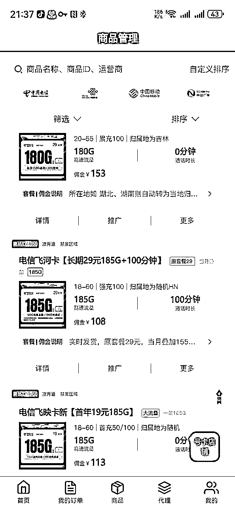
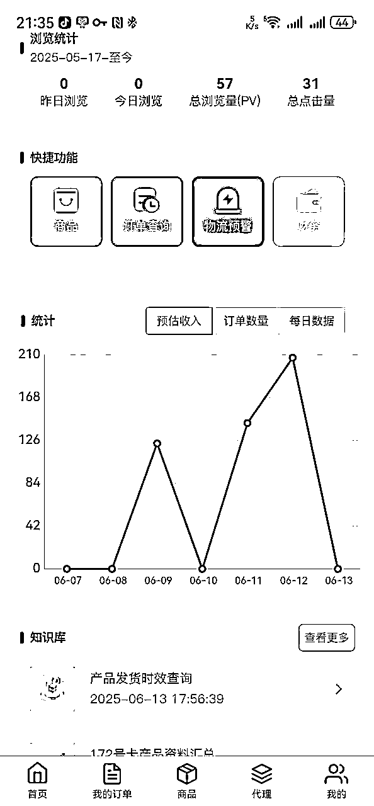
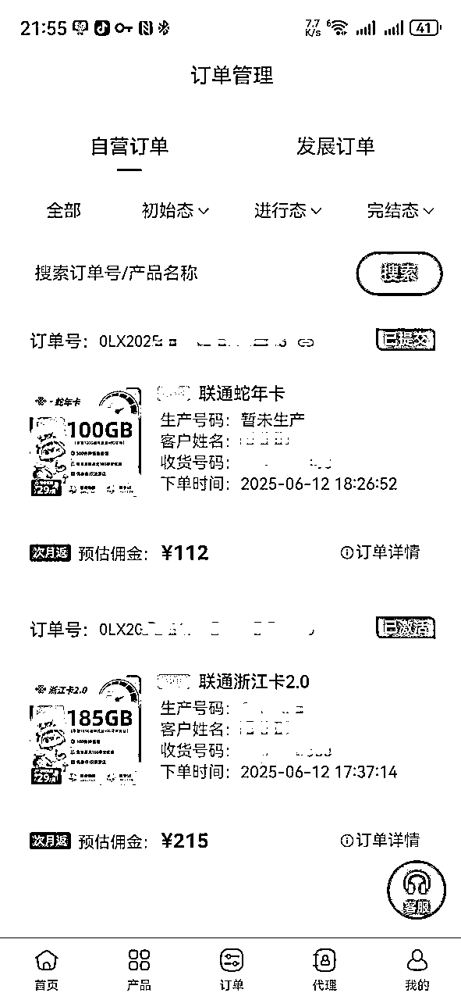
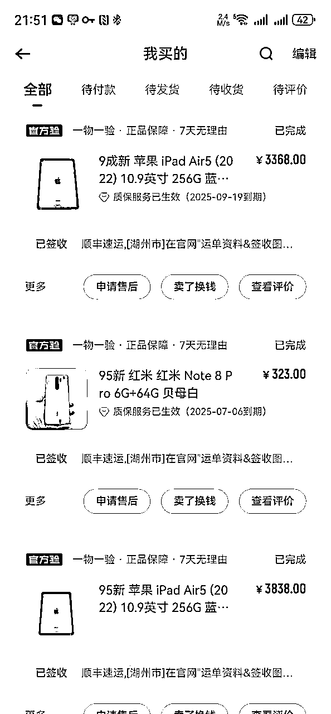

# 低成本低风险搞定项目号卡与备用机，我的实操打法分享
作者：龙哥

最近带📕虚拟资料相关的人聊下来，发现大家最容易卡在两个点上：注册用的手机号卡怎么选，流量怎么解决，以及用来养号的备用机买哪种不踩坑。说实话，这一块不用过度焦虑，关键就是掌握几个实操的小细节和信息差，点透了就能轻松启动。

下面是我自己在用的一套低成本、甚至能做到接近零成本的号卡方案，以及低风险入手备用机的思路，供大家参考，按需取用即可。

* * *

# 一、号卡这件事，别再只盯着最便宜的月租

### 大家普遍的纠结点

要么只办注册卡。像是电信无忧的5元卡、移动联通的8元卡、京东上的5元无流量卡，月租确实低，但流量几乎没有，日常实操根本不够用。

要么想要流量就得另办流量卡。营业厅的套餐价格偏高，还常绑定合约、宽带融合，流程繁琐，成本和精力都上去了。两张卡分开管，号码也越来越多，很容易乱。

### 换个思路：用互联网卡自己赚佣金

其实更顺滑的做法是去看互联网流量卡、校园卡、政企卡这类产品。这类卡资费友好，流量大，有的还带少量免费通话。

有人会担心资费不低、合约长，万一账号被封项目没跑起来不是浪费？这里有个很多人忽略的小逻辑：你办卡时的推荐人是有佣金的。

那为什么不把推荐人变成自己呢？注册一个号卡推广平台的账号，用自己的链接给自己下单，既拿到了需要的号码和流量，佣金又回流到自己口袋，成本直接被抵消甚至倒赚。这就是一个典型的信息差。

* * *

# 二、怎么选卡、怎么操作更稳

### 先挑一个靠谱的推广渠道

目前我自己在用的几个渠道如下：

*   172号卡平台：老牌，佣金水平偏高，未税
*   号易平台：套餐多，佣金未税
*   卡业联盟：品类全，佣金免税，校园卡政企卡资源多
*   林夕号卡：佣金可观且免税，提现速度快
*   卡多多平台：佣金未税，部分有校园卡资源

平台很多，选择时要综合看成立时间、套餐数量、提现门槛、资质与公司规模，这些都能在网上查到。

### 选卡的硬指标

做项目用卡，标准要更具体：

1. 合约周期，优先无合约或3-6个月的短约
2. 禁发区域，不同卡限制不同
3. 发货区域，部分卡指定省份发货
4. 首充金额，尽量50-100元以内
5. 办卡年龄，部分卡有年龄上下限
6. 一证五户限制，同一运营商最多5张
7. 激活方式，快递上门激活 vs 自助激活，后者更灵活
8. 优惠形式，优先直接立减或首充减免，避开月底返现、充返等复杂逻辑
9. 流量构成，通用流量占比越高越好，少选定向或区域专属流量为主的卡
10. 佣金税率，部分平台显示的是税前，提现要扣2%-6%，算总账前要对齐

成本核算举例：

税后佣金120元，月租29元，合约3个月。总支出87元，净赚33元，可到期注销换新号。

再比如税后佣金120元，月租29元，合约6个月。总支出174元，实际月均成本为 (174-120)/6 ≈9元/月。这9元同时覆盖注册与流量需求，性价比很高。

### 我的筛选习惯

以我杭州为例，我会按以下顺序过滤：

收货地支持浙江杭州、首充≤100元、年龄符合、运营商未达5户上限、优惠直接到账、合约期≤6个月。

无合约就图个方便随便挑；3个月合约月租19元的，佣金>57就能做；月租29元的，佣金>87就划算。6个月同理自己算一下即可。

总之先定规则再筛卡，办卡前务必看清套餐详情页，不确定的就问平台客服。

* * *

# 三、备用机怎么买更安心

号卡解决了，设备就剩一步。想要省钱，二手机是主流。但📕对设备封禁很敏感，买到被封的机器等于白花钱。闲鱼个人交易基本不支持退换，鉴别能力又要求高，iPhone二手市场更是水深。

对于不太懂行的朋友，我更推荐转转这类官方回收平台。它支持7天无理由退换且退货包邮。价格相对个人卖家会略高一点，但风险低很多。

万一收到后发现设备已被📕标记，或性能不达预期，都能退换不亏钱，灵活性更高。

我自己部分机器就是转转入手的，闲鱼、酷安也会看，关键是根据自己的风险偏好选择。

* * *

# 四、小结

把号卡的佣金反哺给自己，把流量和注册合二为一，把备用机购买风险用平台规则兜底，就能做到号卡低成本甚至微盈利，设备也更稳妥。少在前期投入上纠结，快速把精力放在实操迭代上，从0到1的突破会更快。希望这套打法能给你启发。