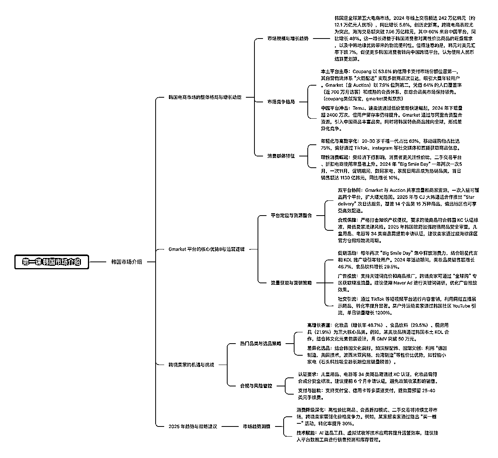
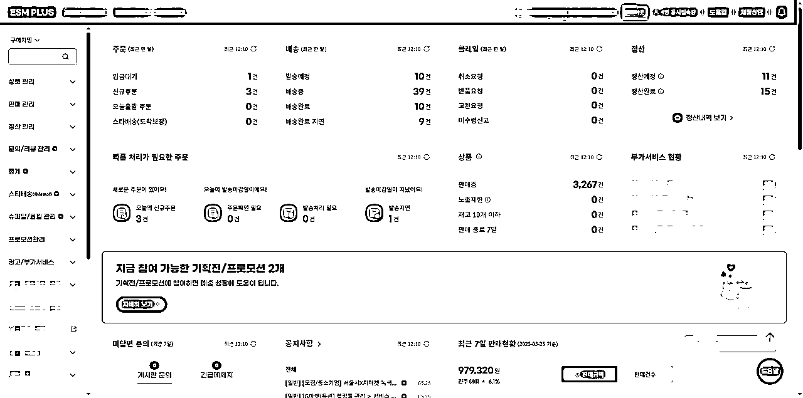
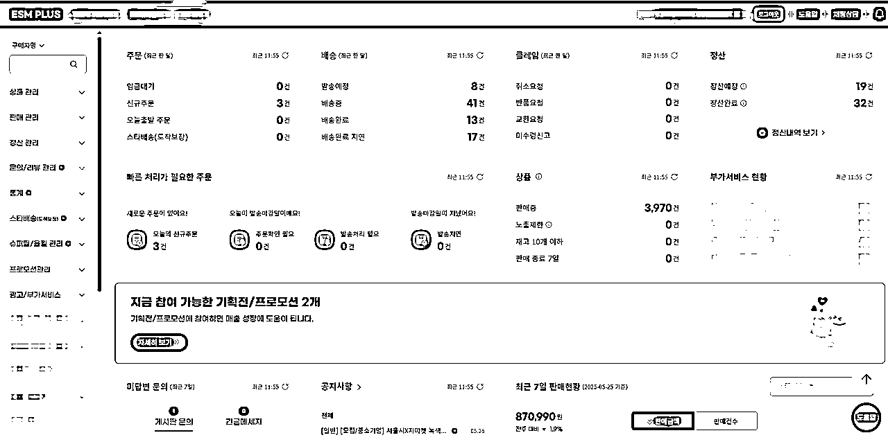
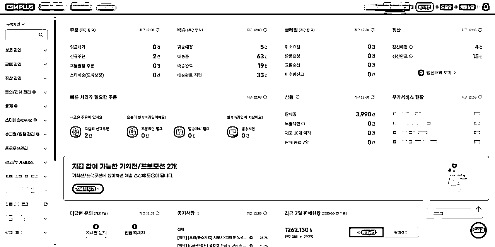

# Gmarket 新店 30 天实战路线：先做出单店模型，再谈放大
作者：龙哥

做韩国电商，很多人一开始就想着多开店、铺更多货，结果忙了很久，却没有验证出一套真正能赚钱的方法。

我的建议恰恰相反：先集中精力运营一家 Gmarket 店，把从注册、选货、发货到售后和复盘的链路完整跑一遍。单店月成交达到 500 万韩币左右，再考虑复制和扩张，会更稳。

下面这份计划，按照 30 天拆解，适合刚入场、还没有形成操作节奏的新手。

# 第一阶段：先把基础盘搭起来｜第 1—7 天

## 1. 开店前的资料与认知准备｜第 1—3 天

### 入驻资料提前备齐

开始申请前，先准备好以下内容：

- 企业营业执照；
- 法人身份证明；
- 第三方收款账户材料；
- 常用电子邮箱。

有几个细节不能忽视：

1. 营业执照此前不能注册过 Gmarket 店铺；
2. 公司需要按期完成税务申报；
3. 经营状态不能出现异常，否则平台可能采取限制甚至封店措施；
4. 现在通常会同步申请 Gmarket 与 Auction，两个店铺合计保证金约为 3000 元人民币。

不要等到审核开始后才补材料。资料缺失、信息不一致，都会拖慢整体进度。

### 先认识韩国消费者

选品不是单纯把中国货搬到海外，而是要理解当地买家在搜什么、在意什么、怎样做购买决策。

建议提前熟悉：

- 韩国消费者常用的搜索方式；
- Naver 的关键词习惯；
- 不同年龄层的消费需求；
- 当地常见的生活场景；
- 平台热销类目和价格区间。

越早建立本地市场视角，后续选货、写标题和制作详情页就越不容易走偏。

## 2. 审核期间完成货品储备｜第 3—7 天

Gmarket 与 Auction 的审核通常需要约 7 个工作日。不要把这段时间当成等待期，它其实是新店准备迎接平台曝光的窗口。

新店审核通过后，平台往往会给出一段初始观察和曝光机会。但能不能获得更多展示，和店铺整体活跃度、可被推荐的商品规模有很大关系。

### 为什么要提前准备大量 SKU？

可以把平台理解成一个需要持续供给的流量系统：

- 商品覆盖面越广，进入不同搜索和类目的机会越多；
- 可参与测试的商品越多，店铺获得有效数据的概率越高；
- 首轮曝光期间的表现，会影响后续店铺评价和分发。

我们曾经对比过两个新店：

- 店铺 A 提前准备约 1600 款，首轮曝光期间有 798 款进入类目展示，第一周成交超过 90 单，毛利约为 35%；
- 店铺 B 仅准备 30 款，最终只有 2 款获得展示，一周只产生 2 单，后续很难继续获得流量。

### 新人常见的两个判断错误

**错误一：把新店当成精品橱窗。**

刚开始只上传几款所谓“精选商品”，看起来整齐，实际上无法形成足够的货品覆盖，平台很难判断店铺具备持续经营能力。

**错误二：低估前 30 天的重要性。**

新店早期相当于平台观察期。前面没有积累足够商品和销售数据，后面再补，往往需要更长时间和更多成本。

因此，建议把“审核通过后尽快补齐 1500 款以上”作为硬任务。更稳妥的做法，是在申请店铺之前就完成候选商品整理。

# 第二阶段：建立选货标准｜第 8—15 天

## 1. 用四个指标过滤商品

新手选品不要只看“有没有人卖”，更要看利润、需求、运输和后续空间。

可以用下面四项做初筛：

### ① 利润空间

目标毛利尽量保持在 30% 以上。

大件商品往往被物流费用吞掉利润，例如行李箱一类产品，运输成本可能占售价很高比例。初期更适合关注家居小物、轻量小家电、创意工具等方向。

### ② 重复购买可能性

优先考虑有持续消耗或配件替换需求的产品，例如：

- 办公耗材；
- 日常清洁用品；
- 小型替换配件；
- 高频使用的生活消耗品。

如果一个产品只买一次，后续增长会更多依赖不断寻找新客户。

### ③ 搜索需求

可以利用 Naver 的关键词数据观察市场热度，月度搜索量最好超过 1 万。

例如：

- “워크어트 데스크”：居家办公桌，月搜约 1.2 万；
- “에어프라이어용 거름망”：空气炸锅滤网，月搜约 1.8 万。

关键词数据不是绝对答案，但能帮助你判断一个方向有没有真实需求。

### ④ 运输友好度

尽量选择重量轻、体积小的商品，让物流成本不超过售价的 15%。

例如，300g 以下的手机支架，运费约为 3.5 美元时，售价至少达到 23.3 美元，才更容易留下合理空间。

## 2. 竞品研究不要只看销量

进入目标类目后，继续下钻到更细的子分类，观察销量靠前的商品。

以“주방수납”为例，可以先查看 11000—20500 韩元的价格带，这一范围往往聚集了较多成交，再逐一研究前 50 名商品的评价内容。

重点不是看好评，而是找差评里的共性问题，例如：

- 密封不严；
- 实物尺寸偏小；
- 安装不方便；
- 材质和图片不一致。

这些问题，正是你的改良机会。

### 三种低成本做法

**做一点功能升级**

竞品是普通单层收纳盒，你可以考虑三层抽屉结构、可拆分设计，并附上韩文防滑贴或使用说明。

**换一个使用场景**

普通鞋架不一定只面向玄关，也可以重新包装为“车载后备箱收纳”，让产品进入新的搜索场景。

**重新定义产品用途**

收纳盒除了“放东西”，还可以围绕空调房保温、办公桌整理等具体需求进行表达，配合更符合韩国审美的视觉元素。

核心不是盲目跟卖，而是在已有需求上增加一点明确的购买理由。

## 3. 上架前先排除知识产权风险

选品时不能只看利润，还要确认商品是否涉及品牌、外观、图案或人物授权。

建议登录韩国知识产权相关查询平台，核对商品标题中出现的品牌名称，判断其是否为真实注册品牌。

以下方向尤其需要谨慎：

- Line Friends、BT21 等卡通形象；
- 三星、LG 的专利产品及相关配件；
- LG ThinQ 系列；
- 现代汽车周边；
- 韩国设计师品牌合作款；
- 明星同款和涉及人物肖像的商品。

没有明确授权，不要抱着“改一点就没事”的想法。

### 还要避开这些高风险品类

- 电子血压仪等医疗设备；
- 婴幼儿服装和母婴用品；
- 烟油、加热棒等电子烟相关产品；
- 韩国本土设计师品牌仿制餐具；
- 高尔夫用品等容易引发品牌纠纷的商品；
- 宠物食品以及其他可能涉及食品监管的产品。

跨境业务里，能不能卖只是第一步，能否顺利清关、长期经营更重要。

# 第三阶段：把发货链路跑顺｜出单后重点处理

商品开始产生订单后，最容易出问题的往往不是前端，而是仓储、运输和清关。

选择物流服务商，建议从四个方面判断。

## 1. 先看完整报价，不要只比较首重

询价时至少确认：

- 首重和续重如何计算；
- 燃油费用是否另收，通常可能占 10%—15%；
- 济州岛、庆尚北道等地区是否存在额外费用；
- 是否有操作费、入仓费或派送附加费。

明显低于市场水平的报价要多问一句，避免对方用普通邮政渠道包装成“专线”，最后时效超过 20 天。

## 2. 核验清关能力

正规服务商应具备可查询的韩国海关登记信息。

如果经营充电器、小家电等带电产品，还要重点确认对方是否熟悉 KC 相关流程，能否处理相应的简化清关。

## 3. 关注售后和仓储

比较实用的服务包括：

- 在线查看物流轨迹；
- 库存不足提醒；
- 韩国退件接收；
- 退件暂存和重新发货；
- 清楚列明仓储收费方式。

较成熟的服务商，有时可以提供约 30 天的免费仓储期。

## 4. 合同里写清赔付标准

建议明确以下内容：

- 超过承诺时效 3 天，每票赔付 2 美元；
- 买家提供开箱视频后，货损在 48 小时内完成赔付；
- 韩国退件免费保存 15 天；
- 重新打包费用控制在每单 0.5 美元以内。

不要只听口头承诺，关键规则必须进入合同。

## 新手可以这样测试物流

**第一步：寄三种测试件**

分别选择轻小件、带电产品和异形件，观察揽收、运输和清关表现。

**第二步：拿预计单量去谈价格**

例如告诉对方当前每天约 30 单，未来三个月可能达到 100 单，以此争取阶梯费率，同时谈免费打单、贴标和短期仓储。

**第三步：保留备用渠道**

建议至少维护两到三家服务商：

- 一家负责普通货；
- 一家负责特殊货；
- 另一家作为高峰期备选。

遇到爆单、线路拥堵或临时政策变化时，才不会被单一渠道卡住。

# 第四阶段：把订单转成利润｜第 15—30 天

前半个月主要完成商品布局和流量测试，进入第三周后，重点就从“有没有订单”转向“每笔订单留下多少利润”。

这时要同时抓售后、数据和复购。

## 1. 售后响应：尽快解决大多数问题

目标可以设为：48 小时内处理 90% 的咨询，并将退货比例控制在 8% 左右。

### 采购中断时

中文参考：

> 您好，之前合作的供货渠道出现了质量问题，我们正在重新寻找合适的货源。如果您不愿意继续等待，我们可以协助您办理全额退款，感谢理解。

韩语参考：

> 안녕하세요 고객님!  
> 죄송합니다. 현재 해당 상품의 재고가 없어졌습니다. 다른 상품으로 변경하시거나 환불을 요청해 주시면 처리해 드리겠습니다.

### 需要买家提供照片时

中文参考：

> 很抱歉给您带来不便。请提供商品照片或视频，我们核实后会继续为您申请售后。发送材料时请一并附上订单编号，方便我们准确查询。  
> 联系邮箱：XXXXXX@naver.com

韩语参考：

> 안녕하세요 고객님!  
> 불편을 드려 대단히 죄송합니다. 문제가 확인될 수 있도록 관련 사진이나 동영상을 보내 주시면 검토 후 A/S를 신청해 드리겠습니다.  
> 메일을 보내실 때 주문번호도 함께 적어 주세요.  
> 제 메일 주소는 XXXXXX@naver.com 입니다.  
> 회신 기다리겠습니다. 좋은 하루 보내세요. 감사합니다.

### 买家要求退货时

中文参考：

> 很抱歉，若商品本身没有质量问题，只是与预期不一致，我们通常不安排商品回收。作为补偿，可以为您退还 15000 韩元，希望您能够理解。

韩语参考：

> 안녕하세요 고객님!  
> 불편을 드려 죄송합니다. 상품에 품질 문제가 없고 단순히 기대와 다른 경우에는 일반적으로 상품을 회수하지 않고 있습니다. 대신 보상으로 3,000원을 환불해 드릴 수 있습니다. 양해 부탁드립니다.  
> 추가 문의가 있으시면 언제든지 연락해 주세요. 감사합니다.

### 需要买家处理商品后退款时

韩语参考：

> 안녕하세요 고객님!  
> 불편을 드려 죄송합니다. 상품을 더 이상 사용할 수 없도록 훼손한 사진을 보내 주시면 전액 환불해 드리겠습니다.  
> 문의사항이 있으시면 언제든지 연락해 주세요.  
> XXXXXXX@naver.com  
> 좋은 하루 보내세요. 감사합니다.

### 投诉处理建议

1. **先确认已收到问题**  
   设置自动提示，让买家在 30 分钟内知道客服已经接手，减少因等待产生的负面评价。

2. **按照问题严重程度补偿**  
   - 物流延误、尺寸偏差：可发放 500 韩元优惠券；
   - 涉及安全或严重质量问题：应在 48 小时内电话沟通，优先解决风险。

3. **每周归纳问题来源**  
   如果很多人反馈色差，就补充不同光线下的图片；如果尺寸投诉集中，就加入韩文尺寸说明。

售后不是单纯赔钱，而是用买家反馈反向修正商品页面和选品判断。

## 2. 用数据淘汰低效商品

每周整理一次全店数据，重点看两个指标。

### 退货率超过 15%

先检查详情页是否存在夸大或不准确的描述。

例如，页面写的是“不锈钢”，实际却只是镀镍材质，这类商品即使有订单，也会不断制造售后成本。该优化就优化，该下架就下架。

### 毛利率低于 25%

销量高不代表值得继续经营。

可以尝试：

- 更换采购渠道；
- 减少不必要的包装；
- 调整售价；
- 换成利润更好的同类商品。

曾有学员淘汰毛利只有 18% 的手机壳，转而重点经营毛利约 45% 的手机支架，整体收益明显改善。

## 3. 找到一个有效商品后，沿着需求扩展

单一爆款很容易受市场变化影响，更稳的方式是围绕同一需求建立商品组合。

### 沿着同一个生活场景扩展

如果折叠收纳箱在厨房整理场景中表现不错，可以继续测试：

- 冰箱整理盒；
- 橱柜隔板；
- 台面收纳工具。

这样可以共用部分图片结构、客服逻辑和内容素材。

### 沿着同一货源体系开发

已有供应商能够稳定提供硅胶类商品，就可以继续挖掘：

- 硅胶漏斗；
- 硅胶保鲜盖；
- 硅胶隔热垫。

同材质、同工艺的产品更容易控制采购成本。

### 做本地化细节调整

针对韩国买家的使用习惯，增加：

- 韩文操作说明；
- 本地售后卡；
- 更贴近职场、家庭等场景的标签。

例如，在桌面支架页面中加入“직원카페 사용 추천”等本地化表达，往往比单纯翻译中文卖点更有效。

## 4. 用户留存部分，后续再单独展开

私域、活动和复购涉及更多平台规则与运营细节，这一部分可以另开专题讨论。

现阶段先记住一个顺序：

- 售后负责守住利润底线；
- 数据负责提高经营效率；
- 留存负责打开增长空间。

三件事形成配合，店铺才有机会进入“成交增加—评价改善—分发变好—复购提升”的循环。

# 最后总结：30 天的意义，是验证一套方法

这套路线并不是承诺“照做就一定爆单”，而是把单店经营拆成一条可以执行、可以观察、可以修正的路径：

- 前 7 天完成入驻和货品准备；
- 第 8—15 天建立选品与物流基础；
- 第 15—30 天重点优化售后、利润和商品组合；
- 达到单店月销 500 万韩币后，再评估复制和扩张。

第 30 天不是结束。后面还可以继续做：

- 用优惠活动增加有效访问；
- 优化供应商和运输方案；
- 挖掘同一场景下的新商品；
- 建立更稳定的复购机制。

真正的起点不是“等资源齐全”，而是先完成第一个动作：提交注册资料、整理第一批候选商品、设置第一条客服回复，或者导出第一份周数据。

很多后来做出结果的人，并不是一开始就比别人懂得多，而是愿意先把第一单做出来。

最后附上新手学员的后台记录，给准备入场的朋友一点信心。祝你早日完成从 0 到 1 的验证！

