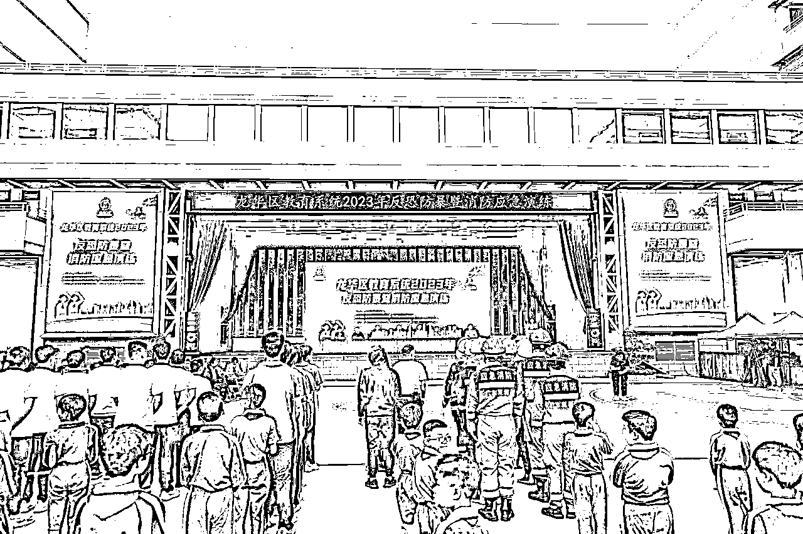
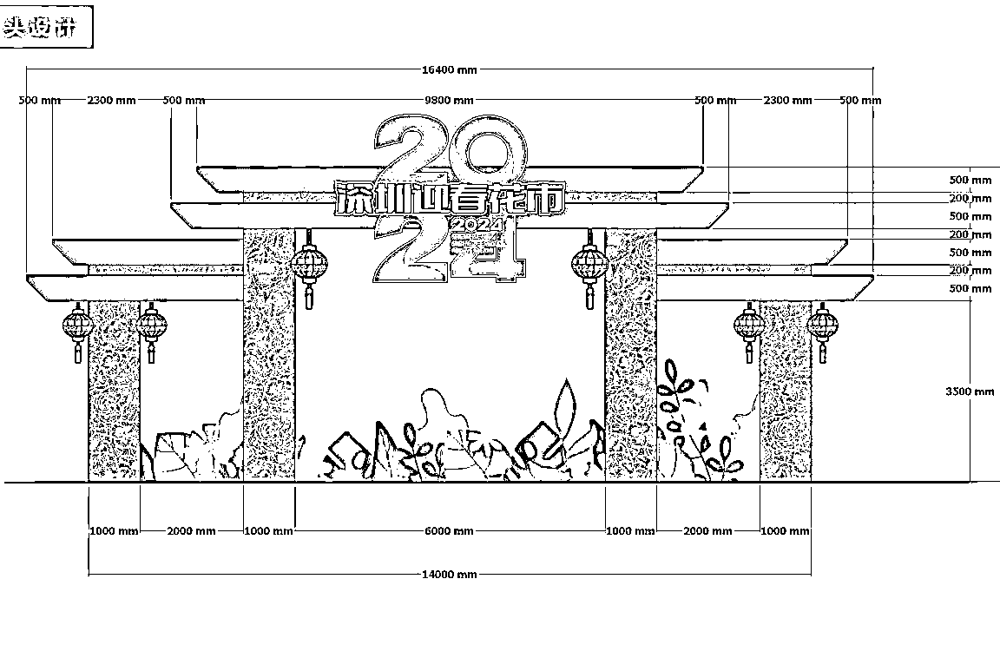
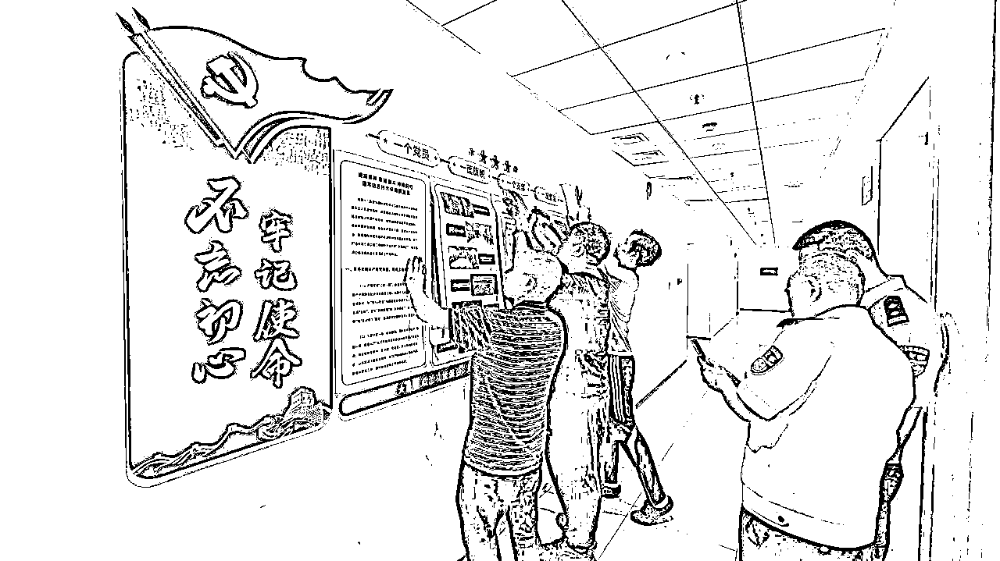
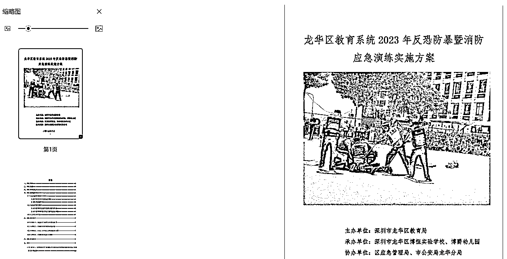
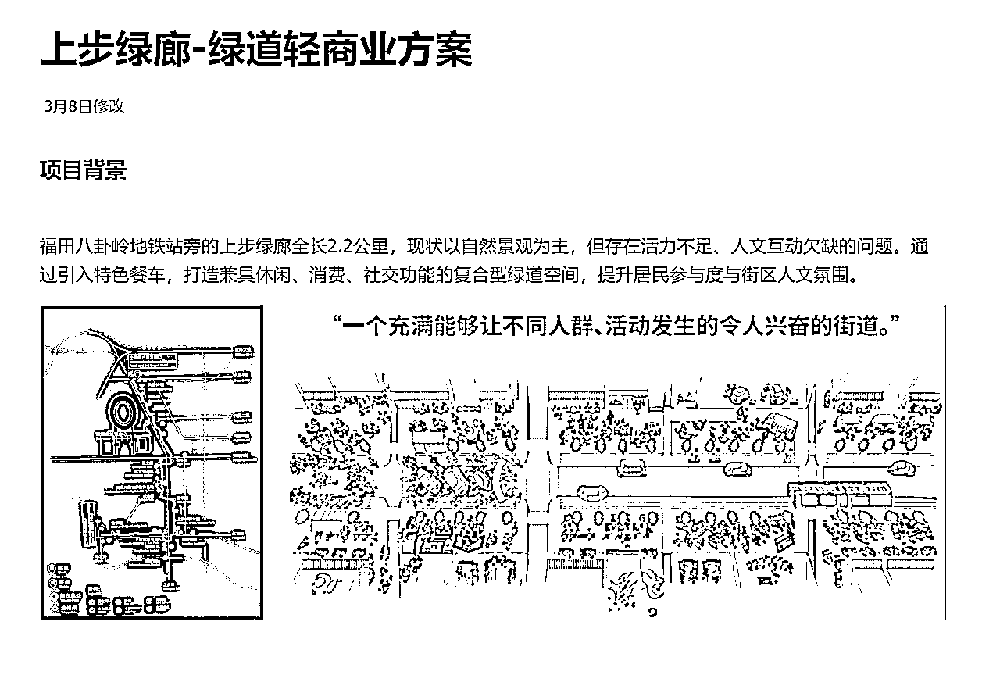

最近后台好多朋友来问我TOG业务到底怎么玩，看来上次在社群里的闲聊让大家意犹未尽。正好，今天我就把这几年跟政府部门打交道的真实经历拿出来，给大伙儿好好拆解一下。

先自我介绍下，我叫Luke林，真名林俊杰——没错，就是那个“不会唱歌”的林俊杰。目前是小挣青年主理人，目标很朴素：帮一千个年轻人赚到人生第一桶金。

我早年在广告策划行业摸爬滚打，服务对象大部分是政府单位。深圳那几个比较有代表性的项目，比如罗湖区的迎新花市、莲塘口岸的警示宣传栏、龙华区教育系统的应急消防演练、光明区的文化刊物设计、福田区八卦岭上步绿廊的商业化方案、宝安区保安公司的内部活动，还有文博会上的红色文化巡礼展——这些都有我深度参与的身影。

一、先搞懂TOG到底是什么

做生意的朋友对TOC、TOB肯定不陌生，但TOG——也就是To Government，面向政府的业务模式，很多人听着耳熟却不知道怎么下手。

这个赛道大致可以切成三个层次：

最顶层是那些手握核心技术的巨头们，比如BAT、华为这类大厂。政务云、健康码这种动辄上亿的大盘子基本都在他们手里攥着，核心技术加平台生态两头抓，下游的事就分包出去，避免自己人打自己人。

中间层是做解决方案的供应商。他们依托顶层的底层技术，开发出智慧城市、电子政务这些细分的系统。说实话，这层水的确很深，一般人连门都摸不着。

最底层就是基层集成商。在深圳，这块业务叫“民生微实事”，花市、马拉松、City Walk这些看得见摸得着的活动，全是他们落地执行的。这层活儿的特点是本地化极强——每个区都有自己的规矩和玩法，有的区全包给一家，有的区拆得稀碎分包出去，还有的必须走招投标。但恰恰是这一层，才是普通人切入TOG赛道最现实的门票。

搞TOG业务之前，你得先认清它的几个“脾气”：

第一，强需求主导。做B端做C端，需求是市场里长出来的。但在TOG的世界里，需求是“自上而下”推下来的——上头定了调子，下面才有活儿干。所以我们基层服务商每天真正在满足的，说到底就是领导的“政绩需求”。

第二，三长一短。这是跟政府打交道最磨人的地方：沟通周期长、调整周期长、回款周期长，唯独执行周期特别短。拿一个街道办活动举例，前期沟通一个两个月很正常，中间改来改去又是一个两个月，真到了执行阶段，可能就给你三到五天时间搭台唱戏。回款呢？拖半年算你运气好。光明区的审计制度那更是出了名的严苛——刊物按字数给钱，审计专员一个字一个字地核对，数量不够就从款项里扣，那真叫一个“变态”。

第三，极高稳定性。既然这么难搞，为啥还有这么多人挤破头往里钻？答案就是稳定。政府客户的预算盘子很稳，而且只要你不作死、结算不出岔子，他们不会轻易换供应商。说白了，一旦你接上了手，这个活可能就是你长期的饭碗。

二、真正卡脖子的不是干活，是说话

干TOG这么多年，我最大的感悟是：很多项目最后搞砸了，不是执行力不行，也不是审计过不了，而是前期没能摸准领导的脉搏，聊不到一块儿去。

第一次面谈基本就决定了你俩有没有后续。所以去之前，你必须想清楚三件事：

1. 这个项目真正的“政绩点”在哪？
2. 领导心里的预算大概是多少？能不能打听到历史成交价？
3. 这活儿背后还有哪些衍生环节？执行中最大的坑在哪？

先说说最重要的“政绩点”。

假设领导想拍一部街道宣传片，同时有十个团队在竞标，你怎么让领导选你？

很多人上来就猛吹自己多牛，张口闭口“提升社区自治力”“增强居民幸福感”——这种空话套话，领导耳朵都听出茧子了，反而会给你打上“不靠谱”的标签。

你要明白一件事：这活儿的出发点永远是“自上而下”的。不管你的方案多完美，最终拍板的功劳都是领导的。领导也是人，你与其证明自己有多厉害，不如证明你有多懂他。

所以正确的打开方式是：先肯定领导的决策很英明，然后用自己的案例和数据去印证这个决策的可行性——比如“我们之前做过类似的项目，居民反馈的数据是XXX，问卷调查显示XXX，如果沿着这个方向走，效果会非常可观”。

别觉得这是拍马屁。在体制内，你明白这件事背后的逻辑，远比你把这件事做得多漂亮更重要。因为“明白”本身就是一种安全感的传递。

再聊聊预算这个敏感话题。

领导嘴上说“预算越低越好”，但实际上你帮他省了钱，跟他自己有直接的利害关系吗？没有。那为什么还要压预算？因为“花更少的钱办成同样的事”也是政绩。所以前期沟通中，百分之百会遇到压价的情况。

这时候千万别傻乎乎地降价。我的策略一般是两个：一个是“增项”，一个是“质量”。

先看看增项怎么玩。有个真实的例子：一个文本刊物项目，我硬是从4万谈到了28万。

怎么做到的？回到街道宣传片这个案例。领导说去年花了10万，今年预算只有8万。你该怎么接？

千万别上来就喷上一家做得烂，也别急着吹自己团队多厉害。你要做的是回到需求点去拆解。

比如这个宣传片是拍商圈的，那背后藏着的需求就是“商圈人气不够、消费下滑、商户入驻意愿低”——所以领导真正想要的不是一部片子，而是“人气旺起来、消费拉起来、商户抢着来”。

如果是拍人文类的，比如美食、公园、学校、景点，那很可能是因为最近居民投诉不少，大家没地方消遣——这时候领导要的是“投诉减少、居住体验提升、居民时间能被打发掉”。

如果是拍主题活动，比如花市、展会、论坛，那多半是需要造势预热——“让全城都知道，最好隔壁区也来围观”。

需求点摸清楚了，你的“增项”话术就有了支点。我一般会这么说：“领导，这个想法我们特别有共鸣。之前我们给XX区做过一个类似项目，结果效果一般——片子拍完只在内部分发，社区压根儿没看到。后来换了个区，那位领导拍板让我们加印了一万册宣传手册，还让我们把视频剪成了四部曲，结果其中两部被广泛转发。您要是感兴趣，我把当时的方案找出来，看看能不能给您做个参考？”

这句话里藏了两个小心思。第一，我提到“另一个区的领导”——我要对比的从来不是项目本身，而是领导的决策水平。言下之意：有另一位领导做了跟你一样的决策，但他做得比你更出彩。第二，我抛出了“参考和借鉴”——这是给领导递台阶，绝不是否定他的决策。永远不要觉得自己是桌上最聪明的那个，你的身份是来帮助领导把事办成的协作者，而不是来夺权的对手。引导，永远是第一位的。

再说质量策略。

说实话，质量是下下策。因为不管你做得再好，甲方总觉得还有更好的方案在路上，尤其在成本面前，质量的说服力往往大打折扣。但有些特定氛围下，它还真管用。

比如你可以这么说：“领导，上一家用的素材基本都是从XX素材网下载的，咱们街道那种特有的文化氛围其实没拍出来，看着总觉得少了点灵魂。我们团队更倾向用稳定器加无人机的组合，把整个街道的气势和质感拍出来。我这里恰好有两段对比视频，您可以看看效果再定。”

质量策略的核心在于“对比”——但这个对比对象不是别的区，而是这个项目本身过去的样子。你要找到之前方案的漏洞，然后用你的专业能力把这个漏洞放大到领导看得见。

三、说点真心话

TOG业务其实特别拼人情世故。尤其是那种项目负责人没有直接点名让你做的，你就更要爱惜自己的羽毛。政府单位内部的决策流程之复杂、之严谨，外人根本想象不到。

在这里我想说一点纯个人观点：

大多数时候，政府单位其实挺缺“政绩反馈”的。很多需求就是一个模糊的政策概念，比如“提升居民幸福感”“增强社区自治力”——这些话太主观了，一百个人有一百种理解。有人觉得拍宣传片好，有人觉得办马拉松好，还有人觉得搞个社区咖啡屋好。但在体制内，这种本来主观的东西反而变成了“绝对客观”——因为没人敢为提出一个“不同观点”去承担潜在的后果。

一旦领导采纳了你的方案，比如拍了板搞马拉松，最后效果却不理想——这个账是要记在领导头上的，搞不好会影响仕途。所以你会发现，体制内的决策几乎都以领导最初的意志为原点，很难漂移。

如果你作为乙方，非要展示自己的“聪明才智”，坚持让项目按你的思路走——那接下来所有风险都在你和你的团队身上了。中间只要出任何纰漏，轻则尾款拿不到，重则你在这个行业里再也混不下去。

说白了，TOG这行被人吐槽最多的地方，恰恰源于体制内决策的成本和权威性，这是组织形式决定的。咱们作为服务方，能做的就是顺着这条决策路径往回摸，找到那个最初的出发点，然后用你的专业经验把可行的方案和建议递上去。

绕了这么一大圈，你会发现所有技巧的终点，都指向同一件事——把“为人民服务”这五个字，踏踏实实地做好。

以上，就是我对TOG业务沟通的一些经验之谈，希望对你有点启发，哪怕帮到你一点点，也算值了。