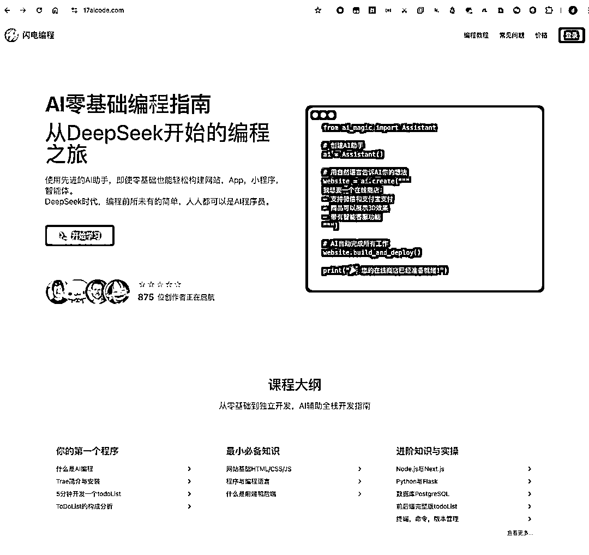
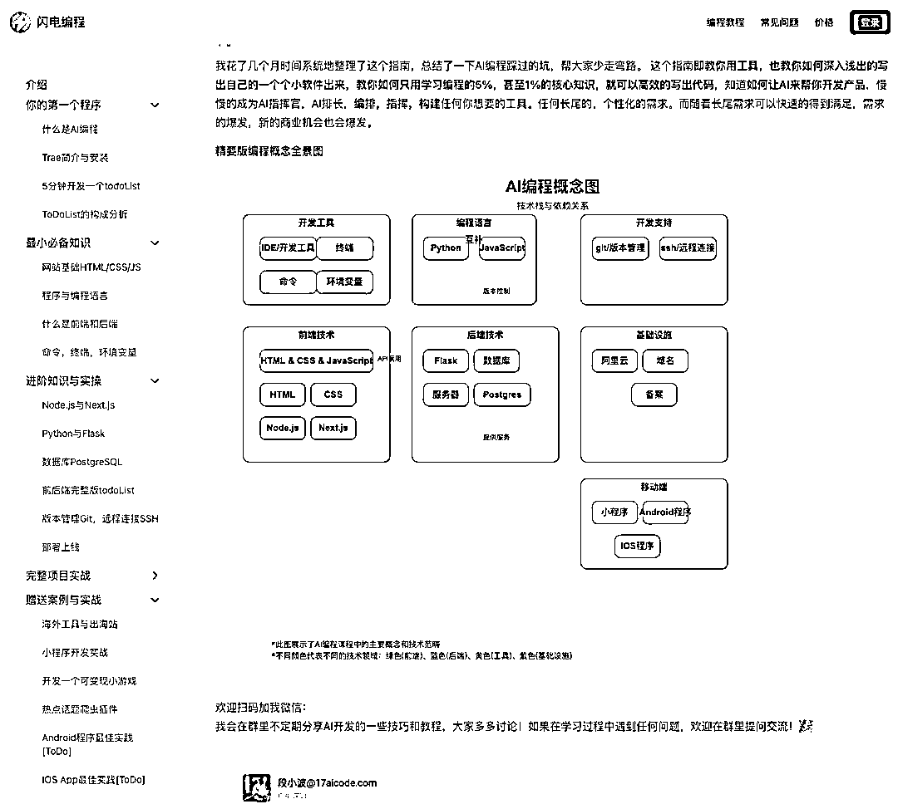

# 10天，用AI做出一套能卖课的系统：我的首次实战记录
作者：龙哥

大家好，我是龙哥。

最近，我给自己安排了一项长期实验：借助AI完成100个应用，重点探索内容创作、电商运营以及各种自动化场景。路线主要有两种：一种是通过智能体实现低门槛搭建，另一种则是让AI协助完成少量编码工作。

这篇文章，记录这个计划的第一次实践。

在几乎没有网页界面开发经历的情况下，我用大约10天时间，完成了一套AI课程平台的第一版。它不只是一个展示页面，还包含课程管理、账号体系、订单处理和🛰️支付等完整环节。上线之后，已经有60多位用户完成购买。

## 起点：想开课，却不会做网页

三月初，我准备推出一门AI编程课程。

问题也很明显：我过去并不擅长前端。按照传统路线系统学习，周期太长；交给外部团队，又和我希望借助智能工具提升效率的初衷相冲突。

于是，我决定直接把需求交给大模型，自己负责目标、判断、验收和调整。

我需要的并不是一张简单的宣传页，而是一套能够真正运行的课程业务系统，至少要覆盖：

- 课程内容展示
- 用户注册与登录
- 订单及购买状态
- 在线支付
- 课程资料维护
- 后台内容更新

## 这次用到的几类工具

### Cursor：主要工作台

Cursor是这次项目中使用频率最高的开发环境。它的月费为20美元，套餐内包含500次高阶模型调用。当时我主要使用Claude 3.7一类的模型。

比较有意思的是，像“搭建整套前后端基础结构”这样的复杂要求，在计费上可能只消耗一次调用。后面再根据运行结果逐步修正，完成初版并没有想象中那么昂贵。

### Trae：作为备用选择

Trae的优势在于使用门槛相对低，不需要额外处理网络环境；国际版本也有机会接触Claude、Gemini等模型。

### Same.new：解决页面视觉问题

它更像一个网页还原助手。给出目标页面后，可以快速生成相近的版式、间距和视觉结构。对于缺少设计经验的人来说，这一步非常省时间。

### 其他尝试

此外，我还试用了Cline、Roocode等方案。Cline按调用量计费，使用起来灵活，但成本增长速度比较快。

综合下来，这次我最满意的是Cursor在工作流整合、上下文承接以及指令执行方面的表现。

## 我是怎样安排与模型协作的

工具只是基础，真正影响结果的是任务组织方式。

### 先把蓝图写下来

我没有一上来就让模型直接生成所有内容，而是先要求它规划技术路线，例如：

> 课程平台采用Next.js作为页面层，Python Flask负责服务端，PostgreSQL用于数据保存。请先输出完整的产品与技术设计，并分别写入plan.md；随后生成开发事项清单，覆盖页面、接口和数据表，保存为todolist.md。

拿到初稿后，我会逐项检查，发现不合理的地方就继续修订。方案确定后，再按照清单推进，每完成一件事就更新状态。

这样做的好处是，项目不会陷入“改了这里、又破坏那里”的混乱状态。

### 让模型说明它交付的内容

遇到不熟悉的文件，我会继续追问：

> 请说明这部分实现承担什么职责，主要函数之间如何配合，还要列出后续维护时需要注意的地方。

这一步特别适合没有前端背景的人。你不必一开始就掌握全部语法，但至少要知道代码在完成什么任务、可能在哪里出问题。

### 先跑通，再整理

初期，我会先提出一个较大的目标，让模型快速给出能运行的版本。比如先完成课程平台的基本形态。

等页面可以打开、主要流程能够走通后，再继续要求它进行结构整理：

- 页面端与服务端分开
- 接口单独管理
- 数据库独立设计
- 课程资料交给Strapi维护

先获得反馈，再逐步改善，比一开始就追求完美架构更适合快速试错。

## 没有设计经验，如何把页面做得像样？

我采用的是“参考—还原—理解—迁移”的方法。

### 先收集视觉参考

我先找了几套自己认可的课程类页面，观察它们的导航、首屏、按钮、内容区和页脚是怎样组织的。

### 对比过多个网页还原方案

Copyweb.ai和V0.dev我都尝试过，但早期输出没有达到预期。后来使用Same.new，页面结构和视觉细节的还原度明显更高，终于找到了适合自己的切入口。

### 不只复制，还要认识页面结构

在这个过程中，我开始逐渐理解一些常见组成部分：

- Navbar：顶部导航
- Footer：页面底部信息区
- CTA：引导用户行动的按钮
- Hero Section：首屏核心展示区域
- Horizontal Grid、Vertical Grid：常见内容排列方式

这些概念并不需要一次性全部吃透，随着页面不断调整，自然会越来越熟悉。

### 把优秀局部迁移到自己的页面

我会通过浏览器开发者工具查看参考页面，挑选其中的卡片、按钮或内容排版，再把对应的结构信息交给模型；有些复杂区域则直接截屏说明。

我的要求通常是：

> 请把参考区域的视觉关系迁移到课程平台的指定模块，同时保证手机端和桌面端都能正常显示。

几轮修改之后，页面的完成度提升得非常快。

### 网站首页

## 模型很强，但项目仍然可能被改坏

自动生成并不意味着每次修改都安全。模型有时会为了实现一个小需求，顺手改动大量无关文件，甚至导致原本正常的流程失效。

我后来固定采用几条规则。

### 1. 重要节点及时保存

每完成一个模块，或准备进行大范围调整前，我都会提交一次Git记录。这样即使后续改动出现问题，也能迅速退回可用状态。

### 2. 始终维护开发清单

每完成一项工作，就把结果写回todolist.md。清单不仅用于记录进度，也能帮助模型准确知道当前已经完成了什么。

### 3. 根据任务选择模型

我的个人体验是，在部分任务中，Gemini的输出相对克制，不太容易自行扩张改动范围。不过模型表现会随着版本和任务类型变化，不能把这个结论绝对化。

### 4. 限制修改范围

我会明确告诉模型：

> 本轮只处理当前问题，优先采用影响范围最小的方案。确认功能正常后，再单独讨论重构与优化。

这句话很有用，能减少“为了修一个按钮，顺便重写半个项目”的情况。

## 最终交付了什么？

第一版平台已经具备一套完整课程业务所需的主要能力：

- 多个课程介绍与宣传页面
- 课程列表及相关动态内容
- 用户注册和登录
- 订单管理
- 🛰️登录
- 🛰️支付
- 基于Strapi的课程资料管理
- 文档新增、编辑、删除与版本维护

其中，🛰️登录和🛰️支付通常被认为是比较麻烦的部分，但模型很快就生成了可用的核心实现。

当然，代码完成只是其中一环。平台备案、商户号申请、平台认证等工作仍然需要人工推进，认证费用也产生了一些支出，每次约300元。

### 课程页

### 网址：17aicode.com

### 欢迎访问

## 10天的推进过程

### 第1—3天：寻找合适的页面生成方案

我先后测试了多款网页还原产品。前几次结果都不够稳定，直到Same.new给出了比较接近目标的页面，才确定了后续方向。

### 第4—5天：建立页面与技术底座

先用Same.new得到视觉初稿，再让Cursor结合Claude完成服务端、页面端、数据库以及Strapi之间的连接。

当用户流程和数据结构逐渐跑通时，整个项目才真正从“页面样稿”变成了“可以运行的产品”。

### 第6—10天：完善细节并熟悉内容系统

最后几天主要处理：

- 页面细节
- 文档渲染
- CMS接入
- 内容录入
- 🛰️能力联调
- 各类异常修正

由于此前没有接触过Strapi，熟悉它本身也占用了一定时间。

如果只计算平台第一版的主要编码工作，从搭建到基本跑通，大约花了10天。后续补充课程内容、处理支付登录的联调问题，依然投入了时间，但需要亲自编写的代码已经少了很多。

## 真正改变我判断的两个瞬间

最初，我也不确定模型是否能够独立完成一套接近商业使用标准的平台。

之前听说过产品经理借助模型制作App，也测试过一些网页生成工具，但早期输出并不稳定。真正让我改变判断的，是两个节点：

第一，Same.new较好地还原了参考页面；

第二，Cursor与Claude完成了从单页样稿到完整系统结构的转换。

当模型能够理解多步骤要求，并持续产出相互衔接的页面、接口与数据结构时，我才意识到：它已经不只是代码补全器，而是可以参与整个建设过程的协作伙伴。

当然，前提是人不能完全放弃判断。产品目标、业务规则、验收标准和风险控制，仍然需要由人把关。

## 时间成本下降，普通人也能试

这次项目最明显的变化，是编码和排错所占用的时间大幅减少。

按照我的粗略估计，在模型参与之后，整体开发投入可能只有传统做法的十分之一，甚至更低。这里说的是包括功能实现和问题定位在内的完整过程。

更大的价值在于：即使不熟悉页面开发，也可以把自己的产品想法快速变成一个可访问、可使用、可交易的版本。

## 用户反馈：已有60多次真实购买

平台发布后，已经有60多位用户付费购买课程。

他们普遍认为课程安排比较清楚，内容循序渐进，原本以为编程入门会很难，实际学习过程比预想中更容易进入状态。

这些反馈让我确认，这个方向值得继续投入。

## 我的最大收获：先做，再补知识

这次经历让我重新理解了学习编程的方式。

借助模型入门，并不一定要先花很长时间把所有理论学完。更适合普通人的路径可能是：

1. 先把想法说清楚，让模型协助完成初版；
2. 再要求它解释实现过程，逐步建立理解；
3. 遇到错误就描述现象、提供上下文，然后继续推进。

你不需要一开始就记住大量术语。先掌握几个能支撑小项目的基础概念，再围绕新功能补充知识，慢慢就会形成自己的技术地图。

今天能看懂页面结构，明天能调整接口，后天能处理数据表；积累到一定程度后，你会发现自己已经可以更准确地提出需求，也能更有效地检查结果。

## 结语

这就是“AI开发100个应用”计划的第一篇记录。

这次实验让我看到：开发自动化产品的门槛正在下降。你不必等到自己成为资深前端，才有资格把想法做出来。更重要的是先选一个真实问题，完成第一个版本，再在使用中不断修正。

我是段小波。

- 前百度资深工程师，曾任职于京东、阿里
- 拥有10年技术实践经验，擅长把复杂系统拆解得更易落地
- 目前专注AI应用实践，主要研究自媒体自动化与电商自动化