# 我的“第二大脑”选型实录：5000字深度测评，帮你避开AI知识库的坑
作者：龙哥

大家好，我是龙哥，98年出生，INFJ人格，坐标杭州。

龙哥盟星球三年星友，也在赚钱的3月视频号航海项目中担任带教教练。

主业方面，我深耕视频号直播运营三年，目前主要做直播操盘和达人孵化。

最近星友圈里聊AI聊得火热，我本人正在折腾的一件事就是搭建属于自己的「AI知识库」。这篇文章就把我挑选AI知识库工具的过程和心得分享出来，希望能给大家一些参考。

## 文章脉络

1. 为什么我动了搭「知识库」的念头
2. 拆解我的真实需求：我对AI知识库的期待是什么
3. 市面上AI知识库产品那么多，到底怎么选
4. 多轮测评之后，我最终留下了哪几款
5. AI知识库到底能带来什么价值
6. 给想搭知识库的朋友几点建议

现在各种AI知识库产品层出不穷，我们真的需要吗？该选哪个？怎么用才能不落灰？

这篇文章记录的就是我对这些问题的思考过程和最终解法。内容完全基于我的个人视角和实际操作经验，比较主观，但如果你的困惑和我类似，希望这5000多字的分享能给你一些灵感。

内容比较长，建议先点赞收藏，免得后面想找的时候找不到。

## 一切源于“收藏从未停止，阅读从未开始”

最开始让我头疼的是：🛰️群里每天都有大量的研报、资料、行业分析砸过来。

很多文件点开看一眼，觉得“哇这个有用”，然后就没有然后了。等某天真的需要找参考资料时，翻遍所有聊天记录也找不到那个文件到底躺在哪个群的哪个角落。

大概两三年前，我决定用飞书知识库来整理我的运营资料。

初衷很简单：第一，逼自己梳理框架，搞清楚手上的资料能解决什么问题；第二，需要用的时候，能快速找到。

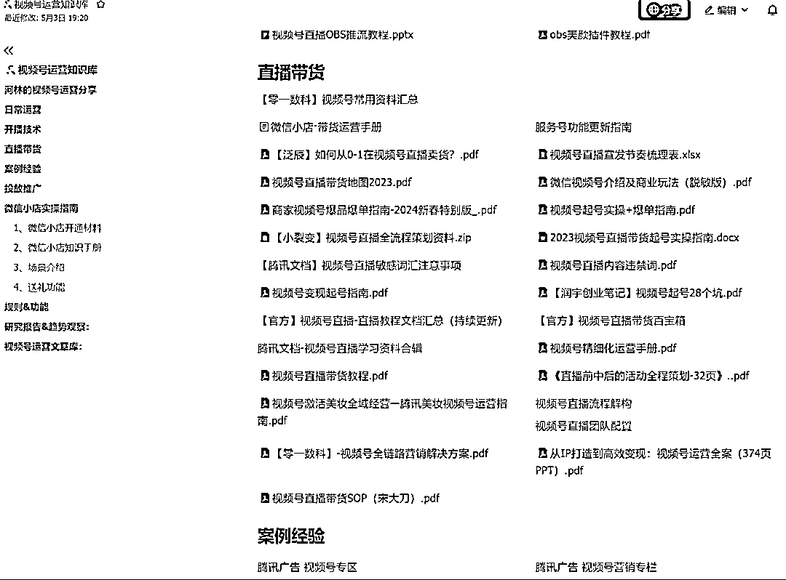

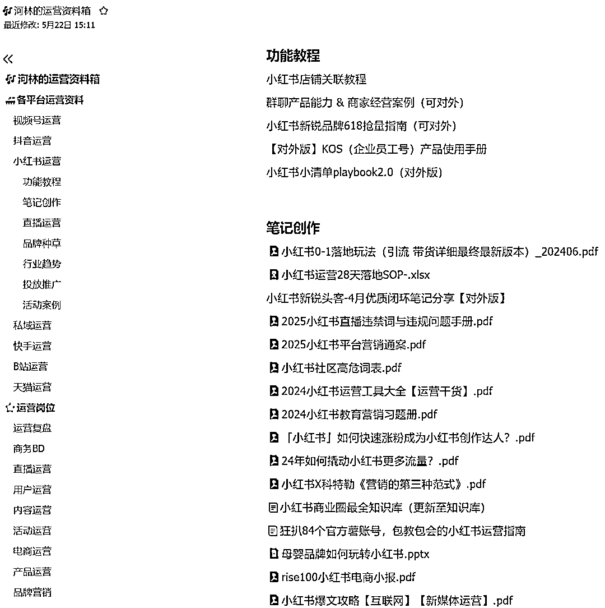

最近各家都推出了自己的AI知识库工具，于是“到底选哪家”就成了我新的探索课题。

## 明确需求：什么才是我的“真需求”

先梳理一下我到底需要解决什么问题，哪些功能对我来说是刚需：

⭐核心刚需：我提出问题、给出检索指令后，它能分析资料并给出靠谱的答案，总结输出能力和逻辑推理能力要足够强。

⭐信息源要丰富：最好不只支持PDF，像👸号文章、各种常见文件格式也要覆盖。

⭐多端同步：电脑和手机都能用，尤其是电脑端的体验必须丝滑流畅。

⭐支持分享：知识库能对外共享、公开访问。

⭐门槛越低越好：免费空间够大、付费成本合理、操作路径简单。

需求明确了，接下来就是物色产品。

目前市面上主流的知识库工具有：飞书问答、纳米AI、秘塔知识库、腾讯ima.copilot、得到get笔记……

先放结论：经过实测对比，我最终留下的是get笔记和秘塔知识库这两款。

## 测评方法与过程

我的测试方法很简单粗暴：

从我的视频号运营知识库里挑了40份质量较高的资料，统一上传到不同知识库产品中，然后用同一个问题去提问，对比各家的回答效果。

以下是按照我个人的满意度排名的测评结果：

### Top 1：秘塔AI知识库

说实话，秘塔AI知识库最开始已经被我放进了淘汰名单。但真正测下来，它的表现确实让我有点意外——是那种惊艳的意外。

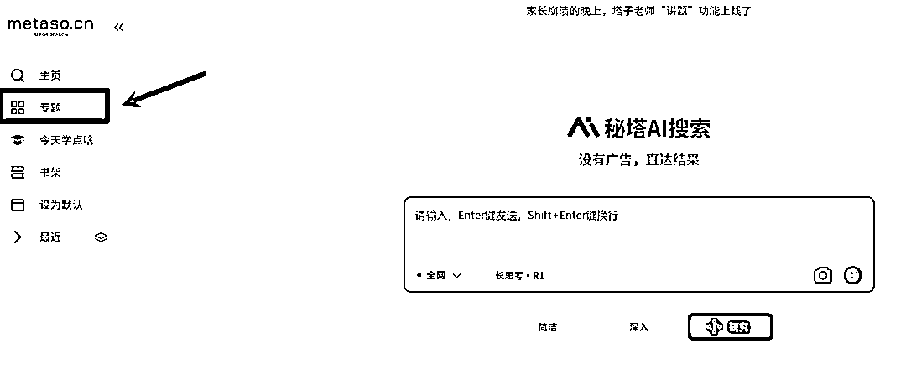

我发现，对比ima知识库和get笔记的答案，秘塔AI在回答质量上就已经明显胜出了。

我在视频号运营知识库里提问“视频号直播间的流量推送逻辑是什么”，它的回答是这样的：

更让人惊喜的是，它还主动提供了一堆“增值服务”，体验称得上“图文并茂”。

比如：

⚡自动生成大纲⚡

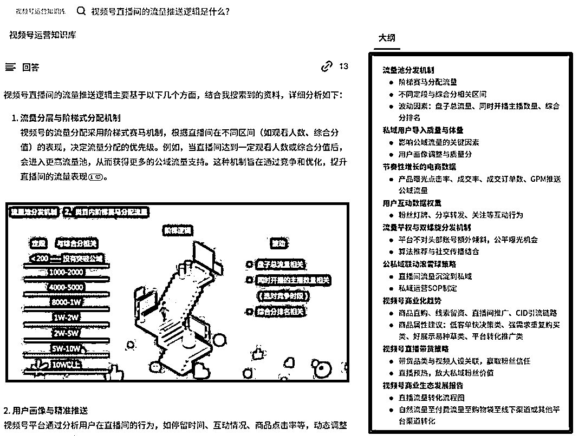

⚡自动生成PPT⚡

针对我提出的问题，它直接产出了12页PPT，而且专业度很高，比我手动做的要美观不少。

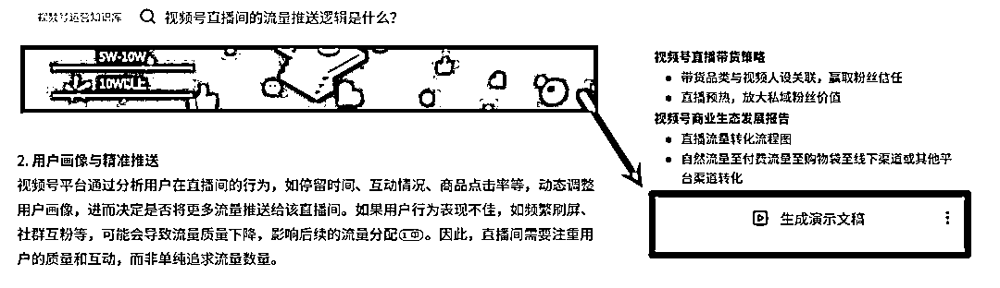

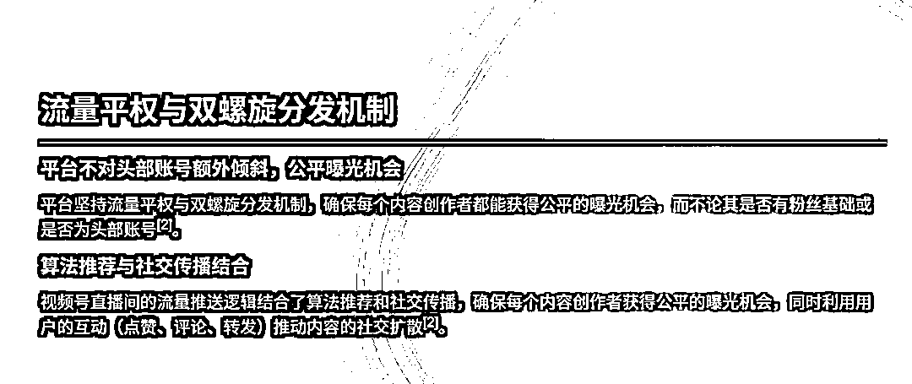

⚡生成思维导图⚡

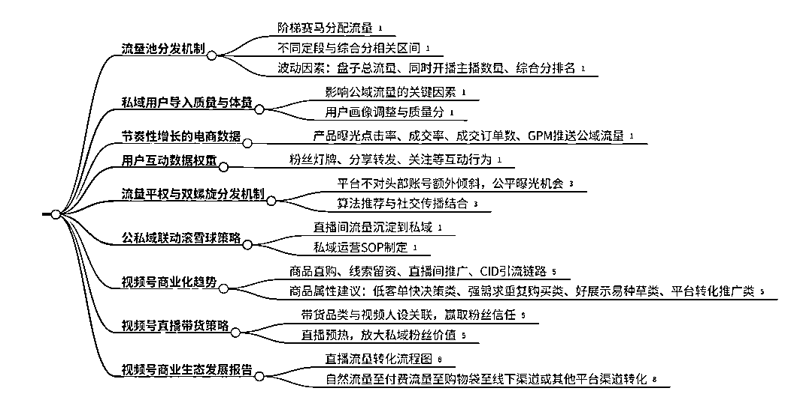

⚡生成互动网页⚡

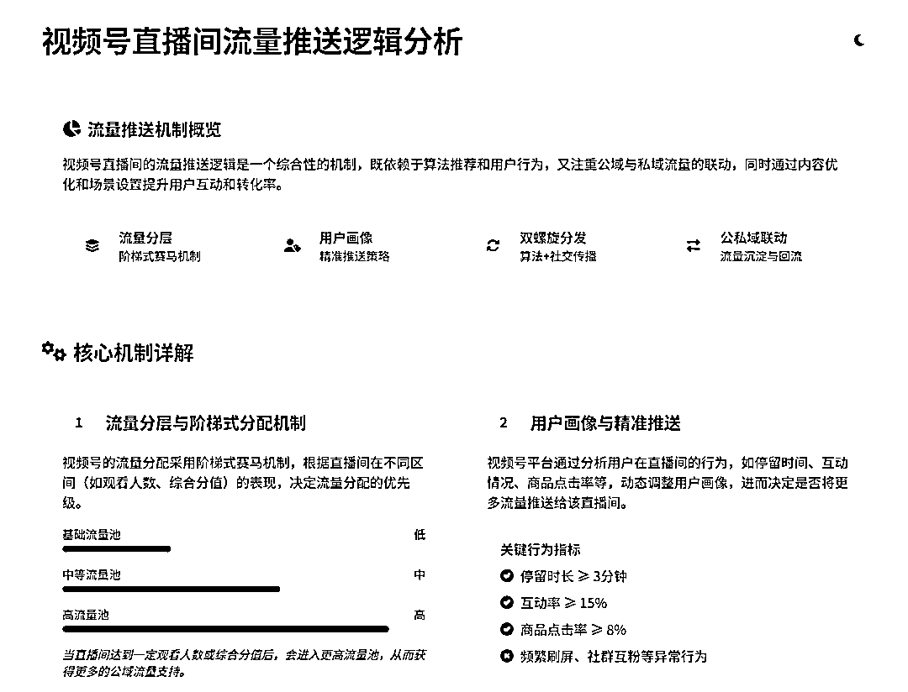

这些附加功能都是我没有主动要求的，它全帮我做了。

打个比方：你让实习生整理一份当月数据，他不仅把数据整理好了，还顺手做了趋势图、写了分析结论，最后打包成一份完整报告交给你。

所以，从我的核心需求——也就是从知识库中检索信息——来看，秘塔知识库的完成度是让人满意的。

再说说缺点。

第一，我自己日常用秘塔AI搜索的频率本来就不高，这会影响产品的打开率。

第二，免费空间只有500M，我传了两个知识库就满了，想扩容的话是100M/3.5元。

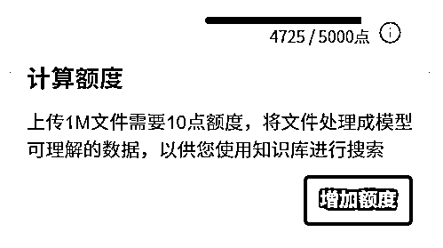

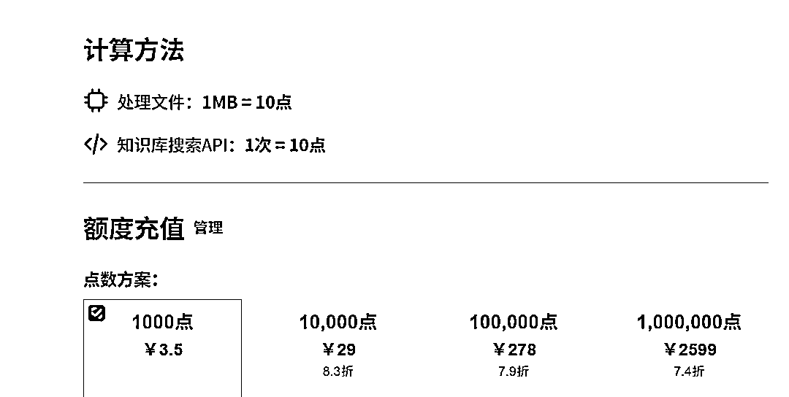

第三，分享功能比较局限，只能通过链接或图片形式分享，没法直接在🛰️里以小程序形式打开。另外，知识库广场也没有对外开放，看不到别的用户公开了哪些内容。

不过，这些缺点并不影响核心功能的使用体验。产品真的好的话，我是愿意付费的。总体来看，秘塔AI知识库的亮点非常突出。

### Top 2：得到的get笔记

get笔记是我今年遇到的少数几个让我眼前一亮的产品。

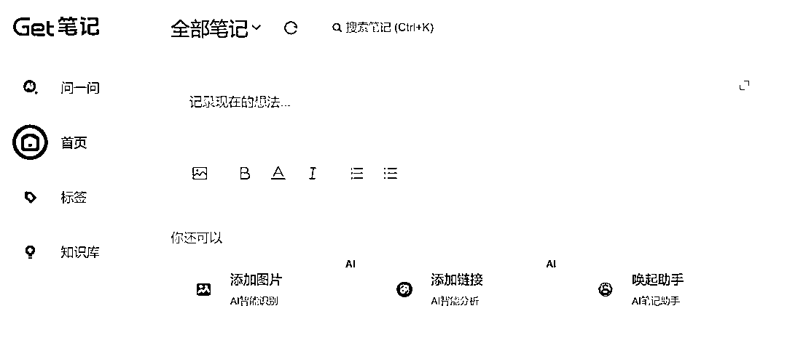

它有很多功能是我一直想要的、市面上没人做的，但get笔记用很优雅、很方便的方式实现了。

最厉害的一点是：get笔记可以自动订阅抖音、得到、视频号博主的短视频和直播，然后自动生成文稿和解读，一并收录进知识库。

这是我订阅的几场直播：

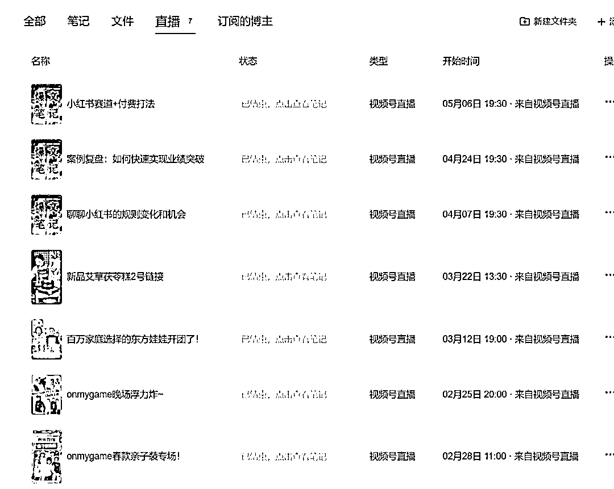

直播结束后，系统会自动生成整场直播的文稿和AI解读，归档到知识库里。

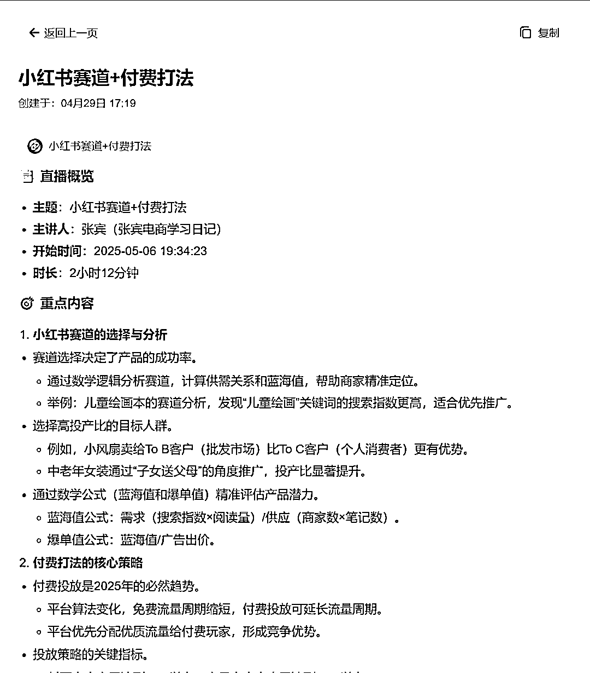

短视频博主的内容也可以订阅，每一条视频都会自动生成文稿加总结。

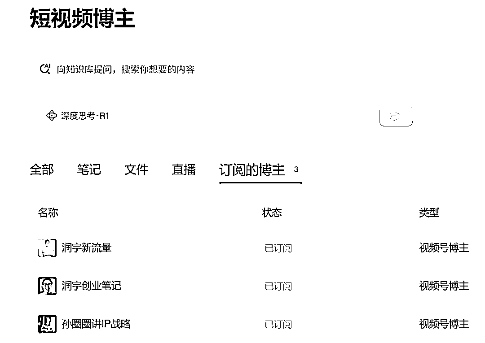

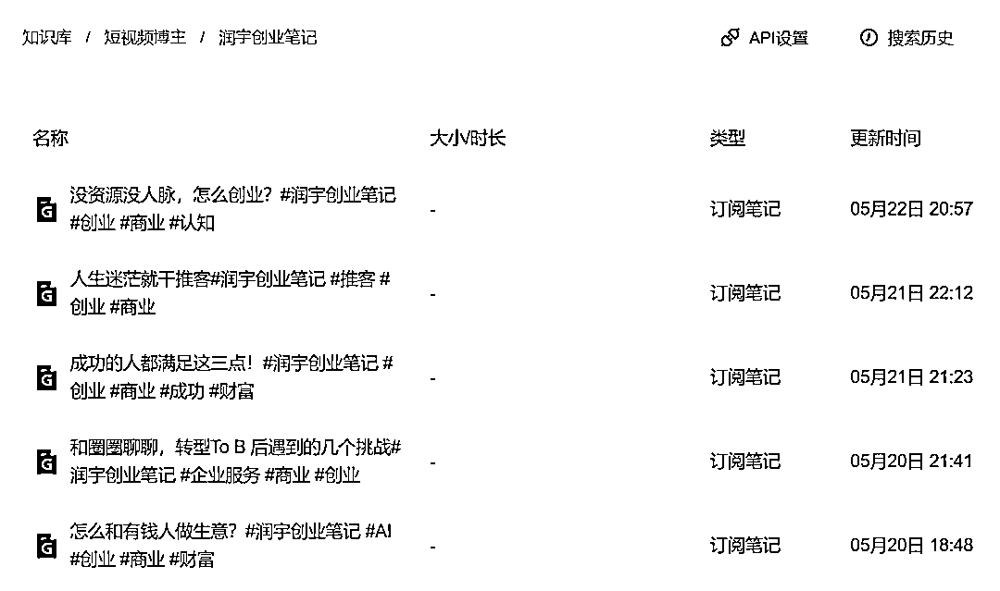

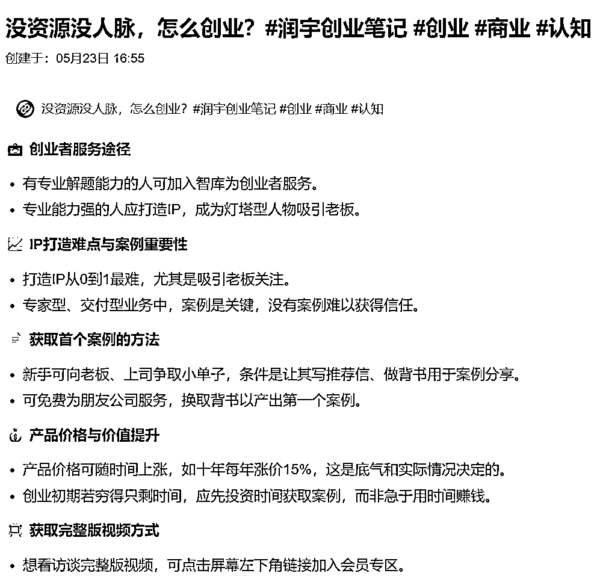

这个能力，目前市面上任何一款知识库产品、AI产品、笔记工具或SaaS工具都做不到。

get笔记还有很多实用玩法，以后有时间我再单独写一篇详细展开。今天这篇重点聊聊怎么用好它的AI知识库功能。

### Top 3：腾讯ima.copilot

ima.copilot是腾讯家的产品。从产品设计上看，它延续了腾讯系一贯的体验优势。

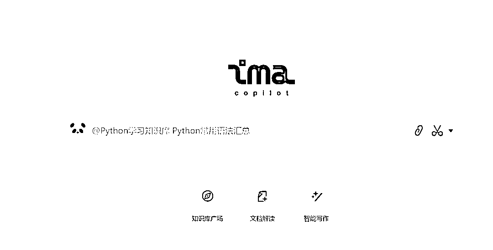

它自带的ima知识库使用指南里介绍了基本功能，下载后可以学习一下。主要包括：

⚡知识库整合：支持把本地文档和浏览过的公开链接统一收录到知识库。

⚡搜索引擎式提问：可以直接在首页提问，它会检索信息并生成AI回答，这些回答也能保存进知识库。

⚡笔记记录：阅读文件和网页时，可以唤起ima做笔记，笔记同样能归入知识库。

ima知识库有几个值得说的亮点：

⭐整合性强：信息来源非常多元，本地文档、公开链接、AI回答、原生笔记等都能统一收纳。

⭐🛰️生态联动好：🛰️端阅读文章时，可以很方便地一键分发到ima知识库，收集👸号文章非常流畅。

由于是腾讯自家的产品，它检索🛰️生态内的👸号内容时效果很好。

另外我还注意到一个细节：它在回答日常提问时，会去检索ima知识库平台上其他用户公开的知识库。这个设计很巧妙，应该是所有知识库产品里唯一这么做的。

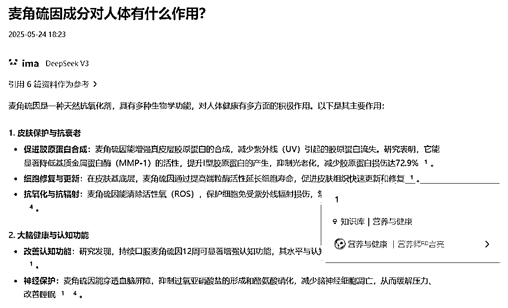

不过，在具体的知识库信息检索、提取、整合方面。我实际测试下来，ima的回答质量与秘塔知识库和get笔记相比，只能算中规中矩。

综合来看，ima在我这里的评价不算高，放在第三位，当个备胎吧。

### 核心测试：知识库提问对比

回到最关键的环节——专业问题的知识库提问测试。

我把内容相同的「视频号运营知识库」分别传到三款AI知识库中，然后问同一个问题“视频号直播间的流量逻辑是怎么样的”，得到了三种不同的答案。

🌟秘塔知识库：

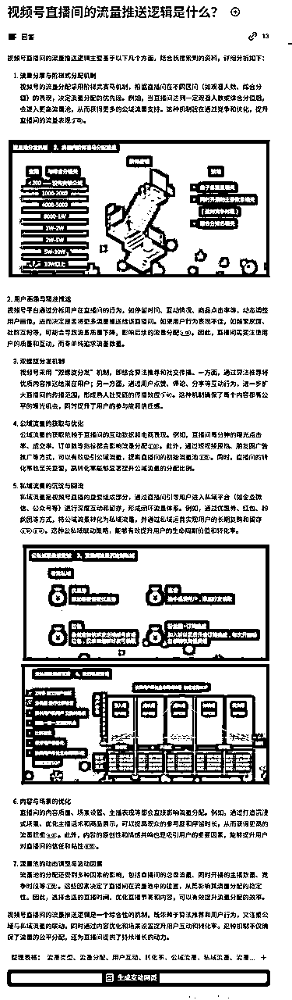

如前面所说，秘塔的答案是质量最高的：内容充实、结论丰富、图文并茂。

🌟get笔记：

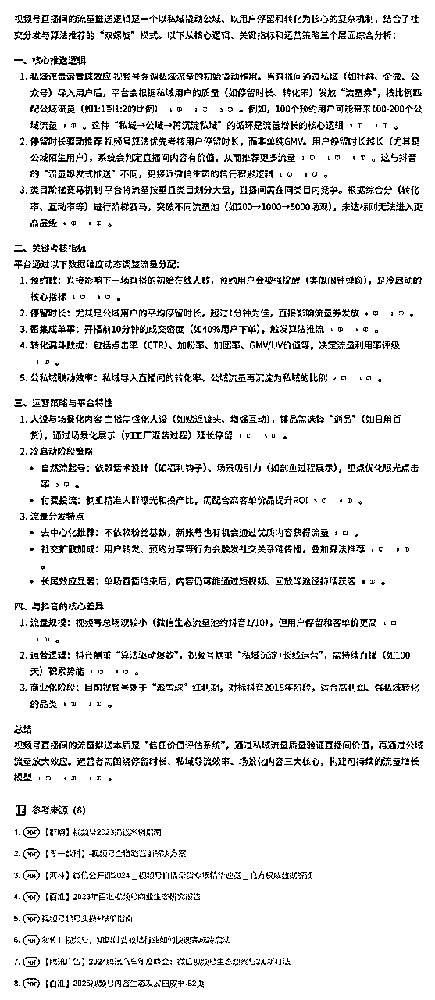

🌟ima.copilot：

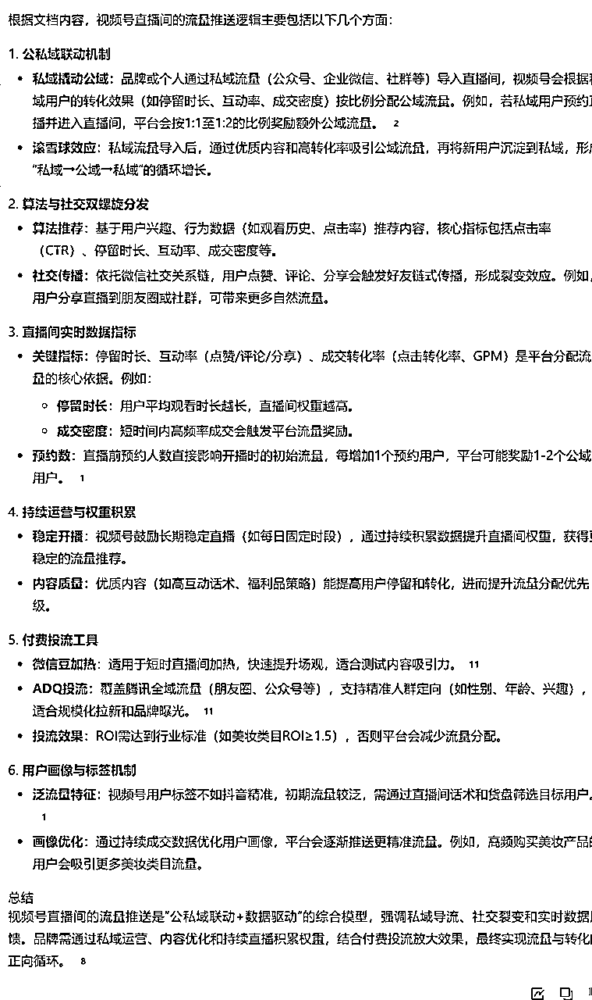

仅就观感而言，get笔记和ima的回答都有参考价值，get笔记比ima稍好一些。但两者的信息提炼都比较简洁，且以纯文字为主。

我又用一个📕运营知识库做了同样的测试，结论基本一致。

## 三款知识库软件的异同总结

⭐三者都支持将PDF、PPT、Word等通用格式的本地文件整合到知识库，也都支持公开网页链接的收录。

⭐在回答的丰富度和实用性方面，秘塔搜索有明显优势，而这恰恰是我的核心需求。

⭐在🛰️生态的联动方面，ima知识库表现更好，主要体现在👸号内容的检索能力上。

⭐在文献来源的对照展示方面，ima的表现不如get笔记和秘塔搜索。

ima标注信息来源时，只能告诉我这段信息来自哪个文件。

而get笔记和秘塔可以直接跳转到具体段落，指出这段内容出自哪个文件的哪句话。

get笔记的效果👇

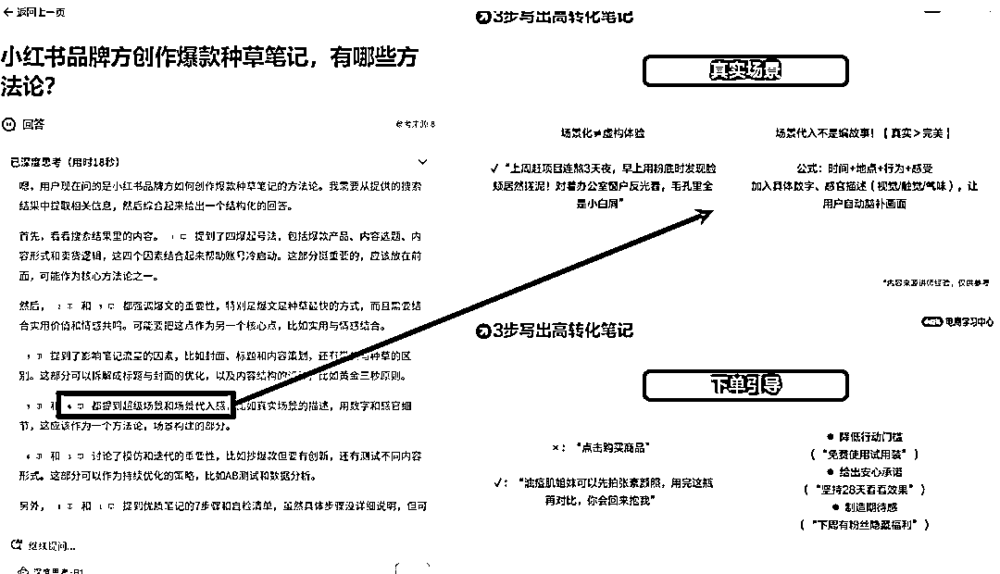

秘塔AI的效果👇

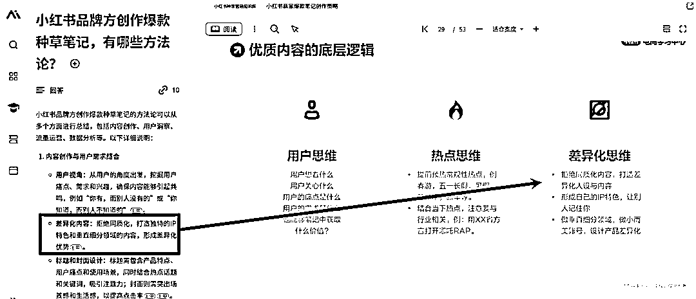

⭐在对外公开分享的展示方面，get笔记和ima知识库都做得很好，都能在产品主页浏览各种公开知识库。

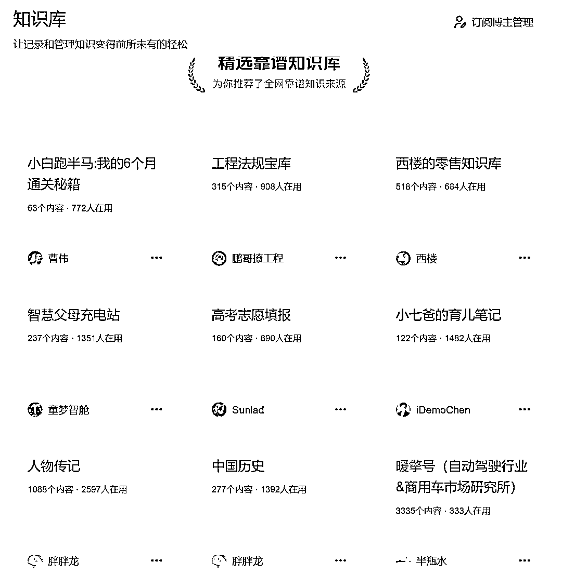

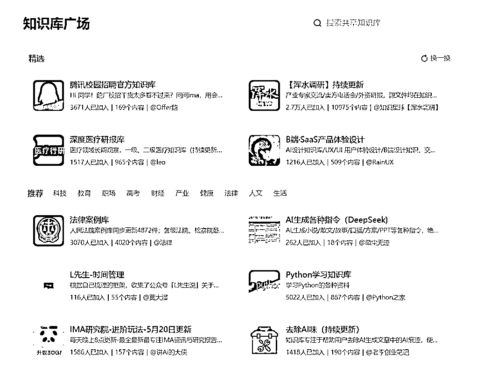

两者都可以通过小程序形式分享到🛰️群，而秘塔搜索只能分享知识库链接和图片。

⭐在订阅来源的多样性上，get笔记具有绝对优势。

get笔记支持订阅抖音、得到、视频号的博主短视频和直播间内容，自动生成文稿和AI解读，归入对应知识库。这是它碾压级别的优势。

不过，get笔记有个很大的问题：在我对知识库提问时，纳入知识库的订阅博主和直播信息，并不在检索范围内。

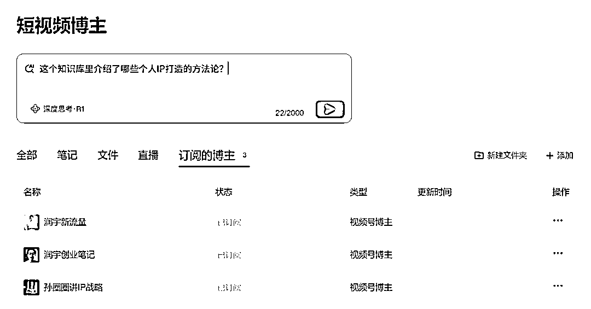

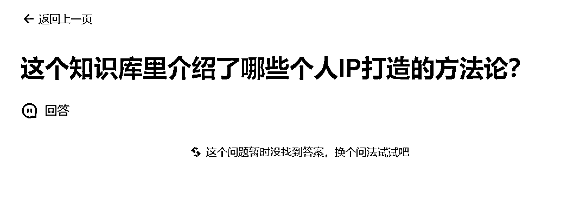

这个限制我觉得有些莫名其妙，等于白白浪费了自己的核心优势。所以，在问题检索能力这个维度上，我会给get笔记减分。

## 我的主观终极结论

👑综合能力最强的是秘塔搜索。如果是做深度检索，或者说我想“一次搜索解决所有问题”，那我选秘塔。它唯一的短板是公开分享效果一般。

👑get笔记和ima知识库，我也会继续同步建立知识库，主要用途是公开分享展示，作为对外曝光的窗口渠道，顺便测测能不能带来一些引流效果。

👑get笔记我会持续高频使用，用来整理订阅的博主短视频和直播内容。

👑ima知识库相比之下比较平庸，我的主要用法是收藏特定主题的👸号文章，偶尔作为辅助检索工具搭配使用。毕竟👸号里还是有不少优质内容的。

### 排除其他工具的理由：

❌纳米AI：

看到很多AI博主在发这个产品的推广通稿。但对我来说，360和周鸿祎的产品一律拉黑，不考虑。

❌飞书知识问答：

实际上，我的知识库从一开始就是搭在飞书上的，包括过去三年的工作周报、我自己整理的运营知识库等等。

按理说，如果飞书面向个人用户推出AI知识库问答，我一定是最受益的用户。

遗憾的是，飞书的知识库产品来得太晚了，前天刚推出飞书知识问答，而且明显优先服务企业用户，目前还处于内测阶段，只有部分企业和那些AI知识库KOL有使用权限。我提交了内测申请，还没通过。

好吧……既然用不了，那我也懒得测评了，老老实实排队等权限吧。

顺便说一句，飞书作为主要靠to B销售营收的公司，先推出面向企业的问答产品也无可厚非。

但我不太理解的是，飞书在知识库领域明明很领先，AI方面也早就推出了多维表格结合DeepSeek的功能，怎么到了AI知识库产品上就掉队了？现在别家小公司的产品都已经成熟了，飞书才姗姗来迟。

如果飞书的唯一考虑是要直接推出服务企业的知识问答工具，那我也没什么好说的。

所以这段时间，我一直把飞书上的文件下载、上传、迁移到其他AI知识库工具中进行测评。

等飞书知识库结束内测、我拿到权限之后，再用用看。如果真的好用、有价值，也许我会再单独介绍一篇。

至于其他工具，目前没看到什么特别好用的。没出现在我视野里的产品，我也不打算花时间主动去淘了。

Flowith这个名字听起来很酷，但我还没深入了解。而且从定位上看，它应该不只是一个知识库产品。先记在备选名单里，有时间单独用一下，如果有价值再单独写一篇。

## 搭建个人AI知识库的价值

最后，谈谈AI知识库的作用和价值。

💡公开分享，链接交流

排行榜前面的公开知识库，订阅量有几万人。

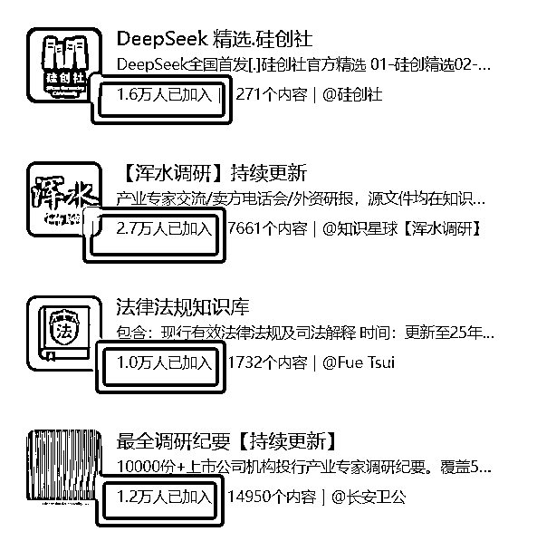

所以做出一个好的知识库，也是建立个人影响力、增加曝光度的有效途径。我一直相信：越分享，越幸运。

💡针对一个行业或领域做主题学习

引用luke老师的一句话：想要在某个领域快速进步，就要在一段时间内集中、沉浸地做专题学习。

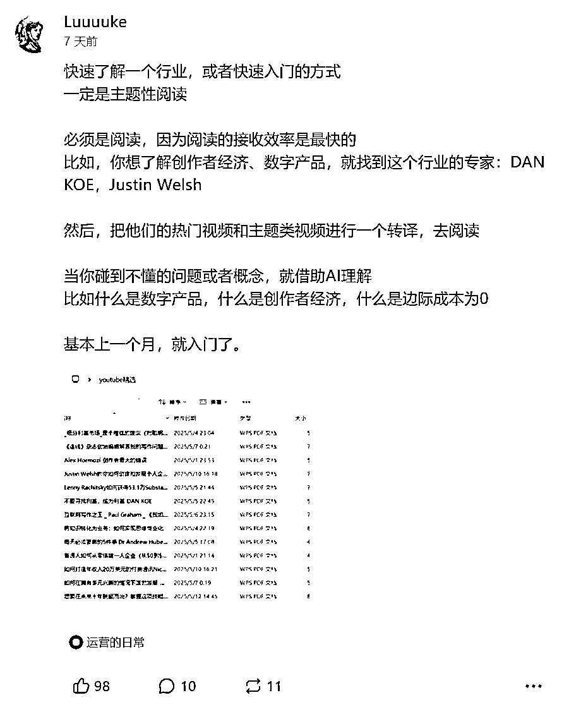

一个特定领域的知识库，就像给大脑外接了一块硬盘，能帮你沉淀信息，快速掌握某个领域的框架、常识、逻辑和方法。

用得好，它就像一个不用付费却价值千金的教练、顾问或咨询师。

再举个例子：遇到特别喜欢的作者，可以把他的所有文章收集起来，单独做成一个知识库，用来专门回顾和分析他的观点，甚至通过提问来“对话”。

等等等等，AI知识库肯定还有更多新玩法等着去发掘。

这篇文章已经够长了，后续如果我在「AI知识库」领域折腾出10个新玩法，就再单独写一篇实操分享。想看的朋友欢迎催更~

## 搭建个人AI知识库的几点建议

1️⃣知识库的主题要聚焦，不要什么都往里丢，不然就成了无底洞。比如“市场营销”“互联网运营”“电商”这种过于宽泛的主题，资料一多，知识库基本就废了。

2️⃣资料的品质要严格把关，只选高价值的内容，别一股脑全塞进去。同时，来源要尽量多元化，不要只丢单一类型、单一媒介、单一渠道的信息。除了别人的资料，最好也能放一些自己加工过、用自己的话整理过的思考。

3️⃣搭建不是目的，关键是要用起来、要输出、要帮到工作和生活。不要沉浸在建设知识库的自我满足里，忘了最初的目标——输出、做事、提升、提效。

4️⃣工具本身没那么重要，别陷入选择困难症。

如果不怕麻烦，也可以用“大力出奇迹”的方式：把同一个知识库同步到多个产品里，遇到问题就同时拿出来提问，交叉验证结果。就像现在很多人习惯一个问题问多个AI产品一样。

但我总觉得这样信息太嘈杂了，选择越多，有时候反而越不知道怎么判断。

用AI产品，要有“弱水三千只取一瓢”的心态，举重若轻，像用瑞士军刀一样，而不是贪心，总觉得要索取更多。

好了，今天的分享就到这里，希望对你有帮助。如果觉得有收获，欢迎评论、转发。