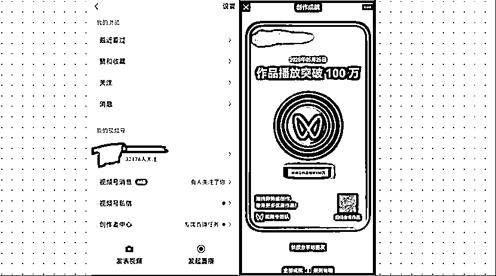
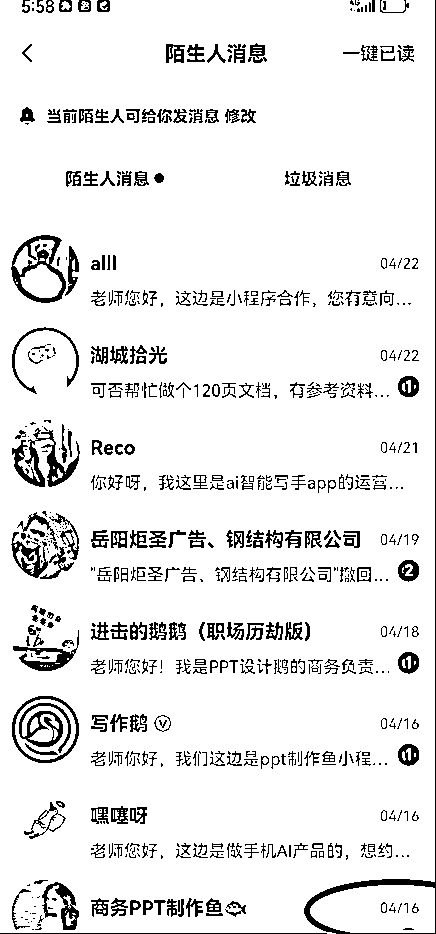
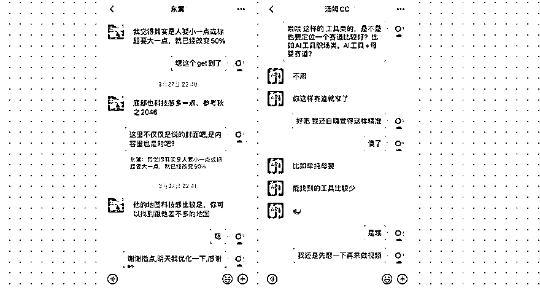

# 2个月全网涨粉4w、商单也来了！我的AI航海复盘

从设计院到AI风口：三娃妈妈60天做出35条短片，攒下4万关注、4次合作

最近刷到一个很带感的真实故事，想跟你聊聊：一位三娃妈妈，设计这行干了十二年，对AI工具原本一窍不通，今年却一脚踏进AI短视频实战营，硬是在60天里攒下4万多关注，并接到4笔商业合作。这不是天生奇才，也不是偶然撞大运，而是一层层试出来、磨出来的。

她叫亚芬。入营之前，她做过其他副业，也在🛰️短视频、小某书等渠道投过精力，但都没什么水花。今年3月，她决定All in这趟AI项目，从注册主页、寻找选题、学习剪辑到对接品牌方，一路摸爬滚打，总算把“创作—吸粉—变现”这条链路走通了。

先看结果。她3月26日发出首支短片，满打满算60天，一共在3个渠道更新35篇内容：
- 抖音：1800多位关注
- 小某书：超过7000位关注
- 🛰️短视频：3万多人关注
- 品牌合作：4条

值得玩味的是，这4万关注并不是平均增长出来的，绝大多数来自其中一支突然爆火的短片，之前的作品多半平淡无奇。但正是这个反差，让她坚定了一个看法：AI内容创作确实能跑通，市场窗口还开着，只要选题够准，关注度可以迎来爆发式增长。

关于这段经历，她提炼了三个关键判断。

其一，选对项目，比埋头努力更重要。这是龙哥亲自定下的“超级课题”，值得全力押注。她原本连DeepSeek、元宝这些热门工具都没碰过，算是彻头彻尾的零基础。正巧当时还有个DeepSeek专项训练营，她索性两个营一起报。但她随后提醒：多数朋友最好一次只专注一个营，否则后期会两头顾不上。靠着专项营里学到的本事，她很快用“出镜讲解+操作演示”做出第一支作品，也验证了她的判断：AI短视频正站在起飞跑道上，新手完全可以一边学一边做，照样能分走红利。

其二，市场需求比想象中来得更早。她印象很深刻的一点是，关注数刚过100时，就有品牌找来投了一支水下软广，报价才50元，却给了她极大的正向反馈。之后不停地有小额合作找上门，虽然单价不高，但至少说明：这个领域确实有人愿意掏钱。

其三，赛道要结合自己的优势，不能只追热度。创业初期她没想清楚定位，看到什么火就做什么，选了“职场提效”这个方向。问题在于，相关工具她平时根本用不上，每条内容都靠现学现卖，越往后越觉得费劲，试错成本也水涨船高。她后来反思，如果当初选择自己熟悉的AI+设计工具领域，创作负担会小很多。

除了收获，她也承认曾碰过钉子，并总结出四段很实用的经验。

第一，项目指南是宝藏，极值得反复翻看。她原来总急着开工，觉得多看一秒指南都是浪费。后来才发现，基本功不牢，后面全得还债。从个人定位、内容策划、吸粉机制、变现闭环，指南里都有清晰拆解。她现在的做法是先翻上几遍，再动手；有疑问先回看指南，多数时候能直接找到答案。

第二，前期至少连更20天，别天天盯着数据。最初那阵，她也免不了被那串播放量和点赞数牵动情绪。后来读到一位前辈撰写的12条经验清单，里头那句“每隔几篇就要有可见的进步，不能原地踏步”让她豁然开朗。从那以后，她把更多心思放在打磨作品上，焦虑感反而降了下来。

第三，复刻爆款不是抄，是快速入门的方式，而且要持续迭代。很多导师都建议学习热门作品，她起初却不自觉地夹带个人想法。被令狐教练点破后，她才开始老老实实照着原片一比一模仿，从剪辑、取景、念白节奏到布光逐项调准，每做一版都力争比前一版更细。那支真正火起来的短片，就是在这个阶段产生的。

第四，卡壳的时候别憋着，主动去问。她特别感激训练营里的朋友们，每次迷路，都会向社群里的高手求助。东篱、汤姆和令狐教练都给过很具体的执行建议，帮她省掉不少弯路。独自蒙头苦干效率很低，借他人的经验导航，才是聪明做法。

最后她说，60天里最宝贵的收获，不是关注量，也不是合作单，而是真正登上了AI这班车。做内容的同时，她在跟着趋势重新学习，认知不停刷新，也在持续把学到的东西分享出去。要是你也正站在起点，别怕速度慢，多去实践，干着学。路线对了，坚持够了，平凡人同样能领到AI时代的那张船票。