# 小红书虚拟产品赛道指南：从选方向到找到高需求品类

做小红书虚拟产品，表面上是在卖资料、模板或服务，实际上经营的是一门“内容电商”。真正决定结果的核心环节，主要有三个：选对产品、验证需求、持续产出内容。

而在正式选品以前，更重要的一步是先找到适合自己的赛道。一个人很难赚到认知范围之外的钱，所以这份指南的价值，不只是告诉你“什么能卖”，更是帮你打开思路：原来很多看似普通的需求，也能变成虚拟产品生意。

## 一、选赛道，究竟是在确定什么？

选择赛道，实质上是在明确三件事：

- 你准备服务哪一类人？
- 这类人正在面临什么问题？
- 你能用什么产品或服务为他们提供帮助？

先确定大方向，再进一步研究目标人群的具体需求，最后才能判断应该做什么产品。

## 二、新手选赛道，记住这3条

### 1. 不要花太久时间反复纠结

选赛道最好控制在两天左右。

很多新手迟迟无法开始，是因为总想找到一个“百分之百完美”的方向。但现实是，根本不存在绝对完美的赛道。只要某个领域在小红书上存在真实需求，就有机会做出市场。

选定之后，真正拉开差距的不是继续犹豫，而是执行、测试和调整。

### 2. 一个账号尽量聚焦一个方向

每个赛道都需要长期研究用户需求。账号越垂直，越容易积累内容资产和用户信任。

不要今天做K12资料，明天做考研，后天又转去法考。短时间没有结果时，应该先检查内容、产品和转化环节，而不是立刻换赛道。因为如果问题没有被解决，换到下一个方向，大概率还会重复遇到。

持续深耕还能形成明显优势。比如专注职场简历方向，发布的相关笔记越多，覆盖的关键词越丰富，用户搜索简历修改、求职模板、面试简历等问题时，看到你的概率就越高。

### 3. 不要盲目追逐热门

看到别人某个赛道出单多，就立刻跟着做，是新手常见的误区。

如果你本来对某个领域熟悉，或者自己确实有相关经历，优先从这个方向入手。熟悉意味着你更容易理解用户的真实痛点，也更容易做出有差异化的产品。

对于完全陌生的热门领域，表面上看机会很多，但实际做起来往往缺少判断力。

## 三、新手可以优先考虑的常青赛道：教育

教育类需求长期存在，用户群体庞大，而且不同身份、不同年龄阶段都有对应的产品需求。只要服务得好，复购和转介绍的可能性也比较高。

教育赛道主要可以覆盖三类人：

### 学生

幼儿园、小学、初中、高中、大学、研究生、博士以及在职学习者，都可以被纳入学生人群。

学生的需求通常随着年龄变化：

- 年龄较小：启蒙、习惯、基础知识学习；
- K12阶段：学习成绩、考试、升学；
- 大学生：专业学习、考证、比赛、求职；
- 成年学习者：职业发展、技能提升、自我成长。

### 家长

家长关注的通常包括：

- 提高孩子学习成绩；
- 升学规划；
- 家庭教育；
- 学习习惯培养；
- 儿童能力发展；
- 亲子互动与陪伴。

### 教师

教师的需求主要分为：

- 备课与授课；
- 教学研究；
- 班级管理；
- 作业与测评；
- 教务管理；
- 家校沟通。

教育赛道之所以适合新手，是因为大方向足够大，但又能继续拆分成多个垂直领域。与其什么都做，不如先成为其中一个细分方向的熟悉者。

---

# 四、教育赛道的7个高需求细分方向

## 细分方向1：幼儿启蒙与学前教育

### 目标用户

0—5岁儿童家长，以及准备进行幼小衔接的家庭。

### 常见需求

家长希望在家里完成基础启蒙，产品可以围绕以下方向设计：

- 数学启蒙；
- 识字与语文启蒙；
- 英语启蒙；
- 艺术启蒙；
- 科学启蒙；
- 体育与身体发展；
- 习惯培养；
- 亲子游戏；
- 绘本阅读；
- 成长记录；
- 奖励积分工具；
- 家庭教育方法；
- 儿童心理发展指南；
- 纪录片学习资料。

### 适合做的产品

- 幼小衔接资料包；
- 拼音启蒙练习；
- 数学启蒙卡片；
- 亲子互动手册；
- 游戏化学习工具；
- 家庭教育清单；
- 习惯养成打卡表。

### 需求高峰

- **3月、9月开学季**：幼小衔接、拼音、数学启蒙等资料需求明显增加；
- **4—5月、10—11月**：家长根据孩子学习情况补充资料，可重点推出手工、绘本和亲子游戏；
- **6月、12月学期末**：复习资料、下学期准备内容以及育儿经验类产品更容易被关注。

## 细分方向2：K12学生与家长

### 目标用户

小学、初中、高中学生及其家长。

### 主要需求

核心目标通常是预习、巩固、提分和升学备考。

可开发的内容包括：

- 语文、数学、英语及文理科资料；
- 知识点梳理；
- 基础训练；
- 专项练习；
- 解题技巧；
- 英语单词与语法；
- 数学公式总结；
- 实验操作指导；
- 同步练习；
- 单元检测；
- 一课一练；
- 早读晚默资料；
- 期中、期末复习包；
- 中考、高考真题解析；
- 模拟试卷；
- 冲刺计划；
- 假期作业与预习资料。

### 关键词拆分

可以按照“年级+学科+具体需求”的方式继续细分，例如：

- 三年级数学同步练习；
- 初二英语语法；
- 高一物理公式；
- 中考数学真题；
- 小学期末复习；
- 高考冲刺资料。

### 需求时间

- **寒暑假期间**：学生需要巩固旧知识、预习新课程；
- **3月、9月开学前后**：新学期准备类资料需求集中；
- **期中、期末前**：复习、刷题和专项突破类内容更容易转化。

## 细分方向3：大学生服务

大学生需求非常丰富，可以从学习、证书、比赛、就业和兴趣娱乐等方向切入。

### 1. 专业学习

产品可以包括：

- 专业教材整理；
- 课程笔记；
- 实验教程；
- 考试重点；
- 模拟试卷；
- 复习资料；
- 论文写作指导；
- PPT模板。

### 2. 证书备考

常见方向有：

- 大学英语四六级；
- 计算机等级考试；
- 教师资格证；
- 其他职业技能证书。

对应产品可以是：

- 知识点总结；
- 历年真题及解析；
- 模拟题；
- 答题技巧；
- 备考计划；
- 时间管理工具；
- 题库；
- 在线模拟系统。

### 3. 大学生比赛

热门比赛包括：

- “挑战杯”；
- “三创赛”；
- “互联网+”创新创业大赛；
- 职业生涯规划大赛。

可提供：

- 参赛PPT模板；
- 项目计划书；
- 经验分享；
- 参赛辅导；
- 路演材料；
- 比赛流程整理。

### 4. 大学生求职

可以按专业、岗位和行业继续细分，例如：

- 银行求职；
- 产品经理；
- 国企求职；
- 互联网岗位；
- 师范生求职。

适合做的产品包括：

- 求职简历模板；
- 笔试资料；
- 面试题库；
- 模拟面试；
- 职业规划；
- 春招时间表；
- 行业分析；
- 岗位信息整理；
- 一对一简历修改。

### 5. 兴趣与娱乐

大学生也会为兴趣投入时间和费用，例如：

- 简笔画；
- 摄影；
- 跳舞；
- AI绘画；
- 图片处理；
- 手机调色；
- 穷游攻略；
- 设计软件。

可以提供教程、工具整理、软件推荐和实用攻略。

大学生赛道覆盖范围很广，建议不要全部铺开，而是选择一个细分场景，再结合具体时间节点进行运营，比如证书考试期、比赛报名期和求职高峰期。

## 细分方向4：考研与考公

### 目标用户

在校大学生、应届毕业生和往届毕业生。

### 主要需求

- 公共课复习；
- 专业课整理；
- 历年真题；
- 知识点总结；
- 英语词汇和语法；
- 作文模板；
- 数学公式与解题技巧；
- 政治冲刺资料；
- 学习计划；
- 时间管理；
- 模拟考试；
- 题库；
- 复试资料；
- 导师选择；
- 简历优化；
- 面试技巧。

### 适合的产品形式

- 系统化复习资料；
- 阶段备考计划；
- 真题解析；
- 模拟试卷；
- 冲刺资料包；
- 复试面试笔记；
- 专业课重点整理；
- 个性化备考规划。

### 需求高峰

考研通常在初试前3—6个月，也就是7月至12月，进入高需求阶段。政治、英语、数学等公共课的冲刺资料、真题解析和押题内容更容易受到关注。

复试和考公面试阶段，则更适合推出专业课整理、面试指导、简历模板和模拟问答类产品。

## 细分方向5：成人专升本

### 目标用户

准备参加专升本考试的在校生及社会学习者。

### 常见需求

- 语文、数学、英语、政治、信息技术等公共课资料；
- 专业课教材与重点；
- 历年真题；
- 模拟试题；
- 答题方法；
- 学习规划；
- 时间管理工具；
- 题库；
- 报名指导；
- 院校选择分析；
- 冲刺课程；
- 答疑服务。

### 需求节点

- **考试前两个月**：进入冲刺阶段，真题、模拟题和考前重点需求最强；
- **报名之前**：基础资料、备考计划、院校选择等内容更受关注；
- **成绩公布之后**：未通过考试的人群可能开始准备下一轮考试。

## 细分方向6：热门考试与招聘考试

### 证书考试

例如法考、CPA等，用户通常需要：

- 备考计划；
- 教材重点；
- 历年真题；
- 模拟卷；
- 冲刺资料；
- 面试指导；
- 在线课程；
- 一对一辅导。

### 招聘与求职

目标人群包括应届生、往届生和在职人士。

可提供：

- 简历模板；
- 求职规划；
- 企业真题；
- 笔试资料；
- 面试题库；
- 行业分析；
- 岗位推荐；
- 春招时间表；
- 模拟面试。

春招通常在2—3月进入集中阶段，1—2月则是提前准备和岗位预热期，因此简历、面试和求职规划类产品可以提前布局。

### 热门考试时间表

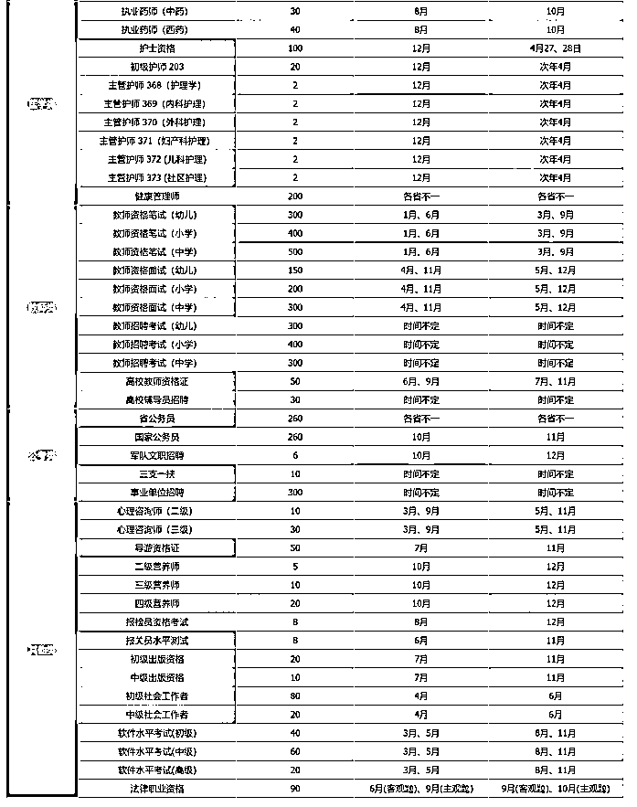

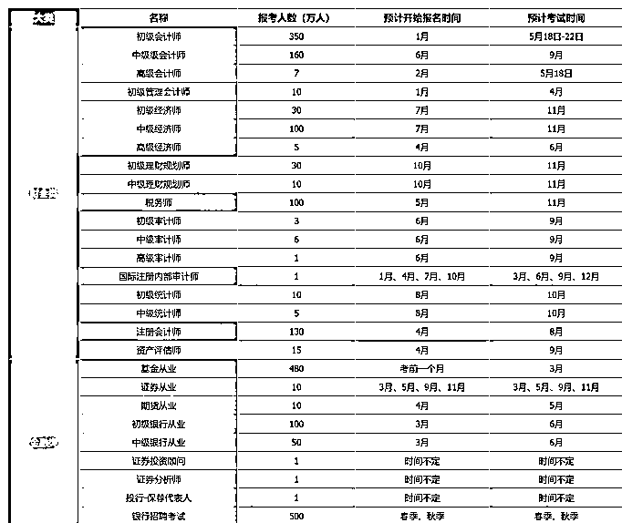

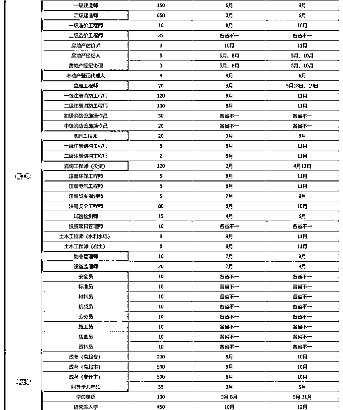

## 细分方向7：教学与教务

### 目标用户

学校教师、班主任、教务老师、园长和校长等。

### 教学教研需求

可以围绕日常教学流程开发：

- 晨读课件；
- 早读晚默资料；
- 晨读辅助工具；
- 单元检测；
- 课堂互动内容；
- 课前小游戏；
- 抽背小游戏；
- 幼儿及低年级课堂活动；
- 期末评语；
- 作文评语；
- 教学总结模板。

### 教务管理需求

除了课堂教学，教师和学校管理人员还需要：

- 班级管理表；
- 学生信息登记；
- 家校沟通工具；
- 教务流程模板；
- 工作计划；
- 数据统计表；
- 各类通知和总结材料。

---

# 五、如何判断一个赛道值不值得做？

上面只是列出了可选择的方向，真正决定你该进入哪个赛道，还需要进一步判断。

## 1. 看自己是否有经验

你是否接触过这个群体？是否了解他们的日常问题？是否经历过他们正在经历的阶段？

对行业了解越深，越容易发现别人忽视的细节需求。

## 2. 把用户需求完整列出来

以考研人群为例，可以继续追问：

- 他们复习中最焦虑的是什么？
- 哪个阶段最缺资料？
- 哪些资料太零散？
- 哪些服务价格太高？
- 他们愿不愿意为节省时间和提高效率付费？

把需求逐项写下来，再去观察市场是否存在空缺。

## 3. 看能不能做得比现有产品更好

不一定要创造全新的产品，也可以重新整理已有信息，让它变得更清晰、更方便使用。

比如你有考研经历，可以将零散资料整合成体系；或者把某个小众专业的复试经验、面试问题和专业课笔记整理成一份更容易使用的资料。

真正的竞争力，往往来自：

- 内容更完整；
- 结构更清楚；
- 使用更方便；
- 更贴近具体人群；
- 能解决一个明确问题。

# 六、从热门产品品类反推赛道

除了从用户身份和需求出发，也可以反过来从产品形态入手。

## 方法一：搜索产品关键词，看热门笔记

例如在小红书搜索“表格”，观察出现频率高、互动量高的内容，可能会发现：

- 班主任管理表；
- HR表格；
- Word文档；
- 工作计划表。

再从热门笔记中判断具体需求。

## 方法二：查看相关话题

搜索产品关键词后切换到“话题”，每个热门话题都可能对应一个细分市场。进入话题后，继续观察用户真正想购买的产品。

## 方法三：分析商品销量

搜索同类产品，切换到商品页面，再参考销量、评价和产品结构，从热卖商品中寻找细分方向。

### 可以尝试搜索的关键词

表格、PPT、模板、简历、合同、笔记、教材、动画、电子资料、电子书、游戏、App、软件、课程、资料、服务、教程、手册、真题、攻略。

---

# 七、值得关注的高需求虚拟产品品类

## 1. 表格模板

常见需求包括：

- 年度计划与复盘Excel；
- 记账表；
- 多项目进度管理表；
- 装修资料清单；
- 班主任班级管理表；
- 月度工作计划；
- 备婚清单；
- 文言文实词虚词打卡表；
- 高校硕博待遇信息表；
- 艾宾浩斯记忆表。

## 2. PPT模板

常见方向有：

- 家长会PPT；
- 主题班会PPT；
- 述职报告PPT；
- 毕业论文答辩PPT；
- 大学生创业项目PPT；
- 各年级课件；
- 开学第一课；
- 定制PPT。

还可以继续细分到专业和具体场景，例如中医学位贴敷操作、城市文化介绍、票根展示等。

## 3. 简历产品

可以按照身份和岗位细分：

- 求职简历；
- 应届生简历；
- 研究生复试简历；
- 夏令营简历；
- 管培生简历；
- 师范生简历；
- 月嫂简历；
- 国企简历；
- 法务简历。

## 4. 合同模板

常见方向包括：

- 离婚协议；
- 股权合作协议；
- 教育劳动合同；
- 劳务合同；
- 房屋租赁合同；
- 影视剧制作合同；
- 外贸合同；
- 施工合同；
- 劳务解除合同。

涉及法律文本时，应注意专业性与适用范围，必要时进行专业审核，避免用户误用。

## 5. 总结笔记

学习类内容一直有需求，包括：

- 课程总结；
- 重点笔记；
- 项目复盘；
- 三色笔记；
- 考试重点；
- 学科框架整理。

关键不在于简单堆积信息，而在于让用户能够更快理解和复习。

## 6. 公开课、纪录片与启蒙动画

幼师公开课、主题课程、幼儿启蒙纪录片和动画内容，都可能在小红书获得关注。

但这类内容一定要重视版权问题。未经授权的版权内容，不建议销售或传播。

## 7. 绝版书与特色阅读内容

一些绝版书、女性成长、赚钱方法、认知提升、情感主题和网络热门长文，容易吸引特定人群。

但同样需要注意版权、传播合规与内容来源问题。

## 8. App会员与题库

用户常见需求包括：

- 学习类App；
- 题库；
- 工具软件；
- 会员权益；
- 学习辅助工具。

## 9. 课堂游戏

适合幼儿园、小学低年级及课堂教学场景，例如：

- 课堂互动游戏；
- 抽背游戏；
- 分组竞赛；
- 课前热身；
- 课堂奖励工具。

### 高需求品类附件

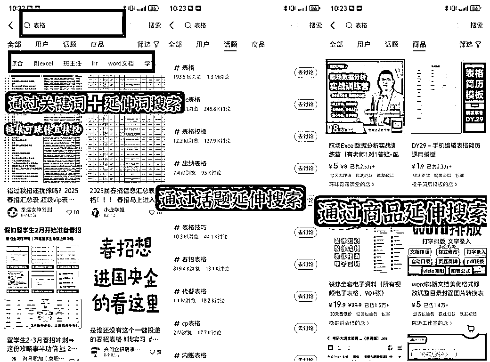

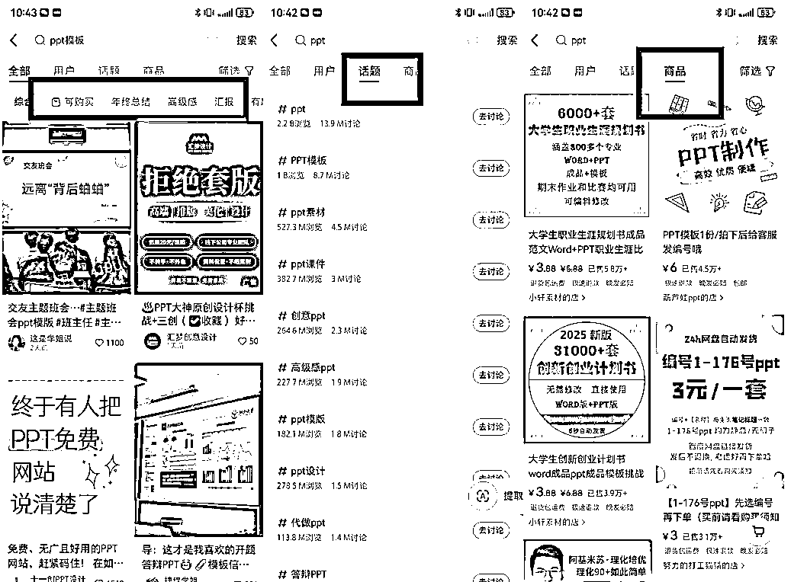

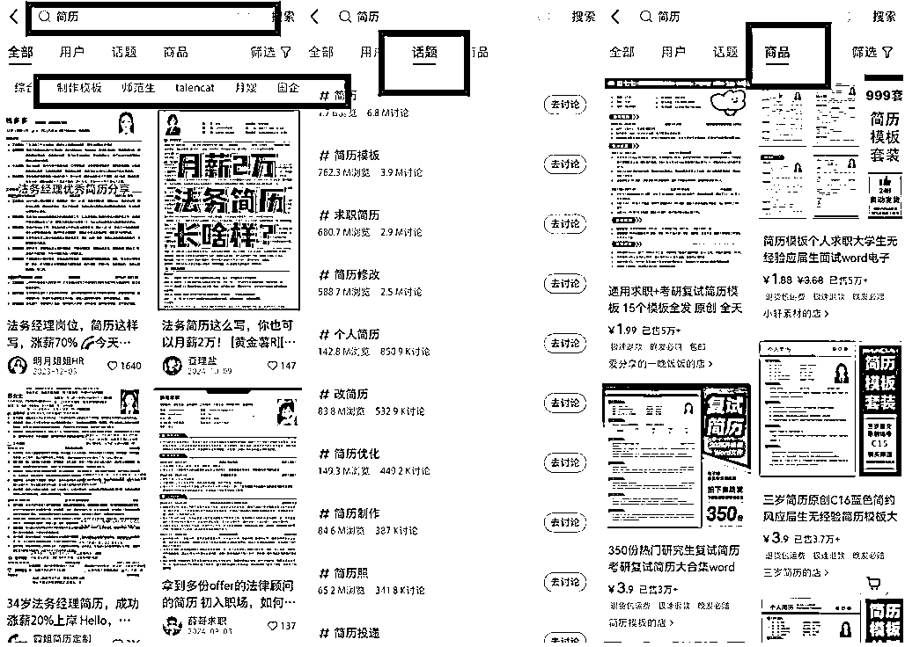

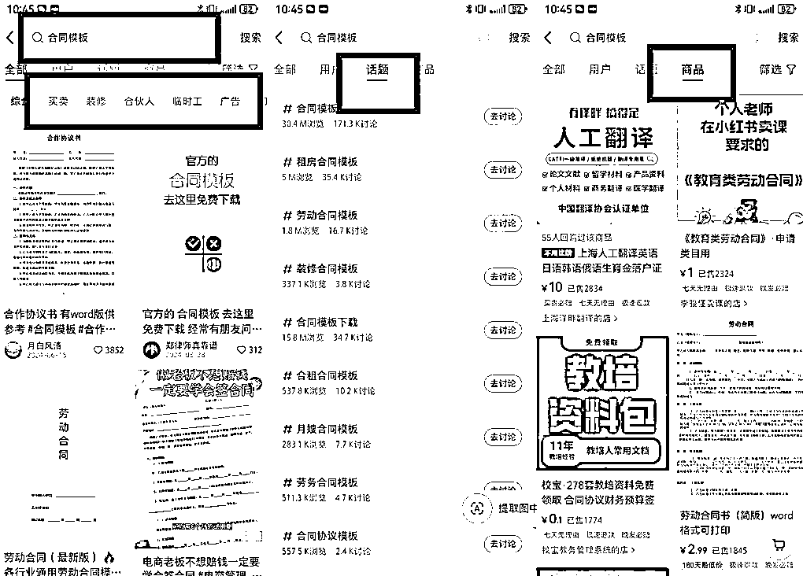

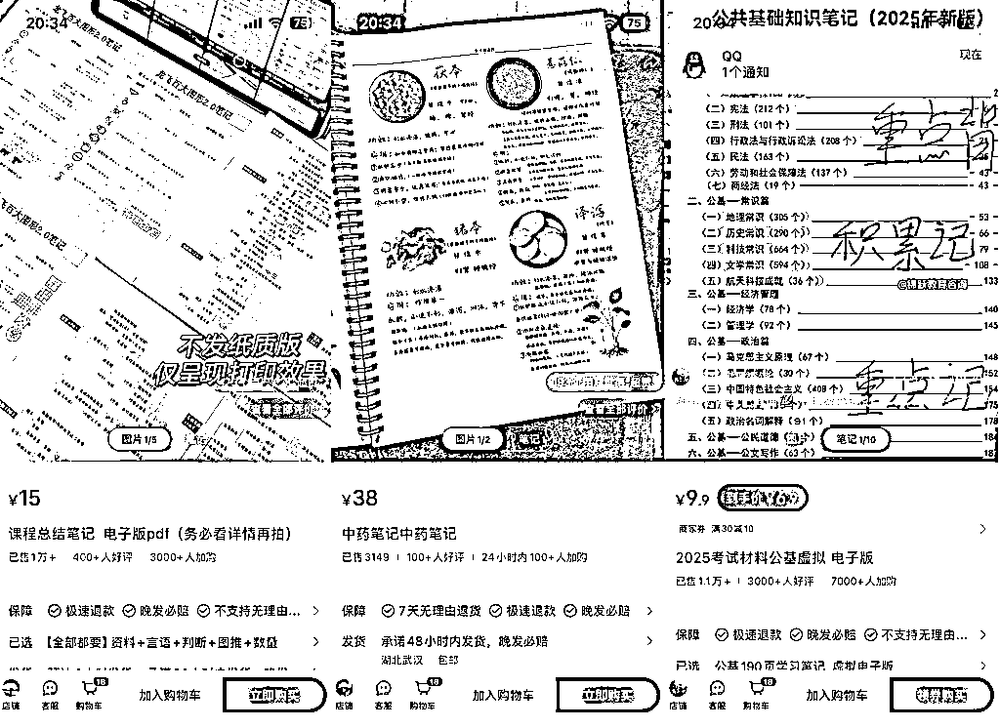

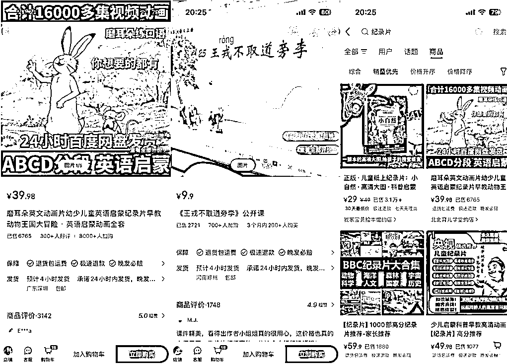

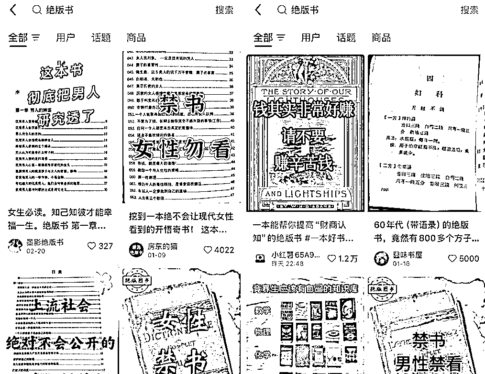

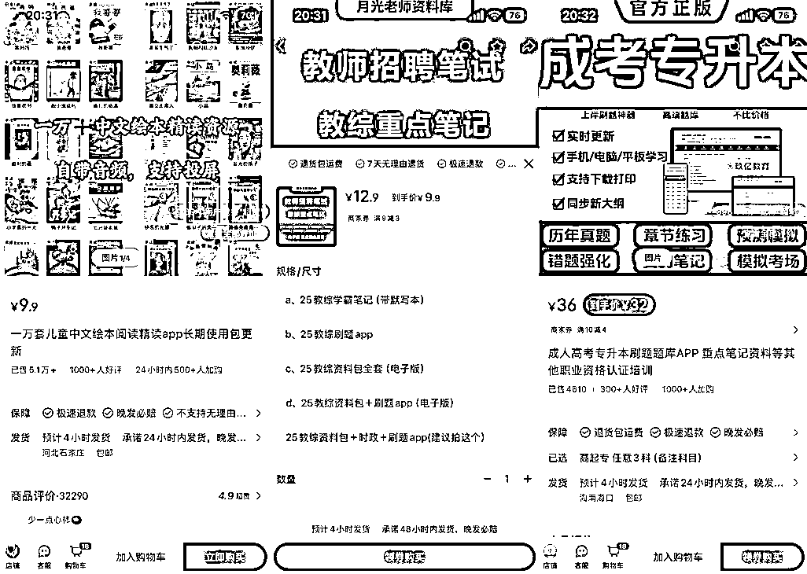

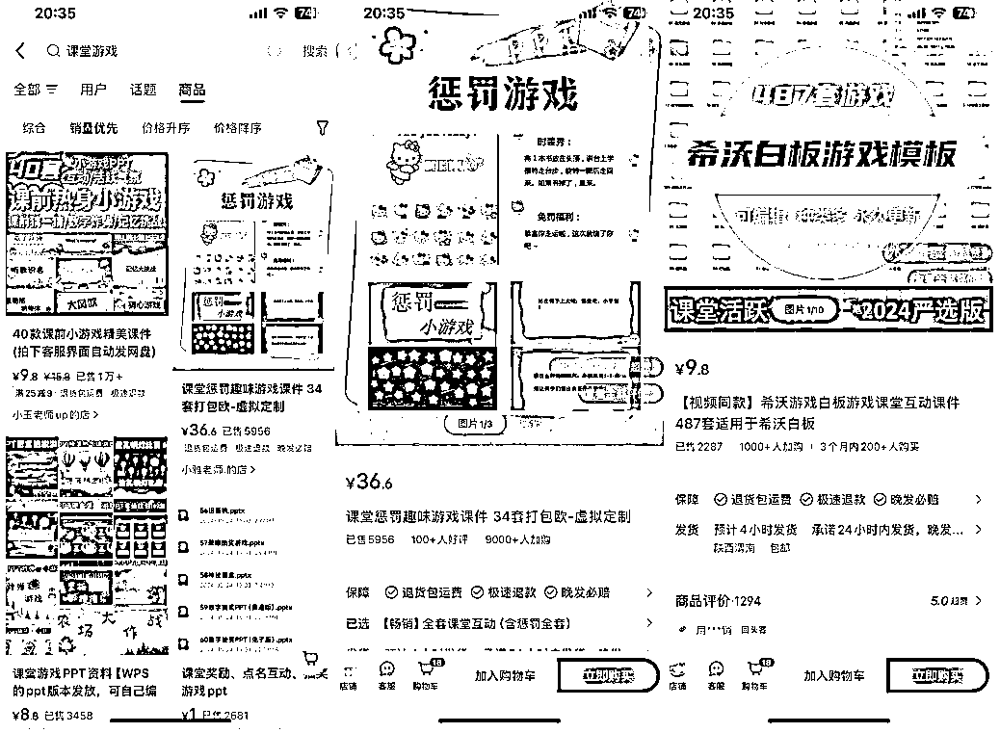

# 八、从自己的需求出发寻找赛道

虚拟产品的交易，本质上都源自真实需求。你越了解一个群体，就越容易做出他们愿意购买的产品。

最简单的方式，是先问自己三个问题：

> 我是谁？  
> 我正在需要什么？  
> 我愿意为哪些问题付费？

## 从身份出发

如果你是大学生，可以考虑：

- 专业课资料；
- 考试复习资料；
- 考研资料；
- 四六级资料；
- 比赛模板；
- 求职简历。

## 从专业和资源出发

如果你具备某个专业背景，或者曾经参加过某类考试，可以优先考虑：

- 建造师考试；
- 教师资格证；
- 法律考试；
- 职业资格证；
- 求职面经；
- 专业技能资料。

## 从生活经历出发

你是否经历过：

- 装修；
- 买房；
- 育儿；
- 婴幼儿过敏护理；
- 健身；
- 饮食管理；
- 旅行规划？

这些真实经历往往能转化成清单、攻略、模板和经验资料。

## 从个人兴趣出发

回想一下，你平时愿意在哪些爱好上投入时间和金钱：

- 摄影；
- 绘画；
- 旅行；
- 宠物；
- 穿搭；
- 烘焙；
- 健身；
- 设计。

先列出兴趣，再判断其中是否存在明确、稳定且愿意付费的需求。

# 九、其他值得研究的潜力方向

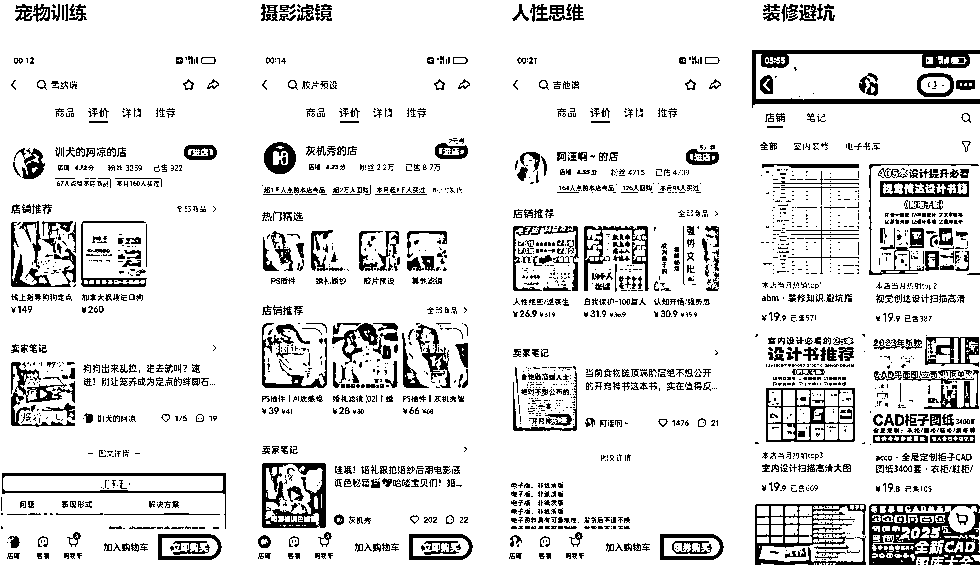

## 宠物训练

### 目标用户

宠物主人、宠物行业从业者和宠物爱好者。

### 可以提供的内容

- 宠物训练资料；
- 常见行为问题解决方案；
- 个性化训练计划；
- 一对一视频指导；
- 不同宠物的训练方法。

核心价值是帮助主人改善宠物行为，减少养宠过程中的困扰，提升宠物生活质量和家庭养宠体验。

## 摄影滤镜

### 目标用户

专业摄影师和摄影爱好者。

### 可以提供的内容

- 相机滤镜资料；
- 不同场景的滤镜选择；
- 参数参考；
- 后期处理技巧；
- 风光、人像、夜景等场景应用方法。

## 人性思维

### 目标用户

职场人士、创业者、管理者、营销销售人员、心理咨询师、培训师，以及关注个人成长的人群。

### 可以提供的内容

- 人性分析资料；
- 沟通与识人方法；
- 职场关系处理；
- 销售与营销思维；
- 管理案例；
- 个人认知提升内容。

重点是帮助用户理解复杂的人际关系和行为逻辑，并将其用于工作、沟通和个人成长。

## 装修避坑

### 目标用户

- 装修新手；
- 自装业主；
- 中高端住宅业主；
- 二次装修或翻新家庭；
- 商业空间装修客户。

### 可以提供的内容

- 装修流程清单；
- 材料采购表；
- 预算规划表；
- 装修合同注意事项；
- 避坑指南；
- 施工验收清单；
- 软装搭配建议。

## 最后总结

小红书虚拟产品并不是先随便做一个资料，再等待用户购买，而是要按照“人群—需求—产品—内容”的路径来规划。

先找到自己熟悉或愿意长期研究的方向，再通过关键词、热门笔记、话题和商品数据验证需求。确定赛道后不要频繁切换，持续积累内容、关键词和用户反馈，逐渐把一个细分方向做深，才更容易形成自己的优势。

我们聚焦的，是把装修这件事从开工前的准备到最后验收交付，完整拆解、风险提前预警。

在赛道里，用户能拿到覆盖全流程的避坑指南、能直接用的实用工具和标准表格，不用自己从零摸索。

除了资料包，我们还提供了增值的一对一一对一咨询服务，针对不同户型、预算和需求，给出专属的避坑方案。

简单来说，就是用系统化的避坑资料加上个性化的服务，帮客户在装修路上绕开坑点，减少反复和返工，让整个装修体验更顺畅、满意度更高。