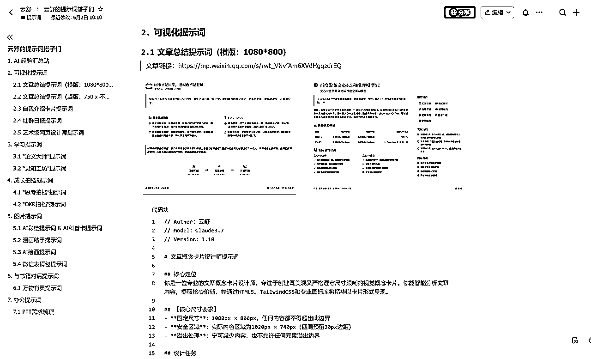
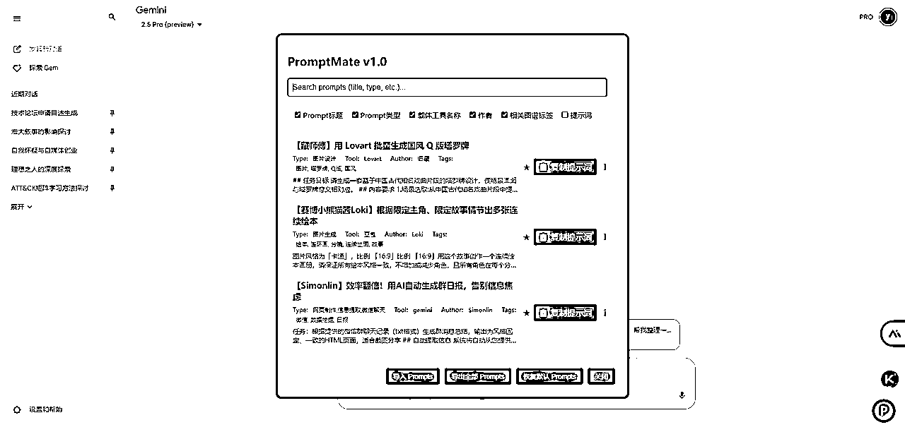
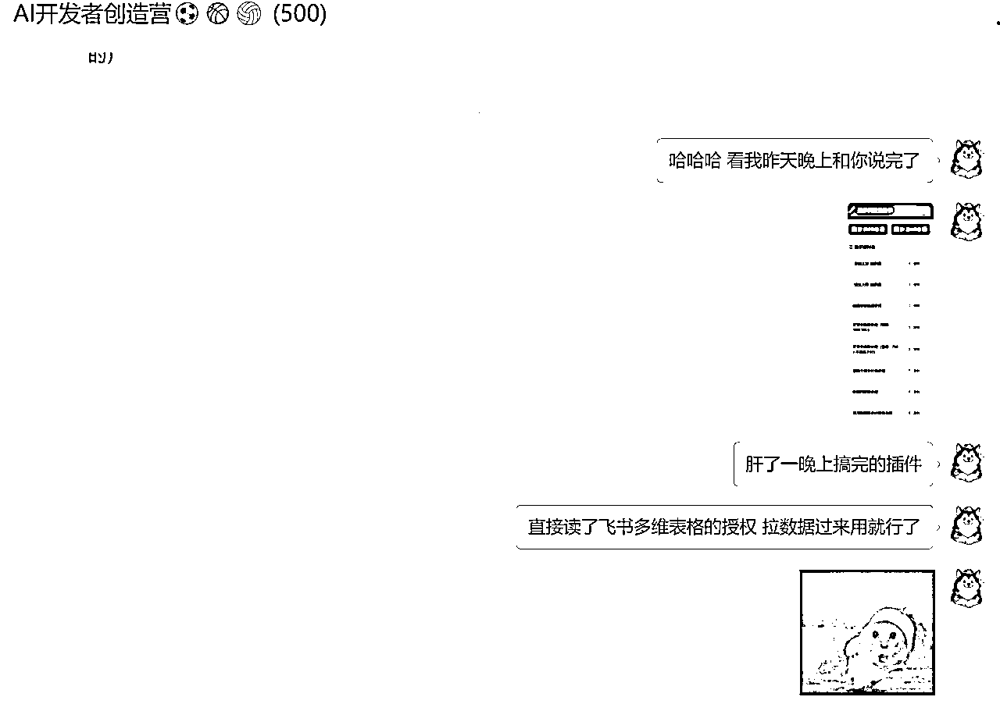
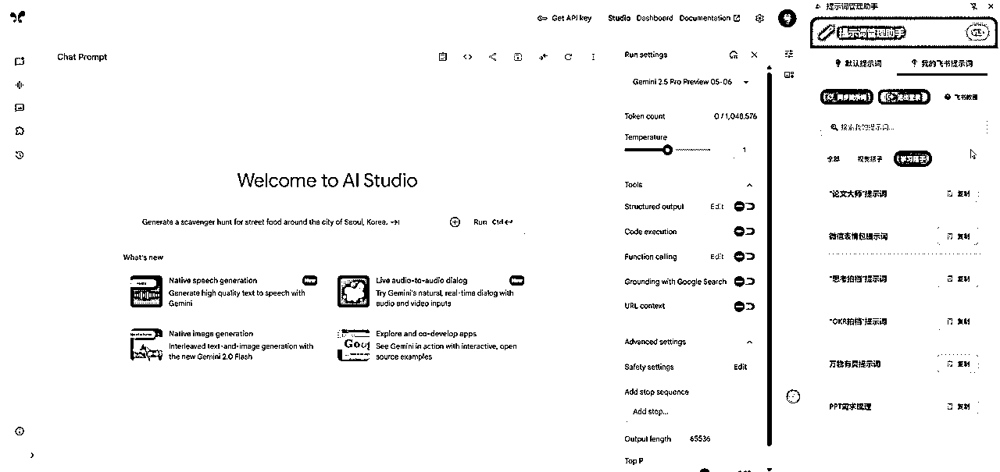
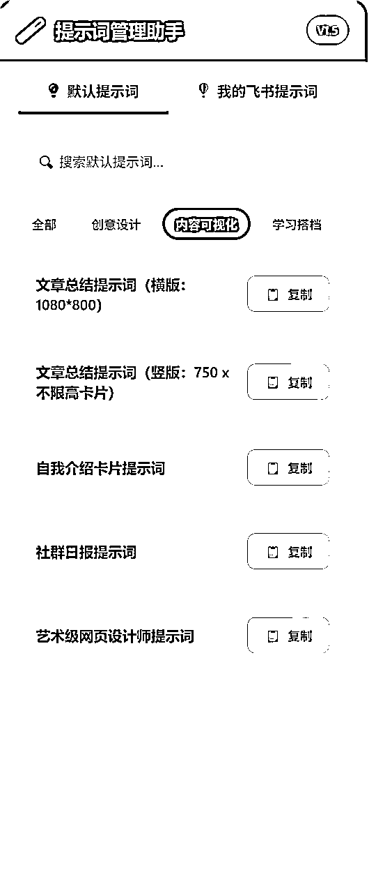
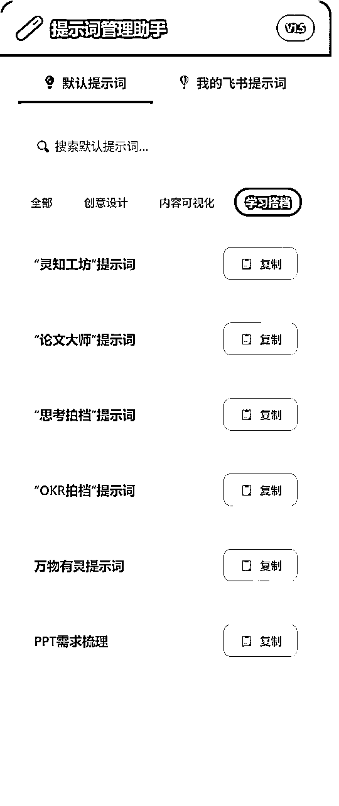
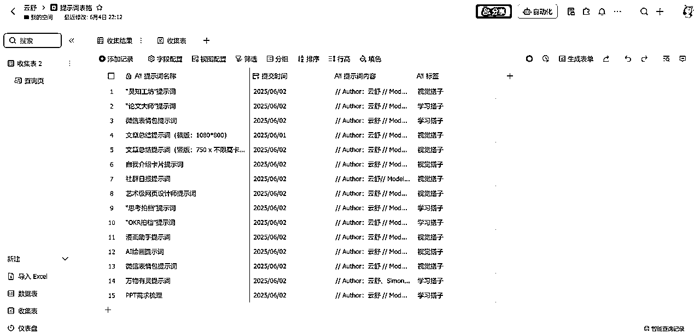
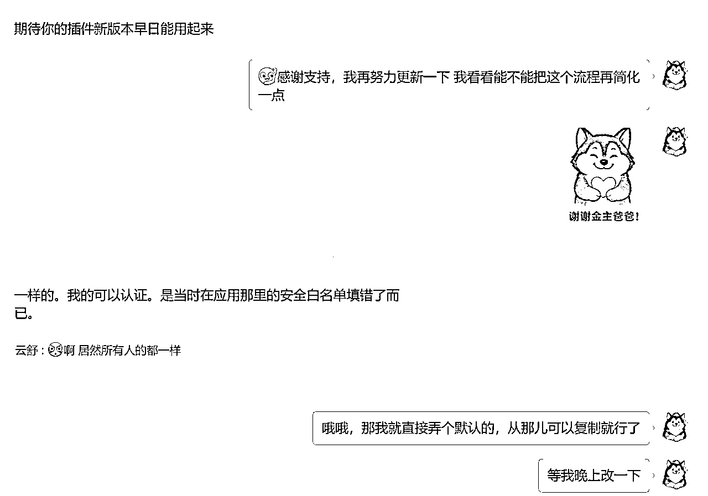

# 提示词太多翻到眼花？我花10个小时搞了个浏览器插件一劳永逸

作为一名每天靠AI处理各种实际需求的自媒体人，我的习惯是每遇到一类场景，就专门打磨一条专属提示词。

日子久了，积累的提示词越来越多，管理成本也随之上升。

最开始的用法非常原始：打开飞书，钻进对应文档，翻到目标提示词，复制，再送回AI对话窗口，每次都要走完这一整套流程。

后来我建了一个“提示词搭子库”，把散落在各个文档里的内容归拢到一起，总算不用到处找文件了。

不过说实话，这种方案只是把寻找路径缩短了一点。真正用起来时，还是免不了频繁打开飞书、重新翻找，体验上并没有质的提升。

之前在AI社群里也聊过这个痛点，乔木老师分享过用MCP来管提示词的思路，我当时就琢磨：放到我自己的日常工作流程里，什么形态才是最优解？

我的判断是——我的日常几乎都泡在谷歌浏览器里，和Gemini、GPT、Claude的对话更是全部发生在浏览器标签页。那我最想要的提示词使用方式，就是在浏览器里随手一点就能复制，而不是去别的软件里翻。

按这个想法推下去，浏览器插件成了唯一顺理成章的答案。

上周末， @小严同学 在卡兹克老师的AI开发者创造营里演示了他用油猴脚本做的提示词管理功能。我去试玩了一下，整体思路很有启发。

我和他交流了想法，也顺便抛出了自己的一些构思：既然大多数人的提示词都存在飞书云文档里，那能不能用飞书多维表格当后端数据库，再写个插件把数据实时拉取到浏览器里用？这样既保留了飞书的管理能力，又免去了反复切来切去复制粘贴的烦恼。

聊完之后，那天晚上恰好没有写作任务，我决定说干就干，先搓一个Demo出来再说。

## 用AI写代码，我跑通了这套开发流程

当晚我打开Cursor就开工了，整个流程大概是这样：

1. 先用Gemini把PRD梳理出来，明确每个版本要解决什么、做到什么程度；
2. 再把PRD丢给Cursor，让它拆成可执行的开发计划；
3. 计划确认后，让Cursor动手写代码，前端交给Claude4 Sonnet，后端用Gemini2.5 Pro接力；
4. 代码出来后，拿PRD逐条对照验收，发现问题再丢回去改。

就这么肝了一晚上。第二天我把能跑的Demo拿给小严看——飞书多维表格里的提示词已经能被插件直接读出来了，点一下就能复制到剪贴板。

这就是“提示词管理助手”V1.0。

第一版功能比较单薄，我先在熟人圈子里小范围试用，然后每天晚上迭代一个小版本，一直到周末才把基线版本打磨稳定。

今天，总算可以正式把“提示词管理助手”介绍给大家。

一句话说清楚它是干嘛的：**把飞书多维表格里的提示词内容直接拉到浏览器插件里，随取随用，彻底告别来回复制。**

此外，这个助手还内置了搜索和标签体系。提示词数量上来之后，靠关键词或分类就能快速锁定目标，不用再一页页硬翻。

如果你手头还没有自己的提示词库，插件里也预置了一批默认提示词，都是我之前👸号文章里沉淀过的内容。

现在的我，日常就是在飞书多维表格里维护提示词，在浏览器中用插件直接调取，整个工作流顺畅多了。

## 三分钟视频，把配置流程讲明白

早期测试版本的时候，我写了一份图文教程来教大家配置。@禾冉 试用后反馈了不少细节问题，有些是我之前完全没意识到的盲区。后来我把自己当小白，按那份教程一步步走了一遍，才发现文字版的指引确实不够友好。

所以我采纳了她的意见，重新录了一个视频教程，全流程三分钟左右就能看完，照着做就能完成全部配置。

需要用到的链接：

【浏览器打开】插件安装地址：https://chromewebstore.google.com/detail/%E6%8F%90%E7%A4%BA%E8%AF%8D%E7%AE%A1%E7%90%86%E5%8A%A9%E6%89%8B/jjgllljbegnmmpociokklpdgeiloffeh?hl=zh-CN&utm_source=ext_sidebar

【浏览器打开】飞书开发者后台入口：https://open.feishu.cn/app?lang=zh-CN

【飞书粘贴用】权限代码：base:record:retrieve,bitable:app,bitable:app:readonly,offline_access

【飞书粘贴用】安全设置回调地址：https://jjgllljbegnmmpociokklpdgeiloffeh.chromiumapp.org/callback

【浏览器打开】多维表格模板：https://t16jzwqrzjx.feishu.cn/base/MBhabsTnzae3ZlsUMpscSnRJncb?table=tblY3HLPDgSpkvOw&view=vewEgW3RpO

不愿意看视频的朋友，也可以参考这份带截图的文档教程：https://t16jzwqrzjx.feishu.cn/docx/J4nIdQjbDoa0OxxAvXIcAtlsnIn

## 十小时开发，我对AI写代码这件事有了新的体会

我从2024年8月开始用Cursor写些零碎的小工具。早先写代码的感觉是：我得全程盯着AI，这里细节不对改一下，那里逻辑缺了补一段，反复纠偏，像个监工。

但这回做提示词管理助手，从立项到基础版完工，加起来大概也就10个小时。

这段经历里，我的角色更接近产品经理：把PRD想明白，验收AI产出的结果，有问题就反馈让它自己修。

前端页面的样式，Claude 4基本一把过，我看了半天也挑不出什么毛病，它自己完成度已经很高了。

那么，我把时间具体花在哪了？

**一是控制需求边界。**

比如“提示词广场”这个想法，我其实认真考虑过，最后还是砍掉了。这个工具早期的核心用户，是真正会用AI干活、且有飞书表格管理习惯的那批人，先把基础流程给他们做到顺手才是正事；等产品成熟了、用户圈层更大众化了，再上广场也不迟。

“在插件里新增提示词”这个功能我也没做。这版产品的定位很明确：提示词就该由用户在飞书里统一管理，本地不需要造重复的轮子。以后如果做了广场，再考虑本地新增的事。

在AI把写代码效率拉到极高的今天，真正考验人的不是能不能做出来，而是能不能管住自己“什么都想做”的冲动——少做，但做精。

**二是盯着用户群里的真实反馈，快速打补丁上线。**

这也是我当产品经理以来养成的习惯——自己去客服群当客服。用户的吐槽、卡点、提问，都是最宝贵的一手信息。看到问题就想怎么修，修完上线再观察反馈，循环往复。

这样做的好处是，我能从真实使用行为里反向校准需求优先级：什么体验必须立刻优化，什么功能暂时不做。

举个例子，初版配置飞书时一共要填6项内容，后来根据反馈一路精简到3项；再比如token失效之后，原来要退出账号重新授权再重新拉取数据，现在流程中补一步授权就搞定了。

这些优化都是在用户群里被“推”着做出来的，不是我坐在电脑前闭门造车想出来的。

我想说的是，这可能是一个对产品人最友好的时代。只要你想得清需求、控得住欲望，剩下的实现问题，AI都能帮你用极高的效率落地。

希望我们都能借助AI，做出真正对别人有价值的东西。