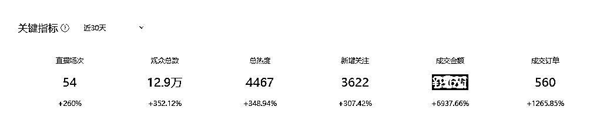

# 从0到日入千元只用12天，我的高报航海实战复盘

# 一、我是怎么来的

大家好，我是夏彬。

线下实体生意做久了，我一直把自己定位成一个闲散资源再分配的人。盘活社会上被浪费的能力和人脉，这件事既是我的副业，也是我最上头的事。

现在我跟着 Lemon 老师的团队在做高考志愿填报直播的获客项目。认识我的人都知道，我手上试过的互联网项目不算少，大多都是没能坚持到底。这次不一样，高报对我来说像是一个有福报的方向，既能把事情做起来，也能真正帮到家长和孩子。我自己当年就是志愿填报踩过坑的过来人，很想用这份经历帮别人避坑。

## 1.1 过去的履历

毕业后我换过好几个身份，销售、国企、自己创业开实体店、开公司，经历算丰富。能拿到的结果也不少，比如：

1. 全国演唱会门票、各类运动赛事门票、明星路演资源对接；
2. 生物制剂、血液制品、单抗类产品；
3. 三甲医院知名专家陪诊、代问诊、加号、床位、手术安排，无创DNA、基因检测、亲子鉴定，海外就医、第三代辅助生殖对接；
4. 全国除甲醛项目分润合作，有资源的朋友可以聊；
5. 快手直播切片授权，感兴趣可以去我之前的帖子看看：https://scys.com/personal/184251242155122?number=61277

还有不少不方便公开的项目，有需要的伙伴可以私下找我。

## 1.2 这次的节点

下面这张表，是我从第一次开播到起号、变现、到日入过千的全过程，数据直接来自视频号助手：

| 时间 | 关键动作 | 补充说明 |
| 4月13号 | 测试账号开播 | 就播了几分钟，第一次摸直播 |
| 4月14号 | 第一次正式直播 | 播了6小时，主要是累时长 |
| 4月18号 | 账号起号 | 场观稳定到4000+，通常一小时破千就算起号 |
| 4月21号 | 第一次带货 | 卖的是一款9元的小课包，佣金25/单，当天出了9单，收入225元 |
| 4月25号 | 日入破千 | 当天开了3场，每场约1.5小时，总收入1100+，小目标达成 |

按赚钱圈的标准收入不算高，但0到1的闭环确实跑通了。项目已经做了超过一个月，保守估计月收入在3万以上，作为一个项目小白，我已经很满足了。

继续上个图：

秀完数据就进入正题了，我想从三个角度来复盘：

1、怎么选航海
2、航海怎么实操
3、航海的心得

结合高报航海的经历，和大家聊聊在航海里要盯住哪些点，才能拿到结果。

* * *

# 二、复盘

## 2.1 怎么选航海

在赚钱圈子里经常听到涛哥说的那句话：做不消耗自己的事。这次做高考志愿填报，我才真正体会到了。

很多人选航海喜欢追热度、追正反馈快。我以前也是这样，什么火就上什么。确实不少项目赚到了第一笔钱，但最后都死在了持续投入上。

真正能坚持下来的差异点，其实是能量消耗度。项目越适配你，耗能越少，活得越久。

我是典型的 ENTP，表达欲强，喜欢高频互动和即时反馈。直播间那种问答、输出、临场应变的节奏，反而让我很兴奋。别人觉得一天播3小时是折磨，我觉得是充电。

反观我之前做的虚拟资料项目，每天就是选品、上下架、重复话术。执行要求高，但认知参与度低，很快就把我耗空了。相当于让一个擅长战略的将军去站岗，长期下来只会内耗。

所以选航海的核心不是看赛道多火，而是看能不能把你的天赋和热情变成持续的生产力。找到那个越做越有劲的点，才是长期穿越的关键。

## 2.2 航海怎么落地

很多人0到1时会卡在“我这样做对吗，要不要再多学点”。但在赚钱航海里，有结果的老玩家都清楚，航海手册已经把路径拆到毛细血管了。从引流到变现，每一个节点都是反复迭代后的标准动作。

新人的瓶颈从来不是方法论，而是能不能把自己调成执行模式。就像一艘核潜艇的声呐，得能精准接收教练发出的指令。

我印象最深的是航海第一周。直播间经常零观众，或者就一两个在线的，6小时自嗨式开播，像在信息孤岛上求生。场观卡在100左右不动时，那种迷茫感真的能劝退大部分人。

但只要做到「简单、听话、照做」六个字，局面会慢慢打开。把直播时长严格卡在6小时，把教练给的互动话术逐字复现，冷启动的冰会自己裂开。

真的很感谢教练团队那种耐心到位的陪跑，让我们在茫茫大海里一直有灯塔。

航海里有不少伙伴就是靠「话术肌肉记忆」的重复训练，从一天80场观一路冲到3000、4000的精准流量。这也印证了航海设计的底层逻辑：反人性的重复其实是蓄能，等势能够了，所有之前的坚持都会集中爆发。

我的建议是：把自己当成海图上的一个点，跟着系统洋流走。在赚钱这片星海里，「简单听话照做」不是保守，是最猛的破冰方式。

## 3.3 航海感悟

等基础的执行到位后，胜负手就落在了细节上。

教练反复提醒我们，直播的成败看三件事：画面质感、情绪张力、内容价值。我现在开播前3分钟会做一次全盘检查，设备、灯光、背景、话术板，全部过一遍。细节看似小，但往往决定这场能不能打响。

还有一点我最近才意识到：复盘一定要写下来。好经验如果只放在脑子里，会随着一场场直播被稀释掉。文字复盘才能沉淀。

我们这一期也有队友连续三天6小时直播零产出。复盘发现两个致命失误：账号定位被误设为美妆赛道，而我们是知识讲解类；直播推荐范围设成了全国，而高报的内容必须按省份投放，标签打不准直接影响起量。

最后感谢读到这里的每一位朋友。感谢龙哥盟，感谢高报航海全部教练团队，感谢 Lemon 老师。

现在正好是6月航海报名期，强烈建议大家多尝试几条航线，在实战里找到最适合自己的那条。

祝所有圈友都在赚钱找到方向，龙哥盟，八方来财~