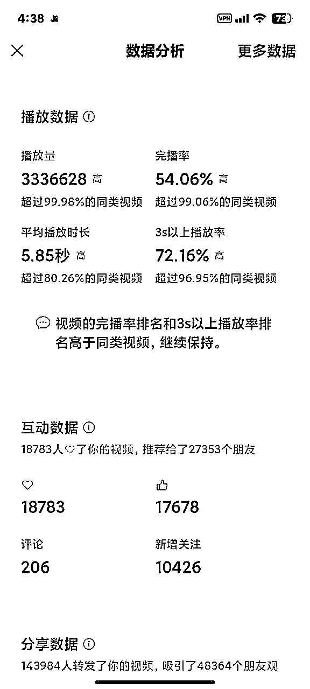
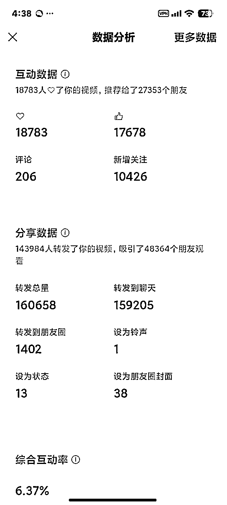

# 视频号直播：从剪辑小白到百万爆款之路！

应宝芙邀请，我来聊聊三月视频号直播航海这趟旅程的收获。先简单介绍一下自己：我是凯西，龙哥盟第三年老会员，做过五年私域社群运营，教培、大健康、知识付费都干过；之前靠单次航海赚回过一张赚钱门票；目前正在探索长期可持续的自由职业。

这次航海的成绩，说实话我自己都有点意外。作为剪辑零基础的小白，我在航海期间坚持日更，硬是剪出一条百万播放的爆款视频，账号涨粉一万多。

这一路踩坑不断、反复重塑，但也攒下不少实实在在的经验，下面掏心窝子分享给大家。

一、态度摆不正，再好的项目也白搭

总有人问：参加航海到底什么最重要？我的回答始终是——态度。只有全力以赴，才有可能拿到结果。

以前我也参加过好几期航海，📕商单、📕店铺、爆文写作、闲鱼虚拟商品、高客单都报过名。结果呢？除了闲鱼那个赚回了门票钱，其他基本都在“陪跑”。看看我当时的打卡记录，你就知道原因了——自己都没当回事，结果自然不搭理你。

这次三月航海，正赶上我职业空窗期，同时报了俩实战项目，心里暗暗较劲：一定要认真对待。具体怎么做？群消息直接置顶，直播场场不落，遇到卡点就大胆举手提问。记住一条：你遇到的问题，别人大概率也会遇到；你开口问了，不光是帮自己，也是帮整个圈友。

二、新手选赛道，别怕“红海”，就怕想东想西

态度好比船桨，赛道就是航向。方向不对，越使劲越跑偏。

新手很容易犯一个毛病：这山望着那山高，总想挑战最难最牛的项目，结果还没起步就耗光了力气。我吃过这个亏，后来果断收心，从手册推荐、自己也感兴趣的赛道里挑了一个，直接开干。教练有句话我特别认同：新手就应该去“红海”。竞争再大，也不差咱这些“小喽啰”混口汤喝。反倒是在红海里，用户基数大，正反馈来得快，更容易坚持下去。

以视频号直播为例，流量红利还在，变现路径清晰，只要你在细分场景里找到自己的差异化切口——比如垂类选品、人设深耕，照样能挖到属于自己的增长机会。

三、选对标、抓“异常值”，视频号有自己的“脾气”

想让内容脱颖而出，必须两手抓：一是选对标，二是抓“异常值”。

其他平台的爆款可以学、可以复刻，但最关键的还是要多刷视频号本身。每个平台的调性不一样，用户偏好也有差异，所以选对标一定要盯紧自己准备深耕的平台。

手册里推荐的目标人群是50+的中老年人，一开始我也犯嘀咕：难道年轻人不能买吗？后来事实告诉我，确实不太行。视频号的主力人群就是二三线、偏中老年用户。既然要吃这碗饭，就得尊重平台的用户画像。

具体到我自己：我选了绿植赛道。一开始我天天去快手、抖音找爆款，结果发现那些视频全是真人出镜实拍，我一个剪辑小白压根没法模仿，找素材找到崩溃。数字人的流量也惨不忍睹。

后来我一边继续发从其他平台复刻的视频，一边坚持刷视频号，天天搜绿植关键词。终于让我逮到一个“异常值”——那种字特别大、背景音乐是鸟语花香的视频，制作简单得不能再简单，但数据却好得出奇。那一刻，真的像打开了新世界的大门。

你们看看这种视频有多简单：几个字，加一个字体特效，配一首背景音乐，完事儿。

我就照着这个模式去复制、去更新，陆续跑出两个爆款：一个播放量十万多，另一个在航海期间冲到一百万，现在都快三百四十万了！账号顺势涨粉一万多，视频带货也卖了33单。

四、写在最后

说起来好像轻轻松松，但实际摸索的过程，真的挺熬人的。毕竟咱也没法预测复刻的爆款到底会不会爆。可无论最终的航海结果怎么样，本事是铁定涨了。我现在剪视频特别快，什么蒙版、定格、转场、特效、九宫格，统统拿下。

放心去做吧，总会有所收获的。剪辑这门手艺，不会辜负你。

祝所有看到这篇帖子的朋友，爆单旗开得胜！