# 从航海手记到模板实战：一次出海建站与 Flux-Kontext 跨境支付模板的沉淀

> 来源：[https://iqa21iualv.feishu.cn/docx/XJa4db2cjo8POTxtQKqcmfCdnWd](https://iqa21iualv.feishu.cn/docx/XJa4db2cjo8POTxtQKqcmfCdnWd)

出海做站这条路，每个人都会撞上几座看似过不去的高山。我这次的经历，也从一条单页小游戏站开始，经历了接入 GSC、Google 登录、AdSense 审核，再到尝试 AI 站，最后转型做导航聚合，最终在@良辰美 大佬分享的 FLUX KONTEXT 模板，以及@林悦己 大佬整理的 Creem 支付配置思路里找到了突破口。

教练这回丢来了一个自带支付闭环的开源模板，我立刻拿来拆解复现。跟着这个模板走，能得到三重收益：

用现成的架构快速搭出 MVP，不用在选型和底层设计上浪费太多时间；读源码就能get到 AI SaaS 在权限、计费、变现上的成熟做法；再对照航海手册做路线规划，试错成本会明显下降。

下面先把三月的航海过程盘一下，再进入模板本地跑通的实操细节。

## 三月航海回顾与踩坑实录

三月 Web 出海航海，我的起点是一个单页游戏站。GSC、GC 接好，AdSense 也递交了申请，顺势转做 AI 站。

当时心态太急，想快点看到结果，没太重视社群里的经验沉淀。

AI 站的核心很快上线了，ChatGPT API 和 Gemini API 都集成了，但一到要收钱就卡住了：

* Stripe 和 Lemon Squeezy 的准入门槛太高，注册流程走不下来
* 团队里有人提过 Creem 这个方案，我当时没抓住

最后只能把方向调整成导航站：https://generateghibli.org/en

这次折腾给我留下三点印象：

1. 心态要开放，多用社群力量，及时求助
2. 开发不是一蹴而就，需要规划 + 持续迭代
3. 失败要复盘，把坑变成经验

正是这次教训，让我特别珍惜 @良辰美 教练开源的 https://scys.com/articleDetail/xq_topic/1524141251441252 模板。整个模板基本涵盖了一个 AI SaaS 的底座：

多语言支持、登录鉴权、权限管理、积分体系、支付安全、适配多家支付渠道、AI 生成核心模块等

把它的设计思路吃透，再结合航海手册的推进节奏，后续做 AI 站会稳很多。

直接从零搭 AI SaaS 太耗时间，支付、账号体系这些坑，模板已经帮你填好。可以避免重复踩在用户系统、计费逻辑和 AI 调用层上的老坑，这也是我之前遇到的典型问题。

模板的价值不只是代码框架，更在于它体现了一套完整的商业逻辑：从用户体验到变现路径，都有系统性的思考。

接下来就把我把项目跑起来的过程分享出来。

# 项目实战：把模板跑起来

## 1、拉取项目

先从 GitHub 把仓库克隆到本地，终端执行：

```
git clone 
```

## 2、熟悉目录、装依赖

用编辑器打开后，第一件事是看 README 了解整体。项目里有 docs 目录，里面是学习笔记和配置说明。

看完我发现一个细节：文档写的是用 bun 管理依赖，但仓库里却躺着 package-lock.json，明显是 npm 和 bun 混用了。为了保持统一，我按文档建议保留 bun，把 package-lock.json 删掉，然后执行：

```
npm i -g bun #如果没有安装bun，第一步先全局安装一下

#安装依赖
bun i
```

执行完后会生成 bun.lock，环境就统一了。

## 3、配置本地环境变量

我基本是照着示例链接一条条去申请。相关配置包括：

Superbase 相关凭证获取页

1、
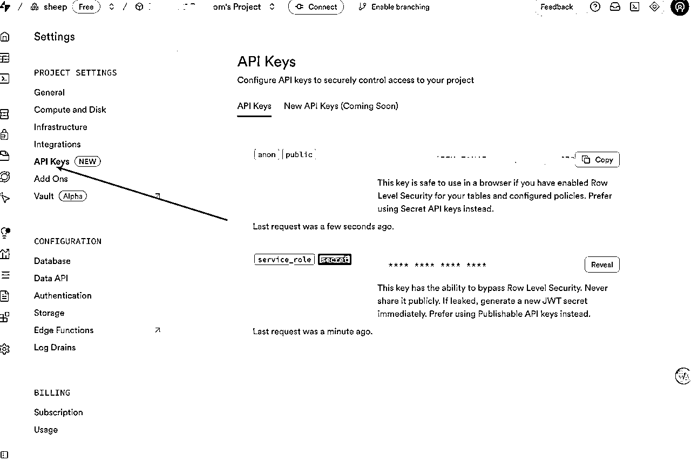

2、
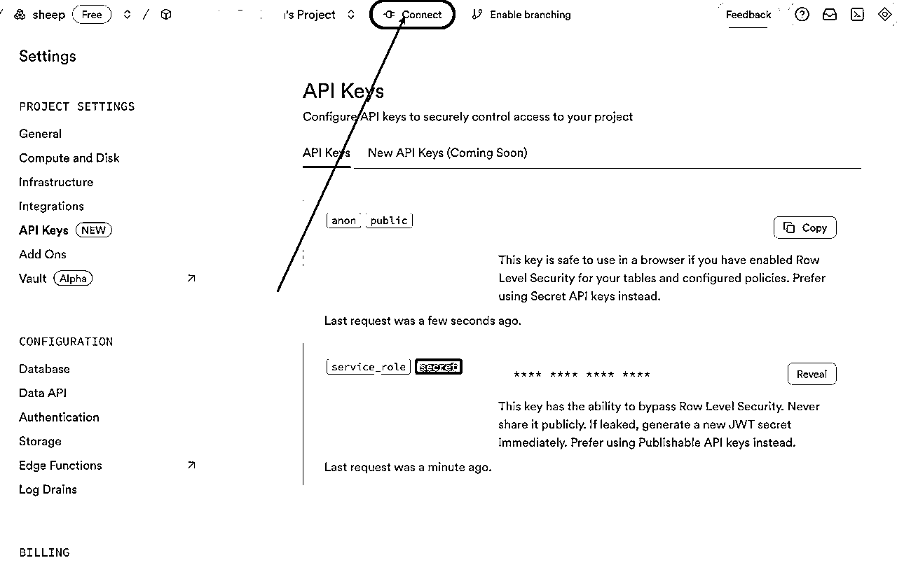

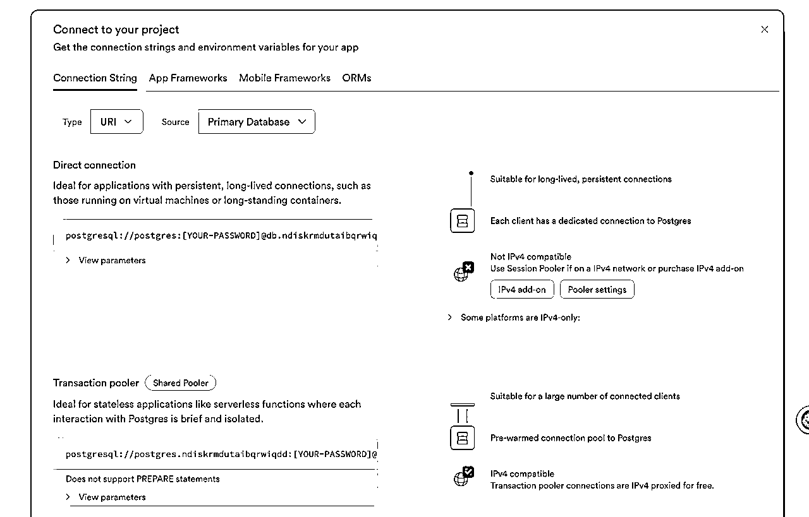

2、Google OAuth

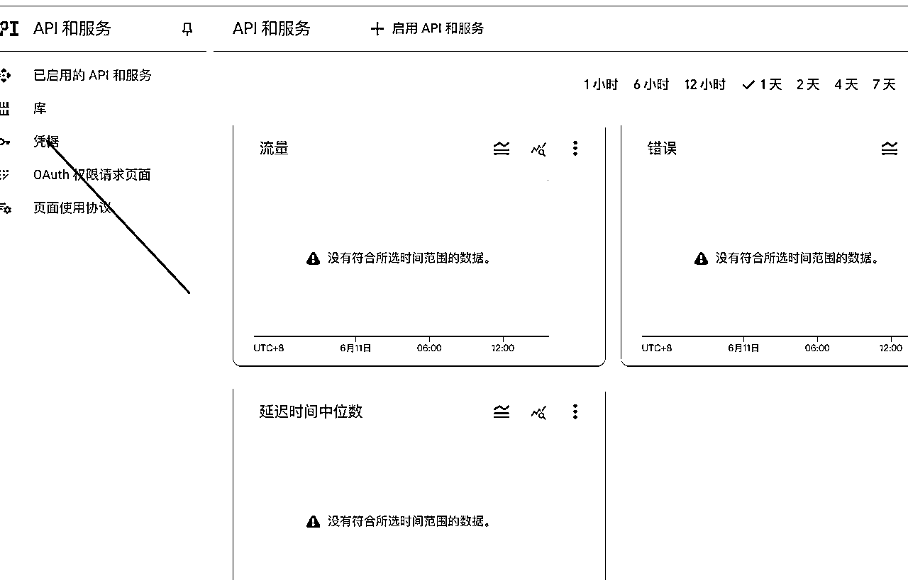

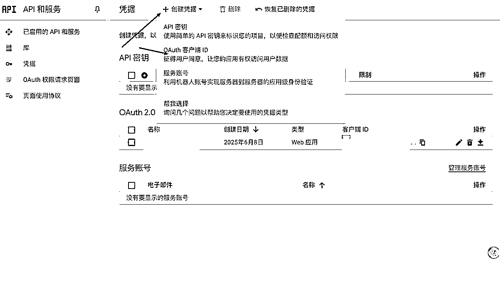

第一个应用类型选 Web 应用，其他字段按自己项目信息填，我是让 AI 帮我生成对应的回调信息

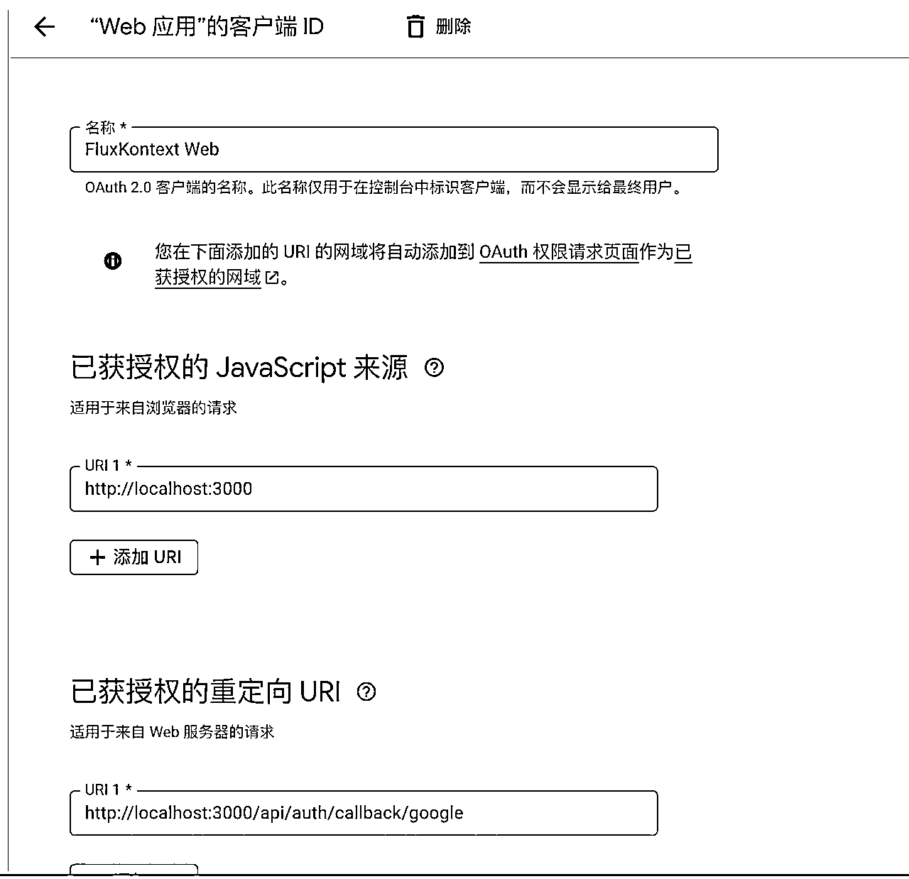

### Cloudflare R2

R2 第一步要先绑定支付账户，这点很多人会卡住。第二个坑是 API Token 在哪，我找了很久才发现藏在 API 按钮下面，点“管理 API 令牌”就能看到

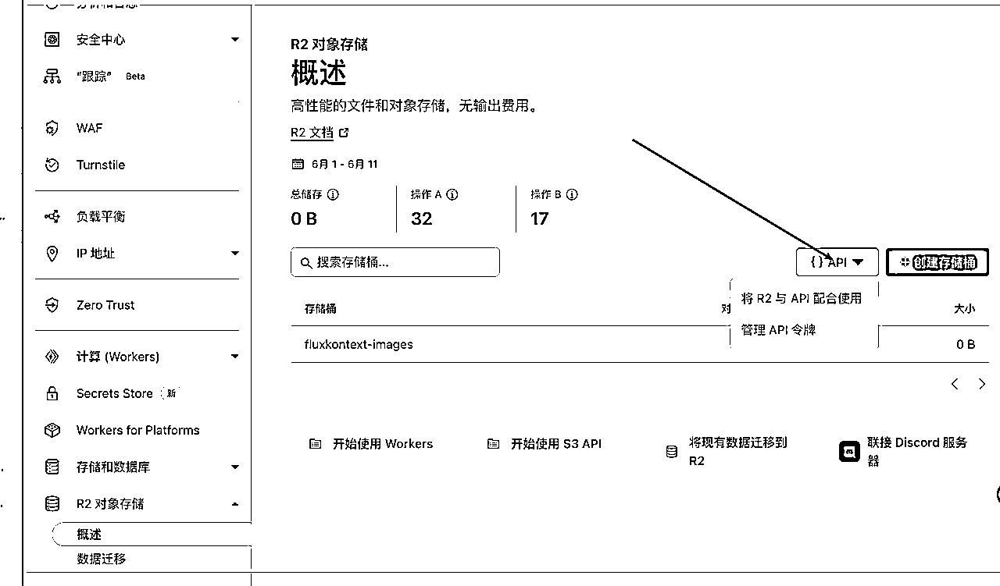

### Turnstile 人机验证

也在 Cloudflare 上配，根据本地域名填写

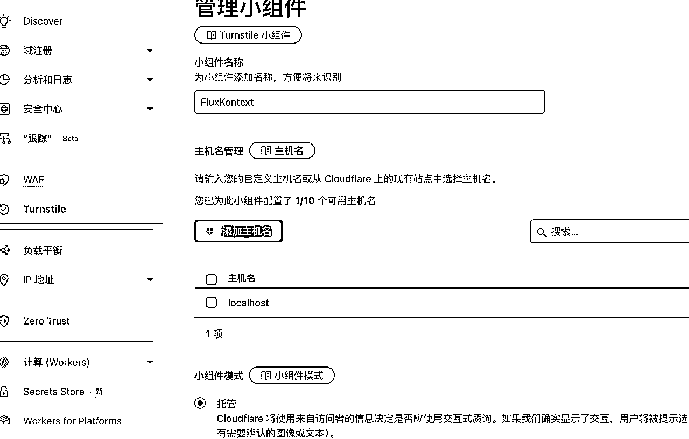

### Creem 支付测试环境

我的 Creem 账号当时还没开通收款，仅做本地测试。我主要参考了 @Cheer林悦己 大佬的教程 https://scys.com/articleDetail/xq_topic/8852488525882522，以及官方文档和 API 说明。

测试环境的 API 地址是 https://test-api.creem.io

在 Creem 后台先打开 Test mode，然后在测试模式下创建几个商品

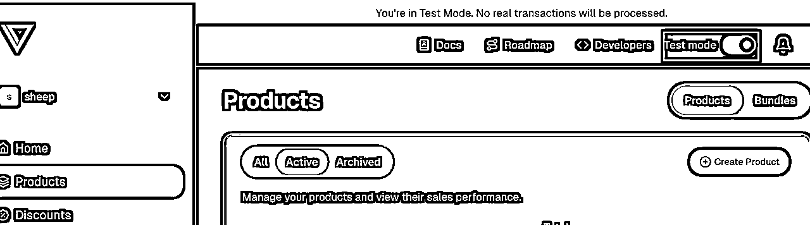

点开测试模式旁边的 Developers，就能看到 apikeys 和 webhooks，API Key 直接复制

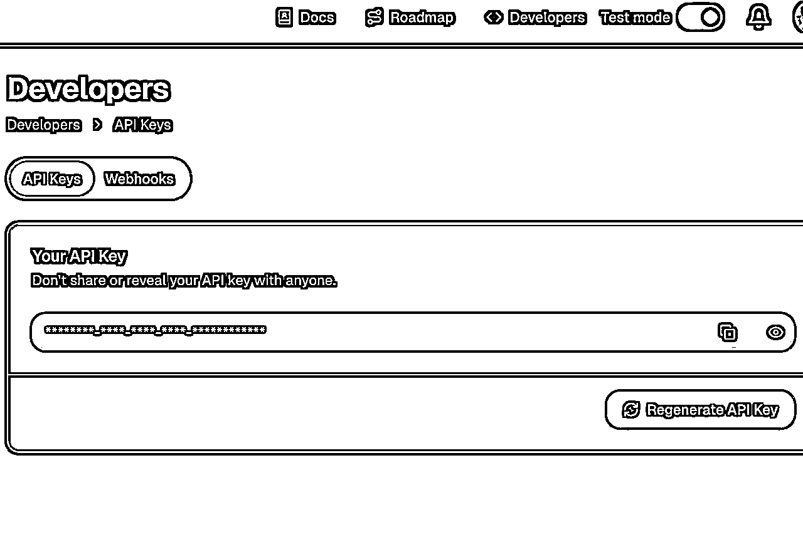

Webhook 需要手动创建，创建后按图示填写

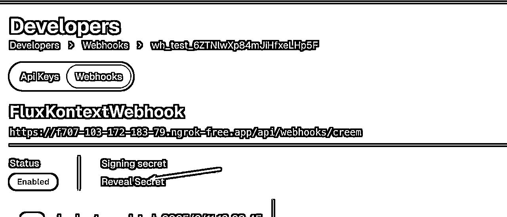

配置完成后记得在项目里关闭 Stripe，启用 Creem。基本就齐了。

## 4、Creem 调试时遇到的坑

一开始没细看文档，直接用生产环境的 api-url 去测支付，结果立刻报 product not found。排查后发现是链接配置错了。

改过来后又出现产品 ID 不一致的问题，项目里写的 ID 和 Creem 平台上的 ID 对不上。试着让 AI 改代码也没解决。

后来我在 Creem 官网自己测了一遍，确认 API Key 是通的。最后是严格对照官方说明和 API 文档重新梳理参数，才把测试支付跑通。代码后续还需要再加固稳定性。

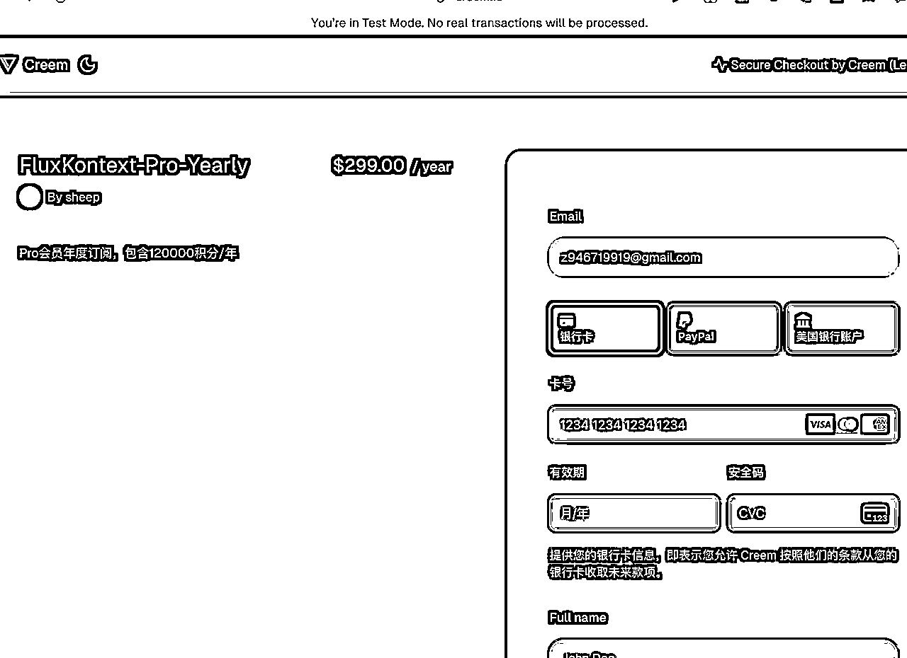

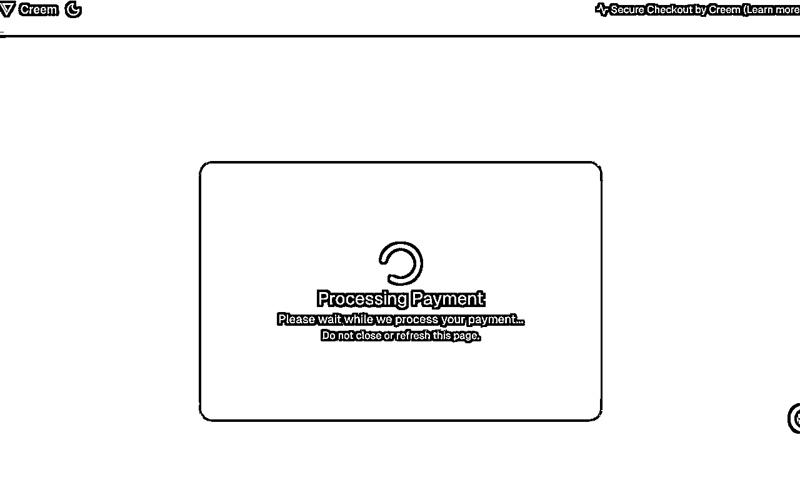

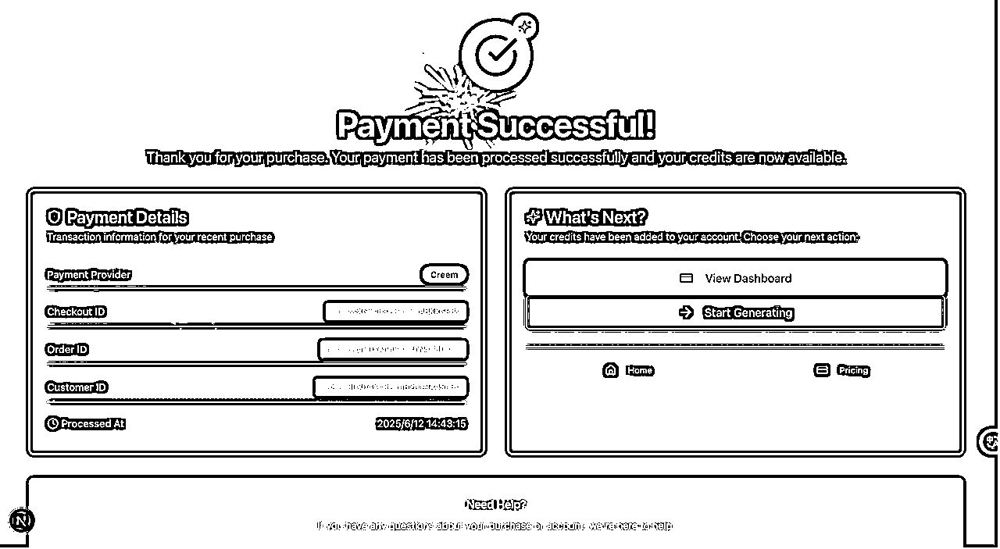

到这一步，核心流程就通了。Google 登录、GitHub 登录、AI 生图等功能，只要把各自的密钥补齐就能直接体验。

## 总结与展望

这次航海回顾 + 模板实操，最大的感受是：

* 成熟开源模板能提供完整的 AI SaaS 底座，省去重复造轮子
* 实践能帮你避开支付、鉴权等关键环节的常见坑，加快 MVP 上线
* 社群协作意识很重要，多问多借鉴能少走很多弯路

目前项目还没产生实际收入，但通过这次沉淀，我对 AI 站的搭建逻辑和出海变现路径有了更清晰的认知。接下来会继续保持开放学习的心态，把经验不断复盘，让项目稳步推进。