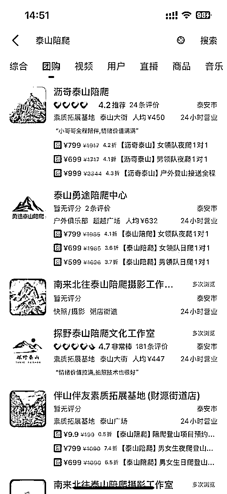
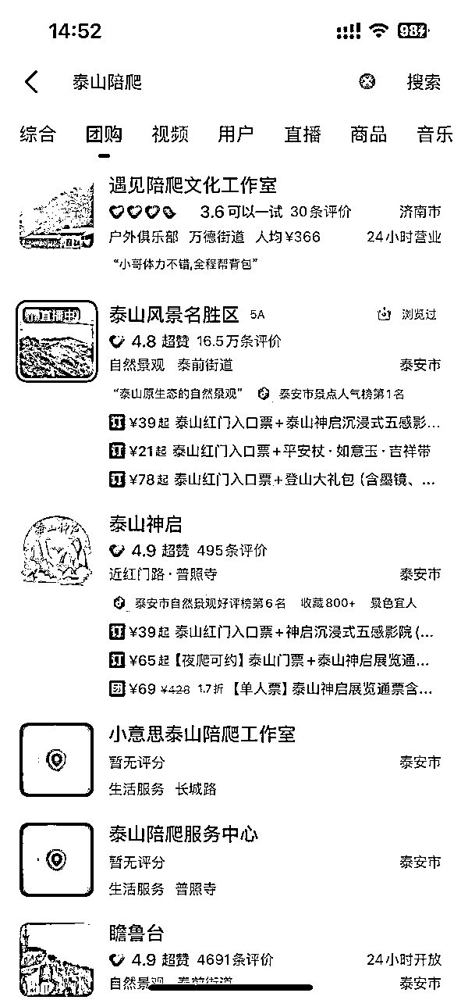

# 靠山吃山：泰山陪爬生意，日均一单净赚两三百

> 来源：[https://gjlkutbtjk.feishu.cn/docx/XOfrdgGlvoLb9cxNx6wcRfJzn5f](https://gjlkutbtjk.feishu.cn/docx/XOfrdgGlvoLb9cxNx6wcRfJzn5f)

## 总览

最近团队在泰山试水“陪爬”项目，真正体会到“靠山吃山，靠水吃水”的味道。整个生意跑通的底层，是陪伴经济的持续升温。大众尤其是付费能力强的人群，越来越愿意为省事省心买单。把时间、外包给专业的陪伴者，成了新的刚需。

这个打法可以复制，只要锚定一个有特色的旅游城市，就能做成轻资产的现金流。

有意思的是，团队里的人并不算颜值担当，却靠着过硬的服务设计和运营思路，在几乎零投放的情况下做到了稳定出单，最高也拿下过“三天陪玩三千块”的大单。

下面把从起步到落地的全套思路拆开讲。

* * *

项目是怎么起的：从灵感到切入点

“生财有术”社区里，跑马拉松陪跑单笔收几千的案例已经不少。核心就一句：有钱人愿意为情绪价值和省时买单。

赚钱难的时候，就去赚有钱人的钱，别盯着没钱人的几块十块。

正好女友是泰安本地人，手里有导游证，打算回家乡创业。于是我们把目光锁定在“泰山陪爬”上。选泰山有四层考量：

1. 符号红利：五岳之首，年客流超500万，5到10月旺季每天上山的人上万；
2. 痛点明确：夜爬看日出、路线选择、体力与安全焦虑，本地人带路价值高；
3. 竞争稀松：本地只有三五家小工作室，服务雷同，没人做品牌；
4. 隐性需求：男性想要女向导陪爬，女性想要男向导护航。赏心悦目，体验感拉满。

* * *

### 实地摸底：换身份打探信息差

第一步：扮顾客套信息

* 建小号加各家客服，问“白天爬和夜爬哪个划算”“女生陪爬能不能保证安全”这类问题；
* 把对方发来的装备清单、路线图、报价表全部存档，日爬400-600元/人，夜爬普遍加100元左右，整理成内部标准；
* 最关键的发现：客人更在乎“有人全程跟着”，而不是讲解有多专业。所以人设要偏向“暖心陪伴”，别硬拗专家；
* 把话术整理成模板，后面跟客户沟通直接套用。

第二步：扮求职者偷师

* 伪造简历去应聘陪爬员，摸清内部流程：
* 门槛不高：无学历限制，会走路线、体力过关就行；
* 面授内容：怎么聊客户、怎么拍手机摄影；
* 分成规则：平台抽成50%，爬一次到手300-400元；
* 结论：用人成本可控，旺季可以大量招本科兼职。泰山脚下高校集中，招人相对容易；
* 后期兼职的分成就按五五，后续如果提供接送、订房等增值，自己把这部分利润留下来。

* * *

### 真正落地：资质与流量的打法

1. 合规绕弯：营业执照怎么跑通

* 难点：抖音团购要求素质拓展类目必须绑定实体场地，陪爬算虚拟服务，通不过；
* 实操中换了好几个地址都失败，最后找抖音销售经理协助提交才过审。地址和执照是否匹配，本质上看能不能说服人；
* 最终找人代办营业执照，1200元搞定，主体写成“个性化旅行解决方案”。这个代办本身也可以成为一个变现点。

2. 平台运营：怎么引流

* 抖音：内容要擦边但不违规
* 发“夜爬避坑”“泰山日出延时”等干货，弱化广告感。直接挂团购做陪伴关键词容易被限流；
* 团购上架用“素质拓展基地”名义过审，设置多档价位：白天、夜爬、男女陪爬等；
* 直播也有效果，人、货、场三要素。人在红门实景出镜，下雨天雨中爬山反而有观看量。

* 小红书：做情绪投放
* 标题情绪化，批量铺笔记做引流，目前还在测试投放效率。

3. 服务做加法：从陪爬到体验

* 摄影加拍：加100元，全程跟拍出9张精修；
* VIP私享：定制避人路线+接送，客单价提升100-300元；
* 泰安三日深度游：从岱庙开始讲解泰山文化，单日客单价可到千元；
* 客户原话：> “原本只担心安全，结果一路帮我拎包、找机位，像朋友聊天，体验远超预期。”

* * *

### 行业底层：为什么能成

1. 懒人经济：2023国内旅游消费趋势报告显示，62%游客愿意为省心多付费；
2. 孤独经济：一线单身比例超40%，线下陪伴需求在涨；
3. 情绪溢价：仪式感成了社交货币，客户会自发传播带来免费流量。

* * *

### 要注意的风险

* 平台审核越来越严，要养矩阵号并尽快导到私域；
* 安全问题必须签免责协议；
* 淡旺季明显，冬季现在还在探索延伸品类。

* * *

### 复制路径：从一座山到万座山

1. 横向复制：黄山、华山等名山用同一套打法，输出标准化手册。目前黄山供给还很稀少，市场空白大；
2. 纵向细分：做亲子登山营、银发陪伴团等专属产品；
3. 生态协同：和户外装备、民宿合作分佣，搭建登山服务生态。

* * *

结语

“靠山吃山”的本质，是把地理资源转化成情绪化、场景化的服务。无论是陪爬、陪跑，还是未来的陪钓、陪逛，终点都指向同一个人性：孤独时想有人陪，累的时候想把事托付。山不说话，但总在等一个会变现的人。
* * *