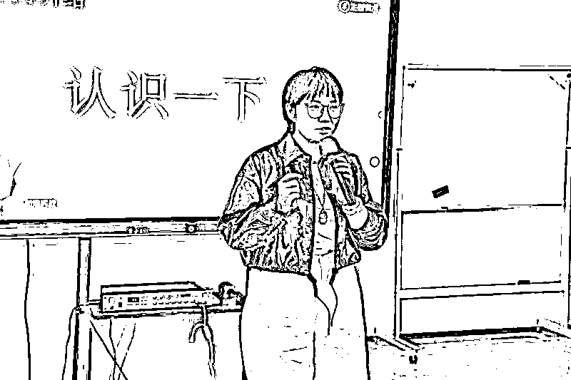
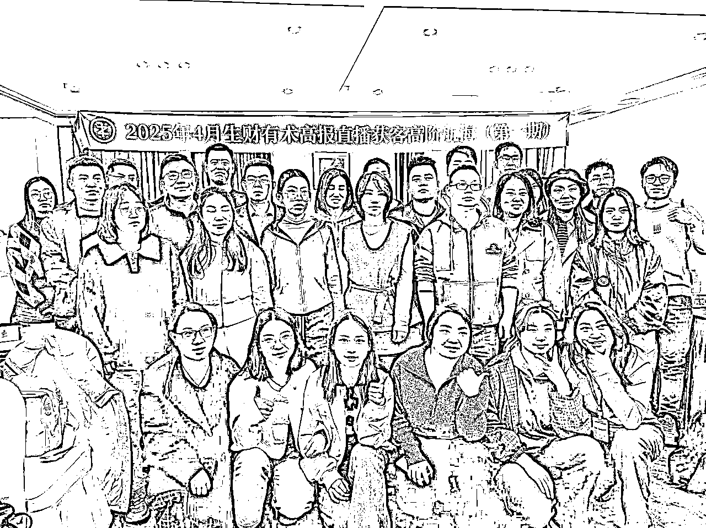
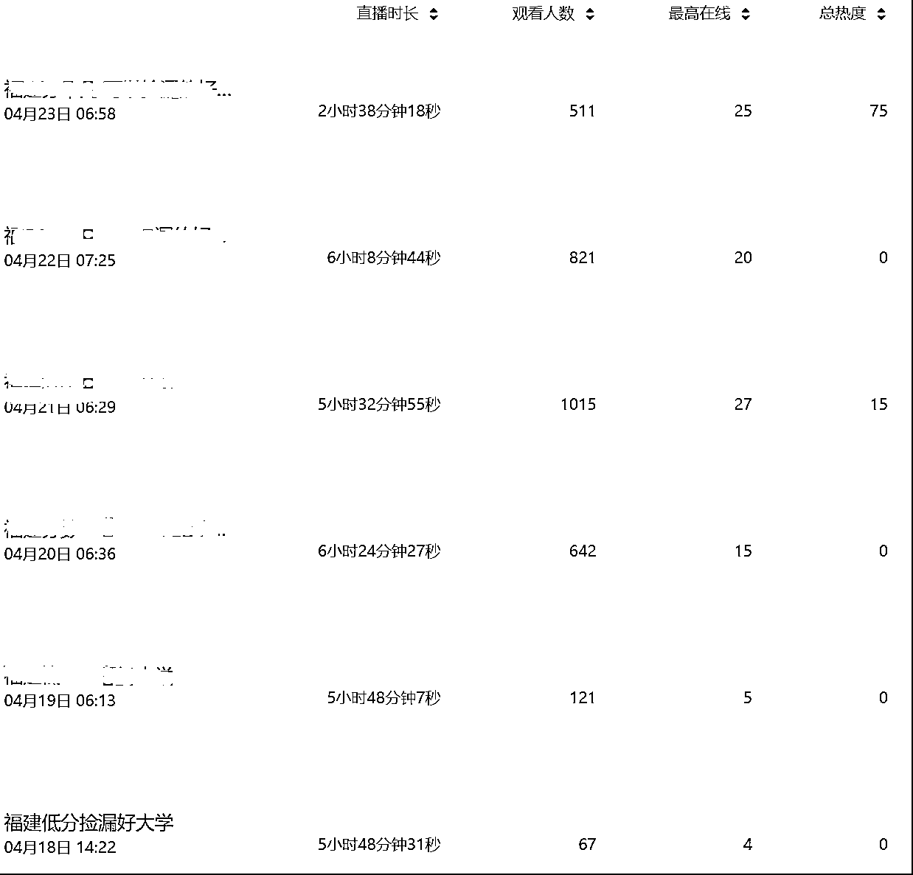
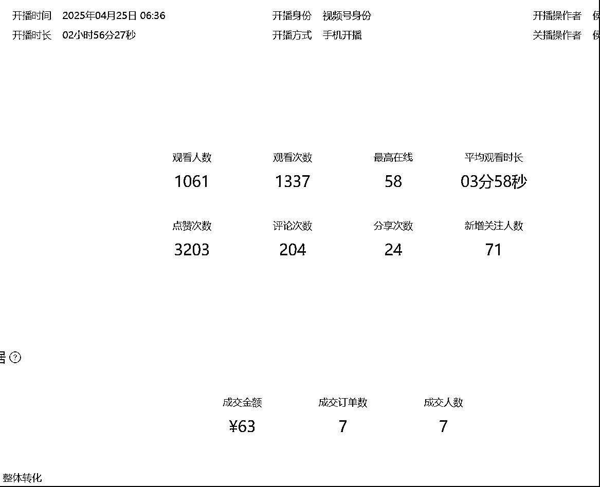
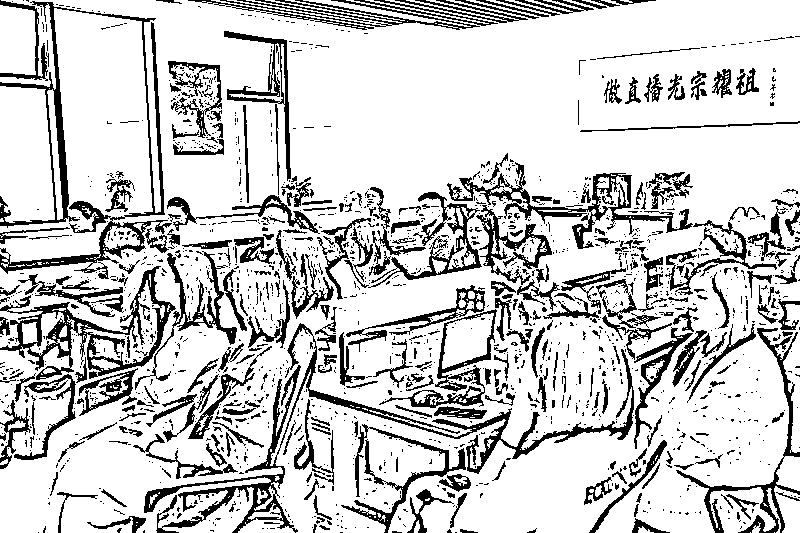
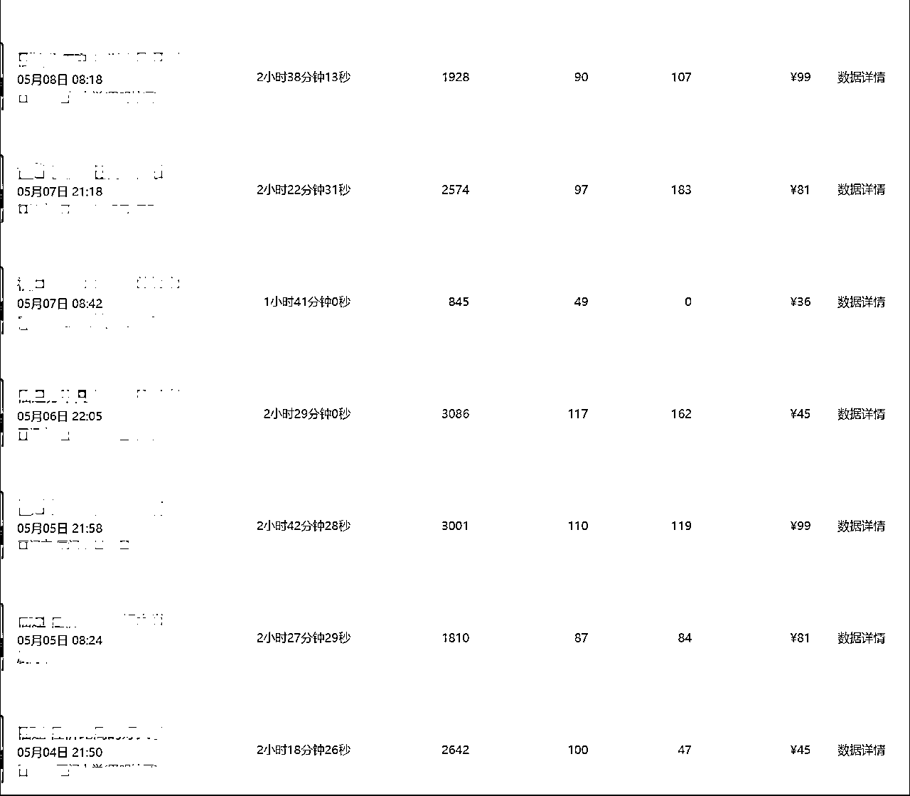

# 17天入门【高报直播获客】航海，月入1万只是开始。
作者：龙哥

各位圈友好，我是龙哥。在赚钱默默潜水了三年，航海等级倒是升到了Lv.7，但一直没什么拿得出手的成绩。之前参加航海大多是围观心态，主业太忙，也认真不起来，白交了不少保证金。今年4月，我终于带着认真的态度下场，抓住机会报名了“高报直播获客”线下航海——80多个报名者里只选了30个，我居然被选上了。更没想到，17天就让我这个“三天打鱼”的人，回家后月入小一万还只是保底。

## 这个项目到底是个啥？

说白了，这就是个“打粉”生意：通过直播卖小课包，按销量拿佣金。但跟普通打粉相比，它解决了两个最让人头疼的问题：

一是号不废。很多打粉玩法都是拿账号寿命换流量，这个项目卖的是正规课程包，完全在平台规则内操作，账号安全，还能长期复用。在各类打粉方式里，直播又是效率最高的——只要号起得来、标签够准，获客就是顺水推舟的事。所以我们这次28个线下成员，全部在17天内跑通0-1，全员上岸。

二是后端靠谱。打粉圈里常见的坑，这里基本没有。不用担心后端拿粉做什么危险的事，因为客户就是高三学生家长，后端接的是志愿填报，正规且安全。佣金按小课包数量算，不存在淡旺季扣量的问题——你卖了多少单，就拿到多少钱。

教育赛道从来都不缺“大钱”，家长在孩子身上花钱从来不犹豫，尤其是高三这种决定命运的节点。虽然淡旺季极其分明，但正因为痛点足够痛，旺季的能量也足够大。而且高报周期短，很多机构还没来得及重兵入场，我们就有机会卡位。每年高三家长都是新的一批，这个项目可以年年重复做，绝对值得长期深耕。

## 17天线下：从“听天书”到首播卖出7单

刚开始我天真地以为，直播一天撑死两个小时，顺手就能搞定。结果Lemon老师排的课把我直接干懵了——前两天的酒店理论课，行业前景、高报知识、直播技巧一股脑砸过来，隔行如隔山，我大概只听懂了三分之一，作业也做得稀碎。

14号就是首播日。我和队友yoyo分到福建市场，一天要同时起两个号，每个号要播满6小时，加起来就是12小时。说起来也巧，yoyo和我都住在杭州三墩，直线距离才2.5公里，缘分这东西真的妙不可言。

老师给的逐字稿需要改成适合自己的表达，我们改了一上午都不顺。直到晚上8点22分才开了第一场直播，我播4小时，她播1.5小时，整场场观只有65，最高在线4个人。虽然惨淡，但总算迈出了第一步。那几天每天熬到凌晨3点多，第二天完全起不来，进度也掉了队。后来我们调整打法：单人每场2小时，最后一场留给队友，我先回去休息，第二天一早6点半开播，这才慢慢追上了大部队。

线下航海和线上完全不一样，身边全是拼命的人，你想偷懒都不好意思。Lemon老师和侯老师几乎全程陪着我们，每场播完马上拿数据复盘。嗓子哑了也硬扛，我两盒黄氏响声丸、一盒金嗓子下去了。眼看着别人一个接一个起号成功，自己的号还没动静，心态差点崩了。Lemon老师及时组局请大家吃饭，讲自己创业的故事给我们打气，那种情况下，除了继续死磕，没有第二个选择。

4月19号，数据终于开始抬头；20号，在老师指导下，我的号成功起号。接着帮yoyo也完成了起号。

起号之后，反而没有想象中轻松——接下来得拉互动率、做数据，让更多家长愿意在直播间停留和说话。又磨了两天，在线人数才慢慢起来。

25号，我决定第一次带货。其实心里很没底，因为在线人数不算多，怕卖不出去。但结果出乎意料：最高在线58人，一场出了7单，每单佣金25元，一晚上赚了175块。这笔钱不多，却是我这十几天的努力第一次变成真金白银，那种开心是真的憋不住。之后我基本保持每天两到三场的节奏，边播边优化。

28号结营，Lemon老师毫无保留地把行业前景、甚至一些核心信息都分享给了我们。晚上大家一起吃了答谢饭，第二天各回各家。

## 回家之后：独立带货照样能赚

29号到家，我马上在自己家里开了首播，数据很稳定，每天两场，每场2小时左右。有时候家里有事，一天只播一两场——就这么“三天打鱼两天晒网”的节奏，一个月拿小一万也没什么悬念。

线下结营，线上陪伴并没有结束。群里的复盘一直没停，遇到问题，老师们回复得依然很及时。说实话，越播越觉得自己的知识储备差太多，家长很多问题我都答不上来，只能先跳过去。这个行业想真正吃透，还需要时间。但也正因为如此，它才值得长期投入。

## 这个项目，让我彻底想通了一件事

以前我做过淘系电商，也做过抖音直播电商，都是带着几百平米的货到处跑。回到杭州接触赚钱后才发现，赚钱不一定需要“有货”。像高报直播，一部手机加个支架，顶多再拿块平板或一张纸，直播间就能开起来。我甚至盘算着暑假带孩子回老家，一边直播一边让他体验农村生活——时间自由，收入也不差。

Lemon老师说，教育里面藏着大钱，今年只是小试牛刀，明年才是真正的开始。我已经用一个月跑通了1-10，接下来就是继续深耕，把这口井挖深。时间是这个行业最大的壁垒，侯老师播了五年，知识储备不输任何高报师。我愿意让自己也和这个项目一起，在时间里沉淀。

## 最后，聊聊赚钱三周年的一些心里话

进赚钱三年，直到去年才开始真正投入。陆陆续续参加了7次航海，精华帖收藏了无数，每次看完都很爽，但执行总是跟不上。去年在📕上折腾了一年，教育资料引流、虚拟店铺都跑通过0-1，却没能跑到1-100。说到底还是心力不足——正反馈来得太慢，能坚持到底的人永远是少数。

但赚钱这个平台，确实让普通人看到了更多可能性。每一本航海手册都是教练们心血的结晶，价值千金，就算不参加航海也能查阅，太友好了。对我来说，赚钱已经变成了我的“副业搜索引擎”，也是这么多社群里，唯一让我心甘情愿持续续费的地方。

这次高报直播获客，17天跑通0-1，离不开老师们的付出和队友们的陪伴。老师只能领你进门，后面的路终究要自己走。从1到100，我还在路上。希望这篇分享，也能给你一点启发。