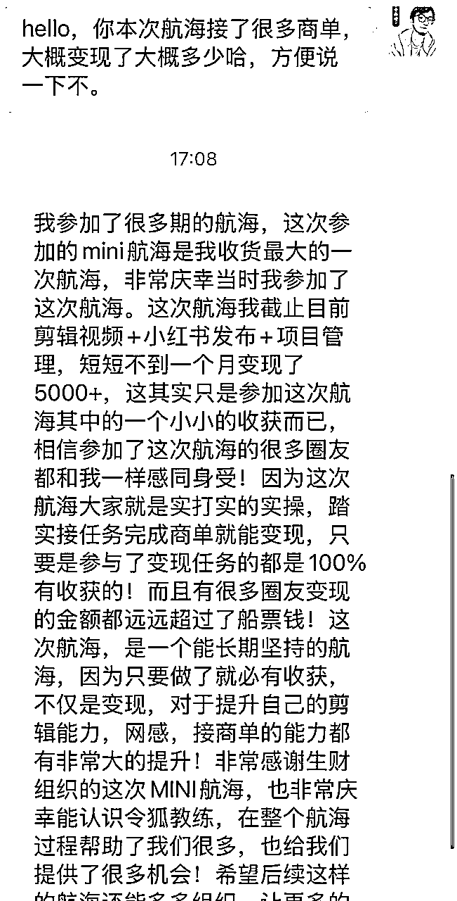
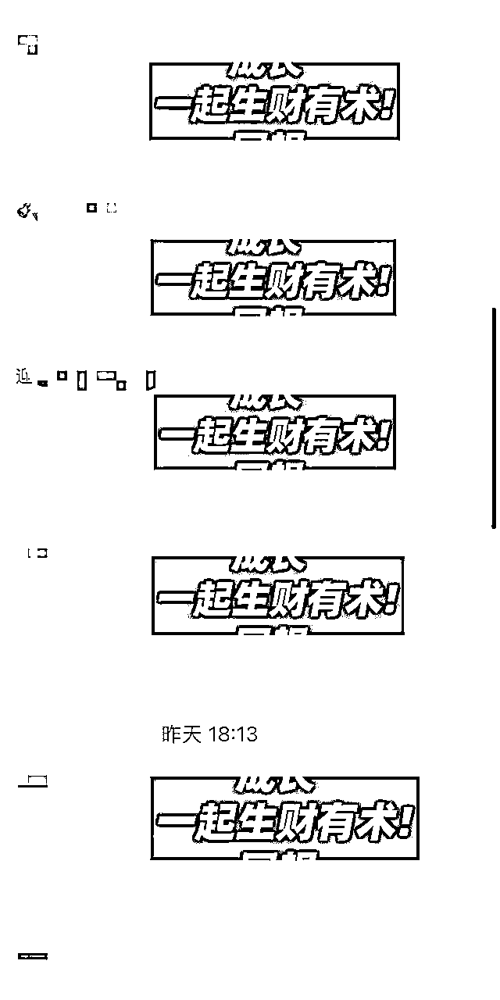
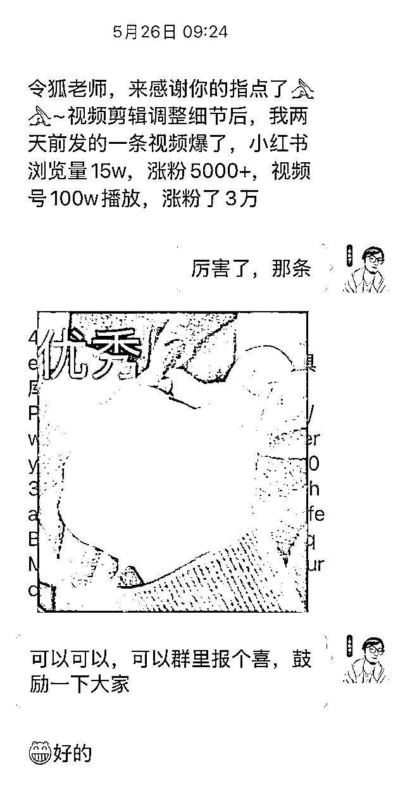

# AI自媒体Mini航海复盘：百余位学员拿到商单

> 来源：[https://bchje44bsl.feishu.cn/docx/RJd7d5wbLoixN0xhQS5cWVSWnsf](https://bchje44bsl.feishu.cn/docx/RJd7d5wbLoixN0xhQS5cWVSWnsf)

各位好，我是令狐峰，朋友们都叫我令狐。很荣幸担任本期航海的主教练，带了360人实操AI自媒体。副手是@hawli和@杨辉，我们团队在小红书的投放记录已累计数千条合作笔记。

# 一、小有成果，路还很长

本次航海共21天，我们帮助100多位同学成功接到商业合作，50多位做到持续稳定接单，最高变现达到5000元。还有同学靠一条短片在小红书两天涨粉5000，后续累计至1万，同步到视频号后又新增3万粉丝。

但现实是，大家目前接到的单子价格多集中在百元区间。

要知道，如今AI自媒体的头部玩家，一条内容制作并全网分发，报价最高可达20万，10万级别的报价也很常见，而这些团队的人数通常不超过10人，年收入却能过千万。

我们和头部究竟差在哪？我先抛几个点出来，欢迎评论区继续补充。

1. 生产高质量内容的能力
一条爆款能带来10万粉和千万级收益，可大多数人缺的并非灵感，而是可复制的操作路径。更关键的是心态和惯性——很多人不敢去想“我能不能做出一条涨粉1万的内容”，觉得自己做不出，也不愿花时间打磨，被自己的认知边界卡住。
2. 捕捉窗口的能力
AI正在经历百年难遇的大变局，头部之所以敢长期投入，是因为他们看清了这波浪潮的深度。把视野拉到30年，AI自媒体才刚起步。

# 二、赚钱的本质是实干

很多人道理都懂，却活不好。我觉得核心是缺“边做边学”的闭环。方向一旦确认是正确，比如已有一年运营经验、年入千万的AI自媒体团队可以被低成本复刻，投入控制在一万以内，这类高投入产出比的项目，就该全力以赴、上下求索。

## 1、从思考到行动的切换

学员常问第一步怎么迈。我给的建议是：把启动难度压低，把尝试频率拉高。

压低启动难度，就是把宏大目标拆成可执行的小动作。先发第一条短视频，别一上来就想月入过万，先拿下第一笔100元的合作。

提升尝试频率，就是增加试错次数。做AI自媒体，最大的隐形成本是时间窗口。每拖一天，就可能错失一次触达爆点的机会。

要建立复盘机制。给自己一个小规则：每日必须有微小进步，持续前进就是最好的开端。对普通人而言，困难总是密集出现，持续进步、能力提升后，很多阻碍会自然化解。人生并无白走的弯路。

## 2、实干的三个进阶层级

第一层：应激式实干
最基础的“哪里痛补哪里”。看到别人靠AI自媒体变现就跟进，看到某个视频火了就模仿。这种方式粗糙直接，却是新手入门的必经阶段。

本期航海里，不少同学就从这里起步。看完教练案例后立刻照搬制作，初期效果不佳，但“先动起来”的姿态非常可贵。

第二层：杠杆式实干
更进一层，懂得用力借力。不是盲目重复，而是找到能放大结果的支点。

比如内容起量后，要复盘它为何起量，能否提炼出一种可复用的内容形态持续产出；也可以思考是否可多开号，将同一素材微调后二次发布。还有同学用AI工具重构创作链路：用AI做选题拆解、文案优化、版本A/B测试，效率提升数倍。

第三层：系统式实干
最高阶，让事自己运转。由执行者变为系统设计者，把流程做成自动化、标准化。

我们团队就是典型。不是单点接单做内容，而是搭建完整的AI自媒体运营体系：选题、制作、数据、商务各环节都有标准SOP和工具支撑，整个运转自然加速。

很多人以为AI自媒体是重复劳动，其实每一次实干都在沉淀三种资产：

技能沉淀：每次制作都在提升选题、脚本、剪辑、发布的熟练度，这是带不走的核心能力。
内容沉淀：每条发布的作品都是数字资产，持续为你发声。
关系沉淀：每次互动都在积累粉丝、同行、品牌资源，未来都可能转化为商业机会。

正如龙哥所言：“利他、长期主义，做对他人有价值的事。”持续创造价值，回报自然到来。

# 三、新手航海的十点建议

作为本期教练，我深刻感受到新手的迷茫与焦虑。这个赛道门槛看似低，竞争实际激烈。下面是我基于行业观察总结的十条建议。

1、95%的问题AI能即时解答，多去提问
不需要等待回复，随时提问即可。进入心流后，做事效率能提升5-10倍。

2、从模仿起步，但要拆解逻辑
模仿是捷径，但要做深度拆解。选近期起量的案例，而非只追大V。因为近期爆过的形态更可能再次生效。研究其结构、爆点、表达与视觉，理解为何有效。

同时把握边界。框架可学，内容需原创；表达可借鉴，观点须自有。在模仿中逐步植入个人特质，形成辨识度。

3、工具是放大器，非万能药
AI工具降低了门槛，但态度要正确。过度依赖会阉割思考，完全排斥则错失效率。它能辅助选题、生成框架、优化表达，但无法替代你的判断、经验与个性。

正确姿势是：AI辅助创作而非取代、AI提升效率而非降标准、AI拓展可能而非限制创意。

4、内容为王，要知好内容标准
好内容不只是精美。用户视角要解决痛点、满足需求、提供价值，可是知识、娱乐或情绪共鸣；平台视角要吸睛、促互动、留用户；创作者视角要体现专业、建立个人品牌、达成商业目标。

好内容是三者平衡的结果。

5、平台选择求稳，别贪多
小红书、抖音、视频号、B站、知乎各有机会。建议先锁定一个最熟悉的主场。熟悉平台用户与规则，胜率更高。

站稳后可扩展，采用“一主多辅”策略，主阵地投入80%精力，辅战场20%。深度比广度更有价值。

6、重视数据，但别被绑架
数据是反馈，不是目的。为播放焦虑、为点赞怀疑，都是不健康的。数据有滞后和偶然性，新号前期表现弱很正常，单条失利也不代表方向错误。

更合理的数据观：短期看趋势不看绝对值，长期看积累不看单条，对比看相对表现。

7、社群价值不可小觑
创作很孤独，好社群能提供技术、经验、情感支持。但社群质量参差，劣质社群会带来噪音甚至负面情绪。选社群看氛围与质量而非规模，进去后要做积极参与者，分享、回应才能获得价值。

8、耐心是最稀缺的资源
很多人做一个月无起色就放弃，三月无爆款就转行。内容创作是复利过程，急功近利只会适得其反。

努力的回声往往滞后，但每条内容都在为个人品牌添砖。巴菲特的“别人恐惧我贪婪”在内容领域同样适用：当多数人因无即时反馈而退出时，正是坚持的黄金期。给自己6-12个月的专注期，相信积累。

9、保持学习，但要筛选
工具、方法、机会层出不穷。不要全盘接收。优先学能直接提升内容质量的能力：写作、视觉、数据分析；其次学能提升效率的工具。

对信息保持判断，多实践多验证。学会对热点说“不”，专注关键少数。

10、坚信自己，也保持谦逊
每个人的经历与视角都是独特的，相信自己的价值。但行业变化极快，没有人能永远领先，保持学习与开放心态至关重要。

成功是长期累积的结果。所有看似成功的创作者，背后都有默默无闻的阶段。差距不在天赋，而在坚持。

给新手一句话：相信时间、相信积累、相信潜能。只要你开始，你已超越90%观望者。路虽遥，行则至；事虽难，做则成。

# 四、收束

《道德经》有言：“千里之行，始于足下。”AI自媒体之路漫长，第一步迈出即在路上。

本期航海，我们带着360人实操AI，已算小小突破，但这只是万里长征的起点。真正的考验是能否持续、走得更远、走得更好。

我相信每位参与者都有成为优秀创作者的潜质，区别在于是否愿意为之投入时间与精力，是否能在逆境中坚持，是否能在顺境中保持清醒。

借马云一句话收尾：“今天很残酷，明天更残酷，后天很美好，但大多数人死在明天晚上，看不到后天的太阳。”

AI自媒体赛道，今天激烈，明天更难，后天机会更多。关键是你能否坚持到后天，看见那轮太阳。

最后感谢龙哥盟的联动，感谢赚钱工作人员宝芙的付出。路上见。