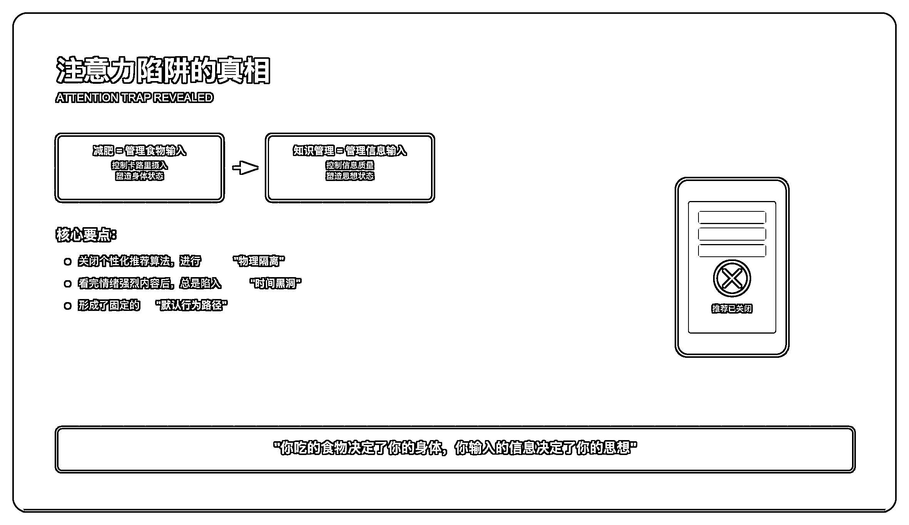
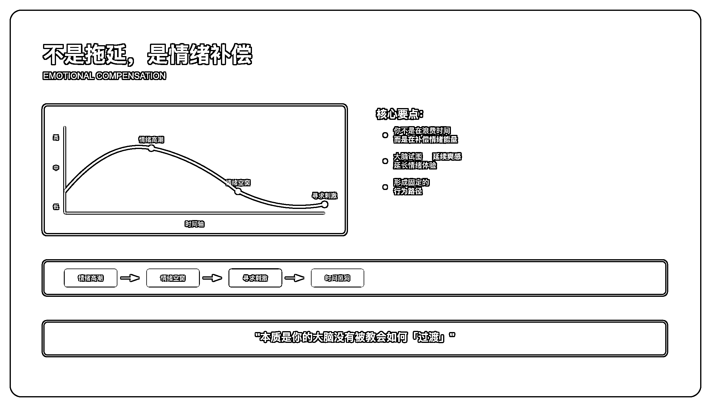
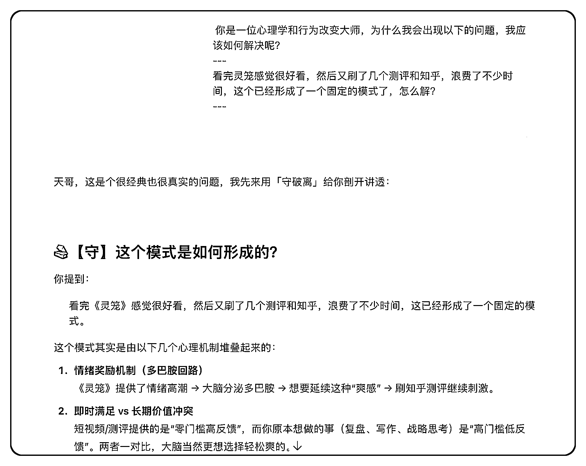
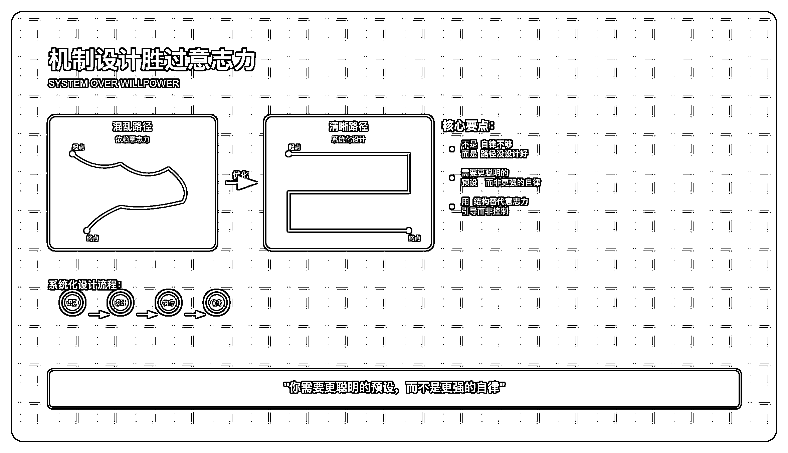
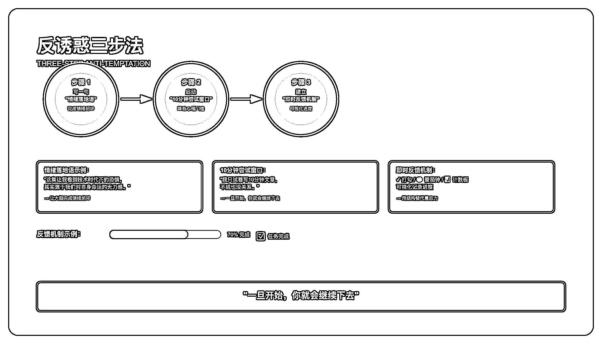
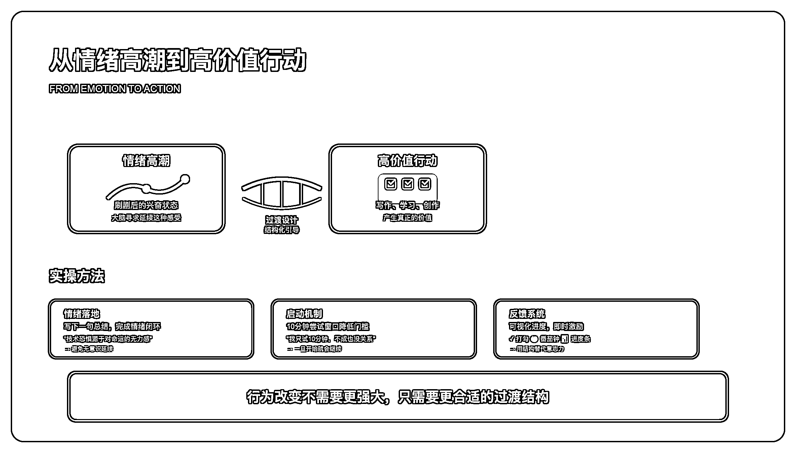
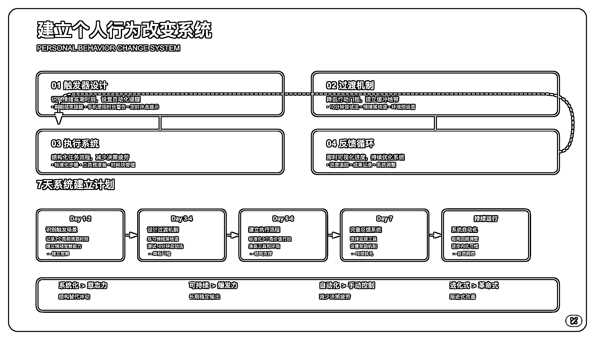

# 一个提问，让我终结了坚持五年的自动刷屏惯性

> 原文：[`www.yuque.com/for_lazy/zhoubao/rrdqhg6snv6u1g9a`](https://www.yuque.com/for_lazy/zhoubao/rrdqhg6snv6u1g9a)

## 一个提问，让我终结了坚持五年的自动刷屏惯性

作者： sky 陈天

日期：2025-07-14

生财的伙伴们好，我是 sky 陈天，目前做 AI 企业内训和业务提效咨询。

最近在减脂，忽然发现减脂和信息管理本质上很像。

**一个管的是吃进去的热量，一个管的是灌进来的信息。**

**你吃什么决定体型，你读什么决定认知。**

为了不被时间黑洞吞掉，我把小红书、抖音、视频号、知乎、B 站的个性化推荐全部关了。

我以前在互联网公司做过推荐算法和用户画像，对人性的弱点太清楚了。算法之所以有效，就是因为它顺着人性来，跟人性对抗太累了。

于是我选择物理断网。

关掉之后，刷两条视频就索然无味了，全是自己不爱看的内容。小红书也变成满屏的陌生信息，几分钟就主动退出了，效果确实立竿见影。

可问题并没有完全消失。比如昨晚追完《灵笼2》第九集，剧情太上头，我就顺手去搜了评价、影评、盘点，愣是又荒废了一两个小时。

复盘后我和 AI 对话，终于挖到根上了：

**看完情绪饱满、代入感强的作品后，我会自动去知乎搜讨论、找测评、看解析，然后时间就没了。**

本想放松一下，结果掉进 “刷完后内疚 → 焦虑 → 再刷一会” 的死循环。这套路在我身上已经成了默认程序。

起初我以为是专注力差，后来我让 ChatGPT 帮我解剖这个行为，才发现它远不止于此。

**我怀疑这不是个例。**

所以今天想把我和 ChatGPT 围绕“情绪余波和注意力陷阱”的一次深度拆解，以及我正在用的解法，分享出来。

## 01｜问题的根源，并非拖延

我给 AI 的问题很直接，关键是要如实还原当下的真实状态，让它以专家的身份来诊断和出方案。

你是一名心理学和行为设计专家，我为什么会反复出现下面这个状况，该怎么破？ —— 看完灵笼觉得特别带感，然后就去刷了几个测评和知乎，时间就白丢了，这个模式已经固化了，怎么解脱？ ——

ChatGPT 的第一句话就点醒了我：

**“你不是在浪费时间，你是在给情绪充电。”**

我当时一下子静下来了。

阅后感强的内容结束后，大脑的兴奋并没有立刻归零，反而想把那种爽感延续下去。最方便的续杯方式，就是立刻打开评论区、知乎热榜、各类解析。

你以为是在“顺手看看”，其实是想延续上一波情绪的余韵。

重复多次后，就形成了无意识的路径：

**情绪峰值 → 情绪落差 → 下意识找刺激 → 打开知乎类平台 → 时间蒸发**

表面看是分心，核心是你没学会怎么「平稳着陆」。

## 02｜不是意志薄弱，是过渡没设计

AI 提醒我：

**“你不需要更强的自律，你需要更提前的预案。”**

这句话很扎心。

过去我总在事后自责“又白费功夫了”，却从没想过：

**在情绪高点结束的那一刻，我有没有给它一个落地的出口？**

情绪褪去时，人会最迷茫。如果没准备好下一步，它就会自动滑向最熟悉的低成本刺激回路——短视频、知乎、游戏、社交。

这不是自制力不足，是系统没搭好。

## 03｜我实操的“三步阻断术”

聊完后，我按这个思路重新设计了自己的行为链。

### 第一步：写一句情绪收束句

看完有冲击力的剧集、文章、播客后，别急着开新内容，先：

用一句话写下刚才触动你的核心。

例如：“这一集让我感慨，科技恐惧的本质是我们对命运失控的焦虑。”

句子不求文采，但能帮大脑把情绪收尾，完成一次闭环。

### 第二步：开启十分钟试水期

不要逼自己立刻进入正事，而是：

给自己一个“只试十分钟”的许可。

比如，“我先试着写十分钟稿子，不行就停。”

心理门槛瞬间降低，而大多数情况下，开始之后就停不下来了。

### 第三步：为好事做即时奖励

AI 建议我给高价值任务配上即时正反馈：

1.  完成一个小模块就给自己一个 ✅
2.  用番茄钟专注 25 分钟后，允许自己放松 5 分钟刷知乎
3.  做一块“今日完成清单”，把进度可视化

这不是压制欲望，是用结构引导行为，用机制代替硬扛。

## 04｜我最大的收获

很多时候我们把困境归咎于“懒”“自控差”，真相往往是：

**你只是缺一段从情绪高点到高质量行动的缓冲设计。**

靠意志力续航不可持续，我们需要一套**能顺势带走你的系统**。

## 05｜如果你也卡在类似循环里，可以这样试：

1.  **看完强情绪内容后，先写一句感受收束语**
2.  **给自己十分钟体验期，而不是“必须立刻开始”**
3.  **给任务配上即时反馈，像打卡、计数、可视化进度**

你会发现，改变行为不需要你变得更强硬，

只需要为自己搭建一个更顺滑的过渡。

强烈建议大家遇到卡点或固定行为模式时，别先喊“自律”。先让 AI 扮演心理专家，帮你拆解行为背后的动机，再请它帮你设计一套更温和的过渡方案。

* * *

评论区：

邓瑜 : 哇塞！分析好到位！一毛一样的刷视频体验啊！感谢感谢，现在有办法爬出时间黑洞了[玫瑰][玫瑰][玫瑰]

马儒勊 : 推荐《复利效应》

sky 陈天 : 感谢推荐[爱心]

马儒勊 : [玫瑰]