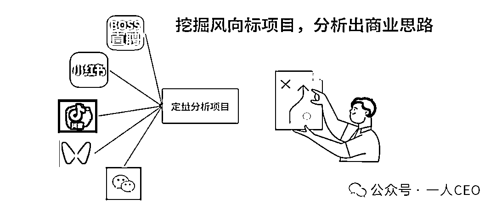
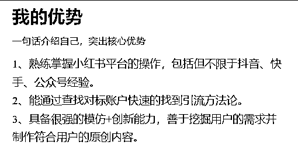
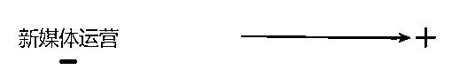
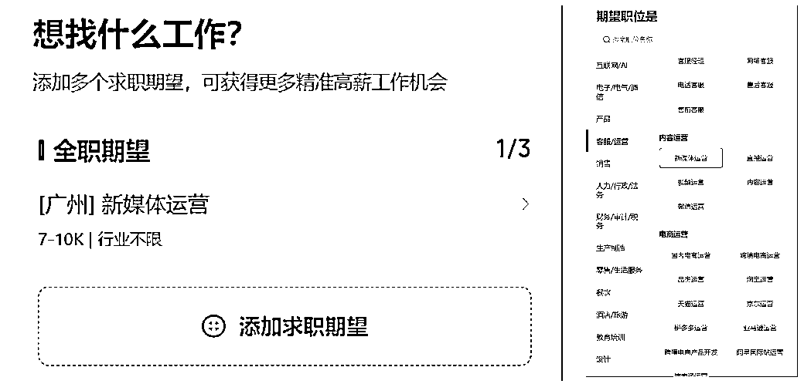
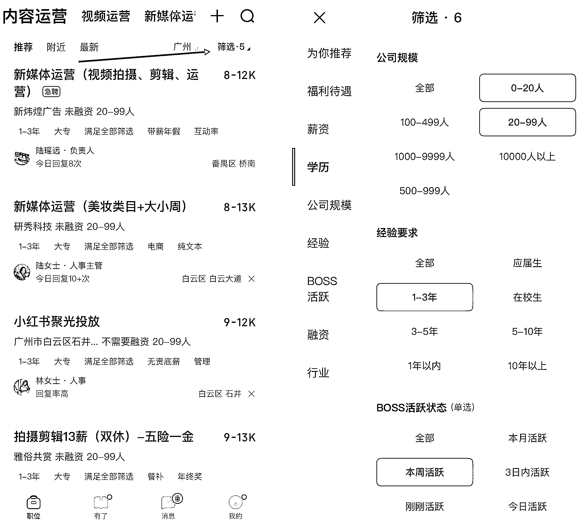
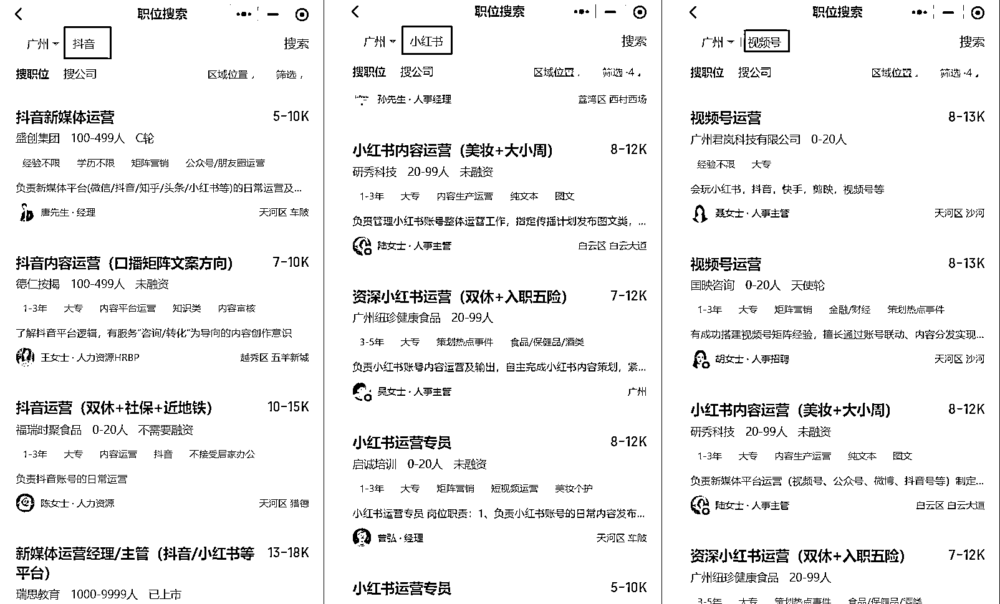
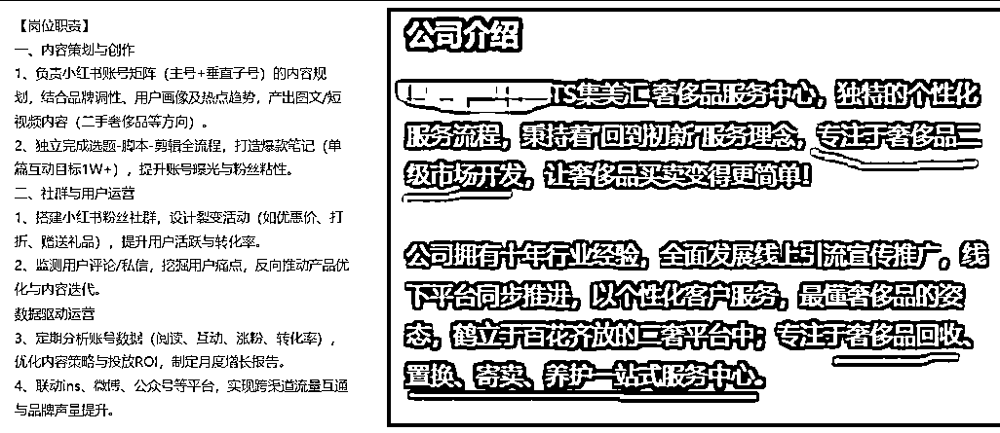
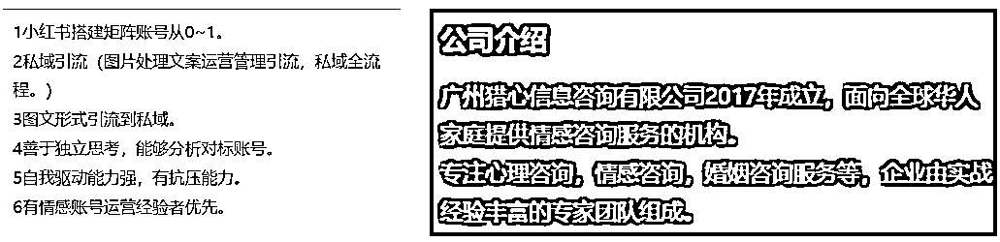
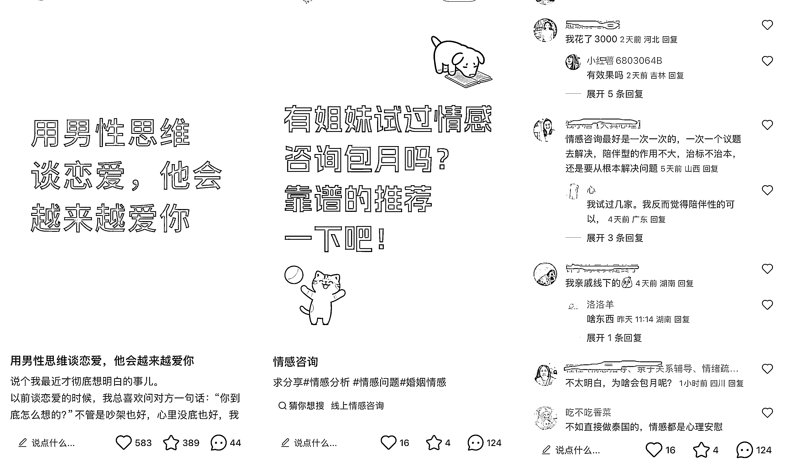
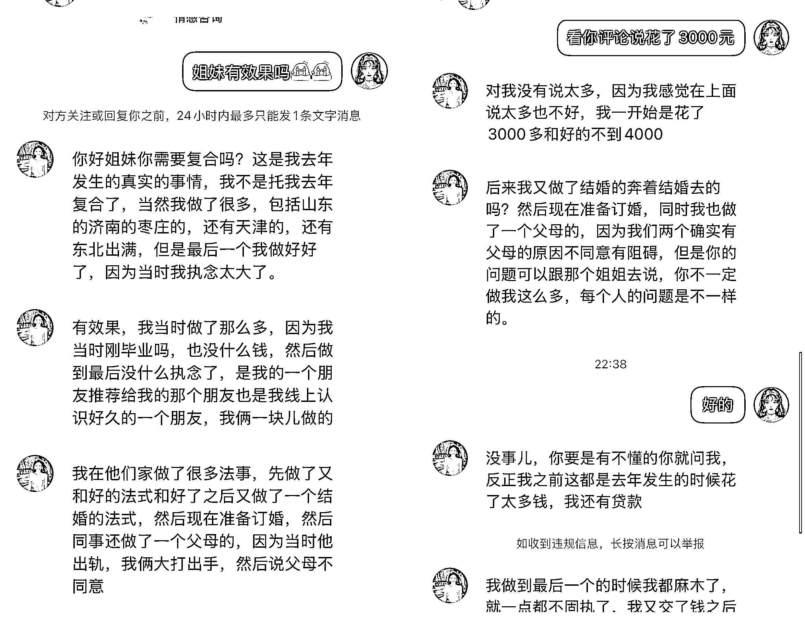

# 如何从招聘平台反向拆解项目，判断一门生意值不值得做？

很多人找项目，习惯去看课程、社群和各种“赚钱案例”。但其实，还有一个更容易被忽略的信息入口：招聘平台。

一家公司开始持续招聘，通常意味着它的业务已经跑起来，正在扩大规模。招聘岗位里，往往藏着项目的运营方式、流量渠道、岗位分工，甚至还有部分转化逻辑。

我的方法可以概括为四步：

1. 在招聘平台锁定正在招人的项目；
2. 去内容平台寻找同行账号，拆解获客路径；
3. 以潜在客户身份咨询，了解产品、价格和成交方式；
4. 把收集到的信息量化，判断是否适合自己投入。

整体路径如下：

## 一、从招聘平台找到正在运行的项目

招聘平台的价值，不只是帮助我们找工作。

无论是小团队还是成熟公司，只要业务需要扩张，就要通过招聘平台补充人手。也就是说，招聘信息本身就是一个观察项目的窗口。

我们可以从岗位职责、公司介绍以及招聘官的沟通中，反向还原一家公司的业务模式。

### 1. 先把求职资料准备好

招聘平台对个人资料的完整度要求比较高，因此第一步要先完善简历。

通常有两类简历：

- **在线简历**：系统会根据你填写的信息，向你推荐匹配岗位；
- **附件简历**：招聘人员聊天或面试时查看，内容与在线简历基本一致。

进入 APP 的【我的】页面，找到在线简历，把头像、姓名、性别、工作年限、手机号、🛰️号、出生日期和邮箱等基础资料补齐。

这里建议把工作年限设置为两年左右，因为很多岗位会按照经验筛选，这样更容易看到目标项目。

求职状态可以设置为“离职，随时到岗”，这样更容易获得招聘方的主动联系。

个人优势部分，则填写与内容运营、账号管理、文案、拍摄、剪辑或数据分析有关的技能。

工作经历主要是为了让系统更准确地推荐岗位。如果过去没有相关工作经验，可以按照目标岗位的要求整理一份匹配度较高的经历。

教育经历则根据自己的实际情况填写即可。

### 2. 设置求职方向

如果我们的目标是研究新媒体项目，那么不需要把所有岗位都选上，先聚焦于内容运营相关岗位即可。

在首页找到岗位类别，点击右侧的“+”。

平台通常允许添加多个求职方向。可以选择已有岗位，也可以点击【添加求职期望】重新设置。

岗位分类很多，但前期建议只围绕内容运营、短视频运营、📕运营、电商运营等方向进行研究，避免范围太大，导致信息过于分散。

### 3. 通过筛选提高效率

招聘信息数量非常多，如果每条都从头看，会浪费大量时间。

可以先在首页点击右上角的【筛选】，进行初步过滤：

1. 薪资范围：5—10K；
2. 学历要求：大专；
3. 公司人数：0—99 人；
4. 工作经验：1—3 年；
5. 招聘方状态：本周活跃。

除此之外，还可以通过关键词搜索，直接寻找更具体的项目类型。

有人可能会疑惑：我们不是来挖项目的吗，为什么还要认真找工作？

答案是，我们正是要以求职者的身份进入信息源头。

岗位职责能够告诉我们公司目前在做什么，招聘要求能反映它需要哪些能力，而与招聘官沟通，则有机会获得更多项目细节。

判断一个岗位是否值得继续研究，可以按以下顺序：

**岗位职责 → 公司介绍 → 招聘官咨询**

## 二、通过岗位信息拆解具体项目

### 案例一：📕奢侈品回收

如果某个岗位描述中提到，需要在📕发布奢侈品回收相关内容，那么基本可以判断，这家公司正在通过📕获取潜在客户。

接下来，我们可以在📕搜索：

- 广州奢侈品回收；
- 奢侈品回收；
- 名牌包回收；
- 二手奢侈品变现。

初步判断，这属于本地生活类项目。

常见的分工方式是：

- 前端负责在内容平台获取流量；
- 后端负责承接客户、估价、上门回收和交易；
- 有能力的团队，也可以把获客、成交和货品处理全部做完。

为什么选择📕？

因为这类商品的核心人群以女性为主，而女性用户在📕上的活跃度较高。公司通过发布回收攻略、鉴定内容、案例分享等笔记，吸引有变现需求的人咨询。

它的基本盈利逻辑是：

客户把暂时不需要、或者急需变现的奢侈品卖出，公司上门回收后进行清洁、维修和整理，再转手销售，通过买卖差价获得利润。

当然，项目能赚钱，不代表所有人都适合做。具体是否参与，还要结合自身价值观、资源和执行能力进行判断。

### 案例二：心理、情感与婚姻咨询

如果岗位信息显示，公司主要做心理咨询、情感咨询或婚姻咨询，并且流量来源是📕，那么我们就可以围绕这些关键词去搜索同行账号。

这个赛道常见的获客方式，大致有两种。

#### 方式一：内容共鸣式获客

账号通过讲述情感故事、婚姻矛盾或心理困扰，引发目标人群共鸣，再把有需求的用户引导到私域咨询。

#### 方式二：账号配合式获客

一个账号发布“求推荐”“有没有靠谱老师”等内容，另一个账号在评论区进行回应，使用“我之前找过”“效果不错”等结果导向的话术，制造信任感。

为了了解后端流程，我们可以站在用户角度，向这些账号进行咨询，重点观察：

- 对方如何判断客户需求；
- 是否有统一接待流程；
- 如何介绍服务；
- 如何设置价格；
- 怎样把客户从低价产品引导到高价服务。

很多团队会提前准备标准化话术。

通过进一步沟通，可以发现，这类服务的高客单价通常在 2000—5000 元左右。

它的基本转化路径一般是：

1. 在📕发布情感或心理相关内容；
2. 将用户引导到🛰️；
3. 用 9.9 元左右的低价服务筛选意向客户；
4. 再根据客户情况，转化更高价格的咨询服务。

这类项目的一个特点是需求可能反复出现。情感和心理问题并非一次性解决，部分用户可能存在持续咨询需求，因此复购潜力相对较高。

如果某个项目特别符合自己的能力和资源，但通过公开信息仍然无法判断清楚，也可以考虑进入公司短期工作。通过真实参与一个月左右，往往能更完整地了解它的 SOP、团队分工、流量结构和成交流程。

当然，前提是遵守法律法规和公司管理要求，不泄露商业秘密，也不要进行虚假咨询或恶意套取信息。

除了📕，抖音、视频号、知乎、YouTube 等平台，同样可以采用这套思路去研究内容运营、电商运营、咨询服务等项目。

长期积累下来，就能建立一个属于自己的“项目雷达库”。

如果研究的是海外平台或国外业务，直接进入相关公司学习实际流程，往往比单纯看公开资料更高效。

## 三、用数字判断项目能不能做

研究出多个项目后，真正困难的不是“找到项目”，而是筛选出值得投入的项目。

一开始，可以先做定性判断，重点观察三个指标：

- 客单价够不够高；
- 客户是否存在重复购买；
- 市场和需求是否仍在增长。

招聘平台上的岗位，通常说明这个业务已经有一定结果，否则公司不会继续招人扩大规模。但别人的项目跑通，不代表复制到自己手里也一定能盈利。

所以，还需要继续调研更多同行，获取尽可能客观的数据。

可以先记住一个原则：

**先假设公开数据并不完全可靠，再假设项目存在可复制空间。**

随后开始算账。

假设我们只有一部手机和一台电脑，需要把以下成本全部列出来：

- 设备费用；
- 账号费用；
- 网络费用；
- 时间成本；
- 人力成本；
- 场地费用；
- 获客和投放成本；
- 售后与交付成本。

然后按照一个相对保守的成交率，比如 10%，倒推出：

- 每天需要获得多少条有效线索；
- 需要发布多少内容；
- 每月需要投入多少时间；
- 大约多久可以收回成本；
- 规模扩大后，单条客资成本是多少；
- 最终利润空间还有多少。

项目不能只看别人晒出的收入，更要看自己的成本结构和执行条件。

创业本质上就是把账算清楚。

当你能够算明白投入、转化、回本周期和利润，项目才真正从“听起来不错”，变成了一门可以验证的生意。