# 两个月跑通 GPT-4o 图像变现：从追热点到做成长期产品的复盘

作者：江炜  
日期：2025-07-09

各位好，我是江炜，2025 年 4 月经小排老师引荐进入龙哥盟。

入圈后我大量阅读了社区里的优质分享，也在找一个能亲手做的方向。恰好当时社区在征集关于 GPT-4o 图像赛道的案例，而我手上正有一款图片类的生成工具，于是把这段实操过程整理出来，供同样在尝试 AI 方向的朋友参考。

项目在 4 月份上线，截至 7 月 9 日累计完成 3252 笔付费，整体付费转化维持在约 5% 的水平。

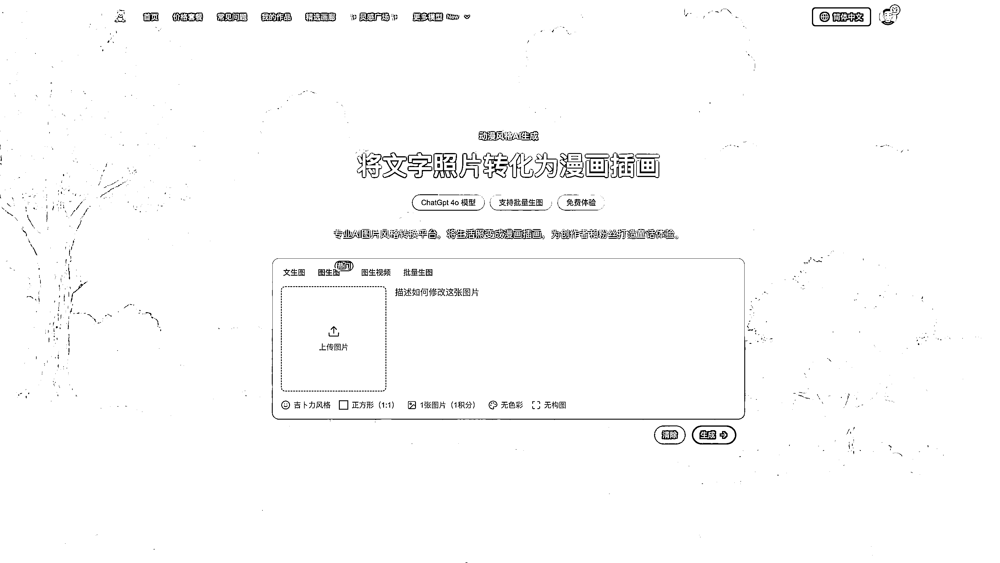

下面会围绕三个问题展开：

1. 吉卜力类站点众多，我的产品为何还能拿到结果？
2. 追热点的工具如何把转化做到 5%？
3. 热度退潮后，如何让一个依附热词的站点获得第二条生命？

## 一、同质化严重的赛道，我为何还能拿到反馈

先说清楚起点并不占优。

热词类项目是我第一次尝试，最初定位是练手。等我决定跟进时，吉卜力风格已经进入爆发期，行业里已经有不少玩家拿到大流量。

当时 idoubi 群里 Lafe 的截图在群内流传：3 月 31 日的日活跃访问 52 万，4 月 1 日已经突破 80 万。由于截图截取得比较早，当天最终数据更高。注意强调的是日活 UV。

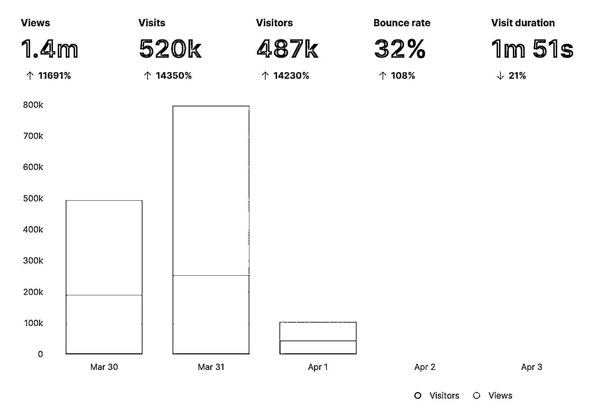

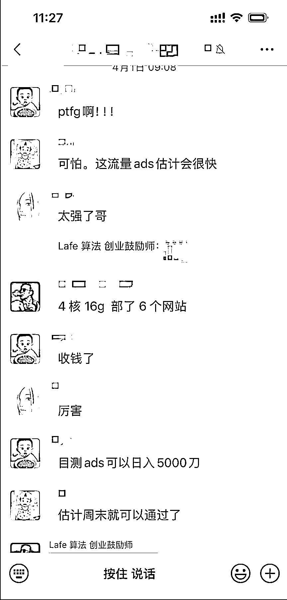

看到这样的体量，我才下定决心冲一次。

判断关键词就是 ghibli，随后注册了 ghiblio.art，用三天时间把雏形搭好。

但上线后很快发现现实差距：

- 抢到的只是热度末端；
- 搜索端布局几乎为零，自然来访很少；
- 暂时找不到可用的 GPT-4o 绘画接口；
- 只能先用备选模型顶着，成图质量一般。

可以说既没流量，体验也不达标。很多人到这个阶段就会止损。

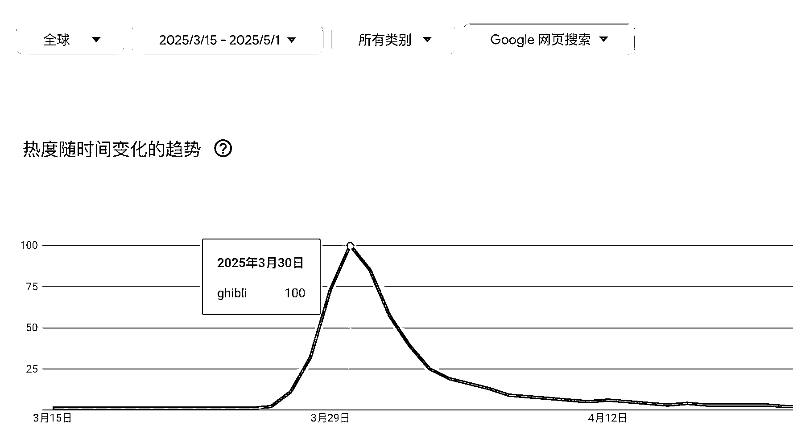

我当时仍认为 GPT-4o 的图像能力是真机会。

没有稳定接口就先用 Flux 占位，同时用官方的 GPT-4o 对话绘图能力来重塑站点的视觉和交互。关于这部分优化思路，我另写过一篇👸号稿：《如何利用 ChatGPT 4o 让网站设计大杀四方！》

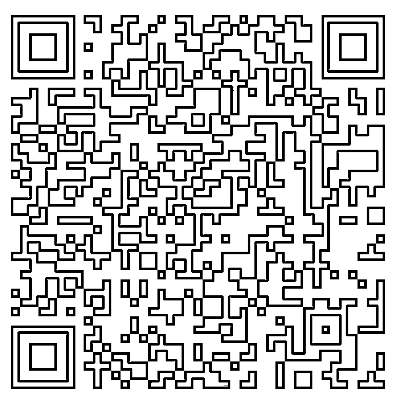

这样功能层和界面层都先就位，只差一个可靠的 GPT-4o 接入。

没过多久，哥飞老师在群里分享了 Damo 提供的通道，我第一时间接入测试，稳定性和出图表现明显优于之前。

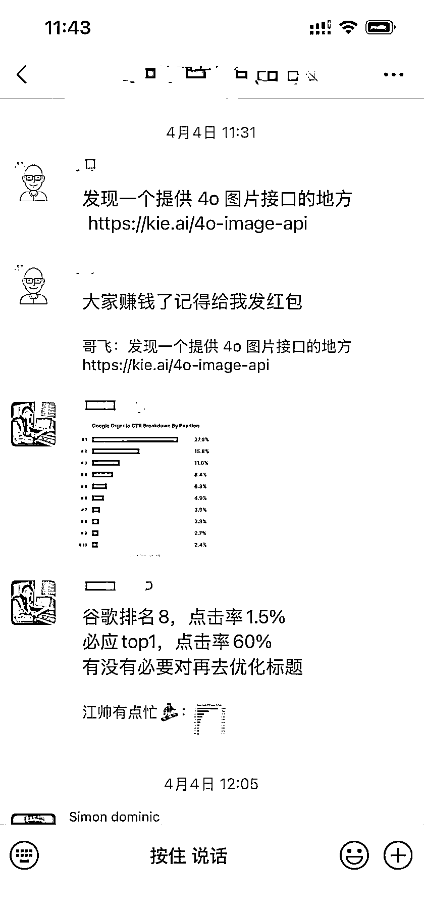

接入后的第二天，我在 V2EX 发了体验帖，反响远超预期，当天成交超过百单。这也是自 2024 年 12 月以来我第一次感受到明确的正向反馈。

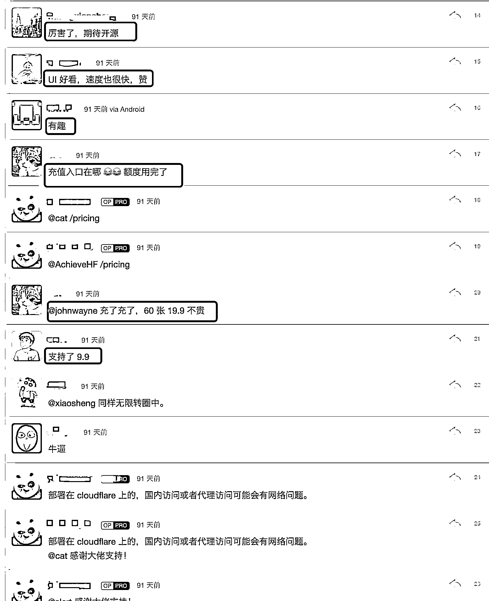

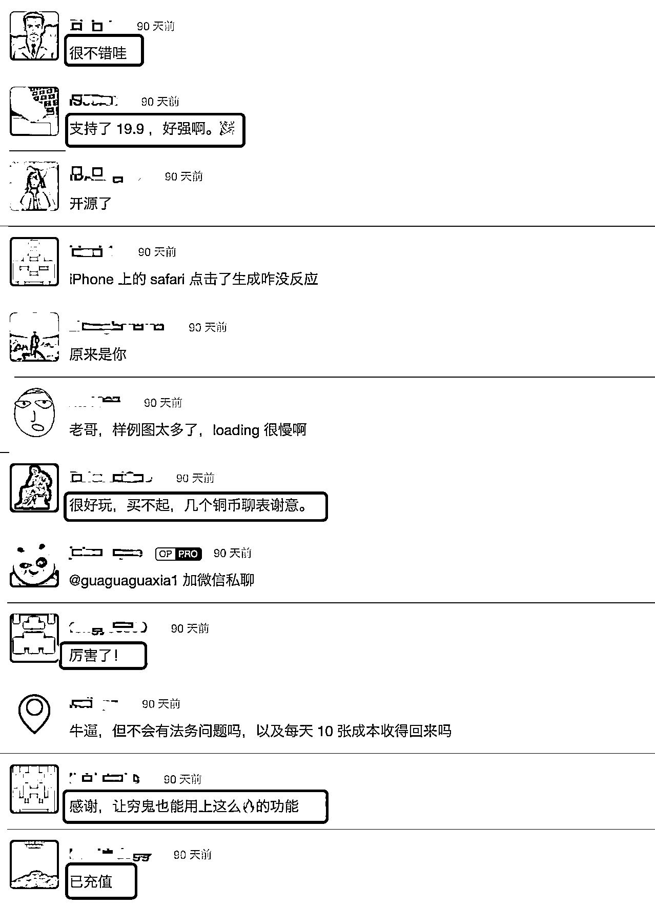

复盘下来，主要做对了三点：

1. 在初期不顺时没有立刻放弃，而是把项目继续完善，等待机会窗口。
2. 坚持先占位再迭代。**模型能力不足时，产品形态可以先行。** 这条思路在模型快速更迭的周期里长期有效，先把入口、流程和场景搭好，等能力跟上来就能迅速切换。
3. 体验直接影响付费意愿。模型稳定 + 界面精致，是用户愿意掏钱的两大催化剂。

## 二、转化率达到 5% 的关键做法

追热点的工具通常转化极低，多数在千分比级别。

我的站点能提升到 5%，主要来自以下组合：

### 1. 模型可信度 + 界面辨识度

模型稳定性是基础，这一点受益于 Damo 提供的通道。其余部分，界面品质同样关键。

我长期做前端，对布局、视觉和交互细节比较在意，这可能和市面上大部分吉卜力站点形成了区分。

功能可用只是门槛，用户第一次进入是否顺手、是否觉得专业，直接影响后续的付费决策。

### 2. 支付方案兼顾内外市场

不少做海外 AI 的独立开发者默认只做美元订阅，这就把国内用户排斥在外。

当时市场上大量吉卜力站点只提供订阅，国内用户的支付意愿接近零。

我的做法是保留订阅，同时上线多种次卡套餐，让不同使用频率的用户都能找到合适的付费点。

海外美元收入诱人，但兼顾两端总比只做一端更好。

### 3. 试用次数的取舍

AI 类产品的试用次数一直是难题：给得多成本扛不住，给得少用户流失。

部分数据表明一次试用短期转化更高，但这不一定适合长期产品。

如果只是短期收割热度，一次试用合理；如果希望做长期运营，就要兼顾体验、留存和续费。

我最初给的是三次免费，后来调到两次。没有普适答案，需要结合成本、需求和规划来测试。

这三者的协同，才是转化提升的核心。

## 三、热度消退后，如何把热词站点盘活

热词站点的普遍命运是：热度来时暴涨，热度散后回落。

吉卜力也不例外，尝鲜付费的用户在热度下降后续费意愿降低，访问量持续走低。

这时是否只能去找下一个热词？我的做法是从三个维度调整。

### 1. 拓展新的获客渠道

V2EX 是一次性爆发。为了获得更稳的来源，我注意到📕上有大量用户在找生图工具，于是开设并经营官方账号 Ghiblio Art，通过持续内容输出获得了相对稳定的自然流量。

### 2. 从单一人设风格转向可持续的平台

吉卜力热度过去后，📕上的生图需求并未消失，只是用户偏好的风格在持续迁移。

比如微信表情包风格、日本 Q 版风格、史努比风格、萌宠自拍风格、城市系列等。

于是我将产品定位从吉卜力生成器，扩展为更宽泛的动漫风格图像生成平台。后来又接入图转视频的能力，可以制作漫画动画内容。

一个依附单一热词的工具，逐步演变成可长期经营的漫画动画创作站点。

📕上近期出现的热门风格：

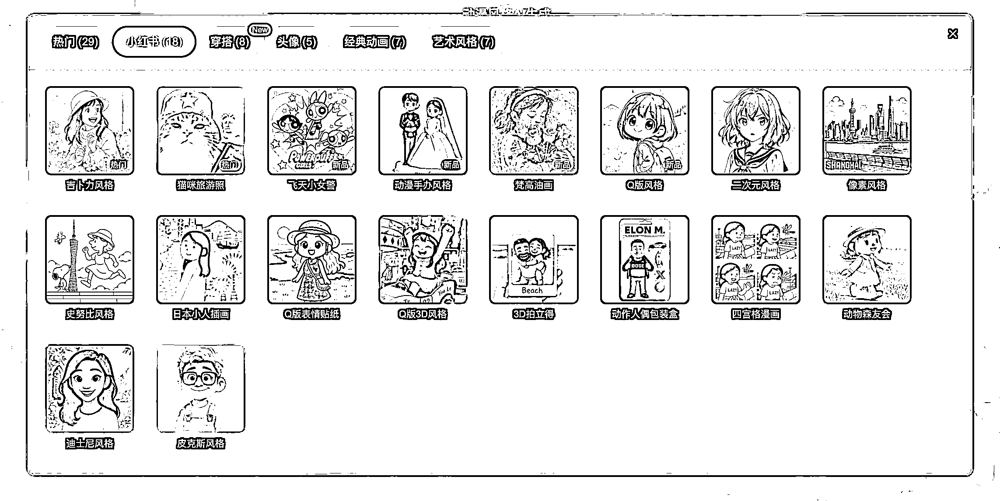

带来的爆款内容：

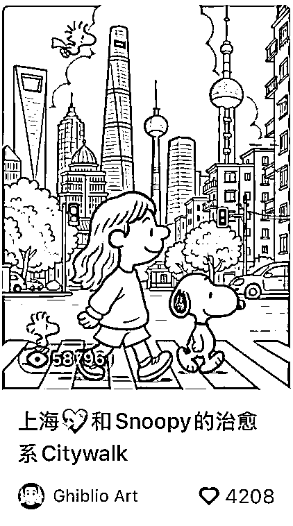

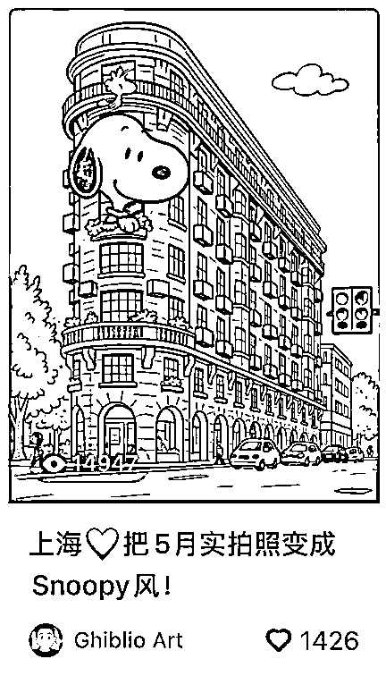

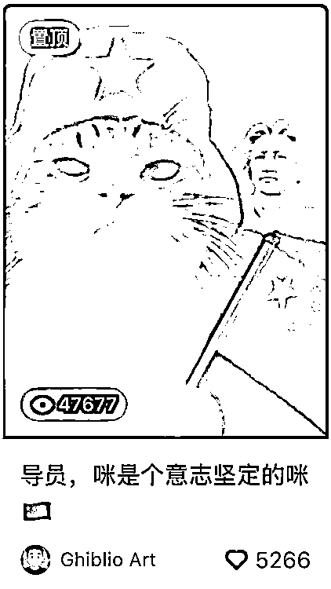

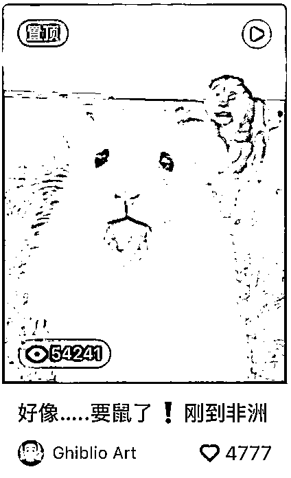

### 3. 深挖真实高频使用场景

建立了付费会员群后，我重点访谈了使用频率高、复购稳定的用户。

发现电商素材制作、短视频创作、带货视频配图等场景是高频需求。

于是围绕这些具体场景做功能优化，而非单纯追逐风格潮流。

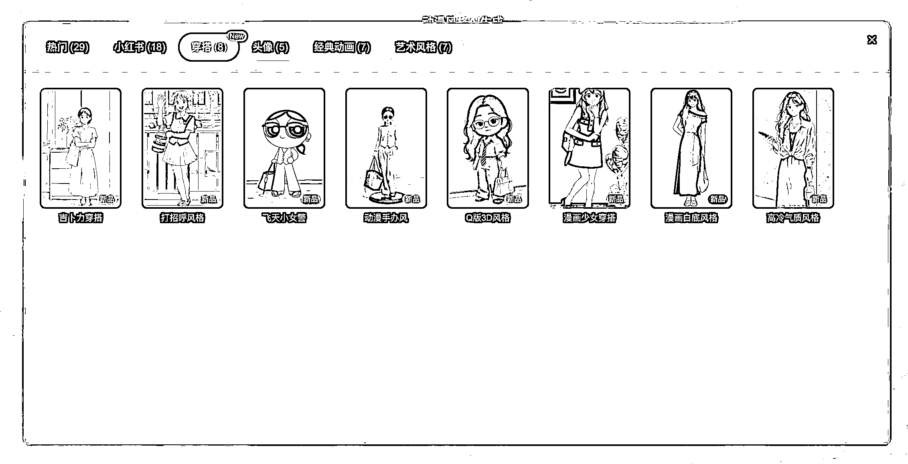

经过上述调整，原本随热度衰退的站点，获得了持续经营的可能性。

## 结语：0 到 1 只是开始，放大才是关键

很多新人看到这个案例会觉得成绩亮眼，但坦率讲，这只是小规模验证，流量体量并不算大。

更值得学习的是那些把热点放大为规模化增长的产品：

- Getimg.ai，3 月借吉卜力热度，访问量环比上涨 681.2%，从不足 200 万涨到 1236 万，成为图片类月增长第一；
- insMind，来自稿定科技，快速响应吉卜力风格需求后，独立访客从赛道靠后跃升至第一，月独立访客 731 万，月增幅第二；
- OpenArt，流量翻倍后突破千万，成为第三个访问量超过赛道中位数 800 万的华人生成工具，月增幅第三。

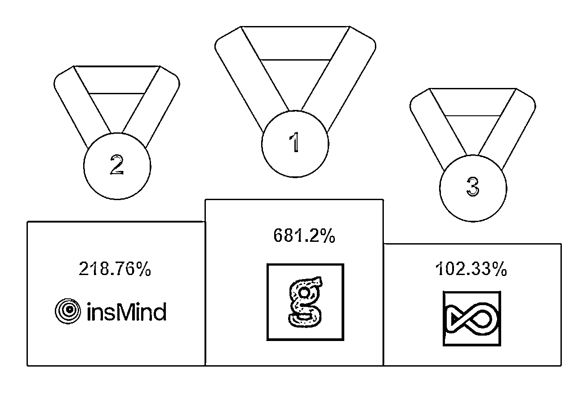

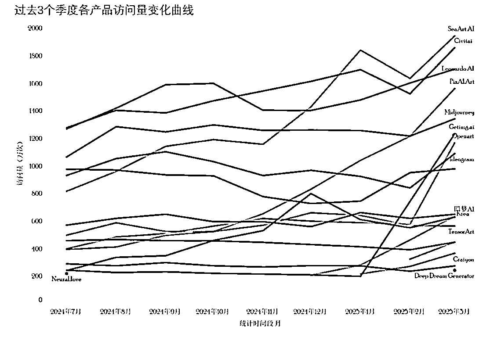

他们的高增长并非单一渠道，而是 SEO、付费投放、达人合作、产品互导等多重手段叠加的结果。

虽然这些是团队级案例，但对个人也有参考意义。个人相比机构的优势在于决策快、调整快、试错成本低。

最终决定机会能做多大的是认知、执行力和放大能力。

我这次完成的是从零到一的突破，后续如何把流量、产品和需求进一步放大，还有大量短板需要补齐。

当下 AI 赛道机会很多，重要的是提前准备。希望下一波机会到来时，我们都已就位。

---

评论区：

刘小排：很强！建议大家认真读这篇。

新页：关注过你几个项目，UI 做得很用心，产品感很强。

江炜：感谢！之前做 To B 时不觉得设计是核心，自己做独立网站后才深有体会。光好看不够，前两个项目虽也精致但最终失败。现在模型和编程能力都在提升，用户需求洞察反而成为差异点。

江炜：小排老师的精品我都看完了，最大的转变是从程序员思维到产品思维。

Freedom：能做成小程序吗？我们有证件照小程序的流量。

江炜：已有小程序版，有合作意向可联系鱼丸拿我的微信。

酷乐猫：国内访问不备案会不会打不开？

江炜：不会，采用海外站的运营方式。