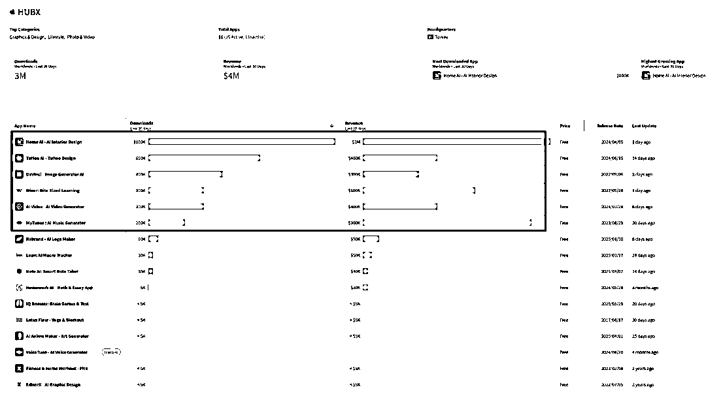
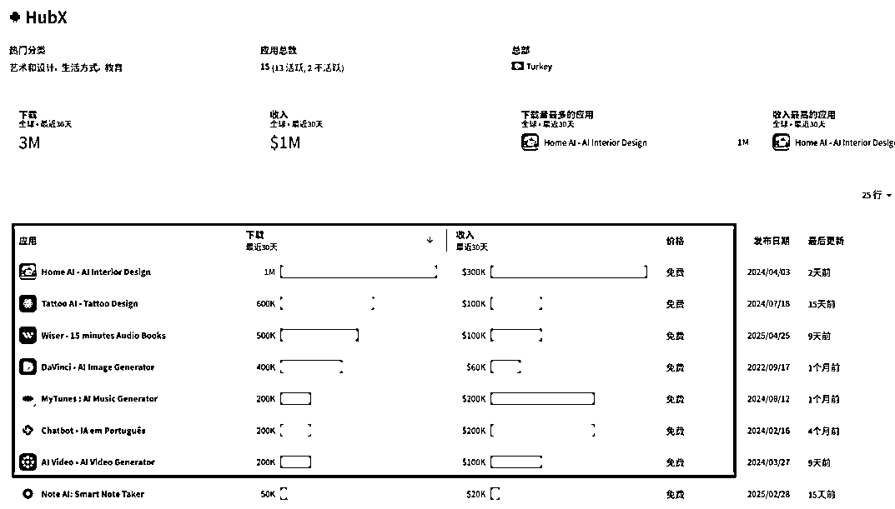
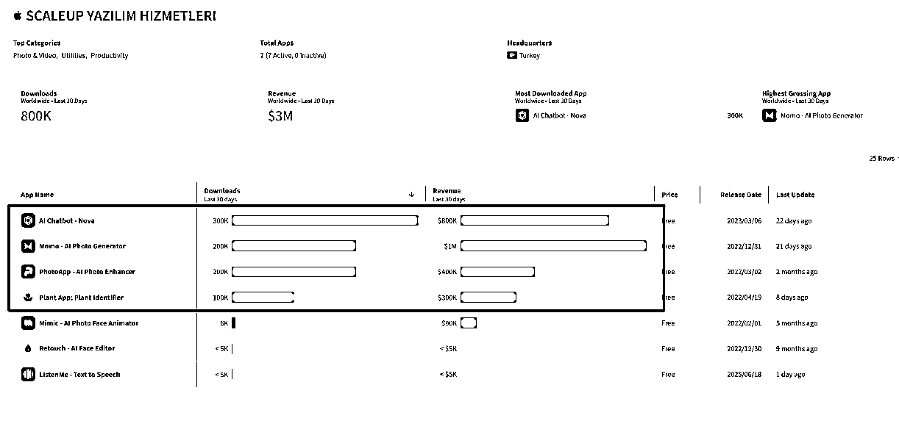
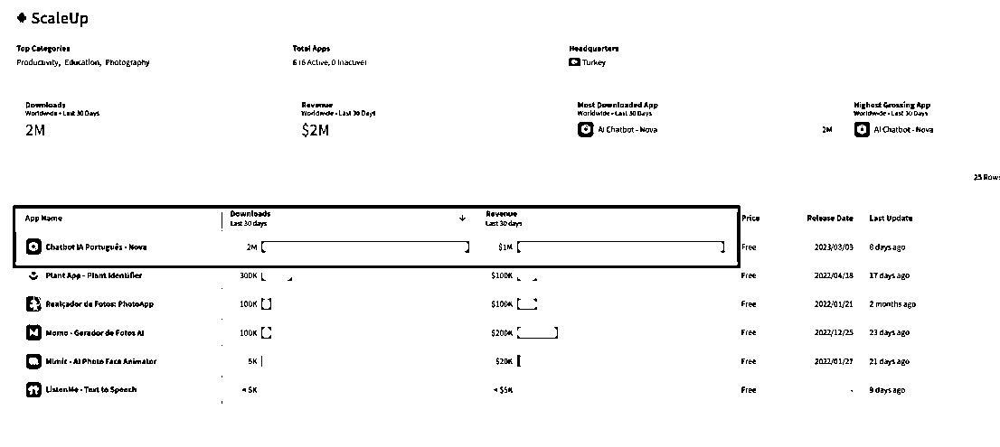
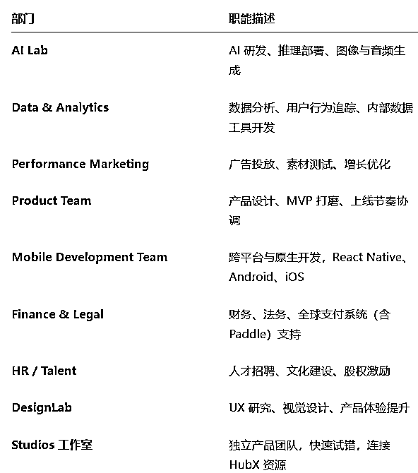

# 这家月入千万美金的 App 工厂，为什么不靠融资也能活得这么漂亮？

今天把 HubX 这家公司再捋一遍，真的越看越有意思。

它不在游戏赛道，纯粹靠 App 工厂的打法硬做起来，**现在月流水已经过千万美元**，而且几乎没见过外部资本的身影。靠的是家族自有资金加上一套很聪明的组织设计，可以说是典型的“钱跟组织双驱动”样本。

如果你对这个名字还陌生，先瞅一眼它旗下的这批产品，下载和收入都在线，认得几个？

市场上赚钱的 App 公司很多，我之所以反复拿 HubX 说事，是因为我特别吃它的架构思路、增长逻辑，还有那种“靠热爱做事、知识敞开共享”的文化。我自己之前也尝试推过类似的结构，亲身知道这套东西是能跑通的。

创始人 Cem 曾经这样定义自己的组织：

**“独立互依工作室”**。每个工作室深耕一个垂直赛道，同时所有工作室都连在 HubX 这个中心枢纽上共享资源。HubX 这个名字本身就点明了——X 个无限的独立可能，由 Hub 连接起来生长。后面我会展开说，这个模式到底怎么玩。

先简单介绍下这家公司本身。

## 一、它不是 2022 年才冒出来的新面孔

表面资料容易误导人。第三方平台上 HubX 的 App 基本都显示 2022 年后才上架，Sensor Tower、Data.ai 也都这么标注。

但看创始人的自述就知道真相不同。联合创始人 **Kaan Ortabas & Cem Ortabaş 是一对兄弟**，早在 **2016 年** 就已经以 HubX 的名义做内部孵化和小规模投资，主要靠家族资金试水。团队在摸索中慢慢成型，到了 2021 年才把“HubX 模式”系统化。

所以 HubX 的发展其实分两段：

**2016-2021**：探索期，家族资金养团队、做早期验证；
**2022 至今**：蜂巢模式正式落地，App 工厂规模化，月入千万美金，人头规模大约在 150-200 人之间。

## 二、愿景、结构和打法全拆解

HubX 内部有一套很清晰的系统化设计：

### 使命与愿景

**使命**：用精细打磨的技术产品，让用户生活更轻松更有趣；
**愿景**：成为全球领先的多垂直移动应用工作室，服务数十亿用户；
**阶段性目标**：先拿下土耳其下载量第一，再造出本土首个非游戏独角兽。

### 【HubX 公司架构模式】

**1. 创始人的原话**

“We are evolving to become a hub that contains interdependent studios under one roof. A hub where each studio has its own team and products, accumulating know-how about a specific vertical in the app categories.”

“At the center of all these interdependent studios, HubX provides shared resources with various central departments, office space, in-house data tools, know-how, and funding.”

**2. 直译过来就是**

公司正逐步变成一个 **枢纽平台 Hub**，旗下收纳多个 **独立互依工作室 Interdependent Studios**。

每个工作室自带团队和产品，聚焦某个应用垂类，把该领域的know-how越做越深。

而 HubX 坐镇核心，提供共享的中央职能、办公场地、内部数据工具、方法论沉淀和资金。

**3. 结构到底长啥样**

整体像一个蜂巢：

Hub 是中心，统管技术、数据、设计、增长、财务等通用能力；

各个 Studio 就像蜂房单元，独立运营、聚焦产品、快速响应市场；

每个 Studio 团队精简高效，通常只负责一条或几条产品线，有自主决策权，但需要资源时随时能从 Hub 调取；

共享机制避免重复造轮子和内部内耗，技术平台、AI 能力、数据中台、增长打法全部统一维护，团队可以直接复用，试错更快、上线更快。

**4. 这套架构能带来什么**

Studio 保持创业级的灵敏度；
Hub 提供集团级的后端支撑，效率和规模兼得；
长期沉淀的组织知识形成护城河。

**5. 和国内的中台有什么不一样**

HubX 的 Hub+Studio 不是国内传统的大中台。

国内的中台往往强调资源整合和流程协同，最后数据和运营部门常被推到后台，被前线挤压。很多公司出现运营归技术管、每个产品线各自招投放、数据团队远离市场做无用功的情况。

HubX 的设计团队也不是配一个 UI 就算完事。它有自己的 DesignLab，集中了 UX 研究员和跨领域设计师，公司认为这是未来增长的关键支柱。要求设计师的定位是：**不是画图的人，而是用视觉叙事驱动增长的创意战略家。**

简单说，HubX 更像是“工作室快速试错 + 中枢集中赋能”。Studio 像小创业公司灵活独立，Hub 像资源母舰按需供给。更接近硅谷的孵化+快速验证逻辑，特别适合多赛道 App 矩阵。

小结关键词：

✔️ Hub 枢纽
✔️ Interdependent Studios 独立互依工作室
✔️ Know-how 积累
✔️ Shared resources 共享资源

## 三、内部部门全景

## 四、为什么值得我们学习

HubX 模式的亮点很鲜明：

✅ 家族耐心资本，不烧外资；
✅ 蜂巢式组织，灵活又高效；
✅ 技术、增长、设计形成闭环；
✅ 以 AI 为主线，多赛道并行；
✅ 数据和产品决策高度一体化。

给做增长和做产品的同行几个自检问题：

你的组织能支撑类似的协同吗？
技术、设计、增长是不是真的在一条线上？
有没有快试错、快切换的机制？

HubX 不是简单的富二代创业故事，而是一个系统性打法的成熟案例，足够我们对照自己的业务去思考。