# (12 赞)把网站和 YouTube 绑在一起做，SEO 游戏规则变了

## (12 赞)把网站和 YouTube 绑在一起做，SEO 游戏规则变了

作者： 书情小跟班

日期：2025-07-09

更好的阅读体验见 飞书文档

本文是对下面这篇内容的一个延展 找 Shorts 爆款视频的好工具--google 插件 YouTube Shorts Crawler [`wx.zsxq.com/mweb/views/topicdetail/topicdetail.html?topic_id=5125488155524554&inviter_id=&inviter_sid=`](https://wx.zsxq.com/mweb/views/topicdetail/topicdetail.html?inviter_id=&inviter_sid=&topic_id=5125488155524554)

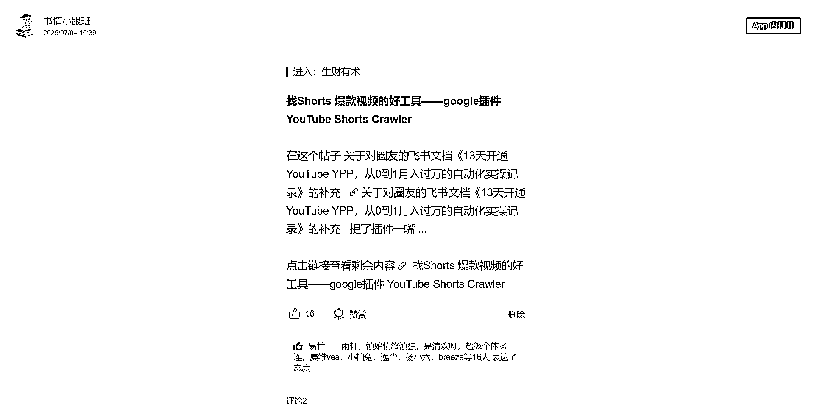

2025 年 6 月 28、29 号我参加了圈友哥飞的线下活动，结合自己的实操复盘了一下 YouTube 的新打法。

道理其实很朴素，真传只是一句话，假传需要堆砌一堆书。

**核心就一点，Google 搜索和 YouTube 搜索现在是打通的。网站和 YouTube 不该各玩各的，而要形成合力一起做。**

先说一个容易踩的坑。你用自己的账号去搜，结果往往失真。比如搜 youtube shorts crawler，你可能会看到 [`shortscrawler.com/`](https://shortscrawler.com) 排第一。实际并非如此。个人浏览历史、搜索记录都会污染结果。

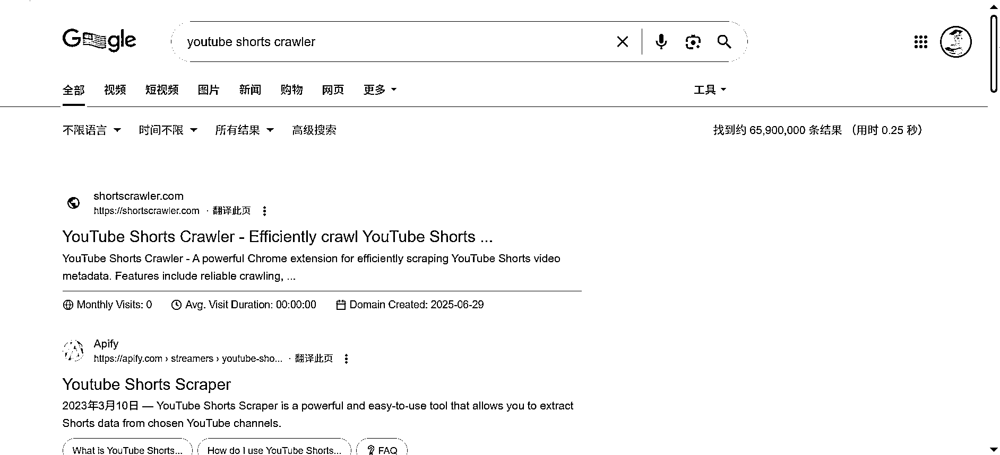

切到无痕模式避开干扰后，真实排名就出来了。第一位是大型平台，紧接着第二位就是 [`apify.com/streamers/youtube-`](https://apify.com/streamers/youtube-) shorts-scraper，然后才是视频结果。

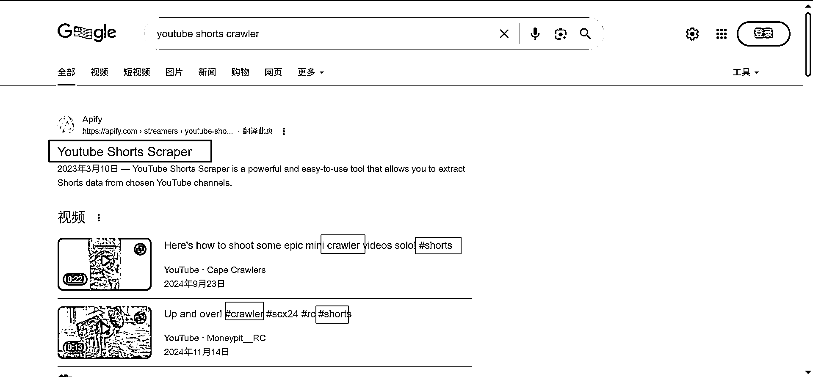

往下看视频标题就能明白机制：第一个是 Here's how to shoot some epic mini **crawler** videos solo!

#shorts

第二个是 Up and over! **#crawler** #scx24 #rc #shorts

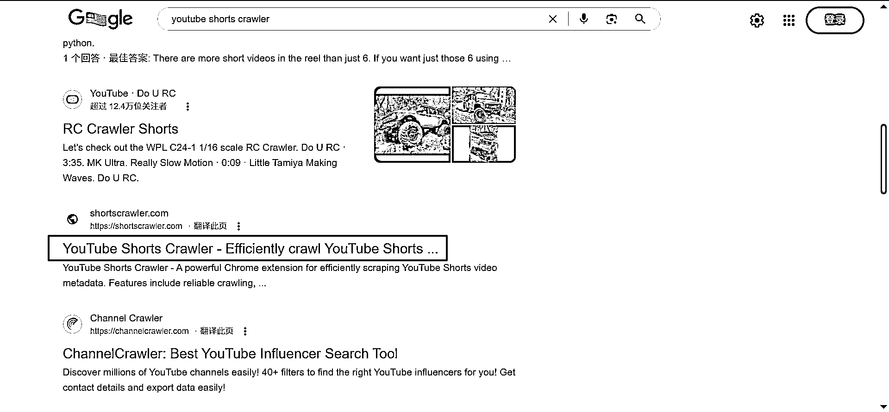

想做引流就别半吊子。标题、视频的语言最好都统一成英文。比如在未登录状态下，相关检索最初会出来广告位。

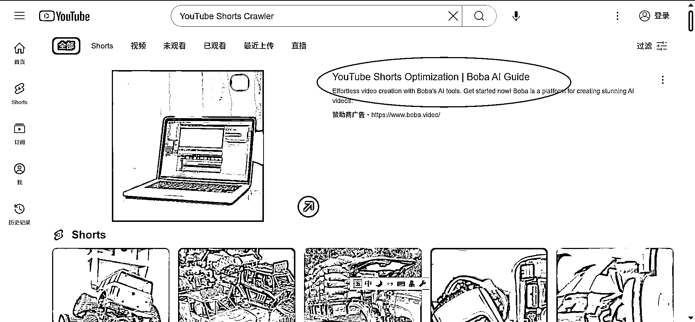

之后才是英文视频占据主要位置。

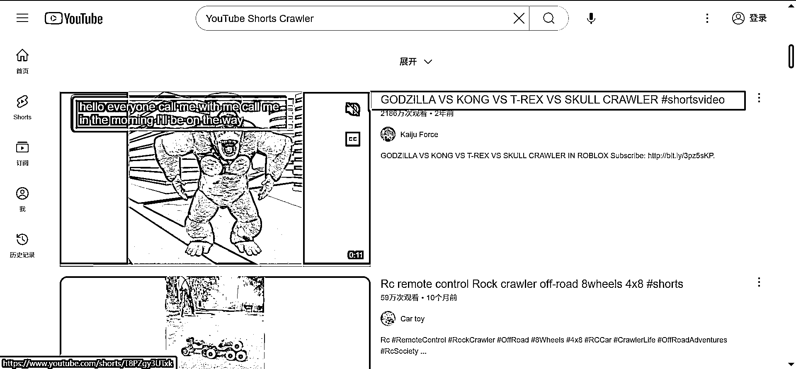

一旦搜索词里出现中文，系统默认就会切到中文结果。所以测试环境我全部用无痕来剔除个人观看记录的影响。

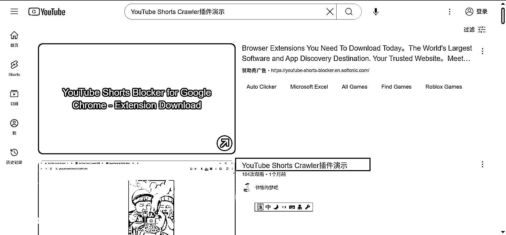

小结一下：

做一个站点或者一个插件，完全可以借助 YouTube 视频标题来做关键词覆盖。这是圈子里已经在用的公开秘密，对一部分人来说是常识，对另一部分人来说仍是信息差。

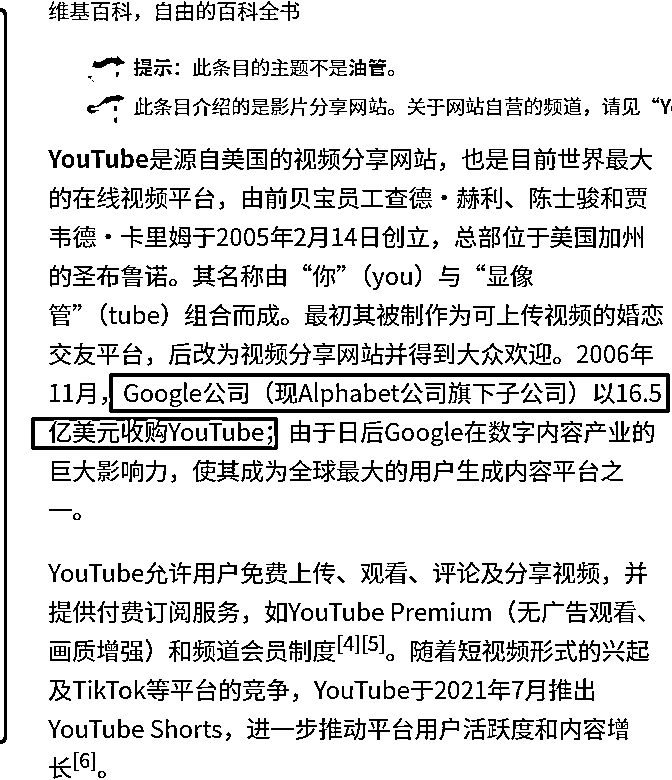

在这种关联机制下，Google 排第一，YouTube 作为亲儿子排第二。很多人只盯着网站 SEO，却忽略了 YouTube 这个流量入口，也没想过两边联动起来打。

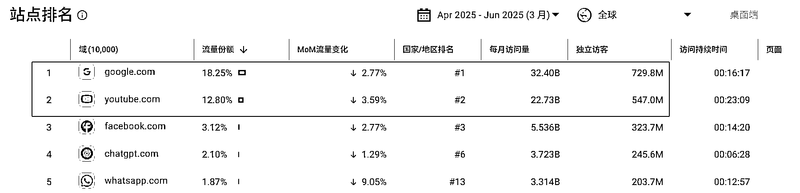

怎么联动？思路很直接：在 YouTube 视频上铺设目标关键词，等用户点进视频，就在简介区把你的站点链接挂上去，完成从视频到网站的闭环。

说完了，就这么简单。之前我在赚钱分享过无人直播的打法，利用无人直播快速通 YPP，找了最近在试水的朋友来举例，如下图。

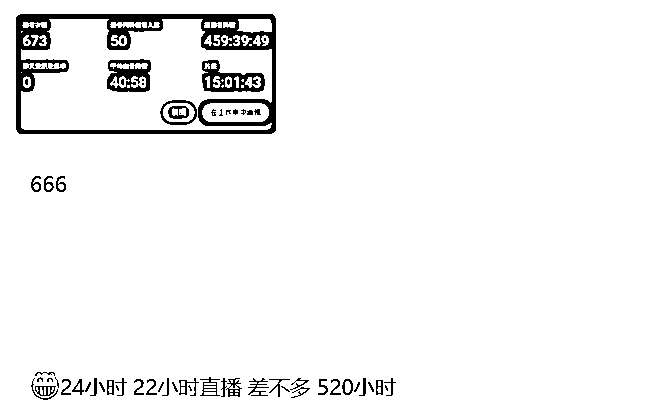

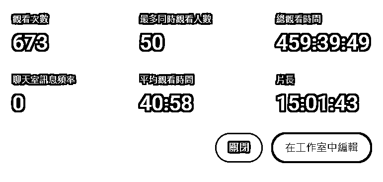

也有操作得更顺的，一场直播时长直接就达标 YPP 了。

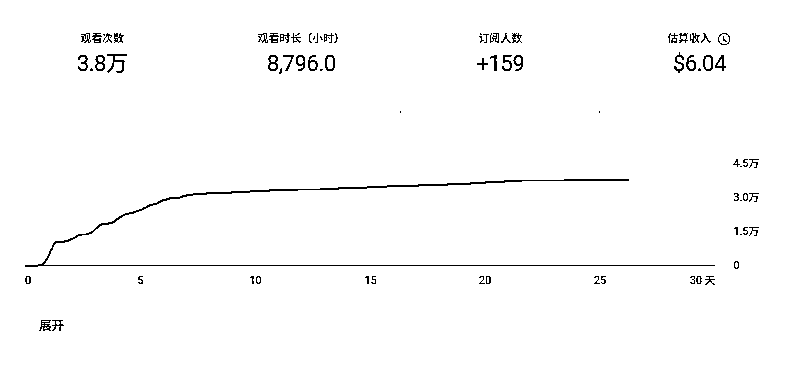

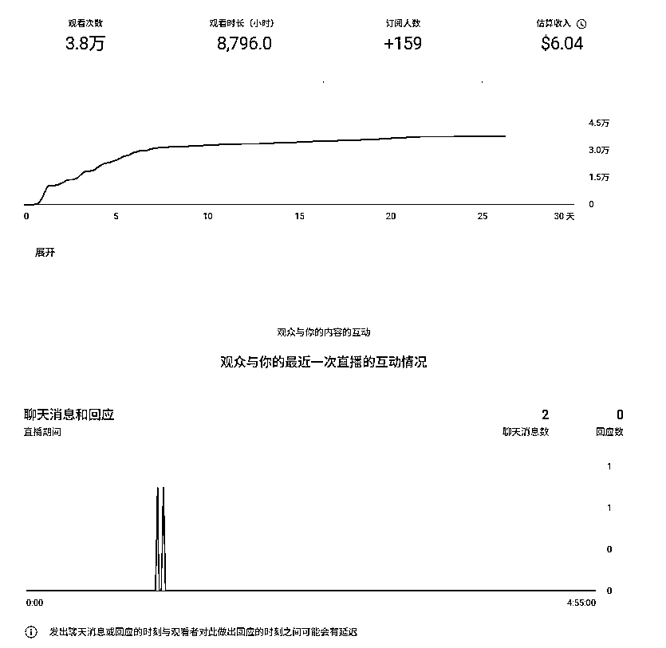

在 YouTube 上做关键词布局，等搜索流量自然沉淀。下方就是一个实操案例，关键词铺好后放着等风来，YouTube 搜索量已经做到 133W 播放。

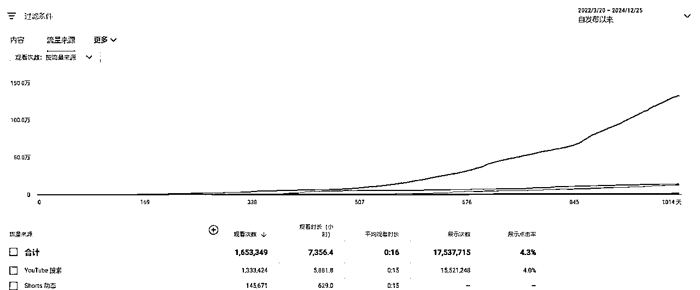

今天这个点对老玩家可能不新鲜，但对不少人来说还是新思路。我算是抛砖引玉，相信很快会有更厉害的同行把这个方法玩出新花样，期待大家的好消息。

* * *

评论区：

暂无评论