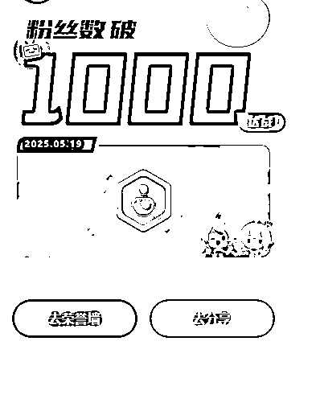

# B站拉新获客与快速涨粉实操拆解

## B站引流打法和千粉增长路径分享

作者： A 旺仔¹

日期：2025-07-08

最近龙哥老师公布了B站好物超级榜的事，这算是平台内部变现的渠道。好物这块我研究不多，但B站在引流这件事上真的很能打，正好补上之前星球里缺的一块闷声赚钱的玩法。

如果你主攻的客群在40岁以内，或者你本身就有引流的需求，这篇内容建议你仔细看完。下面分享的是一套可以直接落地的操作方案。

整篇干货是我亲手写的，篇幅接近上万字，全是执行细节，不做概念空谈。跟着步骤走下来，整个流程是可以完整跑通并复制放大的。里面也包含了一套72小时内在B站冲上千粉的打法，做好物账号的朋友可以直接套用这个模型来起号。

完整版笔记我放到了飞书文档里，大家直接移步查看

[`y9j12wbinr.feishu.cn/docx/J5SydlVtpoxdvHx2P5XcN2tInue?from=from_copylink`](https://y9j12wbinr.feishu.cn/docx/J5SydlVtpoxdvHx2P5XcN2tInue?from=from_copylink)

* * *

评论区互动：

A 旺仔¹ : 配合我之前分享的自动化工具一起用，效率会更高[`t.zsxq.com/IB2SG`](https://t.zsxq.com/IB2SG)

书虫 : 强制实名之后，旧视频会被清理掉吗，还是照样保留？

万尘 : 还是在的

A 旺仔¹ : 视频本身还在，只是账号被封的话，大部分作品会被一并锁定，上架处理。具体情况看号，个别运气好的号封了作品也不会消失

白夜 : B站封号之后还能申诉解封吗

A 旺仔¹ : 基本没有解封的可能