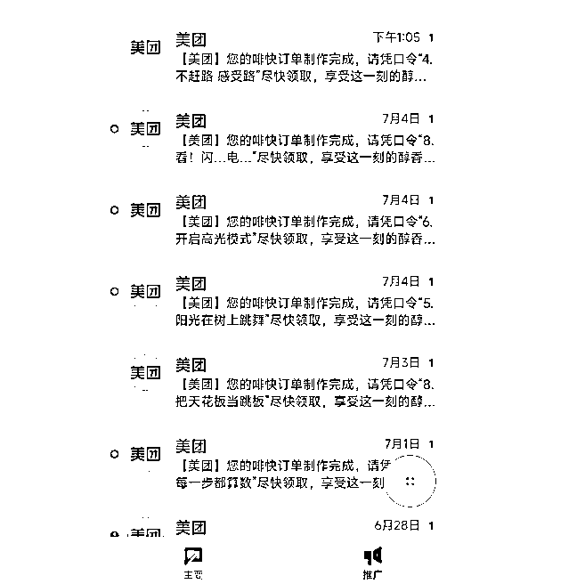
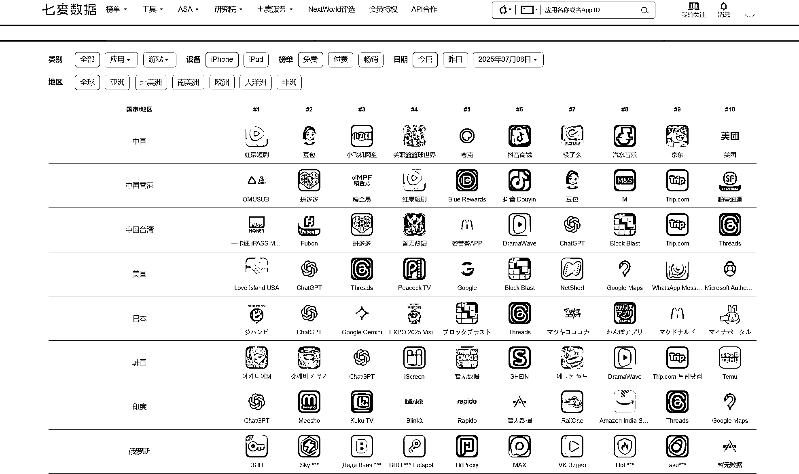
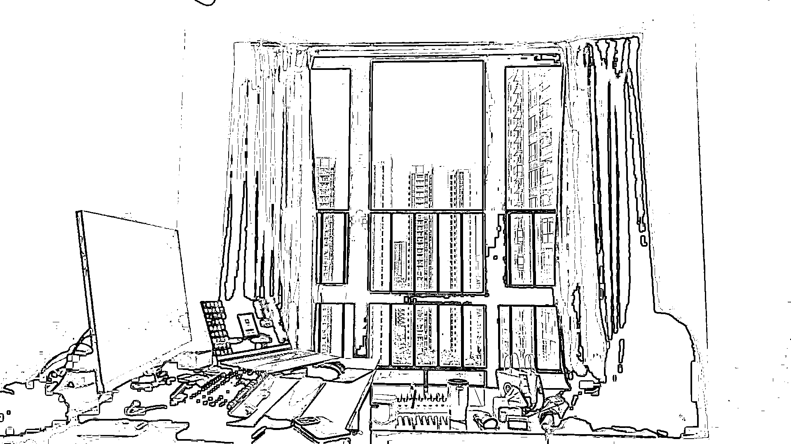
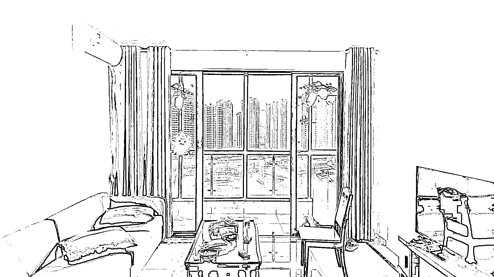
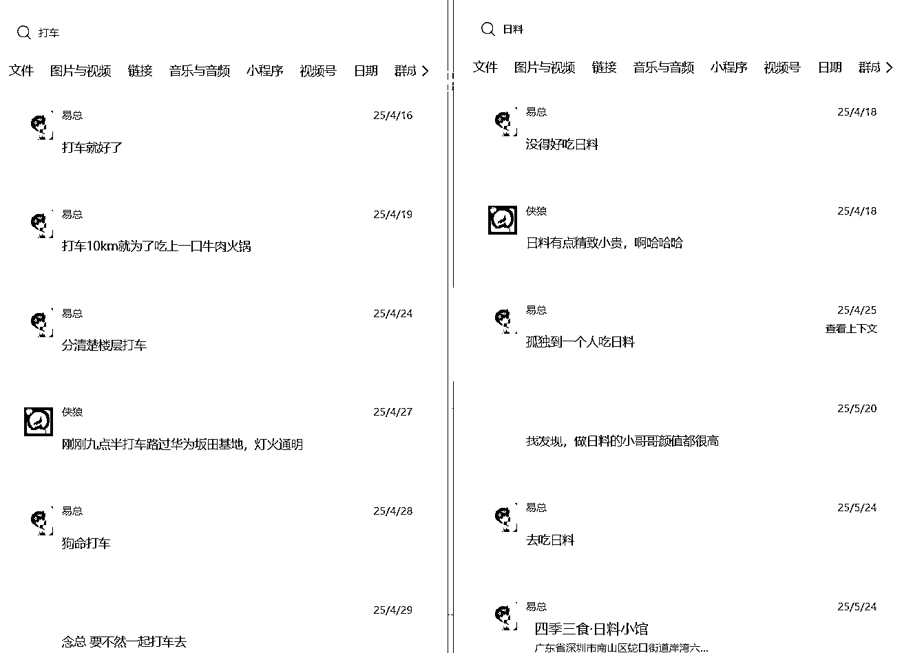

# 半年踩坑复盘：免费流量、付费投流和生活里的那些偏见

过去的半年，对我来说几乎可以用“荒废”来形容——大把时间砸在自动化工具上，回过神来才发现，自己掉进了一个大坑。工具真正的价值，是放在合适的场景里帮你提效，而不是为了用而用。说白了，绝大多数提效动作，最终指向的都是平台那点免费流量。

可如果一直指望免费流量过日子，不追热点、不碰爆款，盘子就很难做大，天花板一眼就能看到——也就是赚点零花级别的钱。当然，对多数自由职业者或小团队创业者来说，这个量级已经够了。

所谓SEO，本质也是薅平台的免费流量。就算你内容做得足够扎实，资本也不一定买账。所以不管创业还是干互联网，关键要让整条链路上的人都有钱赚。别只盯着免费流量，付费流量、推荐流量才能做出规模——没有规模，后面讲什么都是虚的。

免费流量你玩得再溜，平台一改规则，又得从头研究，心累。但真正要命的是另一件事：你能不能给平台带来直接收益。比如做投放，只要没有同行来抢，你可以很清晰地算出投多少、回多少。反观免费流量，每个员工都是成本——如果一个员工产出的流量价值连工资都不够，那其实就是亏损。太多老板创业亏钱，就是栽在这。

更麻烦的是，你辛辛苦苦把员工教会了免费流量，人家学成后可能扭头就出去单干。小公司一旦失去这个核心人才，业务瞬间断层，可能直接凉凉。真正的高手迟早会自己创业，只是早晚问题。所以创业这事，说到底还是找人——人对了，事才容易成。

而且还有个认知差：推荐流量可以反哺任何平台的SEO，但反过来，多数SEO玩法撑不起推荐流量。这话不是绝对，但希望大家心里有个爆款逻辑。推荐流量这块商业化已经很成熟了，平台肯给你多少量，心里都有本账。

写完上面这些，我其实也是把自己的过往认知打碎了重来。接下来这篇踩坑长文，希望对你我都有一点点用。

**一、有门槛的地方，一定要多去看看**

世界远比想象中大，人也一样。有空多找人聊聊，听他们怎么做事、怎么落地方案——哪怕答案你早知道，别人的执行细节照样会给你新启发。想成长、想学习，就别封闭，多跑跑、多看看、多试试。如果可以，我建议先来深圳待一阵子，别像我一样后悔来晚了。这里什么都好，就是房租贵得吓人，同等价位在非一线城市能租个像样的房子，在深圳只能挤城中村，还小得可怜。

说白了，门槛就是筛选，而且一定是筛选。

你去看那些五星级酒店、星巴克、精品蛋糕店、鸭货卤味店，全都在做同一件事——筛选客群。酒店贵有贵的原因，服务体验确实不一样，但说白了，不都是睡一晚？反正我目前是这么想的，也许以后会改。星巴克也是，同样一杯咖啡，贵一大截，我这种天天喝的人真分不出什么风味。可大家就是愿意为那个环境买单，约朋友聊天，我通常也选星巴克请客。

反过来，常喝蜜雪冰城、瑞幸的人，基本都是买完就走，压根不在乎环境。有人说这是群体和收入不同，我觉得纯属扯淡。如果东西一样，正常人第一反应自然是选便宜好喝的；便宜货就算踩雷了，也不心疼。

还有做社群、做培训的，总有人说割韭菜。说这话的人，压根没站到付费者的位置想过。像龙哥盟，是我目前很喜欢的圈子，可只要涉及利益，就有人吐槽、有人喊值。那些真金白银付费的人傻吗？当然不是，只是各自阶段和视角不同。就像坐高铁二等座的人，很难理解商务座的人——反正目的地一样，凭什么差这么多钱？

人心里的成见，真就是一座大山。现在想不通，可能哪天就突然明白了，也许很快，也许很久。但如果你连听都不想听，一碰到不同观点就拒绝，那就永远没有后续。所以同一件事，有条件就多听听别人的角度。答案和机会，都是聊出来的、碰撞出来的，不是自己闷头想出来的。

**二、常见的一些偏见**

说到偏见，我以前特别看不上投流，总觉得那玩意儿分分钟亏钱。现在回头看，哪是投放坑，分明是当年穷+认知低，眼里只有免费流量。后来我把免费流量也做起来了，多少证明自己有点东西。

但真正稳的赚钱逻辑是什么？先用最快、最小的成本把0到1跑通，证明这事能落地，再花小钱试错放大。记住，免费流量是成本，付费流量也是成本。资金允许的话，付费流量的钱值得花。很多人连最基本的0到1都没跑通，自然更没机会验证后面的东西。

很多人跑着跑着就跑偏了：张口就是做矩阵，找人兼职发帖、代做内容……先问问自己，免费流量的闭环你跑通了吗？视频会剪吗？黄金三秒会做吗？图文会写吗？SEO会搞吗？招人、管理你懂吗？这些事越堆越多，难度是指数级上升的，而且离钱越来越远。

事情越杂，离钱越远，结果往往越难看。一定要去做离钱最近的事，正反馈就是第一生产力。

有时候赚钱没成，纯粹是方向跑偏。本该多干自己擅长的事，我却总盯着不会的事折腾。好学没错，但很容易跑题。当然，如果一件事够大、够远、门槛高、你又真感兴趣，那大概率干得成。

比如Web出海，一说这个，好多人先被英语和编程劝退了。其实这俩根本不是核心问题。我身边有朋友一听做网站，脑子里全是写代码、学单词、啃文档，然后就没有然后了。可我自己呢？以前都是套模板建站，毫无技术含量；做SEO就是去知乎、B站发广告引流，不也做起来了？现在我还不是从零开始啃Next.js写Web站，照样能推进。多数人不过是在做白日梦，连学都没学。没有强相关的场景需求，或者没有强烈的执行欲望，光靠三分钟热度，肯定撑不下去。

说到底，还是要从自己身上找原因。你身边是什么环境，你就会被染成什么颜色；想改变“基因”，最快的办法就是换一个全新的环境。为什么公司里新人往往很拼？因为他们想活下来，只能拼命学新东西、拿正反馈。而老员工早就学会摸鱼了，甚至天天把法律挂嘴边——罗翔老师说过，法律只是对人最低的道德要求。

**三、生活里的偏见，还有一大堆**

比如我最近搬到惠州大亚湾，一说这地名，很多人马上想到“鬼城”“南方鹤岗”。鹤岗真的那么差吗？大亚湾真的差吗？这些人压根没去过，只靠自媒体口嗨，不看具体数据和增量。

其实很多信息都能用数据说话：618销售额、手机销量排行、App付费榜、下载榜……都是公开透明的。

同样，一个行业好不好做、是上升还是下行，不调研、没数据就一句“做不了”，这哪是行业不行，分明是你没做起来。可惜大部分人的脑子早被自媒体洗得一团浆糊——没常识、没数据、一问三不知。

再问一句：我为什么来惠州？那些人为什么跑惠州买房？有多少人认真想过？惠阳坐高铁到深圳北只要25分钟；以后西丽高铁开了，从惠阳到南山可能比龙华还快。这才是当年一批人下手惠州的重要原因。

不妨算笔账：在深圳租个2000块的小单间或6平米合租房，同样的钱，在惠阳能租到新小区的三房两厅，甚至五房两厅，离深圳还不远。如果你是自由职业，大概率也会动心。真要有圈友过来玩，随时喊我，这地方租金便宜，五公里内一堆商场。

反过来，如果你毕业后一直在北上广深，住惯了城中村、合租房，你很可能从没想过还能租公寓、小区房，只会下意识地继续找下一个城中村，好像收入预算就锁死在那里。可现实是，很多小区房、公寓的价格跟城中村差不了太多，但七八成人听到“小区房”就自动略过了。

还有个大坑：大家默认标价就是成交价，完全错了。价格本来就是挂出来让你砍的。你不砍，商家当然开心；但有些商家巴不得有人来咨询、来砍价——商品的核心是流动起来，租出去、卖出去才叫赚钱，砸在手里才是亏。

**四、找到在这个位置的人**

要真想知道一个地方、一个行业怎么样，最好去问那些正在用、正在做的人。

就说我租的这套房：惠州大亚湾，5公里内4个大型商业广场，离深圳最近的地铁站12公里，到惠阳站7公里，26分钟到深圳北。110平精装新小区，三房两厅带四个空调，600米外就有大型商业体，星巴克、海底捞全都有。你猜一个月多少钱？

房东最早挂价1600，我让中介试着去砍，居然砍下来了——有时候，机会就是试出来的，你不试，永远不知道答案。最后1300，不含物业费，加物业费1600。很多人一听“大亚湾”就摇头，但压根不了解这里的现状，也不知道大亚湾还有那种特别抗跌的3万多一平的房子。

我有个朋友比我早租房，开口还是按广州的预算来。我说加点预算就能住三房两厅、好环境，但他预算卡得太死，贵的一律不看。而我从一开始就打算多看几套，然后再找中介砍价，结果自然住得更好。同一个小区、不同房东、不同户型，总会有人愿意便宜租、便宜卖，关键看你会不会去试。

互联网上信息太多，人一定要学会判断信息的来源和真假——这正是现在AI短期内解决不了的问题：AI幻觉。AI的数据基本来自互联网，而互联网上大量信息是别人的软文，甚至本身就是错的。如今的AI顶多帮你整合数据、猜你想要什么，还谈不上辨别真伪。

其实很多问题都有现成答案，答案就藏在“在这个位置上的人”那里，直接去问具体数据。我们没法做完整市场调查，但只要能找到对的产品、对的价位，就可以成交。

做调研有个土办法：先准备500到1000块钱，当作“注定要浪费”的钱，找几个正在做这个项目的人，一人转188或88。反正这钱一开始就准备丢掉的，他们收不收都行，但大概率你会多几个朋友——最差也不过是多花几百块。每个人的阶段不一样，这个方法也不一定适合所有人，但保持开放、不抗拒学习，真的太重要了。为什么总说长江后浪推前浪、前浪死在沙滩上？就是因为后浪愿意学，前浪不学啊。

记得多看数据，偏见太容易把人带沟里了。另外，在合适的时候，也可以故意浪费点小钱，去体验点不一样的快乐。

比如花一百多块，去深圳湾一号72楼喝杯酒，看看那些住着近亿豪宅的人是怎么生活的——小钱装大B，值。广州塔也一样，为什么那么多人挤破头也要上去？再比如用Cursor写写代码，试着撸个网站；吃一回榴莲、尝一口菠萝蜜和折耳根；买台苹果手机、一双几百块的跑鞋、一辆上千块的山地车、一台配置更高的电脑……这些事，绝大多数人都负担得起，也配得上享受。怕就怕你连想都不敢想，那才是真的把自己卡死了。

**五、试试看呗**

来了深圳，我很想谢谢小易。有段时间我满脑子只有攒钱。攒钱当然没错，但攒到极致、活着的意义都没了，那还有什么意思？

我当时特别看不懂他：动不动就从龙华茜坑打车跑去华侨城喝咖啡、吃日料、喝粥，车费贵，来回还要一个多小时。 直到后来我也换了城市，亲自体验了一把，才惊觉真香。只是那时我花钱还没他那么大胆。现在在惠州，打车7公里基本不超20块，简直随便造。这种快乐，真得自己试了才知道。对了，要去华侨城的话，记得下午去。

小易有句话特别狠：“你赚那么多钱干啥？大不了再赚回来就行了啊！”我靠，这句话瞬间解开了我好几个心结。真的是这样——如果你一直只做小项目，身边又没有赚大钱的具体案例，那很多消费和想法压根不会被打开，甚至不敢想。想都不敢想，还谈什么后面的事？

所以人必须“开眼”，去看看那些老板是怎么赚钱、怎么落地的，怎么做到一天几万、几十万、几百万的。别一听“日入几万”就说是假的。要学会拿数据去拆解、去思考，先选择相信，再去验证。出门在外，身份都是自己给的，别人也是。

我也见过一些人，月入过万甚至几万，花几千块报课、投资眼睛都不眨，可一到花小钱提升生活品质，就抠得不行。这种心态转变真的需要时间，因为我自己早期就是那样。

当然，这篇文章是有“毒”的，不一定全对——如果一个人兜里只有几千块，硬要他去体验这些就太不现实了。先攒点资金，手里有项目了，再去感受这些不迟。如果可以，试试出海，或者多看看案例，最好是找那种具体到你自己也能照做的，至少让自己觉得又有机会、又行了，不必天天焦虑未来没钱花。

赚钱和创业本来就是以小博大，连野心都没了，还做个毛？人总得为了某个目标往前跑。我也常问自己：我到底想要什么？终极的生活是什么？抛开房子车子，我现在其实挺开心、挺满足。只要把预期调低、需求砍少，快乐很简单。每个阶段都有不同的活法。你要是觉得生活没意思，不如好好想想：我想成为什么样的人？我要把自己活成什么样子？

关键永远是“重在参与”——赚钱、花钱、体验、感受，都得有，而不是只会说“我想要”。人想要的太多了，贪念和欲望是无底洞。主动砍掉一些欲望、砍掉一些不靠谱的想法、砍掉那些不赚钱的事，生活自然轻松。很多时候，是我们自己给自己上了枷锁。其实任何问题都有答案，只是答案可能就藏在你当下遇到的问题里。

**六、利益关系**

最后再聊聊收费这件事。我发现国外很多人的付费意识比我们强得多。比如在贝壳上找房，租房就得给中介费。若没有这份利益，中介小哥凭什么带你看那么多房、帮你砍价、把你的预算理得清清楚楚？说穿了，两边谈拢了，事情就成了。

可总有人骂中介费坑人。坑吗？可能有个别案例，但得分人，不能一棍子打倒一船。记住一个原则：任何牵扯利益的事，都多打几个问号——这事对谁有利？还是双方都有利？如果这种利益关系让你很被动、很焦虑，那就多找几个人问问。

这事跟你有多大关系？你能拿到多少好处？风险又有多大？多问多想，实在不行就找个明白人付费咨询。所有问题都有答案，一个不行多问几个。可很多人不愿开口，总觉得一付费就是被割韭菜，那就真没办法了，死局。

最典型的例子是买房——很多人一辈子买过最贵的东西，十几年攒下来的钱，几天就拍板了。就因为偏见，不多问、不调研，然后被套一辈子。

**写到最后**

这就是我这些年用真金白银换来的心得。这篇文章的“上限”和“下限”都很高，能吸收多少，全看你自己处在什么阶段。最后想送大家一句话：多鼓励别人，也别打击自己。“鼓励师”未来说不定真的是个热门职业。

比如你给自己定了个每天打卡的任务，一个月打了25天，最后几天断了——你会因此否定前面25天的坚持吗？不会，那已经很了不起了。同一件事，换个说法、换个角度，感觉就完全不一样。

好了，先写到这。希望这些踩坑经历，能给你一点参考。有朋友说得更直白：先把能赚进口袋的钱赚到，比什么道理都实在。

很多人做选择时，容易被“离大城市近”这件事吸引，却忽略了真正重要的生活成本和收入回报。

如果一个地方距离繁华城区不远，往返也方便，同时房租、日常开销和生活压力都更低，那就没必要一开始就扎进高成本的大城市。尤其对自由职业者来说，能把开支降下来，再想办法拓展一些本地机会，反而更容易把收入真正留下来。

说到底，不管是工作、定居，还是折腾副业，最核心的目标始终是赚钱。那些看起来光鲜的选择，如果不能带来更好的收益，意义其实没那么大。与其为了所谓的“城市光环”承担更高压力，不如先在性价比更高的地方积累资源，等条件成熟、发展起来之后，再考虑是否进入更繁华的城市。