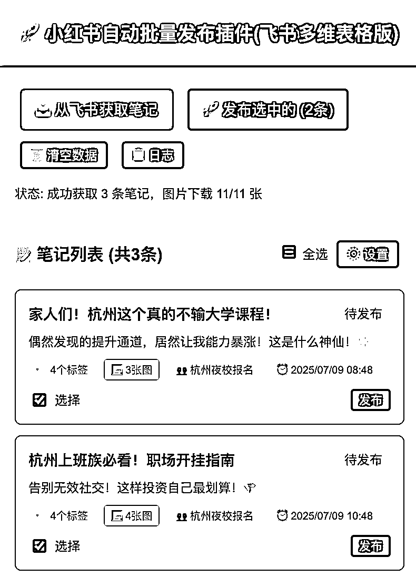

# ('(21 赞)小红书矩阵管理与素人分发工具方案', (2, 24))

在杭州做夜校，我管着 15 个小号，每天固定发 3 条笔记。内容本身不难搞——兼职都在飞书多维表格里写好了，真正的苦力活在“搬内容”：复制、粘贴、发布，再来一遍，枯燥不说，还容易出错。

市面上能“自动发布”的工具翻了个遍，结果发现基本都是绑定图片文件或特定 txt 格式做批量导入，没有一个能直接读飞书多维表格。可飞书多维表格是我图文素材的大本营，凭啥要我反过来适应那些文件格式？既然没有趁手的，干脆自己动手。

我用 cursor 搞了一个浏览器插件，配合比特浏览器和代理 IP，就能在小红书网页端完成自动化发布。定时发布、关联群聊这些功能也都集成进去了，所有配置直接写在多维表格里。现在每天打开比特浏览器，拉取当天的 3 条笔记，批量发布，几分钟搞定。发完插件还会自动把发布账号和时间回填到表格，顺手标上“已发布”。

插件解决了自营号的问题，但素人分发又是另一回事。手机在兼职自己手里，没法装插件，一条条微信转发太折腾；用飞书卡片又得让人家多下一个 app，回填信息也麻烦。我理想中的状态是：对方扫个码，直接跳到小红书发布。

可惜小红书没有开放自动发布的接口。于是我又做了个移动端网页：从飞书多维表格把内容拉出来，手机上按钮一按就能复制文案，发完之后把笔记链接填回表格。就这样一个简单的东西，连我 60 岁的妈妈都学会了发笔记，每天乐呵呵地赚点外快。

  

整套玩法捋下来其实就三步：按条件筛选出要发的笔记、图片下载加内容展示、最后回填发布信息。做这个浏览器插件是我用 cursor 编程 8 个月来第一次上手，踩了不少坑，但也总算把飞书 API 用明白了。真的是在解决问题的过程中学东西最快。

有人如果也想用这两个工具，可以找鱼丸介绍我试用。评论区也欢迎聊聊你们的素人分发方案，说不定有更好的思路。

补充一句评论区里的讨论：有圈友问接口，我这边是浏览器插件模拟点击小红书创作平台网页端实现的；移动端网页没有接口，只能人工复制粘贴发布。另外也有人提醒，比特浏览器现在的流量风控比之前严了，效果可能打折。