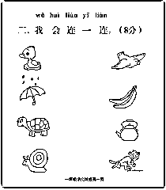
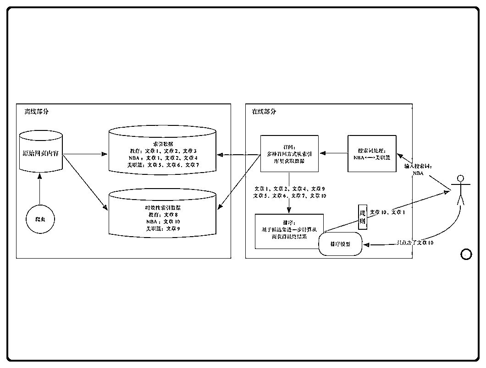

# ('(14 赞)公众号低质量内容破局与推荐系统解析', (2, 25))

最近不少公众号运营者都撞上了同一个怪现象：辛辛苦苦码出来的文章，系统却冷不丁弹出一句“内容质量偏低”。更让人懵的是，有些纯AI生成的东西被提示也就罢了，连逐字手写的原创也被贴上这个标签，甚至阅读量只有个位数也难逃一劫。这到底是怎么回事？我翻了不少资料，结合自己的思考，试着把这套机制讲清楚。

先别急着骂系统，它其实是在干一件“吃力不讨好”的活。

在报纸和杂志主导的年代，我们看到什么，基本由编辑说了算。那时候内容的生产权集中在少数渠道手里，大众的阅读口味，其实是编辑帮你“圈定”的。可到了互联网时代，人人都能生产内容，数量爆炸式增长，编辑这个角色压根忙不过来了。这时候冒出一个新难题：怎么让海量信息精准地送到感兴趣的人眼前？换句话说，怎么让每个用户看到的都是他可能喜欢的东西？

于是，推荐系统诞生了。说白了，它就是为了提升信息匹配效率而设计的一套工具。

你可能会说，推荐算法经常给我推一些莫名其妙的东西。但事实是，系统可能比你更懂你自己。就像是“象与骑象人”，你以为掌控方向的是骑象人，但真正发力的是那头大象。

那系统是怎么实现“懂你”的？它是把世界量化成了一堆数字。想象一下，你站在镜子前，却发现自己被数据解构了：科技占10%、篮球占4%、历史占1%、自然0.3%……用户被拆成年龄、性别、阅读记录等标签；内容也被量化成价格、阅读量、完读率、转发量等指标。推荐系统干的事，就像小学课本里的“连线题”：一边是用户，一边是内容，它负责画上那条连接线。

那这条线到底怎么画出来的？得先聊聊推荐系统的“前身”——搜索引擎。

搜索引擎的原理其实不复杂。你可以把它看成推荐系统的一个极端版本：当系统对你一无所知时，推荐算法和搜索算法基本没区别。典型架构大致长这样：

整套系统分两块。一块是“离线部分”，专门负责内容抓取和整理。爬虫从各处捞回原始内容，再根据搜索需求建立索引。索引是个关键词对应一堆内容的列表。拿“NBA”举例，这个词可能关联着几千篇文章，系统按点击量给它们排序，点击高的、权重大的排在前面。另一块是“在线部分”，负责响应你的搜索请求，把排序好的结果呈现给你。真实的架构肯定复杂得多，但核心逻辑就这两层。

经典的搜索引擎，比如百度、谷歌，流程大概是这样的：爬虫全天候工作，把内容收进索引；你输入关键词后，系统会先清洗理解，做分词、纠错、同义扩展。你敲了“NBA”，系统想到“美职篮”也是它，就一起拉出来查。你输错了字母，系统帮你修正后再搜。最后，根据点击反馈不断调整排序权重。比如“红花会”这个词，在《中国有嘻哈》火起来之前，前面全是金庸小说；节目之后，再搜就变成说唱相关内容了。

到了推荐系统这里，倒装发生了：它同样有离线部分和在线部分，但最核心的差异是——不需要你主动搜了。以前的搜索是“人找内容”，现在变成了“内容找人”。

拿微博举例。最早的时间流形态，完全按发布时间排列。那时候新用户注册完，必须自己选兴趣领域、关注大V，不然时间线上空空荡荡。一个空荡荡的平台，哪留得住用户？于是微博上线了推荐算法。现在你注册，就算一个不关注，打开首页也会刷到一堆美女、军事之类的内容。你手指滑几下，停在哪条上、看了多久、评没评论，系统默默记下，慢慢调整推送。第二天，仿佛整个App都在按你的喜好定制。推荐算法的意义就在这里——它是个比你更懂你的“信息分发员”。

这个过程中，内容与用户其实是双向进化的。对内容来说，每个用户既是消费者又是投票人，被认可的内容被推送得越来越远，没人买账的则被系统降权纠偏。对用户而言，每一次点击、停留、划走，都在一点点塑造自己的数字画像；而系统的主动试探，也在不断给这个画像增加新的标签。

现在回到最初的问题：为什么你的内容没人看？因为你的内容连系统筛选那一关都没过。

前面说过，推荐系统分离线部分和在线部分。你想让文章出现在用户屏幕上，必须得先进这扇门，也就是在离线索引里排得上号。最近腾讯公众号频繁提示“低质量”，不管内容是AI生成还是手写的，都可能被拦。这说明公众号的离线系统里安装了文本质量检测这道关卡。如果你的文章被判定为低质量，直接进不了在线分发池，哪还有什么曝光？

于是又有人问：那为什么有些通篇是乱码HTML代码的帖子，反而能轻松斩获十万加？

因为在系统眼里，那篇乱码文章或许带来了“信息增量”，值得推一把。平台要的是内容生态的多元化和差异化。换句话说，平台不关心你怎么写的，更在乎你有没有提供新的东西，能不能让用户看到不一样的内容。

这里也牵扯到信息源的优化问题。很多人拿着同一个工具反复打磨提示词，但提示词层面再怎么微调，信息总量并没有增加。同一个话题写一百次、一千次，可能性都被穷尽了，哪还有什么增量可言？所以，与其在措辞上死磕，不如去思考如何从源头上引入新鲜的信息维度。

如果你也对这套逻辑感兴趣，可以翻翻闫泽华老师的《内容算法：把内容变成价值的效率系统》这本书，里面讲得更系统。

总的来说，想在公众号体系里杀出重围，光靠“努力产出”远远不够，还得弄明白系统是怎么运转的。过不了系统那关，再辛苦的手写也只是自我感动。