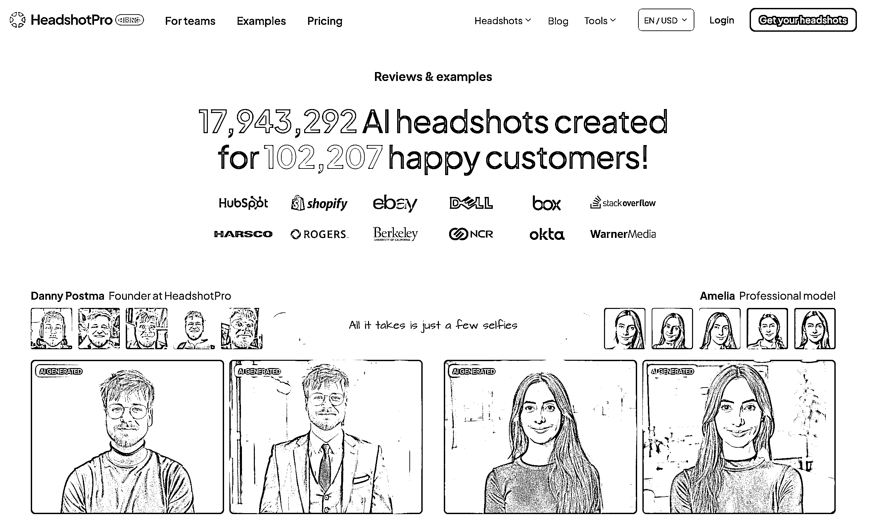
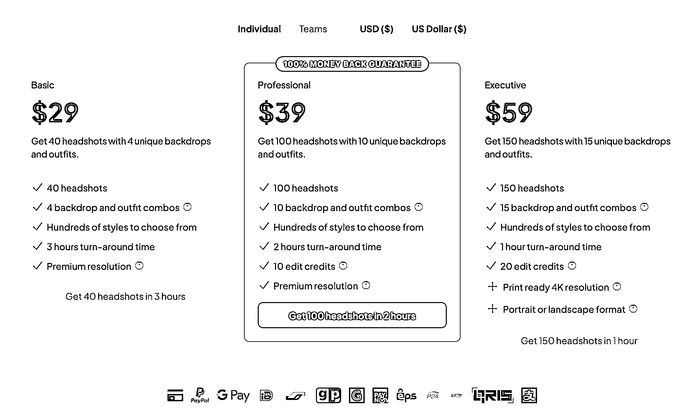
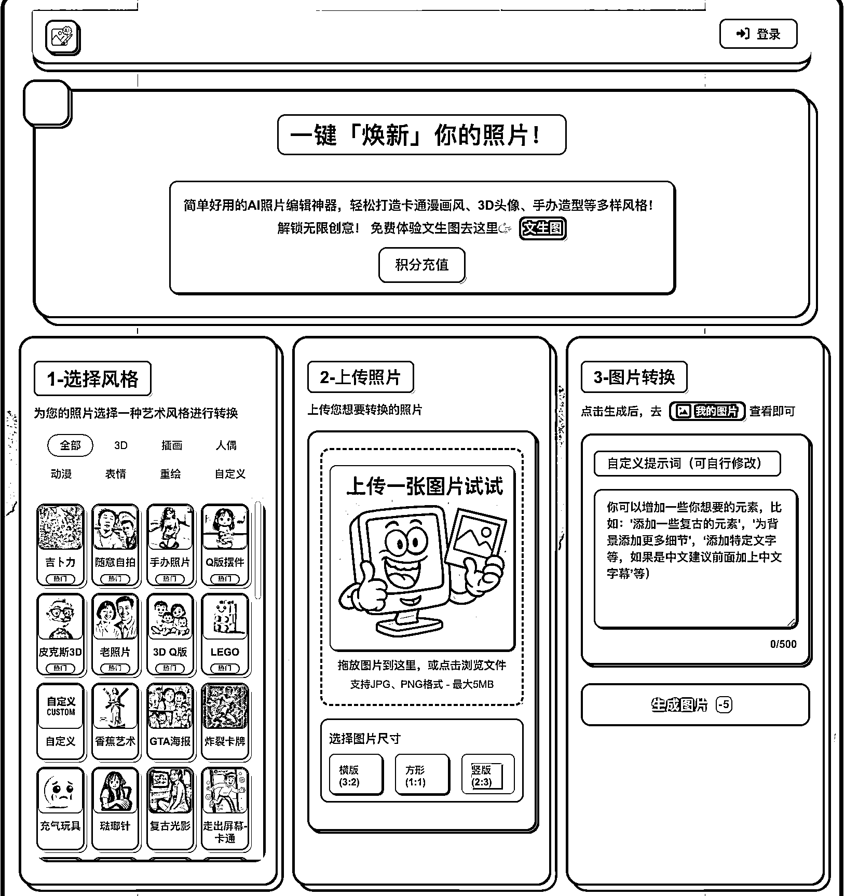
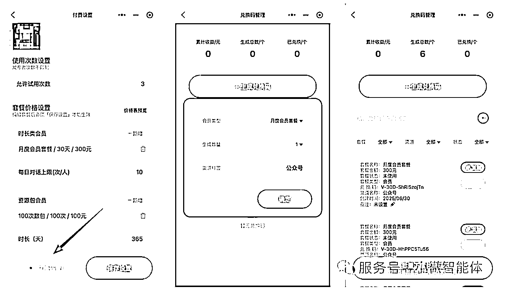
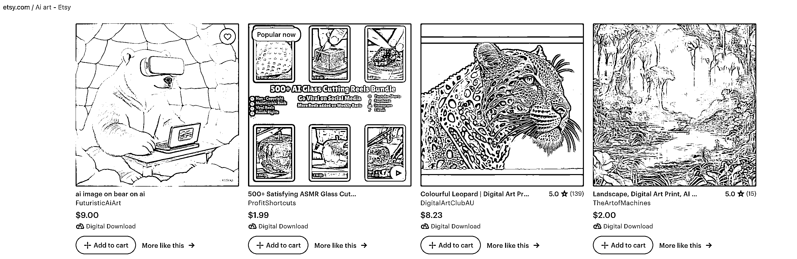

# 图像生成技术平民化之后，普通人赚第一桶金的两条可行路径

过去想设计一张拿得出手的商业图片，要么有专业背景，要么舍得花大价钱买工具。GPT-4o 这类模型问世之后，局面彻底改写——拿着手机说几句话，几分钟就能得到几十张不重样的成片。过去报价成百上千的海报、Logo，如今几乎不再构成门槛。

回头看看：第一次电商浪潮时，犹豫的人都成了看客；短视频爆发那几年，轻视它的人又错过一轮。现在的图像生成浪潮，同样在给那些没有太多筹码、但愿意踏实执行的人发机会票。

继续犹豫，错过的可不是一个热词那么简单，而是个可能让生活轨迹发生偏移的窗口期。风口就在面前，手无寸铁的普通人能不能分到钱？能。但前提是别只当那个欣赏和点赞的旁观者，要亲自跳下来参与。

我把市面上所有跟图像生成相关的模式都梳理了一遍，筛到最后，真正符合普通人操作条件的就剩两类。第一类是自己不产出内容，专门为产出内容的人提供装备，相当于开渠引水、收过路费。第二类是自己拿着工具下场，做出东西直接拿去换钱。前者追求规模效应，后者讲究立竿见影。

下面拆开细说。

## 方向一：做提供装备的人，建一套能自动运转的收钱系统

这个方向的核心逻辑很简单：你不去亲自挖矿，而是给所有挖矿的人供货。你的产品可能是个网站，也可能是个手机端应用，把某项图像处理能力打包进去，用户按次付费使用。不需要解决多大的问题，哪怕只是做证件照、修老照片或者生成职业照，只要足够日常，就有市场。

这种模式的魅力藏在两个词里：规模化和边际成本趋近于零。产品做好之后，服务十个用户和服务一万个用户的工作量没有本质区别。等于养了一台不断转动的机器，白天黑夜都在为你创造收入。

当然，这条路对能力的要求比单纯卖图高一些，但天花板也完全不在同一个量级。

拿 HeadshotPro.com 举例。这个做职业头像的网站，是海外公认的标杆案例。

专门剖析一下它的成功要素：

它切的痛点是传统照相馆体验差：花费高、周期长、程序繁琐。随便一套职业照拍下来就要上千元，加上预约等待和修图时间，快则一周慢则半个月，而且不少人面对镜头就紧张。HeadshotPro 给出的方案非常直接：价格压到传统渠道的八分之一左右，两小时交件，提供上百张候选图。用户传几张普通生活照，剩下的事交给机器，输出效果和影楼精修不相上下。

它的收费设计也没有绕弯子，29 美元打包拿走 40 张照片，多人购买还有阶梯价。想想线下拍摄动辄数百美元，这个价格让人几乎不用犹豫。目前总共服务过的用户超过十万，营收体量达到百万美元级别。

它的访客来源构成也很有参考性：将近一半来自搜索引擎的自然结果，37%左右来自老客户的推荐。这背后藏着一个事实——只要你的产品确实解掉了某个真实的麻烦，传播会自己发生。

看完海外版本，可能有人会问：国内用户付费习惯不同，这套逻辑搬得过来吗？确实需要调整。海外案例最大的价值是验证了市场的存在，中国的做法应该是找缝制的切口，而不是复制一个大而全的平台。已经有先行者在尝试了，像 photo.ideafactorys.com 就是这样的例子。

具体到执行层面，我拆成几步来说。

### 第一步：先找到真正的需求信号

做工具产品的大忌，是闭门造车地想象用户会喜欢什么。正确的做法是去那些已经被反复验证过的需求池里捞方向，再想办法把它产品化。

去哪儿捞？流量最密集的地方。前面刷屏的吉卜力画风滤镜就是一个典型例子——社交平台上大量用户求教程、求工具，这些小需求背后都是入口。如果做一个网页或小程序，让人一键生成同款头像，一单象征性收一块钱，靠流量缺口就能赚个差价。

再比如潮玩圈的 Labubu，做一个让用户上传照片就能合成与 Labubu 合影的工具，传播场景天然存在。需求到底有多大，去社交平台搜一圈求助帖就知道。

方法论归纳起来很朴素：关注各平台热搜榜里的视觉内容趋势，看到苗头就出手。我们做的不是无中生有地创造需要，而是用更低的成本去接住那些已经被表达出来的需要。

### 第二步：技术跟成本，现在已不是拦路虎

定了方向之后，再讨论技术和开销。

技术方面，不懂程序完全不影响。像 Cursor、Trae 这类智能化编码工具，你要做的只是描述需求，代码会由它们生成。产出的质量在快速接近专业开发水平。

举例说，有人完全靠这种协作模式搭起过一个带多风格选择、积分计费功能的图片生成站点，效果相当能打。

开销方面，本质上是一道算术题：每个用户付的钱，必须大于每次生成所消耗的接口费用，这个项目才有做的意义。

怎么选接口服务，市面上有两种路线：

路线甲：追求成本极低的灵活打法。通过第三方聚合平台购买额度，优点是接入门槛低、用多少付多少，缺点是要承受平台不稳定的风险。

路线乙：走官方渠道的稳健打法。直接对接官方接口，长期看更可靠，适合规模化运营，但初期使用成本会高出一些。

我的建议是：验证阶段先用路线甲控制试错成本，等项目有稳定收入后再切到路线乙，这样进退都比较从容。

### 第三步：用轻量组合在🛰️生态里先跑通全流程

有了想法，也接好了接口，这时候最容易犯的错误是马上招人开发应用。在花真金白银之前，那个需求充其量只是个猜测。

更聪明的做法是用 Coze 做大脑、用“小微智能体”做外壳，在🛰️生态里用极低的成本走一遍完整的商业闭环。

首先，在 Coze 平台上把业务逻辑搭出来。你不需要写一行代码，就像拼积木一样拖拖拽拽。拿 Labubu 合成为例：开头节点接收用户上传的照片，问答节点让用户选喜欢的风格，然后画板节点进行素材合成，最后的输出节点把完成图交还给用户。用不了半个小时，一个能跑的原型就出现了。

接着，把这个原型变成一个真正能打开的小程序。核心桥梁是“小微智能体”这个小工具。在 Coze 后台把已做好的流程发布成 API，再到“小微智能体”里做一次授权确认，你得到的将是一个自带分享和支付能力的小程序。

然后是变现环节。“小微智能体”提供了一个很顺滑的兑换码机制：后台先设置好套餐，比如 9.9 元对应 100 次生成，同时挂上你的🛰️号。用户在小程序里先把免费额度用完，系统提示付费，跳出来的就是你的🛰️号，转账之后你从后台核发一串兑换码，对方输入后立即解锁剩余次数。

这套设计的巧妙之处有两点：一是没有平台抽成，钱直接到你的账户；二是每笔交易都顺带把用户放进了你的朋友圈，后续再做触达就容易得多。

最后一步是验证。拿着做好的小程序二维码，去那些有明确求助信号的地方，比如社交平台上的 P 图求助帖评论区，直接递上你的方案。然后观察两组关键数据：是否有人愿意动手试用？试用之后是否有人愿意加🛰️付钱？如果几天内出现十来个付费用户，那就是用几乎为零的成本换来了最强的市场信号。到这一步，再往里面追加资源，做独立应用也好，扩充功能也罢，每一步都落在有支撑的基础上。

这个流程浓缩下来就是：Coze 搭流程 → 小微智能体做成小程序 → 兑换码完成付费闭环 → 验证通过后再规划下一步。这也是普通人操作这类项目时，容错率最高的路径。

## 方向二：做直接动手的人，把创意当场变成钱

如果说上一个方向是修一座自动运转的矿场，那这个方向就是直接拿起工具去河边淘沙。完全不碰技术层面的东西，核心就一项：借助生成工具批量做出市场愿意付费的内容，再拿到平台上销售。它的卖点也很清楚：不需要学编程、只需要一个绘画工具的账号、最快当天就能出单。非常适合想快速验证自己能否靠这行赚钱的新手。

### 海外电商平台上被验证的两种玩法

要观察这条路的想象空间，去 Etsy 看看是最直观的。这是海外数字商品交易最活跃的场域。

第一种是走量的供应商模式。它们的逻辑是放弃打造单品爆款，转而用巨量的链接把关键词覆盖住。今天流行粘土风，就铺五百个粘土风素材；明天赛博朋克起势，再铺五百个赛博朋克素材。每一个小众搜索词都可能成为入口。价格上单品定得很低，一两美元起步，再用 9.9 美元的“全家桶”套装来拉动客单价。在 Etsy 搜索“AI art bundle”这类词，你看到的大量名字里带有 Digital 或 Factory 字样的店铺，玩的就是这一套。

第二种是走心的精品工作室模式。不追求数量与速度，而是瞄准一个极其细分的审美方向深耕，比如只做北欧极简的婴儿房装饰画，把自己做成一个被人认出的品牌。它们的定价也高得多，单品五到十五美元，用户付的不只是画面，更是对品味的认同。搜“custom pet portrait”或“nursery wall art”这类词，你会看到一些店铺，商品数量可能只有几十个，但点开之后，风格统一、主图讲究、评价扎实。

### 国内平台怎么做出差异

回到闲鱼和📕这两个对新人格外友好的平台。

现实情况是，这两个平台上的同质化已经非常严重。这时候如果还跟着做大同小异的头像，大概率连个水花都不响。工具的平等只是假象，它给每个人同样的笔，但最终拉开差距的是画出什么内容、拿去给谁看。

提供三个跳出同质化陷阱的思路：

其一，交叉需求定位。别把“定制头像”卖给所有人，要找到具体的人群和场景叠加。毕业季的国风情侣纪念头像、把宠物猫画成中世纪骑士的油画，这些听起来有点小众的需求，恰恰对应着愿意掏钱的高意向用户。去求助帖里翻一翻，就能看到大量的真实需求样本。

其二，风格时间差。大部分人的素材来源是国内的流行风向。你要去看海外的创作者社区，例如 Midjourney 的公开画廊或 Sora 的页面，按热门或上升排序。看到某种风格让人觉得眼前一亮，但国内还处于空白，立刻把它转化过来。也许先吃到红利的人只比你早了那么几天，但这几天就是信息差的价值。

其三，服务体验溢价。当同质化不可避免时，服务是最难被模仿的部分。承诺一小时内交付并超时退款，成交率就会有肉眼可见的差别。每单额外附赠一张配套壁纸，虽然成本为零，却制造了物超所值的感觉。把客户返图和好评包装成精美的展示笔记并@对方，既充实了自己的内容素材，也让对方获得了被重视的满足感。

用一句话总结：在拥挤的市场里，别做最普通的那个选项。用人群定位来区分，用审美差来制造新鲜感，用服务来沉淀信任，做到其中任何一点，都能让你从一堆相似的卖家中间跳出来。

## 几张对比，帮你选边

下面的表格把两种模式在几个关键维度上的差异陈列出来，选哪条路，可以对号入座：

| 对比项 | 提供工具（前一种） | 直接卖内容（后一种） |
|---|---|---|
| 前期投入 | 相对较高（开发、接口、运营） | 近乎为零（工具账号即可） |
| 技能要求 | 需要一些搭建和部署能力 | 不需要编程，步骤简化 |
| 盈利方式 | 自动化的多次收入 | 一次次交付，靠单品或跑量 |
| 增长上限 | 没有明显天花板 | 起量快，但受平台流量制约 |
| 维护负担 | 需要持续更新、处理客服 | 上架之后基本不用管 |
| 适合对象 | 有一定底子或想做团队的人 | 零基础、试水、兼职 |

说到底，图像生成这波机会留给每个人的时间窗口都不会太长。你可以继续站在围观席上看别人把风口变成壁垒，也可以现在就下场，把手上的一点泥巴塑造成属于自己的城堡。选哪个方向不重要，重要的是先选一个，然后动起来。

别再当观众了！AI风口这么猛，普通人到底怎么上车？其实答案不在别处，而在你自己身上。你的技术水平、预算、时间、创意，都是指向标。下面这份“AI路线选择指南”，帮你快速对号入座。

**如果你有技术基础，也愿意折腾AI工具**  
那你别浪费天赋，去挑战高天花板，做一个能自动赚钱的“SaaS工具服务”产品。别怕单打独斗，先用Coze等平台搭出个简单Demo，边学边做，路子就会越来越清晰。哪怕最开始很粗糙，也没关系——跑起来就有答案。

**如果你预算不多，时间又零碎**  
别等“准备好”再开始，直接上手“AI商品售卖”。利用平台的免费流量，圈到第一波客户，试错成本几乎为零。有审美、有想法、想搞副业的人，尤其适合这条路。先玩起来，边玩边赚，慢慢你就找到了手感。

**如果你创作能力很强**  
那就走精品高溢价路线，把作品卖向全球，赚更高维度的钱。前期不会技术不要紧，抱紧📕、闲鱼、Etsy这些平台，靠内容吸引同频的人，靠用户反馈打磨自己的产品，经验自然会沉淀下来。

**如果你资金充裕，也肯做长线**  
那就双线布局：前期用商品生意快速回本，中后期投入到AI工具研发，打造自己的护城河。短期有现金流，长期有壁垒，攻守兼备，稳扎稳打。

**别犹豫了，现在就走第一步**  
AI已经彻底打碎了“从0到1”的门槛。你不需要完美的方案，也不需要高深的技术。先试着让AI生成几张图，放到闲鱼或📕上，感受一下“躺赚”第一单的快乐。

之后，你还可以这么玩：用Coze工作流搭出产品原型，让小微智能体帮你生成小程序，再用兑换码模式在私域里跑通变现；等需求被验证，再考虑放大投入。说白了，就是做一个你的AI“卖铲人”产品，把想法丢进市场里试水，值不值钱，一试便知。

AI图像革命这扇门已经敞开，机会总是留给先动手的人。普通人也能抓住新时代红利，踏上属于自己的“零门槛掘金之路”。现在行动，就是最好的时机。祝每一位看到这里的圈友，都能稳稳握住这波技术革命带来的红利！