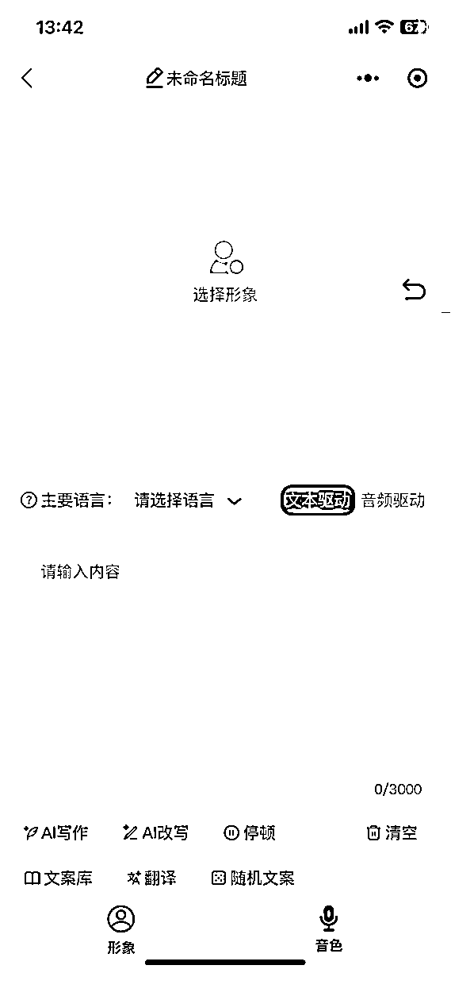
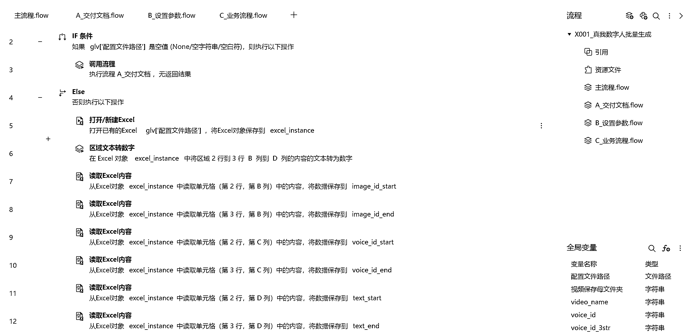
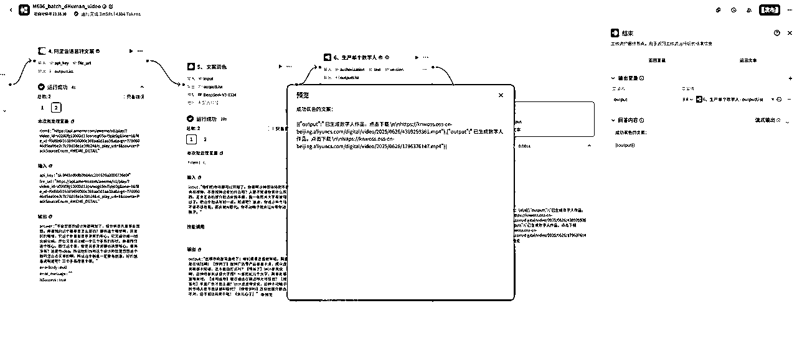

# 别再手动做口播视频了！我批量搞定了100个专属数字人

做短视频的朋友们，数字人工具估计都不陌生。但你有没有发现，想合成一个口播视频，网页或软件里得来回填好多栏信息？光是走完一套流程，少说也得折腾七八步。

对大多数用户来说，这勉强够用。但像我这种玩矩阵的人，脑子里永远在想一件事：能不能有一个按钮，直接全部搞定，批量出货？

有两条路可以走：

**路线一，RPA自动化**。把参数设定好，交给影刀之类的工具模拟人工操作，帮你在网页上跑完整个流程。我试过，效果是OK的，但有个硬伤——运行的时候电脑必须保持在线状态，人不能离开。可我是常年在外面跑、只带一台笔记本的人，这方式对我不太友好。

**路线二，让技术小哥直接开发数字人的API接口**。这才是真正的突破口。

有了API之后，我自己动手在Coze上做了个插件，接着用Coze搭了一个能“一键生成”自己形象的数字人智能体。最终的效果是：点一下，就能批量产出100个拥有我专属形象和声音的数字人视频，全程不用逐个去调整参数。

这套方案具体能做什么？给大家列一下：

*   复制一套专属于你的声音（音色克隆）
*   把文字转成语音，可以用你克隆的声音，也可以用公共音色
*   克隆你的个人形象，还支持动态场景
*   生成对口型数字人（克隆形象和公共形象都能用）
*   批量抓取多条链接里的文案，二次创作后直接生成数字人视频
*   附带一个7月2日刚更新的小功能：查询音色ID和形象ID

整个教程的目录也给大家放出来，方便速查：

> 零、搭建思路
>
> 一、语音克隆工作流
>
> 二、形象克隆工作流
>
> 三、获取音色和形象ID工作流
>
> 四、数字人视频工作流
>
> 五、一键批量工作流（案例）
>
> 六、其他一键批量思路

内容比较长，但门槛并不高，一步步照着走就能上手。正文在这里，enjoy~

[`jinhuaclub.feishu.cn/wiki/ZIChw1kntiOqIpkNH8Dc4j9SnpP?from=from_copylink`](https://jinhuaclub.feishu.cn/wiki/ZIChw1kntiOqIpkNH8Dc4j9SnpP?from=from_copylink)

评论区里有人问：生成的成果展示效果如何？也有人关心这套工作流能不能用于B站好物分享。作者新侠答复说要看具体业务流程，建议先理清自己的链路再来套用。

如果你也是批量生产的重度玩家，这波可以试试，直接解放双手。