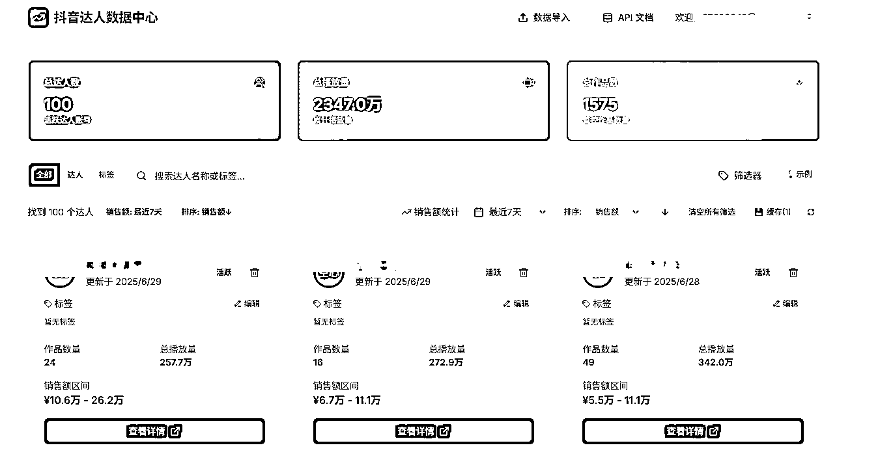
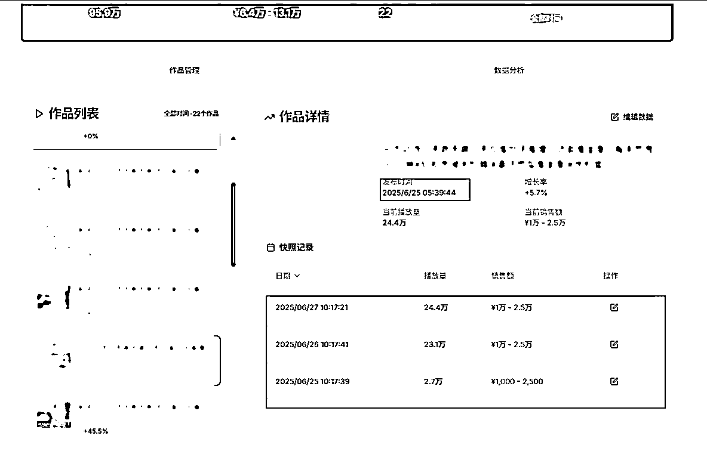

# 用 AI 编程，快速搭建抖音达人作品数据快照平台
作者：龙哥

## 一次从开发到上线的实践分享

作者：涛涛  
日期：2025-06-29

这篇内容主要记录了一个实用工具网站的完整打造过程：借助 AI 编程工具完成产品构思、功能开发与部署上线，用较低成本快速验证一个数据采集类业务的可行性。

文章还重点讨论了一个问题：数据采集完成之后，如何让运营人员更容易看懂、用起来。针对这一需求，作者设计了“作品快照”功能，把达人作品在不同时间段的数据变化记录下来，用更加直观的方式展示内容表现和增长趋势。

对于正在制作业务辅助工具、运营分析平台或数据看板的团队来说，这套从需求梳理到快速交付的思路，也具备一定参考价值。

## 为什么需要作品快照？

在抖音短视频和直播带货领域，选品往往直接影响最终结果。除了关注商品本身，同行账号的内容表现、爆款作品的增长速度，同样值得持续追踪。

接入快照系统后，运营人员可以更清楚地观察：

- 同行达人作品的数据变化
- 视频在不同阶段的涨幅表现
- 哪些内容正在快速增长
- 值得及时拆解和跟进的爆款脚本

相比单次查看数据，快照记录能够保留作品的变化轨迹，让运营从“看当前结果”进一步升级到“判断增长趋势”，从而更快发现机会、优化选题，并跟进高潜力内容。

* * *

评论区：

暂无评论