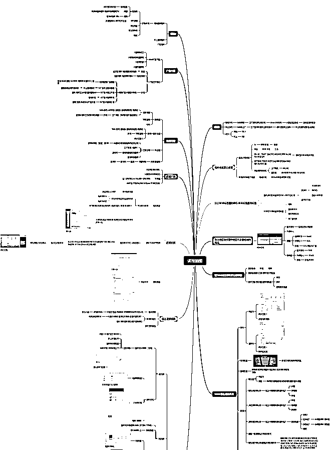
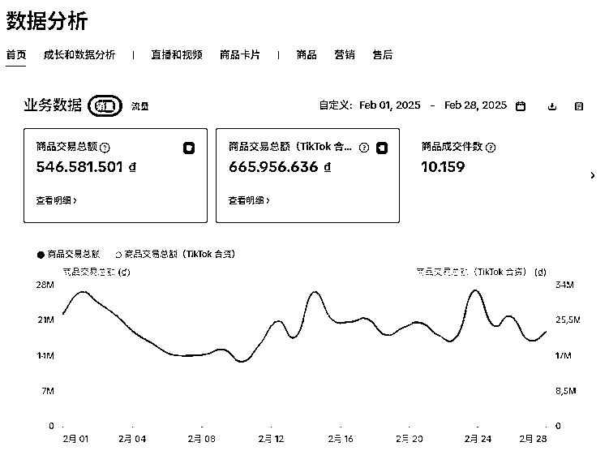
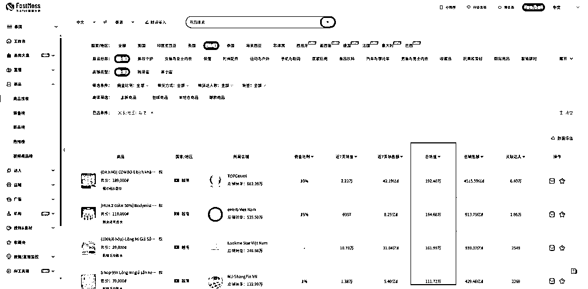
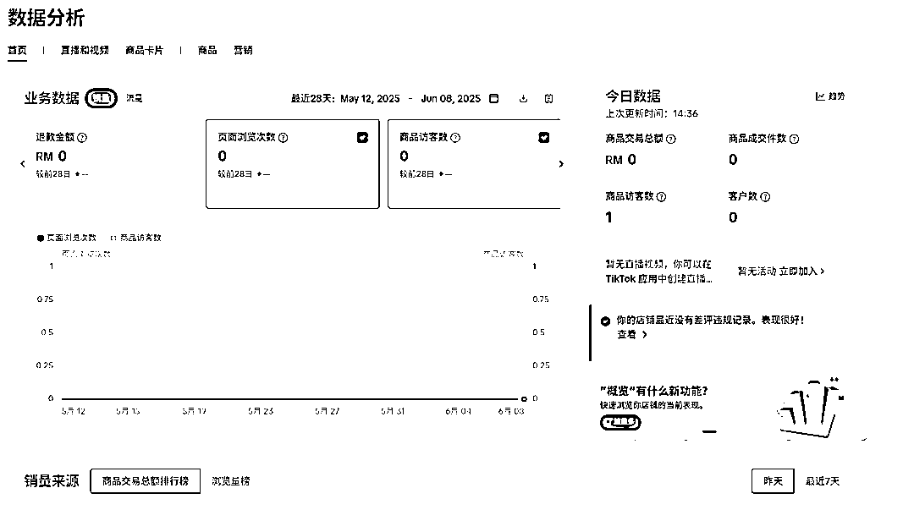
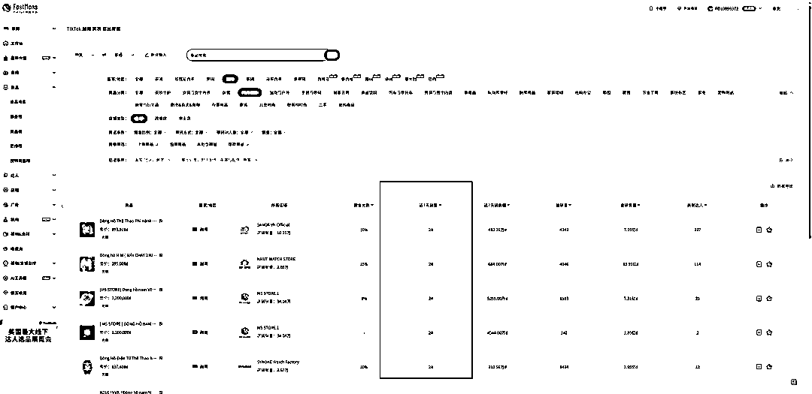
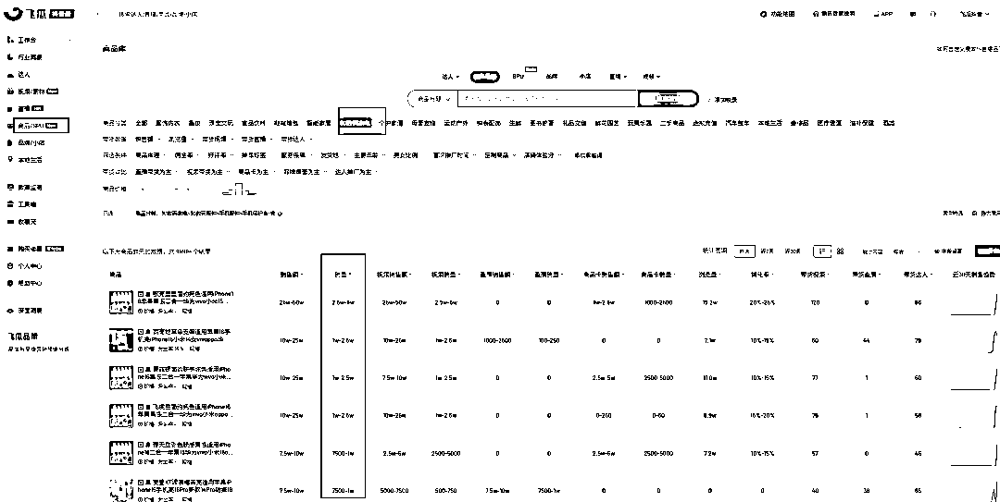

# TikTok 自然流商品卡，实战走四步就够了

## TikTok 自然流商品卡，四阶段打法拆解

作者： 大博跨境电商

日期：2025-06-28

**先放内容颗粒度**

**再放下单店铺的单区数据**

**  **

**下面进入干货 不废话**

每天私信里问得最多的几个问题：店铺没曝光、没成交、成交少、没利润、到底哪个区好做。

这些表面看是结果问题，本质上是认知问题。

用这种思路去排查，是永远解不开的。

做店之前先想清楚：你的模型到底是走低价量还是打爆款？低价分几个阶段？打品分几个阶段？每个阶段要达成什么？关键动作是什么？没有一套阶段化的 SOP，就很难有稳定产出。

今天就把自然流商品卡的玩法、步骤、关键动作和效率标准讲清楚。

# **商品卡自然流 四个阶段**

第一阶段 拉体验分 目标 30 单

第二阶段 跑量期 目标 单店单区单日 100 单

第三阶段 利润期 目标 跨境测品盈利

第四阶段 放量期 目标 一品多仓本土备货放大

# **一、拉分期 核心动作 刚需款+五折定价跟卖**

很多人迷信 TikTok 店铺权重，我不认同。

美国区店铺卖贵，大多是资质问题导致的。

早年天猫淘宝的高等级店有粉丝基础，能直接变现。TikTok 不一样，它没有店铺级权重。

天猫/淘宝是广告计划权重、达人分发权重，商品卡的权重来自低价截流+搜索累积。

先用低价把链接激活，具体就是用 FASTMOSS 找刚需高销量的品 1:1 仿款不仿牌，比原价低 50%，快速做满 30 单，把体验分打过去。

没体验分之前，店铺基本是这样：

**1、FASTMOSS 趋势品跟卖视角**

**2、新店无体验分视角**

方向对了，重复做就够了。

# **二、跑量期 核心动作 趋势款+保本定价跟卖**

这个阶段只干一件事：单区单店冲到日 100 单。

操作是打开 FASTMOSS 筛选 20+ 起量品位，大量跟品，核心是用保本价抢量。

跟不出量的原因基本就这几条：

**1.上品标准不清晰，要么没价差，要么价差不够**

**2.上新效率不够，每天稳定 30+ SKU**

**3.品类策略不对。家电玩具等是定价跟品，饰品百货家具日用是常规跟品，箱包等重货类是常规+本土跟品**

**4.SKU 总量不足，没把二三级品类拆细**

# **三、利润期 核心动作 国内趋势+利润定价跟卖**

真正能赚钱的阶段到这一步了。

站内跟卖很难盈利，跟不上爆款，跟不上趋势款也保本，养不起链接。

所以要换数据源，去抖音飞瓜跟。

逻辑跟 FASTMOSS 一样，只是可跟范围更大。

**1、飞瓜操作演示**

**2、定价逻辑**

定价不是看你成本多高，而是看该类目的平均客单价。

把同类目销量前十的客单价拉出来作为参考线。商品卡不一定要平价或更低，有供应链规模才能堆出那个量级，作为后续大链接的优化价格锚点就行，甚至可以略高于参考价。

跨境商品卡的盈利，就是这么来的。

# **四、放量期 核心动作 爆品控流速+本土备货**

**目标 跨境链路起量/本土链路起量**

链接起量后，第一个对手是跟卖。

这时候要立刻降价测流速。降价后流速如果能提升 30% 以上，就说明有放大空间，可以做一品多仓、本土备货。

首次起量的链接建议先用一品多仓，熟悉本土店流程。

第二次起量可以直接本土备货，跨境流速测出来后小批量补，降低空派周期，绝不能断货，也不要堆大库存。

大规模备货的前提是链接稳定，否则很容易积压。

* * *

评论区：

暂无评论