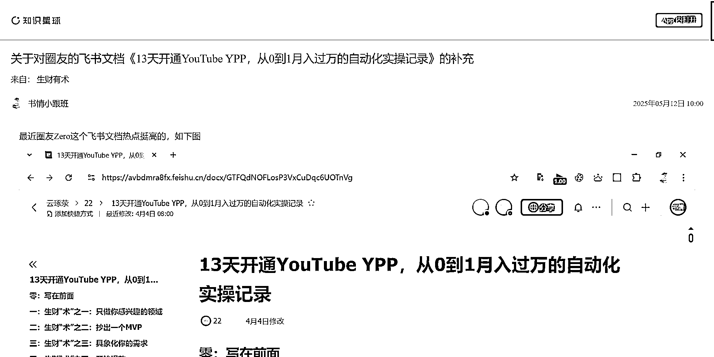
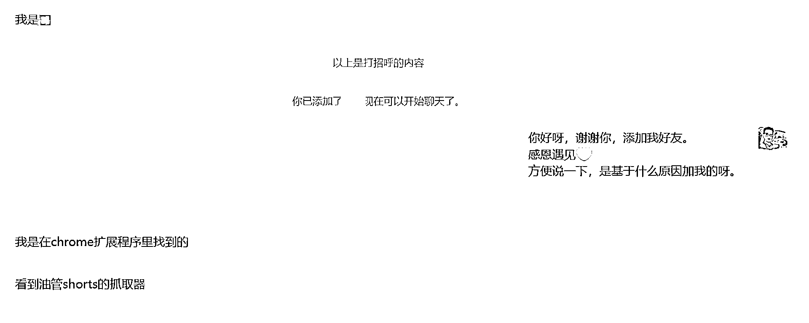
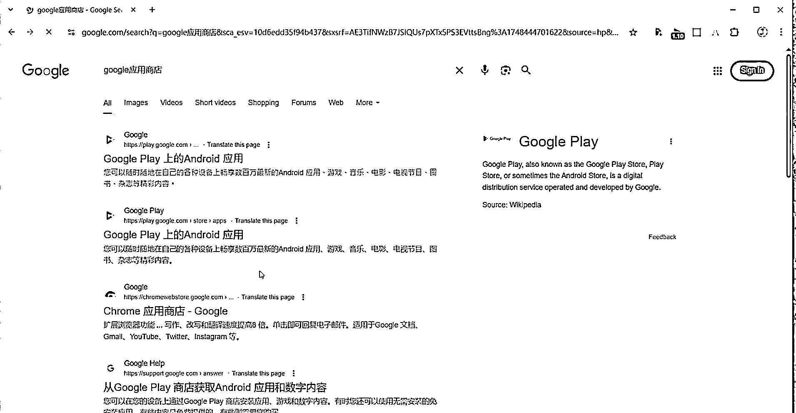
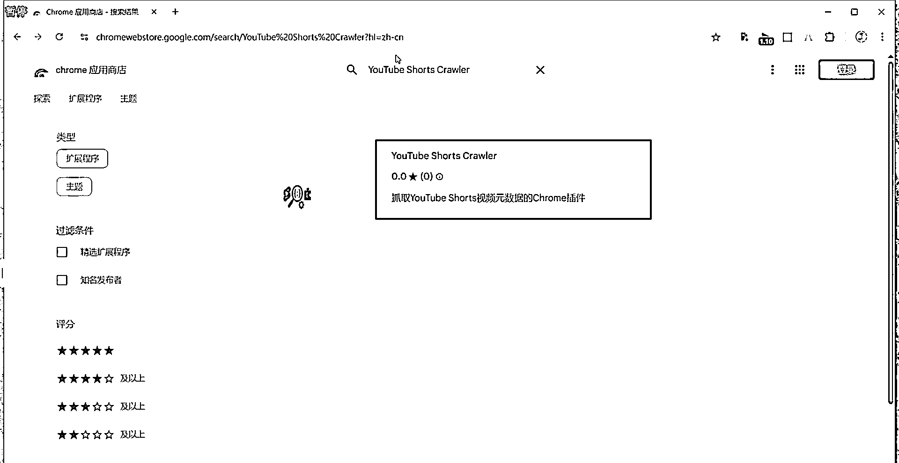
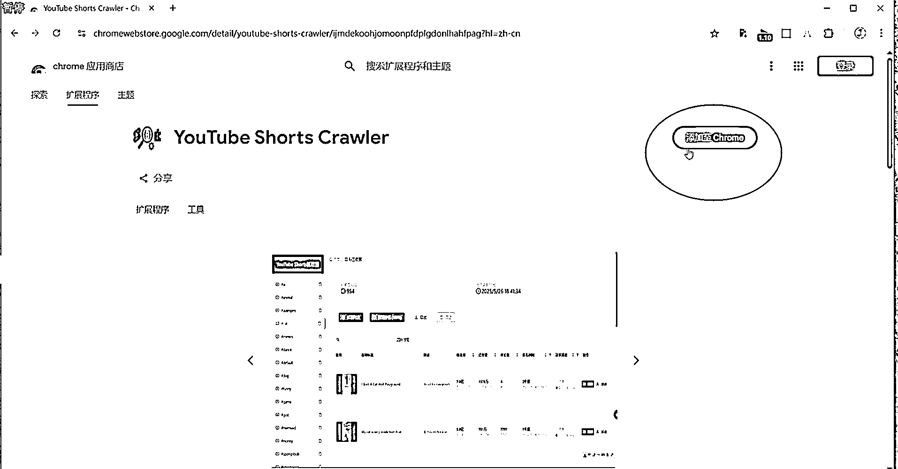
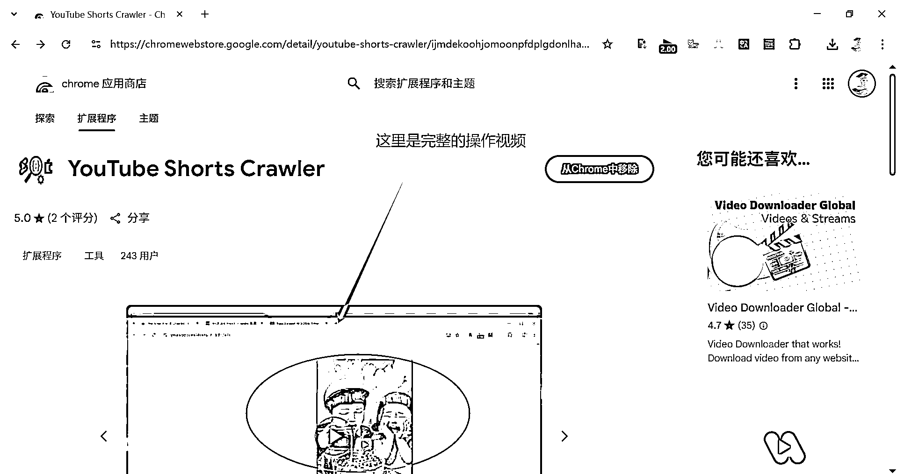

# 免费 Chrome 扩展「YouTube Shorts Crawler」使用分享
作者：龙哥

## 免费 Chrome 扩展「YouTube Shorts Crawler」使用分享

作者： 书情小跟班

日期：2025-07-04

此前在回复《13 天开通 YouTube YPP，从 0 到 1 月入过万的自动化实操记录》这篇飞书文档的延伸讨论中 [`articles.zsxq.com/id_kwkew57xewgw.html`](https://articles.zsxq.com/id_kwkew57xewgw.html) ，我有简单提到过这个工具。

看到下面这两张截图效果后，我觉得值得单独开一帖来详细介绍一下这个小工具。

接下来是具体的安装与使用步骤

在 Chrome 应用商店里检索 YouTube Shorts Crawler

点击将其安装到 Chrome 浏览器

该扩展完全免费，体验好就行。

* * *

评论区：

小黄快跑 : 这个是用来下载还是用来找爆款的？

逸尘 : 牛牛牛