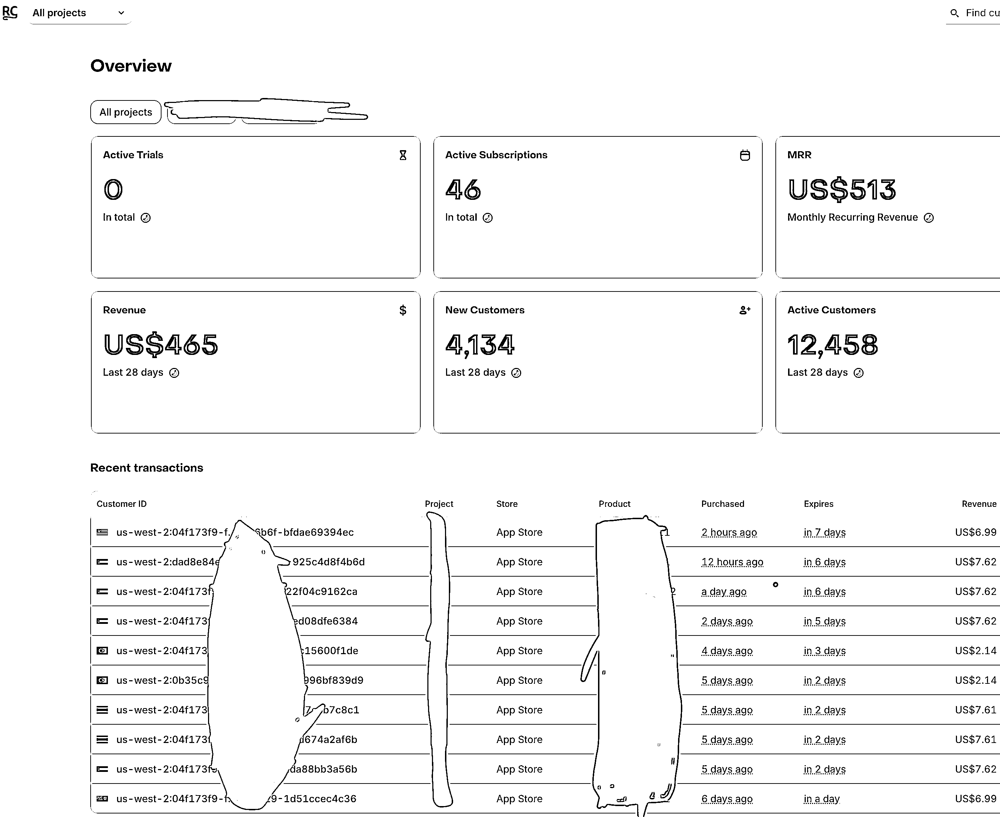

# ('(27 赞)AI App 开发 SOP：1 周上架 23 天赚$513', (2, 37))

从零代码到$513 MRR：这个AI App开发SOP，让普通人也敢“抄作业”

你敢信吗？一个常年不碰代码、自称“客户端新手”的人，只用了一周，就成功上架了两款App；紧接着的23天里，他的月经常性收入（MRR）做到了$513。

这位来自生财有术的圈友linyy，在最近一次AI航海中给自己出了一道题：一个几年不碰代码的“客户端新手”，能不能靠AI把App从0到1完整跑通？他的答案：不仅能，而且压根不需要什么黑科技。

直接看战绩：

真正让他突围的，并不是技术上的高招，而是他砸了大量精力打磨出来的那套方法论——一套可以复用的产品生命周期管理流程。在他看来，想在AI时代赚到钱的普通人，最重要的不是死磕某一种技术，而是找到属于自己的“系统打法”，用一套固定SOP应对从机会发现到产品上线的每一步。

整条路径被他拆成了三段：机会发现，交给AI去挖市场需求；开发交付，交给AI来辅助完成代码；获客增长，坚持零成本，一分钱预算也不花。每一段都被打磨成可以直接照搬的模块。

他说，这套SOP不是空谈，而是过去一个月里用真金白银和时间验证过的实战总结。与其在技术细节里打转，不如直接复制他的路径，让自己跑得更快、更稳。

目前他已经把完整的SOP拆解整理成文，放在了飞书文档里，想上手的朋友可以直接去取经：
https://qcnievo9yz2n.feishu.cn/docx/VUf7dfm74ohG0Vxk6Yecz0iinmh

评论区里，已经有眼尖的圈友在“火钳刘明”，“先赞后看”成了标准动作，“干货”两个字也是最高频的评价。看来，这份SOP确实踩中了很多人最需要的东西。

不知道你是否也想过用AI做一款自己的产品？或许这套方法，能成为你的第一块跳板。