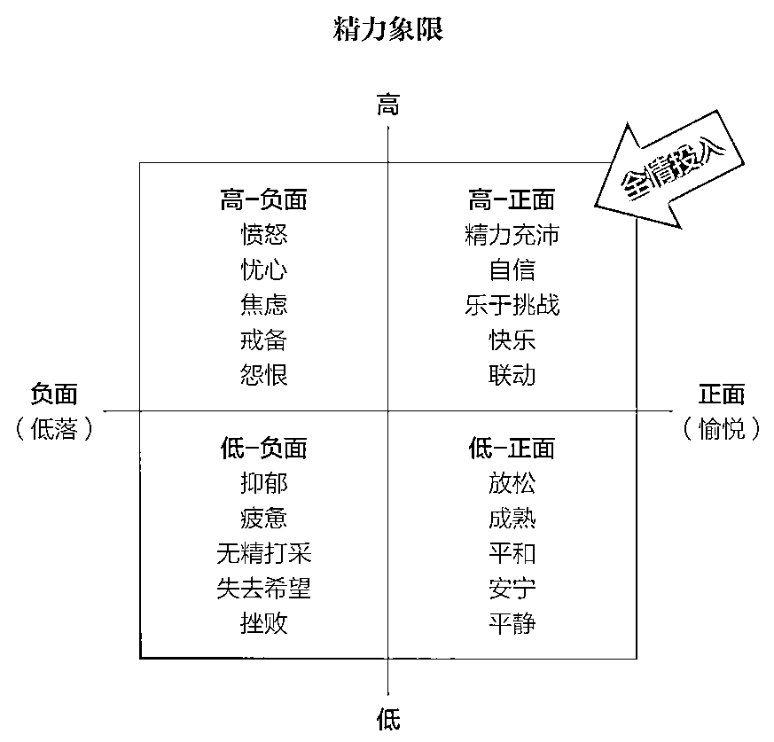
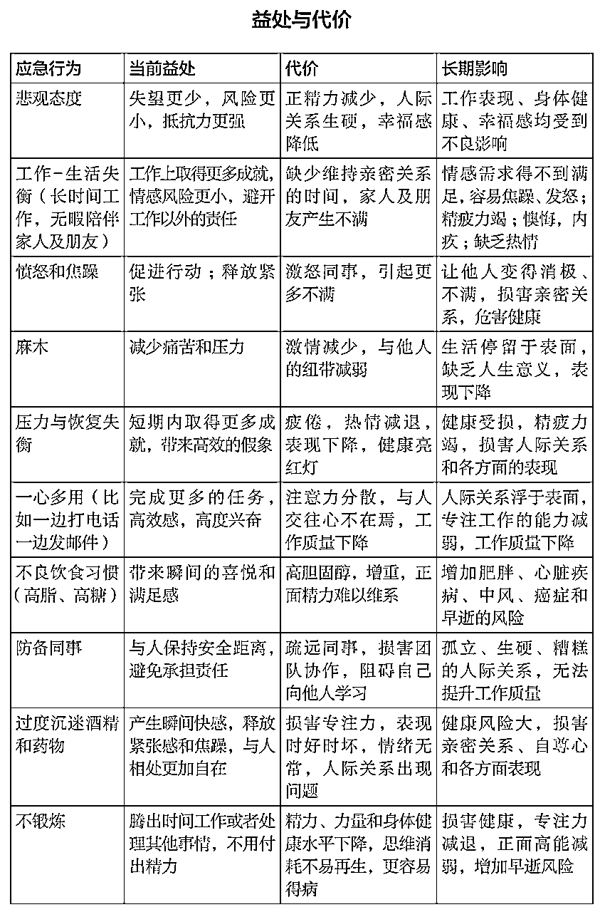

# 废柴自救指南——如何摆脱低精力，启动开挂人生

大家好，我是李子。一个在杭州打拼的东北95后，自由职业者兼创业者，长期泡在网赚圈子里。熟悉我的老粉可能知道，我以前是个十足的“精力困难户”：脑子容易跑神，身体动不动就累，一天下来没干几件事，却像被抽干了一样。后来我才想明白，我做项目时最大的卡点根本不是什么技巧，而是“电量”太低——进度慢、执行力差，全是被它拖垮的。

所以过去一年，我像集卡一样疯狂搜罗各种提精力、改状态的方法，然后一个个在自己身上做实验。结局还挺惊喜：项目年流水做到了500万，体重也甩掉了50斤。今天就把这套亲测有效的心得摊开聊聊。如果你也总是疲惫、没状态，但又特别想把钱赚到手，那不妨花几分钟看完。觉得有用的话，记得用发财的小手点个赞，也欢迎来评论区交流～

# 一、真正稀缺的，从来不是时间

很多创业者、自由职业者最爱说一句话：时间就是命。但说实话，时间对所有人都一视同仁，一天就24小时，谁也没法多偷一分钟。那为什么有人能用同样时间做出几倍的成果？答案在“精力”。

决定你能否把时间变成结果的，是你有没有足够的能量去驾驭它。状态好，时间就是滚雪球；状态差，时间再多也是空转。计划列了一堆却完不成，做点事就疲惫、烦躁、效率低——这不是你懒，而是身体的能量系统在“透支经营”。透支久了，拖延、焦虑、低产出全都会找上门。

精力翻倍，等于单位时间产出翻倍，也约等于时间翻倍。所以高精力才是真正的高回报。你去观察身边那些走得久的创业者，他们未必是智商最高的、最拼命的，但一定是最会“管理自身能量”的人。

# 二、精力不是天赋，是能练出来的肌肉

每个人的“精力容器”初始大小不同，但好消息是：精力更像肌肉，可以通过刻意训练越撑越大。底层逻辑是“超量恢复”——让身体承受略高于日常的压力，然后好好恢复，它就会长得比原来更强。这需要长期主义眼光，别怕短期的不舒服，那是成长的信号。

精力还分成四块：体能、情感、思维、意志。它们彼此独立，又互相影响，而且每一块都有限度，必须统筹管理。这里有一个很关键的观点：全情投入和最佳表现，只会出现在“情绪正面+精力高”的象限里。也就是说，心情不好，精力再足也白搭；精力低，情绪再嗨也撑不久。

# 三、六个维度，把精力一点点养大

## 1. 习惯，是最省电的自律

人其实是习惯的产物，每天大多数行为根本不是靠意志决定的，而是潜意识在自动驾驶。所以想省精力，就别总跟意志力较劲，而是把好习惯设置成“自动挡”。如果你发现自己在某方面怎么都养不成习惯，也别急着骂自己“不自律”，换个思路，去找一种真正适合自己的自律方式，才是正解。

## 2. 工作的节奏：既要会冲刺，也要会躺平

精力管理最怕两件事：消耗太多，或者恢复太多。消耗大于恢复，人会枯竭；恢复大于消耗，人会萎靡。人体天生就有90到120分钟的“活跃-休整”周期，从睡眠到清醒都一样。所以别想着一口气干一整天，聪明的做法是“短跑模式”：需要时全力冲，间隙里碎片化放松。别把生活过成单轨道，多一点角色切换和多元节奏，精力反而更有弹性。

**怎么休息更快回血？**
- 工作最多90到120分钟，就主动歇一会儿，别等脑子冒烟了才停；
- 定期给自己安排一次真正的度假，彻底深度放松；
- 培养一两个能让你放空的小爱好；
- 用1分钟深呼吸，给身体充个氧，精神头马上不一样。

**怎么工作更能省电？**
- 提前一晚规划好第二天的任务，白天直接执行，不内耗；
- 工作时把干扰降到最低，手机放远点，电脑只开需要的软件；
- 生活和工作分开，别让注意力在两个气场间反复横跳；
- 有条件的话，一天只专注做一类事，减少切换损耗；
- 摸清自己的“黄金时间”：比如我早上适合做无脑执行、进入状态，晚上最适合写方案和做规划。

## 3. 饮食：稳住血糖，就稳住了精力

有一句话我很认同：你吃进去的不只是热量，更是在喂养你下一个小时的专注力。我以前也爱外卖零食，高油高糖一下肚，血糖猛涨，人就开始犯困犯懒。后来看了不少精力管理的书，才算开了窍——饮食的关键从来不是“吃多”，而是“吃稳”。

我的原则很简单：
- “二八定律”：八分吃健康食物，两分留给自己喜欢的、哪怕不太健康的东西；
- 早餐必须吃，它是上午的精力的启动电源；
- 每餐有适量蛋白质、少量优质脂肪和碳水，把血糖稳住；
- 不饿也不撑，保持身体能量平衡；
- 全天定时喝水，水这个东西太容易被忽视，但缺了它，什么精力都是空话。

注意，咖啡、茶、健怡可乐这类咖啡因饮料，虽然能让你瞬间提神，但有利尿作用，长期喝反而会让身体缺水、更疲劳。另外，我还会额外补充一些补剂：维生素D必须强烈提一句，现代人普遍缺，因为它靠食物很难补够，基本要靠晒太阳。建议去医院查一下，缺了就规律补上。鱼油、枸杞原浆、人参原浆这些我自己也在用，但效果因人而异。如果身体有慢性疲劳、免疫失衡这类问题，可以去了解下功能医学——它不搞头疼医头，而是追根源。我之前桥本甲状腺炎的两个抗体指标就是靠生活调整+功能医学调回正常的。这类疑难的，可以先做“食物过敏源”和“食物不耐受源”检测。想深入了解，可以搜杭州邵逸夫医院的陈丽英医生，她的小红书内容很干货。

## 4. 活动：久坐是精力黑洞，运动是精力投资

世卫组织很早就把“久坐”列为慢性疲劳和代谢疾病的高危因素。别小看这个，久坐可不只是屁股疼，它会在不知不觉中把你的精力和健康一起抽走。我的对策是：用手机或运动手环设一个60到90分钟的久坐提醒，时间一到就站起来溜达一圈，哪怕只是走一分钟，也能迅速回神。

真正让精力扩容的，还是运动。短期看它让人累，长期看它给的回报高得惊人。运动后身体分泌的内啡肽，能让大脑又清醒又愉悦，长期坚持还会改善神经系统。我以前是重度运动厌恶者，办了好几次健身卡都打了水漂。去年硬着头皮找了私教，断断续续练了大半年，竟然从“讨厌”变成了“习惯甚至喜欢”。

如果你也超级讨厌运动，两个方法亲测有效：一是找人监督，比如请私教、朋友圈公开立flag、给朋友发钱打卡、找个本身就在运动的搭子；二是把门槛降到最低，选一个自己喜欢的运动方式，不求时长和强度，每天5分钟都是胜利，地点尽量选通勤顺路的，在家跟视频练也行，关键是固定时间形成节律。

不同运动还有不同功效：健身长肌肉抗衰老；拳击练反应，适合创业者练胆；游泳跑步强心肺，还能放空思考；跳舞让人快乐；攀岩能降低杏仁核敏感度、稳住情绪。间歇有氧和力量训练对增加精力容量尤其有效，养成习惯后可以按需轮换。

## 5. 睡眠：稳赚不赔的投资

有一句话特别扎心：一天不睡觉，大脑的反应能力相当于喝醉了。《Why We Sleep》里讲得很清楚，睡眠不是成本，而是回报率最高的投资。我以前的睡眠差到离谱：睡得晚、睡不着、醒来还是累。长期睡不好，不只是困，更是精力枯竭、创意下降、免疫力崩塌、记性变差。

研究表明，大多数人的最佳睡眠时长是7到8小时，过多或过少，死亡率都会明显上升。调整睡眠，先调节律。

第一步，打造睡前黄金1小时：关掉亮光，特别是电子设备蓝光；读几页难啃的纸质书，或者做睡眠冥想；用温水泡脚、拉伸、泡澡，让身体放松；把房间温度调得比体温略低一点，更容易入睡。尽量别在睡前看让你兴奋激动的内容，不然越想越睡不着。

第二步，建立起床仪式：固定起床时间比固定睡觉时间更重要；窗帘留条缝，让早上的光提醒身体苏醒；周末也尽量晚起不超过1小时，别打乱生物钟；早起出去走一圈，让阳光帮褪黑素下降、皮质醇归位，整个人才真正开机。

## 6. 情绪和思维：最隐蔽的精力开关

情绪不是可有可无的东西，它本身就是精力的一部分。情绪不好并不是玻璃心，而是神经系统在向你发出“失衡”警报。情绪一乱，再好的身体状态都会被击穿。

几个实用的情绪调法：
- 换一种表达，把“我心态不好”改成“我心态有待提高”；
- 保持一到两个高质量的深度关系，多和给你正向能量的人交往，主动远离消耗你的人；
- 多读毛选，那种不畏难的强者思维，对创业者来说特别“补气血”；
- 身体先行：冷水洗脸或冲澡，刺激副交感神经；运动也超有用，尤其是拳击和跑跳类；
- 按摩、冥想，深度放松身心；
- 实在不行，找靠谱的心理咨询师，亲测对找到自洽状态非常有效。

思维上，我们要多做正强化、少做负强化。正强化是那种做了以后会得到奖赏、愿意重复的行为，比如想象成功场景、学习商业知识、坚持健身——它短期可能有点累，但长期是复利。负强化是能暂时减轻痛苦、缓解焦虑的行为，比如逃避、拖延、刷手机——它短期特别爽，长期却会一把火烧掉你的精力。负强化的思想和行为，往往都是短期受益、长期受损，所以要时刻盯着自己。

想清楚三个问题，能帮你从源头减少内耗：我到底想成为什么样的人？我到底想过什么样的生活？我到底想拥有什么样的人生？这三个问题想透了，目标清晰，精力自然就往一处使了。

# 四、最后，把精力管理跑成一个闭环

别把上面这些当成零散技巧，它们可以组合成一套可执行、可追踪、可优化的系统。每周做个复盘，问自己两个问题：哪个维度对我的精力正面影响最大？哪个维度是我最容易掉链子的？然后每周集中补一块短板、强化一项长板，你的精力系统就会像滚雪球一样越滚越好。

我一直觉得，自由不是想做什么就能做什么，而是无论何时，你都有精力去做真正想做的事。创业也不该是把自己当蜡烛烧，而是先找到自己的能量源，再点燃整个系统。身体，是你所有人生可能性的地基，照顾好它，是长期主义者的必修课。

有些人天生精力旺盛，但如果你和我一样，属于容易累、容易乏、精力不太够用的那一类，也别灰心——只要愿意系统地去呵护、去训练，这个能力一定可以长出来。

我是李子，一个在杭州搞网赚的东北95后。这篇内容如果对你有一点点帮助，记得点赞鼓励一下，也欢迎你来评论区聊聊你的精力管理心得～下次准备写怎么提高专注力、怎么进入心流，感兴趣的可以关注我。