# YouTube shorts 动物故事一个月15w粉

大家好，我是eaton。早些年我在广告公司待过，也自己折腾过自媒体，国内几个平台像抖音、快手、📕都做过，起号经验不算少。但AI赛道对我来说是个全新领域。今年5月6号，我上传了第一个YouTube Shorts，从那之后，事情开始起了变化。如果你也在做AI宠物故事，这篇分享或许能帮你少踩一些坑，建议看到最后。

最开始为什么会做这个？其实是4月底的时候，我一直在想找个容量足够大的赛道，偶然刷到了Meow频道，又顺着看到SuperCatPapa，当时就意识到这个方向能容纳20亿播放量级的账号，而且这种天马行空的视频风格也正好是我擅长的。于是说干就干。后面我用21天开通了YPP，一个月涨粉15万，两个月的时候到了29万。下面把我的完整过程拆给你看。

一、起步：粗糙得不像话

这是我的第一个视频，现在回看简直没法入眼。5月6号那天我才第一次接触AI视频工具，用GPT和Runway硬生生熬了24小时，做出来一坨自己都不想看的东西。也就是从那时候开始，我彻底想明白了一件事：图片才是整个流程的地基。对视频生成模型来说，一张好图的威力远大于一句花哨的提示词，视频里所有的表现力都源自图片。所以后来我把即梦、豆包、GPT、LibLib，市面上能试的文生图模型全试了一遍，不停调整优化。

运气还算不错，我第四个视频就破了700万播放。也是在这个过程中，我慢慢看清了AI短视频的两条路线：

一条是技术大牛型：编程能力强，直接搞全套自动化流程，用AI批量生产图片和视频，主打新奇炫酷，靠量产和压成本取胜，用数量换概率。但问题是很难形成个人IP，别人想复制就能复制，最后大家都差不多，只能拼谁更肝。

另一条是精品内容/赛道型：这类人懂视听语言，知道怎么让画面和声音配合出1+1>2的效果，目标是做一个能长久立住的IP，内容里有情感、有故事。核心武器是拿捏观众的情绪，而不是单纯靠视觉冲击。

我仔细想了很久，觉得只有精品路线才有机会打出真正的爆款，而且我想在短时间内拿到结果，所以就坚定选了第二条路。

二、换形象：一次让我惊醒的测试

早期我所有视频都用大橘猫当主角，想着能跟别人拉开差异化。结果有一次我刷到一个对标账号，只有10个视频，粉丝却有10万，数据是我的两三倍。说实话，心里特别不平衡，也一下子明白了：方向可能搞错了。

于是我做了个对照测试：内容完全一样，只把主角换成一只白猫和一只橘猫。这两个片段都是用在一个视频的开头三秒。坦白讲，我私心一直觉得橘猫那个效果更好，因为咱们中国人天生偏爱橘猫，这几乎是刻在骨子里的印象。但我的观众不这么想。

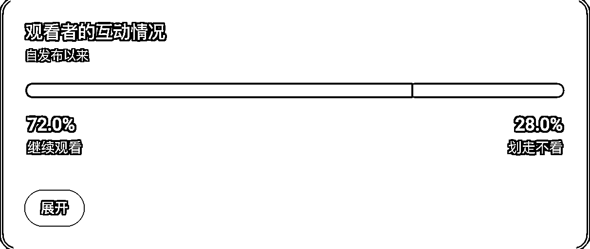

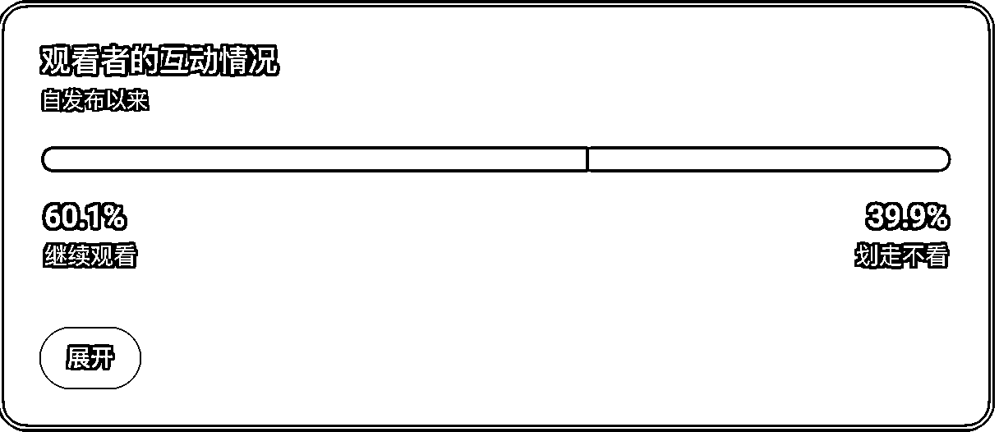

数据摆在面前，我无话可说——白猫明显更能勾起人的观看欲。所以我果断把所有视频的主角都换成了白猫。广告行业里有个词叫“视觉记忆”，意思是当一个形象被反复曝光到人人熟悉之后，你每次看到它，潜意识里就会自动联想到相关的记忆。白猫这个形象就是如此，大量顶级账号都在用同一只白猫做不同内容，累计曝光量接近50亿，这就是赛道的容量。既然别人已经花大把力气把这个IP养熟了，我们为什么不直接“借势”呢？又不存在版权问题。金枪大叔写过一本书叫《借势》，做短视频的朋友真的值得一看。

总结一句话：一定要不停做测试，确保你的制作方向走对了。单个视频成不成功不重要，只要方向对，持续做总会爆。但方向错了，越努力越浪费。多测试，搞清楚你的目标观众到底爱什么形象、什么角色，是为了省下未来更多的试错成本。

三、爆款创意从哪来：白猫翻身仗

这是我换成白猫之后第一个真正意义上的大爆款，也是验证换形象这一步走对了的关键证据。那支视频拿了4000多万播放，光是它就吸了5万粉丝。

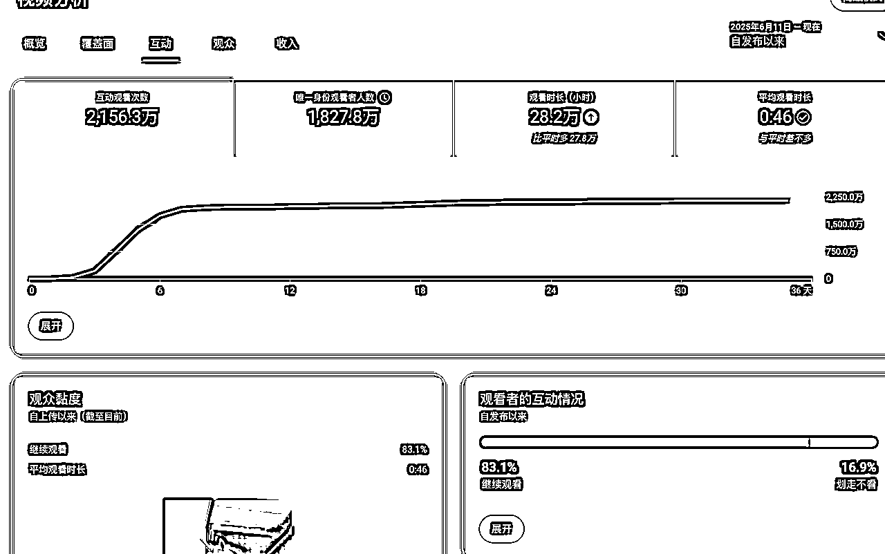

下面这张图是整个视频最亮的点和最后的反转设计：

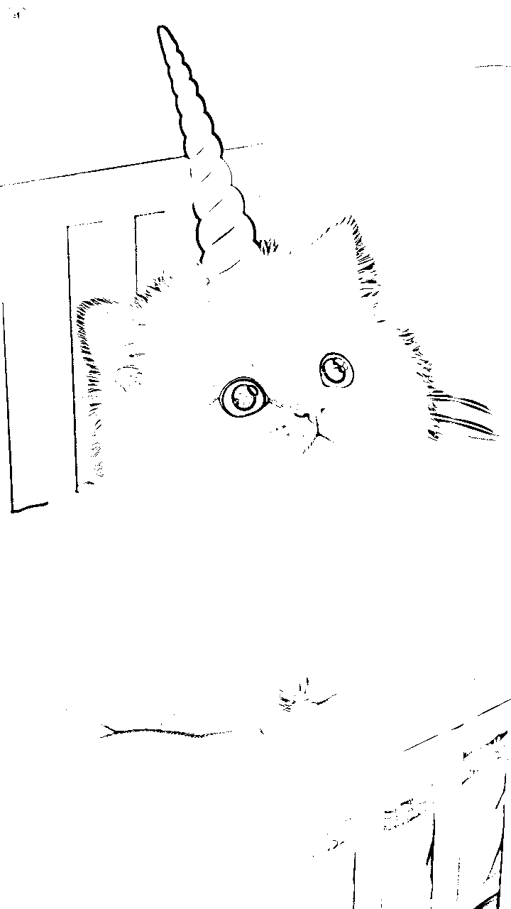

这个灵感是哪来的？其实很简单——就是到处看别人的AI作品网站，其中最有代表性的就是Sora。这是Sora官网上的原图：

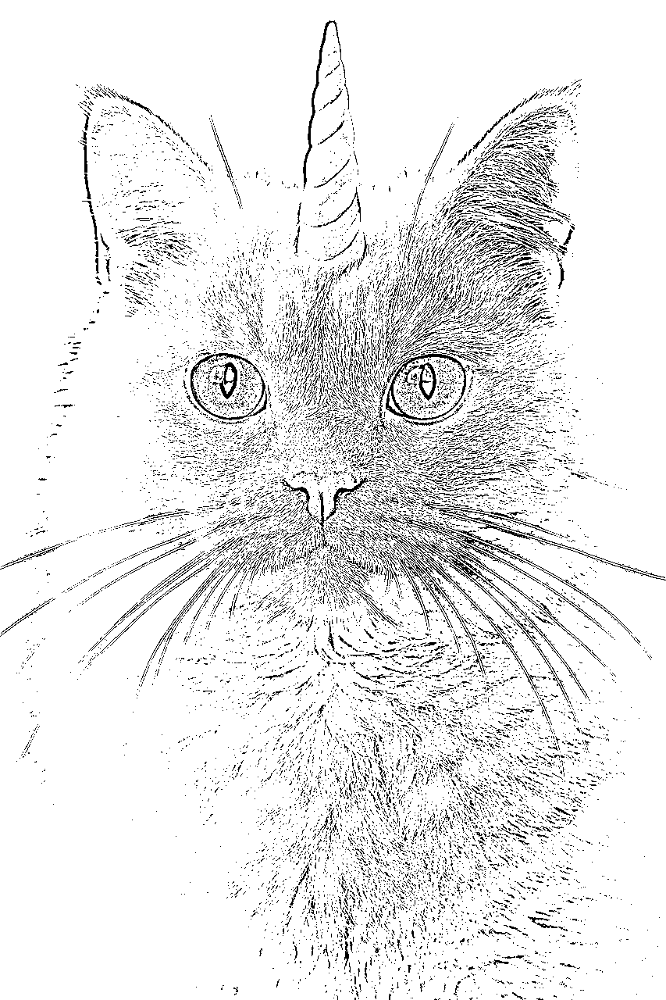

我一直有个习惯，看到好的作品就截图存下来。Sora官方那个页面，本质上就是一个巨大的“创意市集”，很多人完全忽略了这一点。上面有海量的创意可以参考，而且Sora这个模型做出来的东西天生就带着“病毒式传播”的基因，那些创作者产出的内容非常贴合短视频的逻辑。

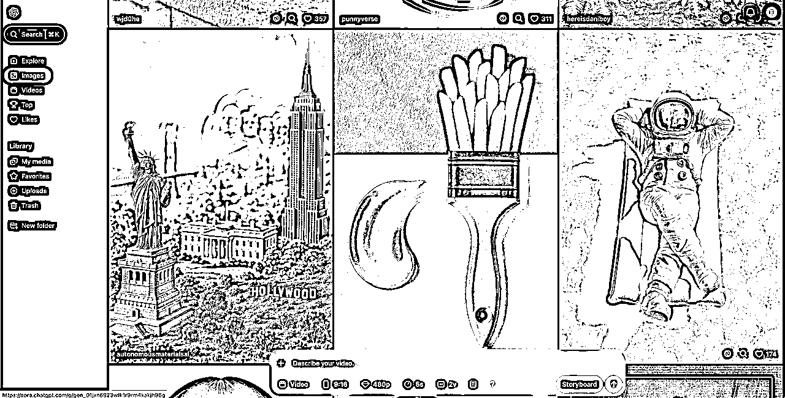

如果你平时刷到一些有趣的图片，点赞数又很高，那完全可以大胆做“微创新”，把它融进你自己的视频里。因为高赞本身就说明这个创意已经被小范围验证过了，更接近大众口味。

四、持续出爆款的底层逻辑：20%爆款原则

随着视频越做越多，我手里的数据也越来越充足，慢慢总结出一个规律：爆款，往往是从另一个爆款里长出来的。

有天深海圈的风向标小组开会，李队长随口说了一句：“爆款的模板稍微改一下发出去，流量还是很好。”那一下我就像被点醒了。后来又想起教练跟我说过：“视频千千万，爆款就那几个。”结合我自己跑的数据，我提炼出了一套“20%爆款原则”。为什么叫这个名字？请继续看。

先说白猫这个形象的利与弊。坏处是：同质化内容已经泛滥了，你随便一刷就是一堆同类视频，而且大多都是翻拍。好处是：观众不需要被教育，大家对这只猫已经熟得不行，只要你的画质更好，他们就愿意多停两秒。所以我的结论是——如果你很有信心，想做到金字塔尖，那可以闯这个赛道。但怎么闯？我的“20%爆款原则”也许能帮到你。

这个赛道里，并不是所有“爆款”都值得复制。你可能会遇到一个特别诡异的现象：你明明把对标的爆款视频复刻到了95%，画面节奏几乎一模一样，结果还是完全不推流。这很正常，因为算法的分发逻辑没那么精准——算法不一定把你的视频推给对这个内容感兴趣的人，而那些被推送到的人也许根本不爱看。即便你做到了95%的复刻也照样没用。

所以我得出一个看法：SuperCatPapa这样的账号，有一个就够了。会去看他的人，大概率不会去看别的同质化内容。所以你必须做出有剧情差异的东西。SuperCatPapa的核心是“极致真实+趣味+亲情”，几乎所有视频都围绕这三个框架。于是我在我自己的频道里额外加了一个元素——“奇幻”，比如独角兽、美人鱼之类。

那么加上元素之后具体怎么做？分两个阶段。

第一阶段：先复刻，保留80%。对标视频的剧情、画面、节奏、场景，保留八成，剩下两成大胆创作、加入你自己的元素。这个阶段最稳妥，但也最费力气，因为所有东西都得靠你亲手重做一遍。而且你得不停测试，因为每一个微创新视频都可能成为你下一个爆款模板。这里有个特别重要的提醒：多看同类账号，尤其是低粉丝、高播放的那种。因为这种账号能爆，说明内容已经被市场充分验证过，复制的成功率更高。千万先别盯着高粉高播放的大号，我曾经踩过这个坑，展开说一下吧，因为很多人都问过。

我之前对标过一个视频，在我眼里它完全不合格：前3秒留不住人，很单调，剧情走向平平无奇，只有一个反转，除了画面精美之外一无是处。可它居然跑到了近一个亿的推流。我不信邪，照着做了一只，结果数据血崩。这就是我的反面教材。

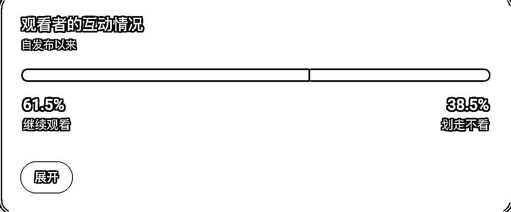

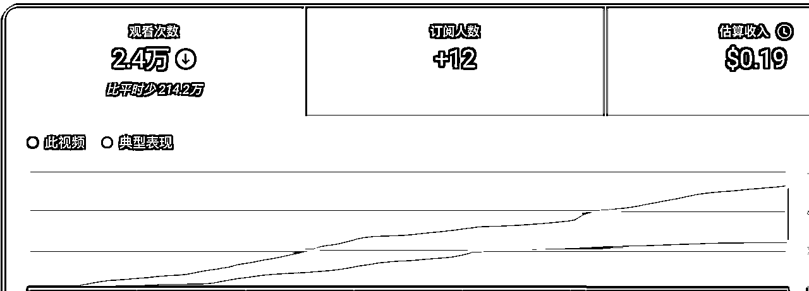

所以真的不要轻易去复刻高粉爆款，因为对方的粉丝模型和你的账号模型完全不一样，很容易翻车。

回到第一阶段：你大量看过同类账号之后，把你频道里独有的元素——比如人物或剧情——融进去，但只融20%，做出你自己的“第一批爆款模板”。注意，是一批！至少要有2到3个。

第二阶段：直接拿你已验证的爆款模板改！一样只改20%。其他画面能不动就不动，时长也不要动，只改某个人物或某个生物就好了。不说废话，直接上数据。

这是我第一阶段的第一个爆款：

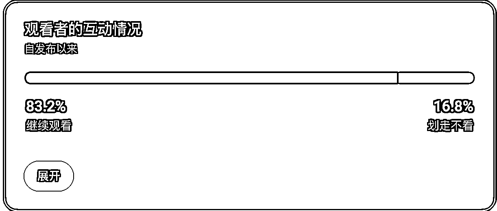

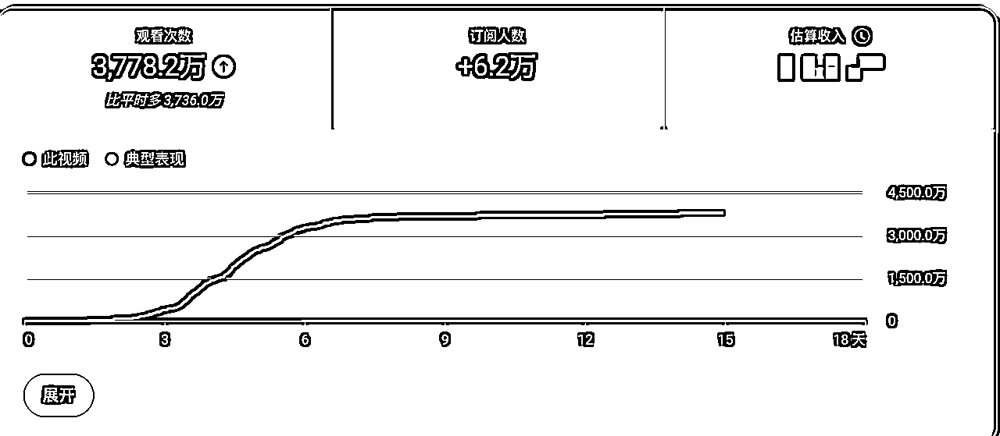

然后我按20%的改动量调整之后，发出了这个最新视频：

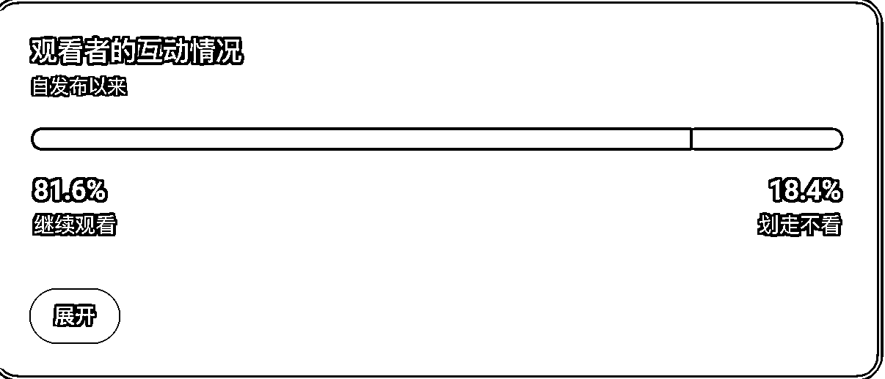

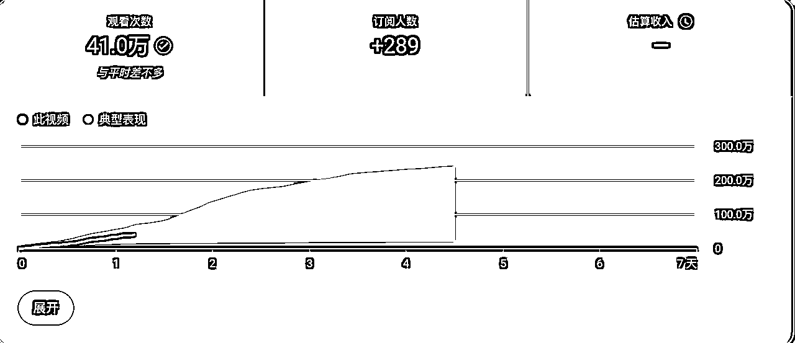

这个视频当时刚发一天，还没完全跑起来，但已经具备爆款属性了，无论继续观看率还是平均停留时长都在线，接下来就让子弹飞一会儿。

再说一个反面教材。我根据同一个模板做了另一个视频，结果数据很差：

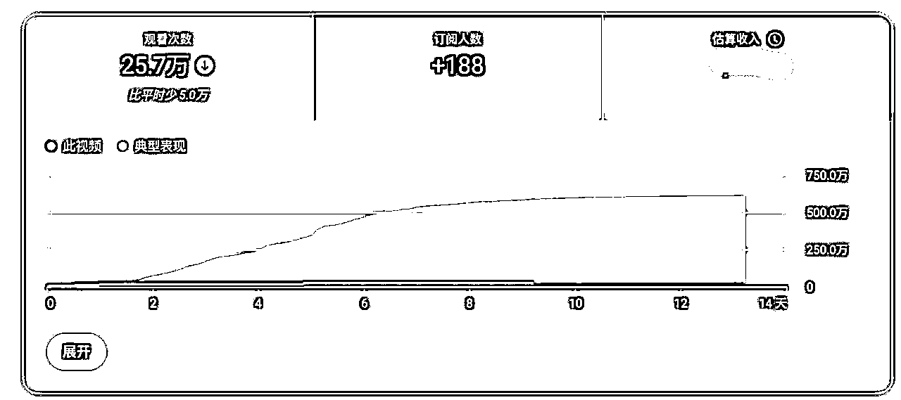

我自己复盘了一下，原因就一个：改太多了。我把被救人物、营救人员、营救场景、剧情走线、画面场景全换了，改动量接近50%，远远超过了20%。所以说这套方法叫“20%爆款原则”是有道理的——改动越多，可控性越低。控制在20%左右，是目前最可靠的数据结论。

所以我的总结是：你的爆款改完20%之后，它依然还是个爆款。但前提是，第一阶段你得用大量测试来铺路，锻炼制作能力，同时让推流系统精准抓到你的观众画像。之后你就可以一直复用这个模式，最大化爆款的概率。当然这个模式不会永远有效，模仿的人一旦多起来，观众肯定视觉疲劳，推流效果也会衰减。所以做短视频一定要同时具备两种能力：制作爆款的能力，和复制爆款的能力。你复刻对标，本质上是为了深度学习、深度思考。只有真正学会深度思考，才能给频道持续带来爆款。记住，精品视频的壁垒在于：你要做出工作流无法轻易复制的质量，这需要你对剧情和节奏有足够深的理解。

五、赛道认知：顶级IP的四个关键词

我总结了一下，AI宠物故事这个赛道里，顶级IP的框架大概是：极致真实化 + 趣味性 + 短（40秒以内）+ 自己的创意。

先拿SuperCatPapa来拆解。

极致真实化：大家可以看看它最火的三个视频，其中播放最高的一支推流到了1.5亿。它把制作火腿的过程特别细致地拍了出来，用小猫视频的形式去呈现一件现实中大多数人不会做的事。手工制作的过程本身就是看点，越详细、越真实，观众的“继续观看”就越稳。另外两个做鳄鱼皮、老虎皮的视频也是同理——用详细制作过程把现实中不太会发生的事演出来，但它又是真实存在的，所以特别抓人。

趣味性：我做过很多计算，故事类视频的前三秒一定要有至少三个镜头，平均一秒一个。大家去看我的视频就会发现，第一个镜头通常给猎奇，第二个或第三个镜头最好能带出趣味感，最好能让观众笑出来。一旦这个基调定住，视频就有机会大火。我说的“大火”是千万到亿级别的推流。因为快乐是短视频的核心内容——如果一个人在三秒内就被你逗笑了，那这个视频的传播性会成倍放大。以前我也不信，觉得开头只要够炸、够刺激就行，后来发现那些都不如“有趣”有力。这其实也是我目前账号的瓶颈——我的内容更多是紧张和刺激，缺少一点趣味性。感官刺激只会吸引特定年轻人群，很难破圈。你想，一个印度人上完一天班，回家就想安安静静躺会儿，被动接受点快乐，他还会去看战争片吗？道理很简单，做起来很难，但只要有想法，你就能创造奇迹——这就是AI视频制作的魅力。

短（一般40秒以内）：视频一定要短！千万要短！假如一个60秒的故事能压缩到30秒，那就争取29秒搞定！多一秒就会流失一批观众。这是我血泪换来的教训。同样的内容，我做了两支视频，一支54秒，一支47秒，只差了7秒而已。但数据完全两个世界：

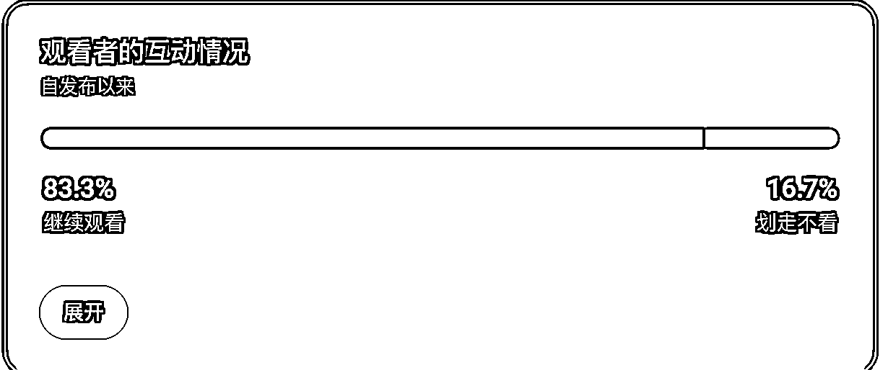

看到了吗？就是这么夸张。第一个成了垃圾，第二个成了爆款。短视频要的不是逻辑通顺，而是观众神经通顺。他们只要“爽”就够了。你不需要解释任何东西从哪来——只要“它”先出现了，观众才会想去看“它”是怎么来的。另外，“继续观看”这个指标极其关键，想冲千万甚至上亿播放，这个数字至少要达到80%以上。

自己的创意：为什么叫微创新？因为视频千千万，爆款模板永远就那几个。你必须在一个已验证的爆款基础上去做创新，而不是凭空想象。我在这方面吃过太多亏了。我这个人比较有想法、也比较大胆，所以做过很多“很爽”的视频，自己觉得牛得不行，可观众就是不买单。后来我明白了：一定要基于现有爆款模板去拆解、微调。我建议微调的幅度不要超过40%，这就要看个人功力了。我以前动不动就50%到70%，后来被教练骂了一顿，才算骂醒了。

还有一件事：风向标。一定要多看风向标，搞清楚用户这段时间爱看什么。甚至有个偷懒的办法——把风向标视频下的所有评论复制给GPT，让它分析用户到底喜欢什么，然后再反推，把观众想看的东西加进你的视频里。记住，你是短视频创作者，永远是服务于用户的。懂用户，是开始制作之前的第一步。

六、测试并优化三秒开头

分享一下我最近的优化打法。每个视频发出去之后，我会先让它跑到几万观看，然后第一时间看数据，重点看“继续观看”和平均停留时长。如果继续观看特别差，我会先尝试优化开头三秒——当然前提是你对后面的内容有信心——然后重新发一次。

这是我发的一个视频，播放数据是这样的：

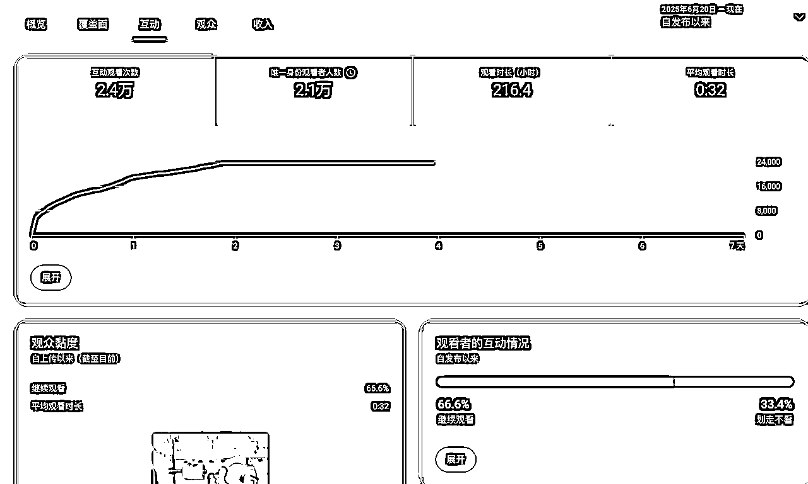

这是我优化完三秒之后发的第二个版本：

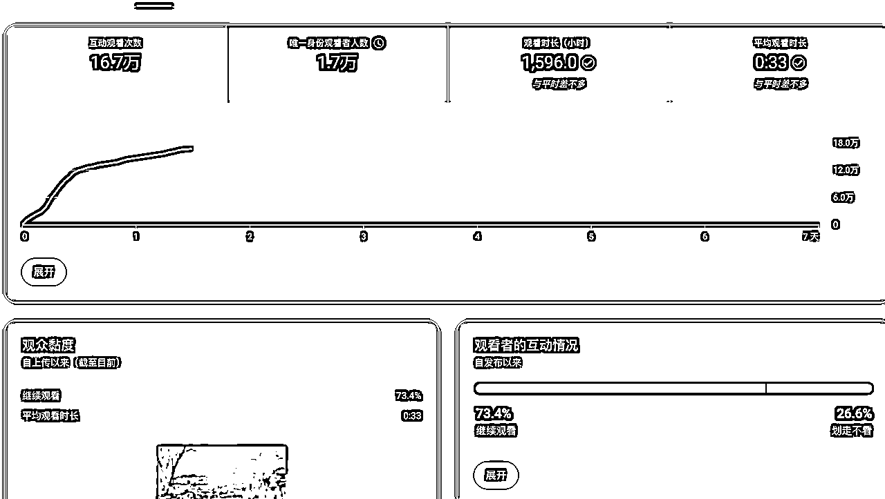

这个策略的好处是：一方面能锻炼你的网感，另一方面能最大程度降低成本，减少废片率。如果你对自己的内容有信心，完全可以测完再优化。当然我也不是每次都能优化成功，有的视频继续观看只有60%，我就直接放弃了。有些死马就是死马，你没必要硬医，去做下一批马就行了。

最后说点真心话

我在深海圈其实挺有名，原因是我之前发过两支长视频，大家都觉得挺惊艳。

那两支视频制作确实精良，也真的花了不少钱——金钱、时间、精力全砸进去。后来圈友问我花了多少钱，我老老实实说“350到400左右”。从此大家就觉得我是个“敢死队”，敢这么烧钱做视频。可能你也会这么看我。但我想说的是：

这个赛道看起来门槛低，人人拿AI都能做，但真正能跑出来的，一定是那些愿意死磕细节、反复测试、用脑子做内容的人。别怕从一开始的粗制滥造，也别怕数据打脸。最关键的是：方向要准，改动要稳，创意要基于爆款而不是凭空乱造。希望我的经验能帮到你。祝你也早点做出自己的爆款。

AI这波冲击真的太直观了。

veo3把语音口型同步这件事给真正解决了，海螺02又把物理世界的计算难度降了下来。这两个节点一过，意思就很清楚：AI视频从此进入快速迭代期，今天卡住你的技术瓶颈，可能下一个模型更新就直接消失了。门槛会跟着一起崩塌，只要会写一句prompt，普通人也能产出媲美大片的画面。

说白了，工具越来越好用，prompt越来越简单，未来能用AI做短视频的人会像雨后春笋一样冒出来。那站在这个浪潮里，靠什么活下来？我反复琢磨的答案只有四个字：先发优势。

我为什么要比别人更舍得砸钱、更拼命？因为我想先一步把粉丝抢到手。AI会升级，我也会升级。等别人反应过来进场时，我的私域已经盘活了，几十万的受众粘着。哪怕对手用同样的模型做出一模一样精致的画面，他才几百粉，我已经几十万了，差距立马拉开。

先发之外，必须有护城河。我一直强调微创新。能在赛道里爆的，核心永远是供给了用户在别处看不到的东西，或者把同一类内容做到极致，这就是稀缺感。持续制造稀缺，才会形成IP壁垒，把记忆点刻进观众脑子里。用户看到你的水印会主动停留，因为他潜意识里知道，这地方有独特的趣点、有他想要的调性。

到这一步结论就很残酷：慢慢磨、抠成本去做AI视频的人，最终只会被愿意花钱做精品的人干掉。你花得越少，你的内容替代性就越高，人人都能复制。真想做出差异化的质量，AI时代也是一分钱一分货，市面上一切都是明码标价。

有人说我像敢死队，其实也差不多。正因为敢all in，我一个月就拿到了别人追不上的成绩，而且已经回本了。在这条AI大革命的时间线上，时间比技巧更值钱。你比别人早一个月拿到10万粉，就多了一层抵御下一次模型升级带来的竞争红利。每一次AI进步，都等于多了一批新对手，可能是真人，可能是AI流水线。所以粉丝就是筹码，先发就是竞争力。

但先发不是躺赢。你必须持续进步，持续输出精品，保持与众不同的内容体验。视频没爆别总怪算法，现实是你的作品还不够打动人。YouTube就这么现实：一个优质作品没火可能是运气，但你连续稳定产出50个优质内容，火只是时间问题。

说到乐趣，这份工作其实挺像黑客的。你的账号、你的作品就是你的代码，你黑进的是观众的大脑神经。换个视角看，会发现这件事本身就很有意思。