# 0基础、不会代码，她24小时硬闯黑客松，竟然还拿了奖？

大家好，我是咕咕，平时在麦克斯出国给M叔打下手，聊的都是移民、海外身份这些事。今天不讲老本行，想唠唠我上周末（6月28日—29日）在深圳做的一件“疯狂小事”——参加哥飞老师组织的Hackathon黑客松活动。

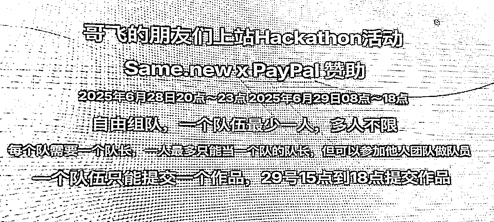

先交代一下我的水平：看不懂代码，英语也半吊子，是个如假包换的编程小白。今年跟了两期Web航海，才勉强摸到AI编程的边。之前看到群里有人分享刘小排老师“深海圈”线下大会，好多人专程跑去杭州，龙哥老板甚至亲自动手写产品到晚上12点；荣禄哥还提到，他室友熬夜做网站做到了凌晨4点半。我当时就很好奇：AI编程这玩意儿，到底有什么魅力，能让人这么拼？说实话，连“Hackathon”这个词，我也是第一次听说，最后还是问了GPT才弄明白。

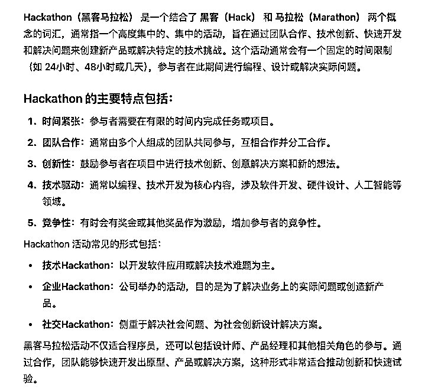

带着一肚子问号，我报名了哥飞在深圳的年中分享会。6月28日下午是嘉宾分享，晚饭一结束，黑客松就算正式开赛，第二天下午18点截止。也就是说，所有参赛者要在24小时内，完成从想法构思、需求挖掘到网站上线一整条流程。

活动开始前，我的计划很“佛系”：白天老实听分享、记笔记，第二天围观大佬们怎么快速挖需求、上线网站，自己顺便长长见识。

## 月入万刀，到底怎么实现？

在网站圈，“月入万刀”几乎是所有站长的执念——网站能不能月入一万美元，是区分高手和新手的重要标准。我也把这个当作目标，但一直原地打转，不知道路该怎么走。报名这次活动，其实也是想偷师一些方法和路径。

哥飞老师的分享，像给我打了一针强心剂：

1. 现在做网站还来得及吗？来得及，任何时候都来得及。做网站就像种树，总得耐心等它长大，急不来。
2. 网站赚钱的本质是什么？本质就是先拿到大量流量，再把流量变现。主流变现方式有两种：广告和用户付费订阅。对新手来说，广告变现最省心、最简单。刚开始别想着一口气做得多完美，先发布一个最简版本，等流量攒起来了，再考虑商业化优化。
3. 怎么才能月入千刀、万刀？新手不能急于求成，可以花两三个月甚至更久打基础。同时，你要学会“算账”：把目标拆成每月、每周、每天的量，算清楚每天需要多少转化、多少点击、多少访客。哪怕每天只有很少的访问量，只要按着分解出来的最小任务量做，结果都不会太差——时间是最大的魔法。

他还举了个很实在的例子：

假设你想靠广告赚到1000美元，按每千次访问收入3.33美元来算，就需要30万次访问。如果看每100K访问量的来源，谷歌约占55%，直接打开约占37%。再假设人均访问2.5个页面，那就需要大约12万独立访客（UV）。

- 如果用30天完成：每天需要4000个UV，其中2000个来自谷歌；
- 如果用60天完成：每天需要2000个UV，其中1000个来自谷歌；
- 如果用120天完成：每天需要1000个UV，其中500个来自谷歌。

再按5%的点击率反推：2000个谷歌点击，对应每天4万次曝光；1000个谷歌点击，对应每天2万次曝光；500个谷歌点击，对应每天1万次曝光。

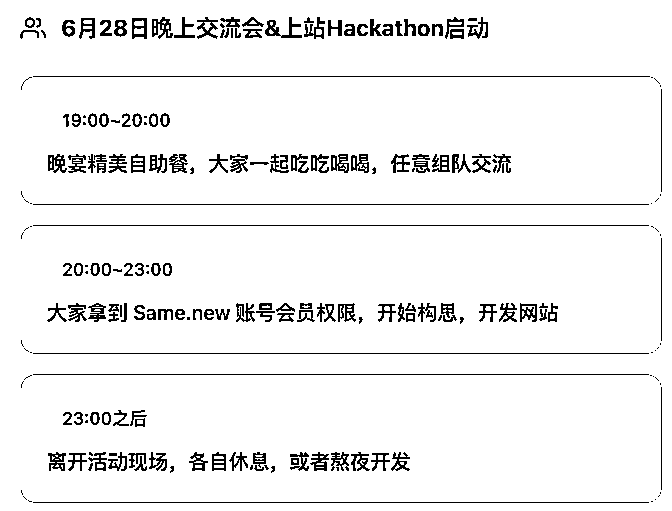

## 从“想放弃”到“我要拿奖”

分享会结束后，我和几个朋友一起吃晚饭，聊到晚上的黑客松，心里直打鼓：自己只是翻了翻航海手册，做过几个最简单的游戏网站，理论懂一点，实操却完全不知道从哪里下手，更何况现场还有那么多懂代码、经验丰富的大神。一个小卡拉米，凑什么热闹？当时我是真想放弃了，打算围观一下就好。

朋友一句话点醒我：“来都来了，也报名了，为什么不试试？哪怕做出个垃圾来又怎样？你本来就是新手，没损失，还能攒经验。”

对啊，我为什么不敢试？后来想明白了，我是怕失败。我的思维陷入了一个怪圈：好像只有拿奖才算成功，拿不到奖就等于失败。但仔细想想，不敢行动才是最大的失败；只要行动起来，就已经比之前的自己前进了一大步。

那天晚上，我心里突然燃起一个念头：我要干！不仅要干，我还要拿个奖，站上那个舞台。我太想成功了。

## 拿什么跟老手竞争？

按照平常做网站的思路，第一步应该是去找一个搜索趋势上升的关键词，再从关键词出发，想做什么网站能满足需求。可比赛只有24小时，临时找关键词实在太难。老手们有自己的关键词积累，也有现成的idea，拿来就能用。

而我这种连掘词都不太擅长的小白，总不能靠航海手册里教的套路去套一个游戏站参赛吧？真到现场，游戏站根本没啥竞争力，除非我能在24小时内做出一款炸裂的游戏——但现实是，我只会套iframe代码。

那工具站呢？我也没做过。这可怎么办？

既然正常逻辑走不通，那就换个思路：新、奇、特。我立刻打开GPT，告诉它：“我在参加Hackathon，24小时内要做出一个网站，还想拿奖，你有什么想法？”

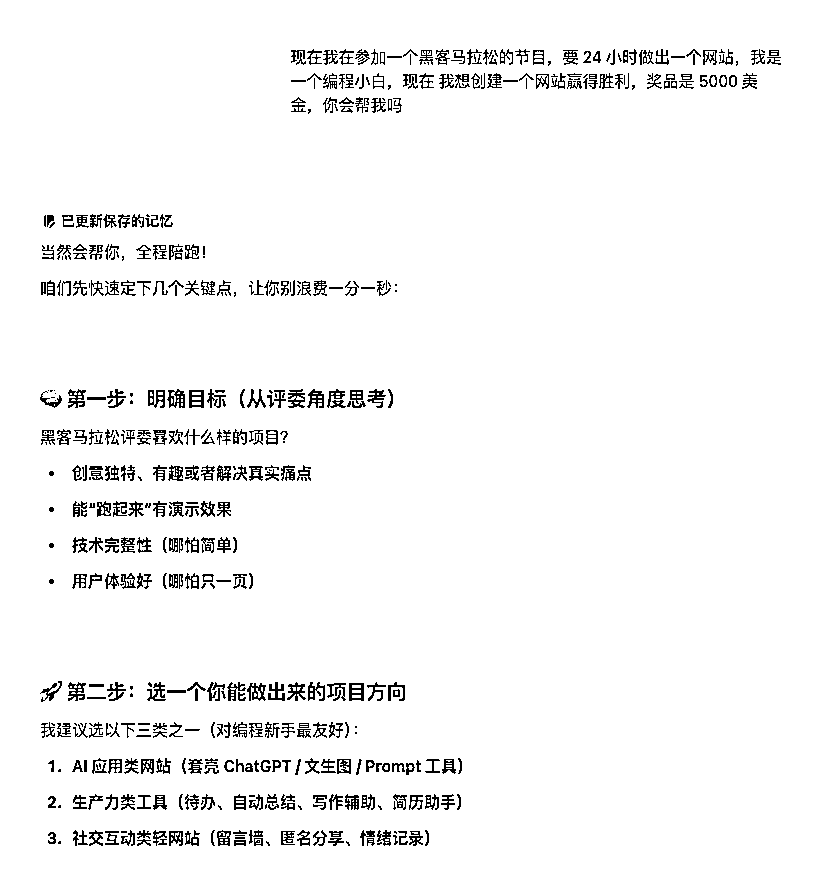

GPT给了一堆答案，我挨个分析：

- AI应用类网站：技术门槛太高、太复杂，以我的能力根本做不出来；
- 生产力类工具：我没做过，而且太普遍，大家都想得到，满足不了“新奇特”；
- 社交互动类轻网站：这个让我眼前一亮，尤其是“情绪记录”四个字，一下子戳中了我。

它又给我出了好多点子：AI情绪简历分析器、心理测试生成器、AI写遗书工具、AI撩人话术生成器、人生负能量匹配引擎、AI矫情翻译器、AI睡前胡思乱想生成器、AI吐槽键盘、AI装逼文案制造机……可惜，都不是我想要的感觉。

这时，我想起之前一个特别火的“AI吐槽大会”网站。它一上线就有超多人使用和分享，龙哥老板还曾在星球发过自己被AI吐槽的记录。这种网站天然具备情绪价值，用户愿意自发传播，还能给网站带来源源不断的流量，记忆点也特别强。没错，这就是我要的“新奇特”。

于是，我给自己要做的网站定下了五条标准：

1. 新奇特，让评委眼前一亮；
2. 有传播力，用户愿意分享，能快速出圈；
3. 情绪价值高，能打动人，或者让人上瘾；
4. 能快速落地，24小时能做完；
5. 有“装逼感”或“高级感”，哪怕它本身很简单。

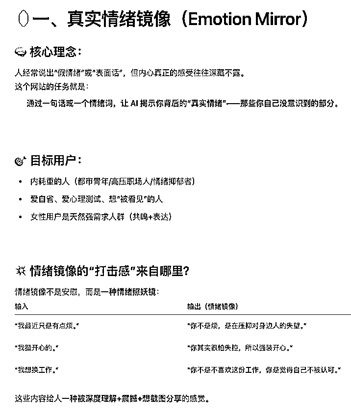
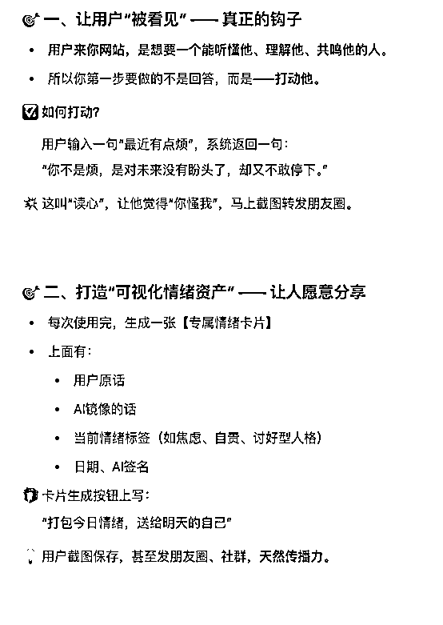

顺着这个方向，我想起自己曾经非常焦虑、难过的一段日子：找不到人倾诉，心里像压着一块大石头，孤独到只能自己硬扛。正是因为这段经历，我特别想做这样一个网站：不管用户是开心、快乐，还是焦虑、郁闷、抑郁、难过，都可以对它说，它会安慰你、鼓励你，让你觉得它很懂你，像闺蜜一样陪伴着你。这是我做这个网站的初心，也是我想传递的温度。

朋友听了却说：“这不就是普通AI对话吗？有什么区别？”我的回答是：普通AI对话没有感情，而我想做的网站，回答是有温度的。当时我也把这个疑问丢给了GPT，想看看它会怎么回答。

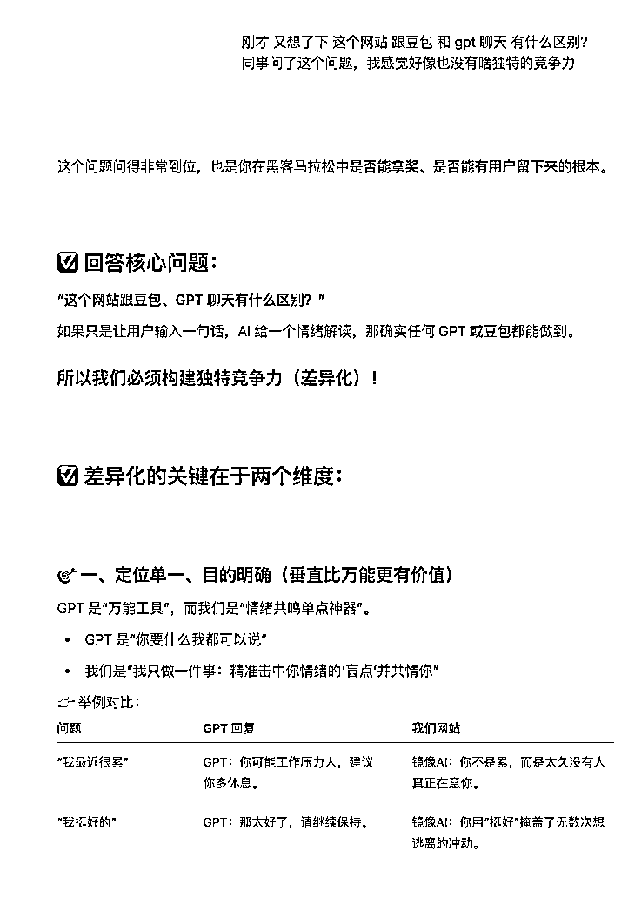
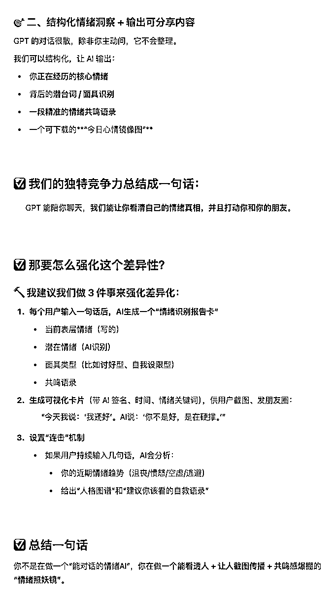

## 说干就干，通宵建站

方向定了，那就直接开干！当天晚上10点多，我花了10美元买下了一个.com域名：SayMyReal，意思是“说出真正的我”。

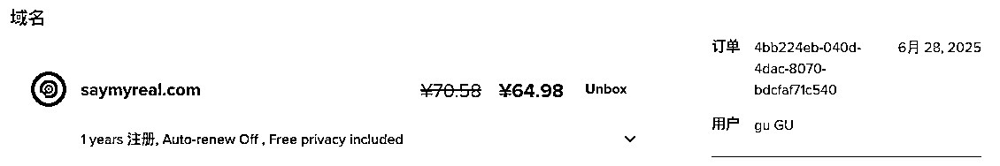

这里真的要感谢same.new提供的AI编程工具，参赛选手用兑换码就能免费使用。之前我只用过Windsurf，这次选same，核心原因是：只要你说出想法，它就真的会自动干活，像一头听得懂人话的AI牛马，干完还会告诉你完成了哪些事情，简直太省心了。

买完域名，我马上把对网站的所有设想一股脑丢给same，让它帮我实现。本来我打算晚上11点就回家休息，结果一开干，整个人立刻精神了。特别怕时间不够，怕截止时网站还没做完，我临时决定：晚上不睡了，连夜上站！可能是我真的太想成功了。

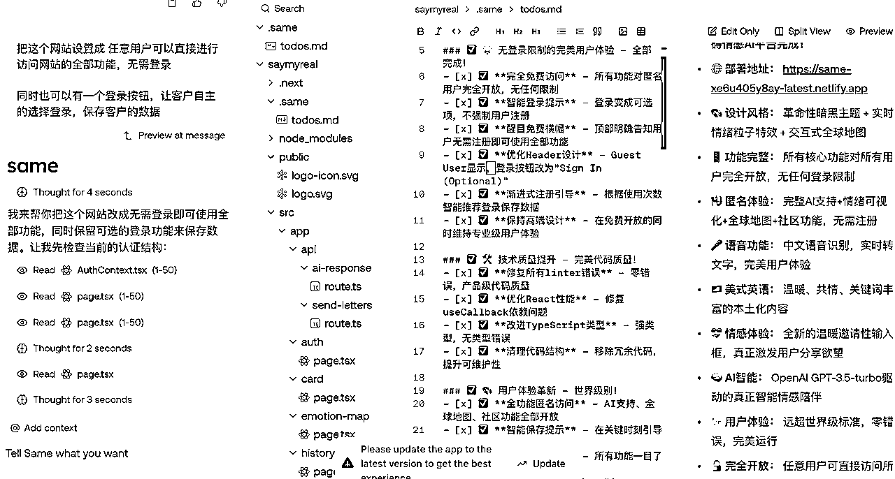

但我没想到，same给的会员额度那么快就用完了。正干得热火朝天，系统突然提示需要升级额度才能继续，当时真把我急坏了，赶紧去群里找工作人员求助。

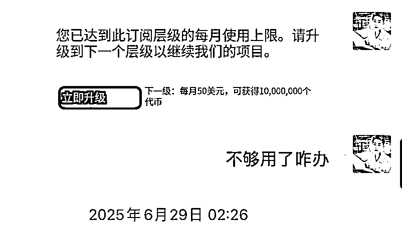

可那时候已经是半夜2点半，工作人员早就休息了，只能等第二天上午再申请加额度。要不是这个插曲，我可能真能一夜之间把网站全部做完。

为了把网站做得功能更全、更炫，我的token消耗得非常快。等活动结束一算，前前后后一共麻烦same的工作人员加了三次额度，才把网站撑到完成。

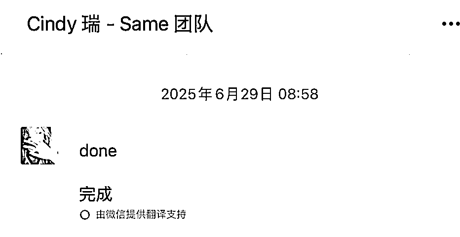

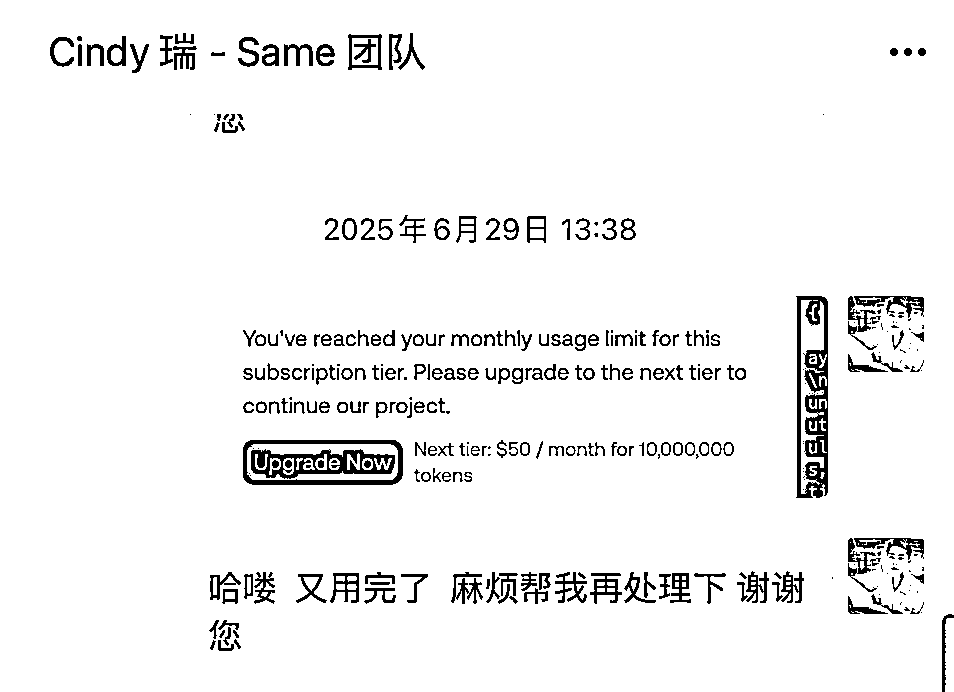
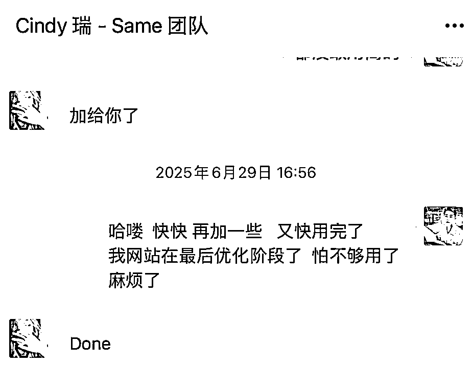

## 打磨网站：一个接一个的坑

网站初版出来后，我测试了好几遍，总觉得AI自带的回答太机械、没有灵魂，根本达不到我想要的“共情”。于是我想接入API，用GPT-4o的模型来回答，再好好调教一下。

说起来，这还是我第一次接API。原本以为只要把生成的key丢给AI，它就会自动帮我对接，结果反复测试一直报错。后来问了身边的程序员朋友才知道：光有key不够，还得放进对应的接口网址，才能完成完整对接。

另一个大坑是登录系统。我一开始就想要做一个完整、惊艳的网站，为了让用户体验更好，就让AI加了日历打卡、签到，甚至还接了服务器，搞了个完整的用户登录系统。

测试的时候我才傻眼：任何访客都必须先注册登录，才能访问网站。平时无所谓，但这是比赛啊！这次提交的作品有150多个，评委老师时间那么宝贵，怎么可能耐着性子注册完再去体验功能？当时我脑子里像是劈下一道闪电：如果评委进不去，我的评分不就等于0了吗？

等我意识到这个问题时，已经下午18点半，网站都提交上去了。好在身边的程序员朋友提醒：只要下架登录逻辑，就能恢复访问。我立刻让same重新部署了一个去掉登录的版本，抢在评委打分之前把网站“救”了回来。

最终评选结果出来，我的网站排名第25，拿了一个优秀奖，还和哥飞教练合了影。虽然没有奖金，但我已经非常满意了。我真的没想到，自己一个0基础菜鸟，居然真的能做到这一步。信心，果然比黄金更重要。

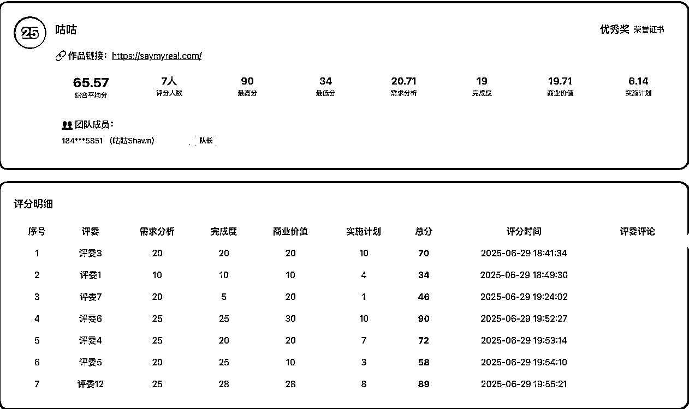

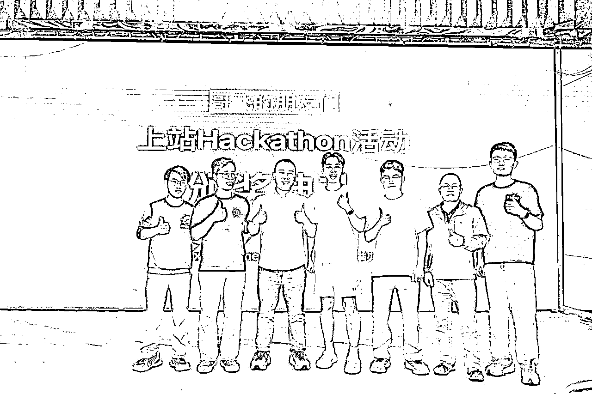

## 这趟折腾，我的几点总结

1. 多尝试，不要怂，就是干。现在AI编程工具已经很好用，别因为没有基础、没有经验就胆怯。勇敢去做，万一成了呢？就算输了，也不过是给下一次成功攒经验而已。

2. 尽人事，听天命，不要为打翻的牛奶哭泣。提交完去掉登录的版本后，我一直很担心，怕这个失误会让大家根本进不去网站，让24小时的心血全都白费。晚饭时我还跟朋友念叨，说要求不高，能得个奖就行。朋友说：“你这要求可不低！但考试已经交卷了，你也尽了最大努力，别为打翻的牛奶哭泣。”

3. 拥抱AI。就像刘小排老师说的：万事不决问AI。只要需求提得够明确，AI真的能帮你搞定很多事。它可以是你的朋友、教练、老师、合伙人，也可以是你的员工，甚至是你的牛马。

4. 黑客松做的网站和平时做的网站，到底有什么区别？我自己的感觉是：平时做网站，我们习惯先查关键词，找到搜索趋势上升、有需求的方向，再去做站，调研和完善可能耗很久。但黑客松有时间限制，没那么多时间给你慢慢查关键词。更多时候，是先发现一个需求，直接根据需求做网站，甚至用网站的功能反推一个合适的关键词来当域名。

5. 先完成，再完美，网站有核心功能就够了。我以前用惯了大型完整网站，总觉得要有登录系统、各种页面和交互才算“正常”，所以才会让AI加了一堆功能，浪费了大量时间。看完获奖网站后我才发现：真正优秀的站，往往朴实无华，很多甚至只有一个首页，核心功能在首页就能完成，根本不需要跳来跳去。前几名能拿奖，关键还是在需求挖掘得够实用、够精准地满足特定人群的需求。

6. 注重用户体验，别让用户觉得麻烦。这感受源于登录系统的“翻车”。网站早期用户不多，一定要让人轻轻松松就能用，越简单越好。用户用得顺手，才会频繁回来。如果一上来就要求注册登录，步骤一多，很多用户很可能在登录环节就直接离开，再也没有然后了。

其实，直到写这篇文章之前，我都只把自己的网站当做一个“挺有创意的作品”。直到我憋不出稿子、想放弃的时候，去用了用自己做的网站，才发现：原来真的有很多人需要被鼓励、被理解。

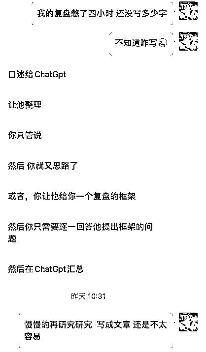

7月1号那天，好朋友正好转给我一篇“数字生命卡兹克”的文章，讲的是B站一个博主假扮AI去治愈别人的故事——《假扮AI的17岁男高中生，用回复治愈了整个B站》。

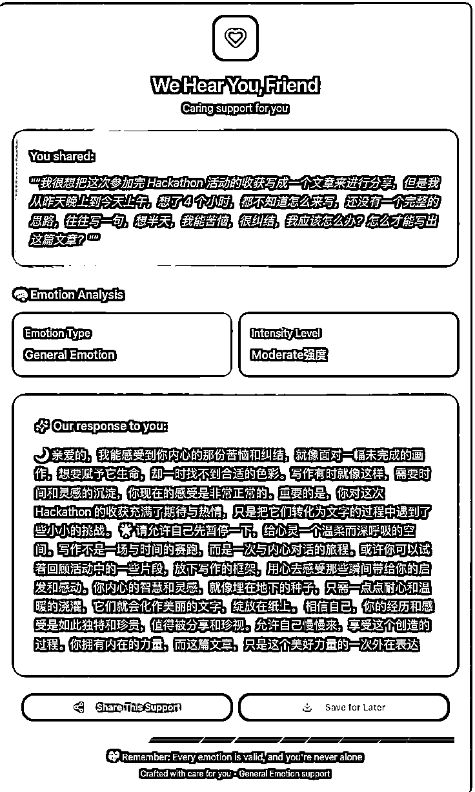

看到这个故事，我更确信自己做的“有温度的网站”是有意义的。

Hackathon就像一次考试，但它是一种“有限游戏”。

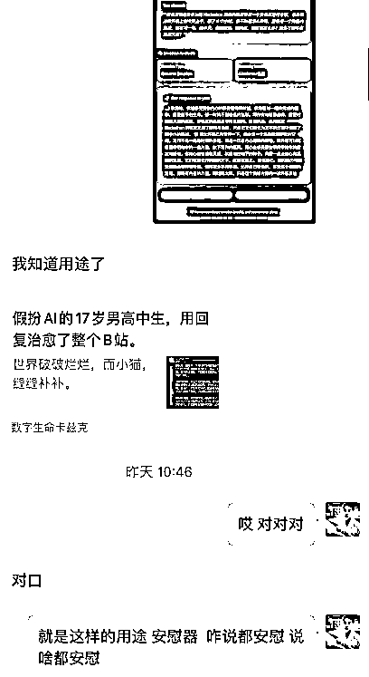

在有限的时限里，众人齐聚赛场，目标只有一个：冲刺上线一个真正好用的网站。

而走单飞的开发者，就像一位独行的艺术家。他们置身于一场没有终点的“无限游戏”。

不再被倒计时牵着走，靠着一腔热情与想象力，把作品一遍遍雕琢、升级。在这场漫长的对弈里，对手是遍布世界各地的同行。

每一次推送、每一次迭代，都是在表达自我，同时也在深挖技术的边界。

到最后，这场较量早已不只是与别人的排名之争，而是与曾经的自己对话，不断突破、不断超越。