# 【YouTube新人进阶指南】30天拿下千万Shorts播放，快速达成高级YPP

大家好，我是逸尘，一个YouTube新人。刚结束航海的第二天，我的第23支作品就破了千万播放，目前累计播放已超六千万，订阅突破五万。

此前我在平台发过一篇入门帖：https://scys.com/articleDetail/xq_topic/5125442228188414 本来想等到百万播放再发，却没拿到精华，有些遗憾。现在回头看，那阶段做的确实还不成熟。所以这次推出进阶版——从0到1如何做出百万甚至千万级的爆款。本篇在旧文基础上做了大量补充完善，思路更完整，不用再回头翻。

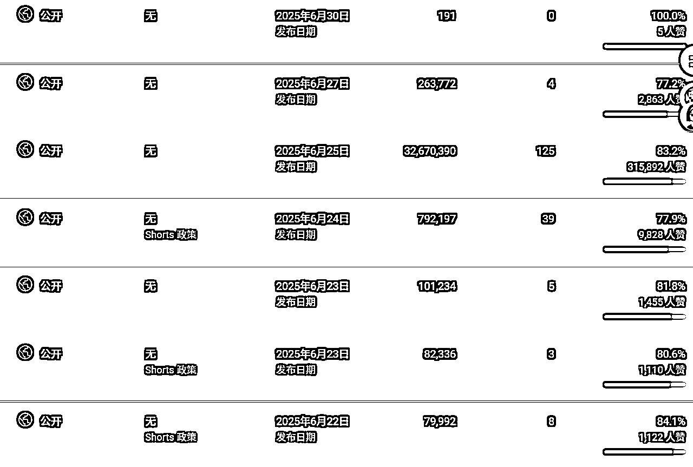

# 一、开场说点实在话

表面看，我只用了25天，发出23条短视频，其中一条就冲到六千多万播放，效率好像很高对吧？

实际上背后是我对一个一级细分赛道做了深度迭代，并挖掘出十几个以上的二级细分赛道，每个三级赛道基本都是迭代后才发布的作品。本篇我先讲操作，再谈感悟，希望能给你一些启发。

这篇文章我会毫无保留地把我知道的都摊开：我的频道、参考频道、最新打法、具体执行细节，全部放在文末。

我为什么敢这么公开？

1.说得直白点，就算你完全照抄，成功率也极低，后面会解释原因。

2.我花二十多天才摸索出这套进阶方法，后续积累的速度只会更快，这些东西对我而言已经不值钱了。

3.万一能帮你解决某个卡点，我就赚了。

4.如果你真靠这篇开通了YPP，记得请我喝杯奶茶，开玩笑的😜

文章是在期末考试的间隙赶写的，有纰漏欢迎大佬指正，我虚心接受。

# 一、赛道选择

选赛道时很多人会先去研究自动化工具，我认为这条路不划算。第一，技术门槛高，会耗费大量时间；第二，你的目标是找到一个合适的赛道，而且只要一个！就算你爬了几万条，最后也只用一个，有必要吗？这种规模化操作更适合做YouTube战略层面的团队。

选赛道核心就一个标准：低量爆款。低量指同类作品数量少，最好控制在30条以内；爆款指单条播放量高，我的标准是基本都要有千万起步，甚至上亿。

道理很简单，如果一个对标号体量只有一千万，你学他天花板大概就是百万级；如果他是亿级，你才有机会冲到千万级。

我的寻找方法如下：

1.多开几个号刷Shorts，专门找自己看了会爽、做完会觉得愉快的视频。

2.点进视频下方的标签，一个个进去看，同类爆款是否稀少，越少越蓝海。

3.看到喜欢的就点赞订阅，系统会继续推同类。如果发现这类内容最近持续爆，播放高但数量少，很可能就是方向。几个账号一起刷，能筛出几条感兴趣的方向，最后选一个最优的下手。

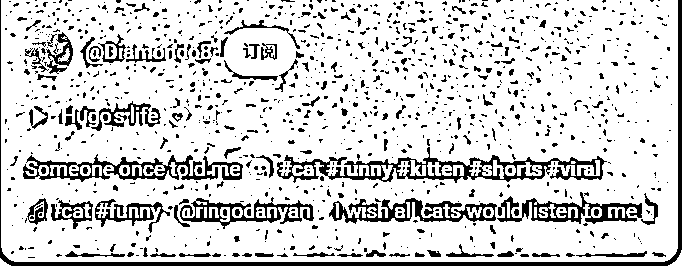

总结一句话：同类少、订阅多、播放高、自己喜欢。

# 二、拆解爆款

拆解利器我用的是Google AI Studio：https://aistudio.google.com/

没用过的小伙伴可以先去看我之前的帖子：https://scys.com/articleDetail/xq_topic/5125442228188414

想做好YouTube，先学会抄作业。抄的方式比抄本身更重要，很多人就卡在这里。这一步必须重视，我一开始也忽视了方向走偏，还是朋友提醒才及时刹车，文末有致谢。

下面是具体拆解流程：

## 1.用GAS做对标频道的整体画像

GAS一次可上传十个视频，操作很简单，直接把对标频道的爆款视频链接复制进来粘贴就行。记住，链接塞得越多，分析越全面。

注意点是历史最多只能保留十个视频，但你可以在对话里把多余的删掉继续上传，之前的记忆还在。这个技巧非常好用。但别超过十个，否则会报internal error，删掉就正常了。

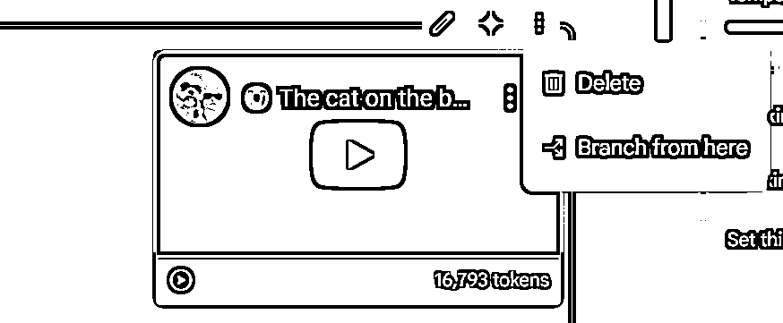

上图是我拆解一支视频的做法，把对标账号播放120万以上的视频全部丢进GAS分析，一个对话大概能吃20w Token。

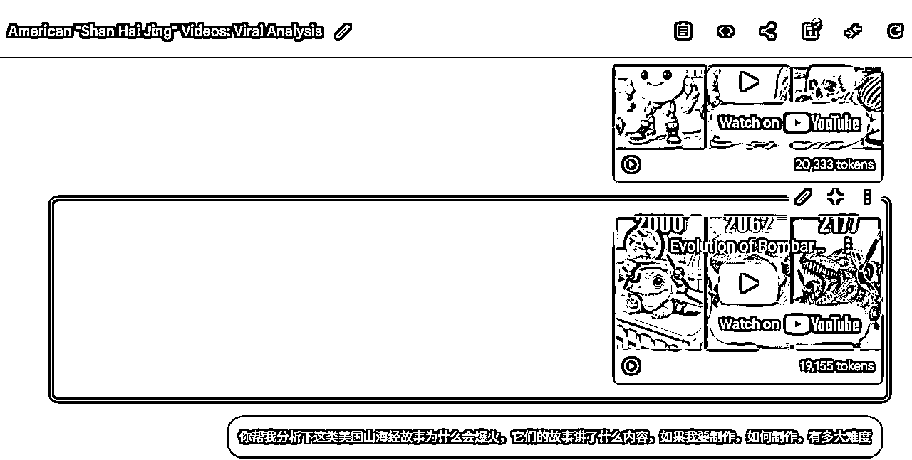

这样就能清晰知道这个爆款频道的核心内容是什么，用什么方式制作。

GAS会把细节掰开揉碎讲给你听。

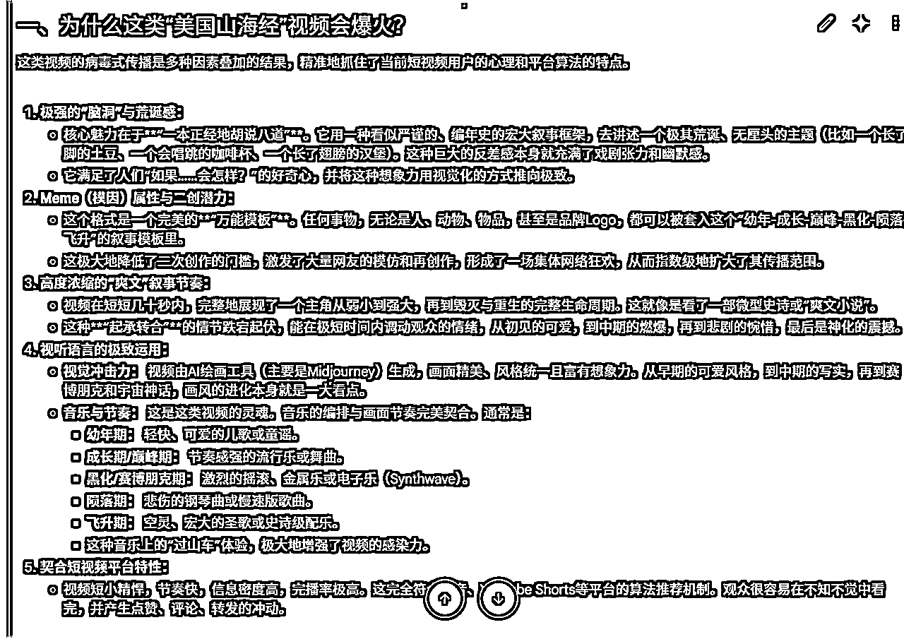

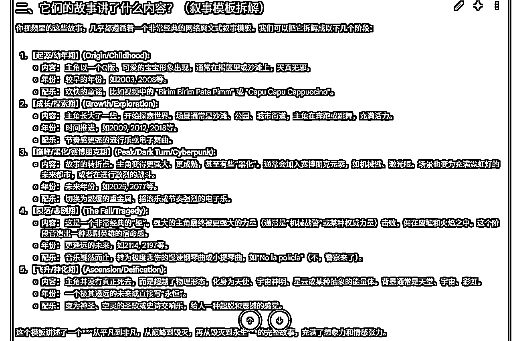

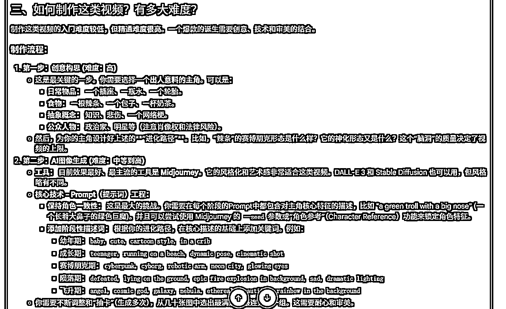

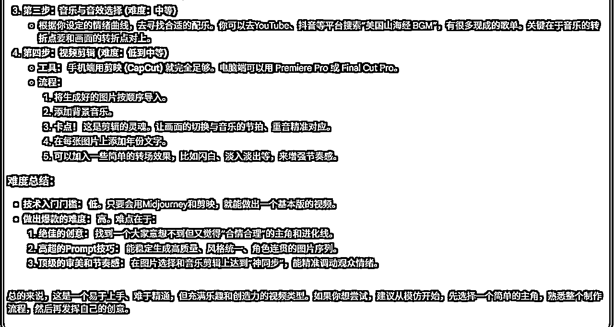

做完这一轮，这个频道讲什么、为什么火、用了哪些套路，就基本摸透了。

## 2.对照自身能否胜任

再去看对标的爆款，注意每个细节：内容脚本、音效、BGM、转场、滤镜、特效，看自己能不能复现。如果做不到但又很想做，就把视频丢给GAS，让它告诉你某一段用了什么技术、怎么实现的。看得懂GAS的解释，就说明你能做。能力都是做出来的，敢下场才有成长。No what, no why, just how to do it！

## 3.微创新，最小手术

我在初级篇犯过一个致命错误，把对标视频改了八成以上，只保留了非核心元素，结果前期一直卡壳。

记住，抄是最大的学习，不要乱创新！把天马行空的想法收起来，只做最小的微创新，动最小的手术——只换主角主体，或只换服装，背景可微调但不能影响核心内容。

具体操作：

### 1.分镜拆解

在GAS里输入对标爆款视频链接，用这条提示词：

拆解这个视频的每一个分镜，给我生成能完美复刻的文生图提示词，图文生图描述词原则：

用连贯的自然语言描述画面内容(镜头【远景、近景、中景、特写等等】+主体+行为+环境等)

文生图描述词示例：(中景，一只白色的大胖猫，在躺椅上戴着墨镜，手拿酒杯躺着晒太阳，身上盖着浴巾，背景是大海。)

注意：每个镜头独立描述，因为我进行生图的时候是独立进行的，所以所有主角的提示词在每个镜头中保持一模一样，不得有一个字的不同；此外，具有相同环境的镜头对于环境的提示词必须保持一模一样。（比如在同一个房间里面，有两个镜头，那么这两个镜头对房间的描述词必须一模一样））

### 2.检查遗漏分镜

GAS不一定能一次全抓到，需要自己再看一遍视频，漏掉的用截图或关键帧工具补上，再让GAS补充。

### 3.微调人物细节

一般我会换个衣服或直接换主体，看具体视频决定。把原人物描述词替换成你想要的描述词即可。

### 4.文生图文案丰富化

GAS给出的提示词往往太简，元素不足，需要优化。比如：

你现在来帮我修改一些分镜的提示词。比如，我需要你帮我变动一下每个分镜的背景提示词进行微调（比如说，第一个镜头，背景是背景是模糊的、带有大片草坪的现代化别墅和绿树，你就可以给我增添一些别的不影响画面的事物，对整个画面进行微调，但不要影响故事的主体和主要内容展现，主要是为了避免抄袭的嫌疑。如果你没明白微调的含义，我再举一个例子，镜头10在一间被摧毁的现代化卧室里，你就可以对这个卧室里面的陈设以及颜色进行一下描述，来修改一下这些不是很重要的元素，使得整个画面的主要内容与对标视频相同，但是次要背景与对标视频不同，有效帮助我进行二创）

### 5.细节打磨

剩下的看个人审美，颜色、光影随便调。景别非常关键，远景、近景、特写、仰拍、俯拍都要到位。

小结：这一步决定生死，我刚开始每次都要花1-2小时静下心雕琢，每次精细的打磨都是爆款诞生的前奏。

# 三、文生图

图片决定第一眼感受，所以要反复抽卡打磨，一般也要1-2小时。先把提示词磨到80%准确率，生成成功率会翻倍，磨刀不误砍柴工。

## 1.抽卡方式

### 1）豆包一键出图

做法参考李澹归老师的帖子https://scys.com/articleDetail/xq_topic/1524488222818842

### 2）即梦批量出图

参考李澹归老师另一篇帖子https://scys.com/articleDetail/xq_topic/2852211242585521 我补充几点注意：

1.每次重登必须重新点“添加账号”

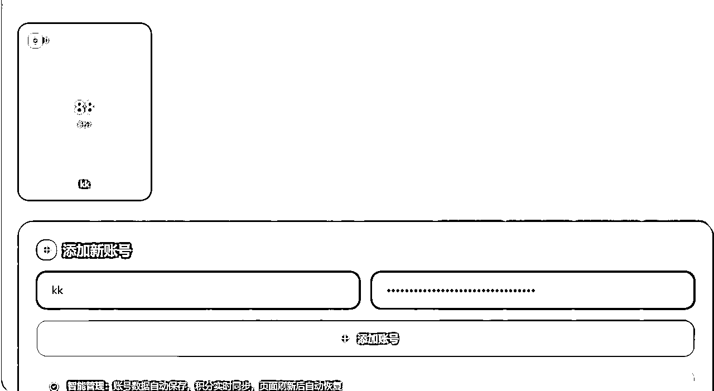

2.有时候页面显示空白，不用重生，图片其实在网页端即梦里已经生成了。

### 3）付费批量工具

有需要可以试Chrome插件：AutoGPT，支持GPT/即梦/MJ等自动批量出图。官方文档：https://www.yuque.com/autojourney/docs/pkil2i72vcqfweld

## 2.处理顽固图片

遇到角度、服饰、身体不对的情况，我会这样处理：

1）反复抽，直到对为止

2）精修提示词

3）换工具试试，GPT Sora、豆包、即梦、Runway、海螺、可灵、MJ都可尝试

4）截图法，把要复刻的画面截图发给AI做参考，成功率更高

## 3.去水印

即梦会员左上角仍有“AI”水印，需要去。推荐三款免费工具：

画质较差的Google插件先不推荐。以下两款画质保持较好：

https://online.niuxuezhang.cn/online-photo-watermark-remover/detail/

https://www.arkthinker.com/zh/watermark-remover/

缺点是一次只能处理一张，可同时开两个用。

## 4.人物一致性

我用即梦做的是山海经主题，主体无一致性要求。但故事类通常需要稳定的人物。

我试过很多工具，结论是：

不充MJ的前提下，最佳选择是GPT和Runway。

把主体参考图上传，让它以此为主体去生成对应提示词的画面即可。

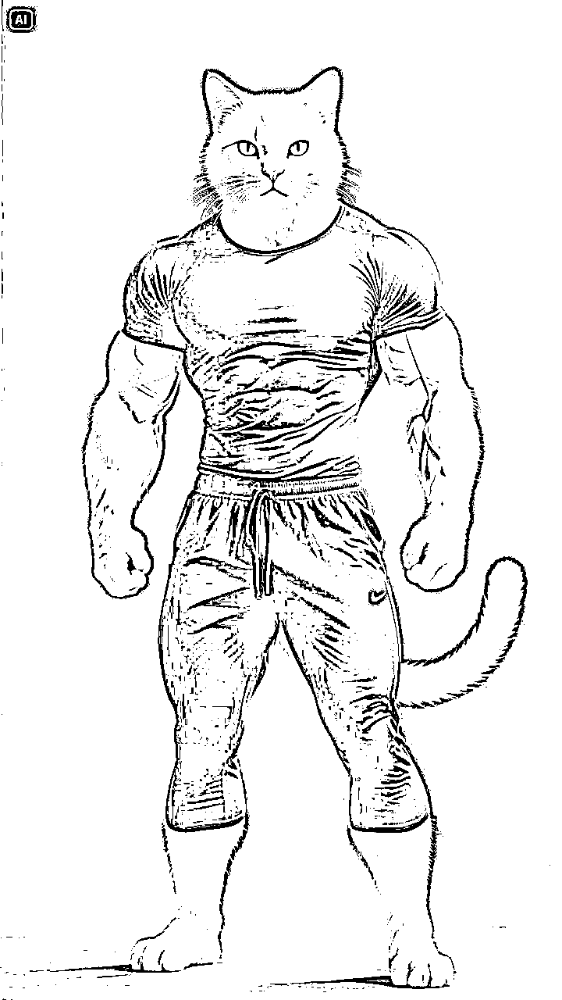

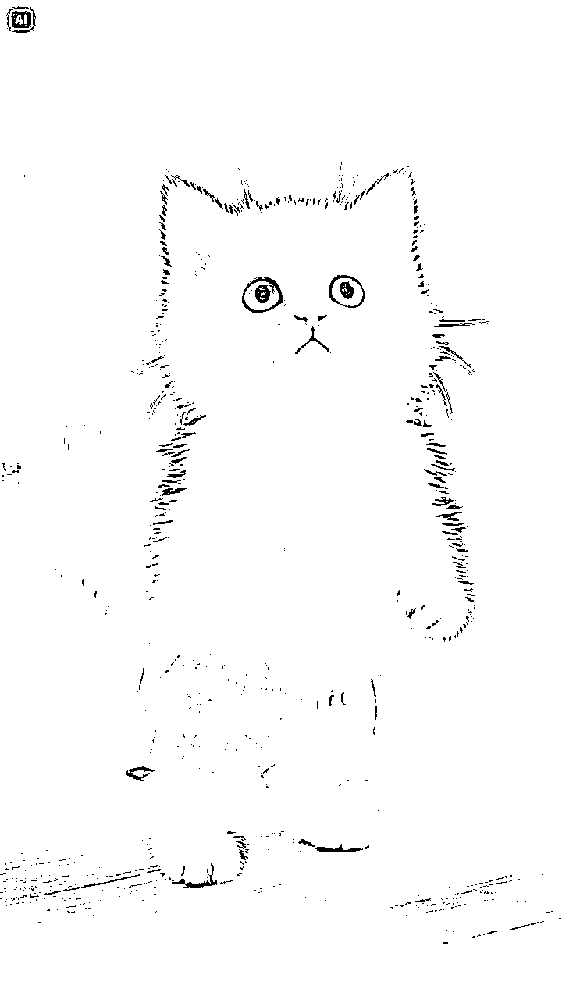

GPT单号生成量有限，Runway单次消耗积分较高，免费玩法就多开号，不差钱就用Auto工具加速。

# 四、图生视频

## 1.图生视频提示词

这里很多人会犯错，在生图时就顺手写了图生视频提示词，其实这样不准。正确做法是等所有图片齐了，再统一丢回GAS，让它根据图片顺序和故事生成提示词。

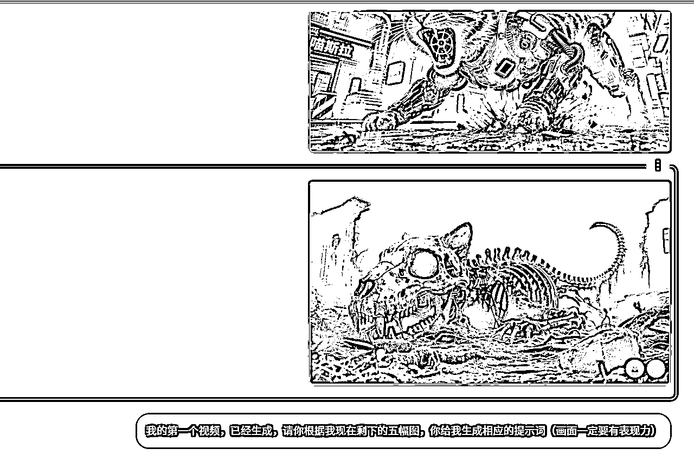

因为我之前已喂过提示词，所以这里不再重复。我的常用提示词是：

你先给这些图片进行排序，然后根据故事内容给出最合适的用即梦图生视频的提示词（提示词要求如下：运镜方式【拉进、拉远、左推摇镜、环绕运镜、跟随运镜等等】+人物或主体的动作+人物的表情【所有的人物可以指动物主体】，所有的提示词都要连贯的用一句话输出，不要有非必要的形容词

## 2.图生视频平台

我主要用即梦、智谱清言、可灵，豆包免费每天10次，海螺更新后效果极好且送积分。

综合排名：海螺>可灵>即梦>智谱清言/豆包

即梦Pro模型贵且效果一般，不推荐。即梦的音乐生成现在免费，一个视频可配三段音效，很香。

多薅海螺的羊毛，性价比最高。

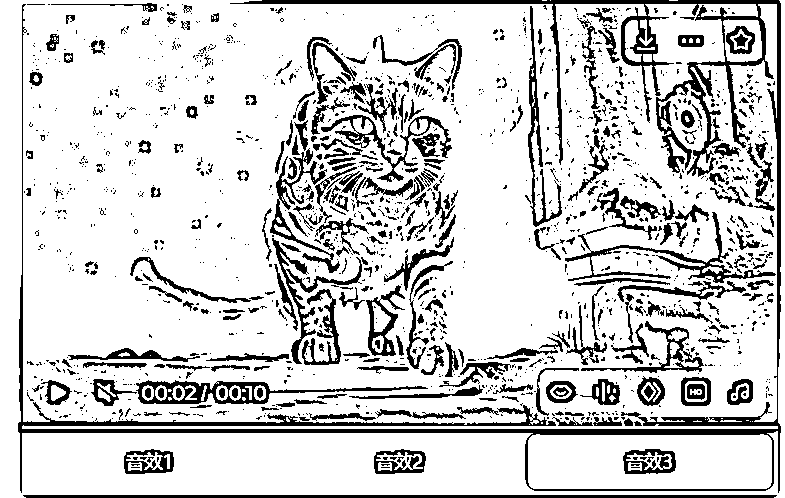

白嫖党也能玩得很开心。

# 五、剪辑

## 1.GAS辅助剪辑

剪辑功底很重要，但GAS能把你拉平。之前我看到对标视频末尾的回忆片段觉得做不了，直接丢进GAS，它就手把手教你用剪映实现。大多数效果只要把视频丢进去，GAS就能用小白语言一步步教你。

## 2.音效搭配

动物类视频没有字幕，音效占成败的30%。找不到合适的音效时：

1）丢链接给GAS，让它分析并推荐音效名称，再去剪映搜索，命中率高。

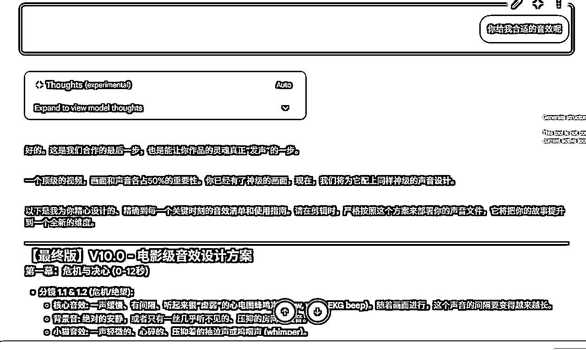

2）去爱给网https://www.aigei.com/ 找免费商用音效，试听下载。

## 3.剪辑细节对齐

剪完别自我感觉良好，去对比对标视频的转场、音效、色彩差异，逐项修正。

# 六、复盘与提升

别急着上传。把成品最后丢给GAS，让它对照对标爆款进行点评，找出不足再优化。

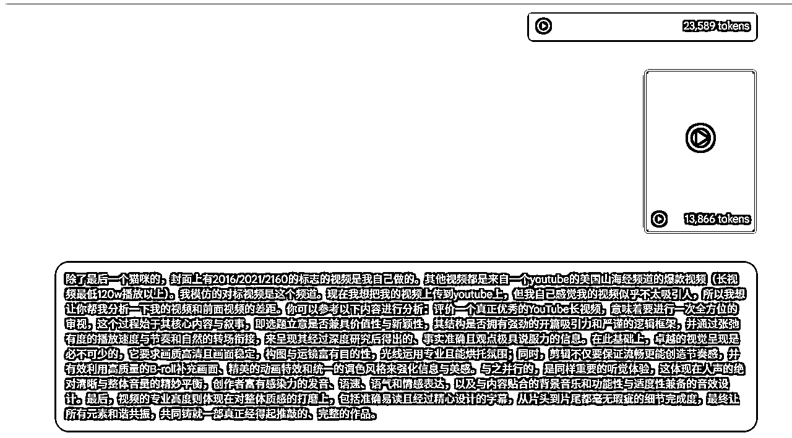

我的常用提示词：

* * *

除最后一只猫的素材外，封面上带有“2016 / 2021 / 2160”标识的片段，都是我自己制作的。其余部分参考了一个美国频道里的热门山海经风格作品，那些长视频的播放成绩普遍超过百万。我目前也是按照这个频道的创作方式进行学习。

不过，在准备发布自己的版本时，我总觉得成片还缺少足够的抓力。因此，我想借这个机会，请大家帮我看看：我的作品和那些高播放视频之间，真正的差距究竟在哪里？

判断一条成熟的 YouTube 长内容，不能只看画面是否漂亮，而要从多个环节一起检查。

首先是选题和表达。主题既要让人觉得值得观看，也要有区别于同类内容的新鲜感；开头需要尽快抛出悬念或冲突，让观众有继续看下去的理由。中段则要保持信息推进，前后关系清楚，节奏不能始终一个速度。内容最好建立在充分查证的基础上，事实可靠，观点也能经得住推敲。

接下来是画面。清晰度和稳定性只是基础，更重要的是每个镜头都要有用途：画面怎么构图、镜头如何移动、光线怎样服务情绪，都应该经过设计。剪辑既要连贯，也要有起伏；补充镜头、动态图形、特效和色彩处理，不能只是为了堆元素，而要真正帮助观众理解内容，同时维持整支片子的视觉统一。

声音同样决定观看感受。旁白必须清楚，声音大小要协调，语气、停顿、速度和情绪要贴合故事发展。音乐不能喧宾夺主，音效也要在需要的时候出现，既能增强临场感，又不能让听感变得嘈杂。

最后还要检查细节：字幕有没有错字，字号是否易读，样式是否统一，片头片尾以及每一次衔接是否存在明显瑕疵。只有内容、画面、声音和细节彼此配合，作品才会显得完整，而不是“素材拼接”出来的成片。

顺便说一下，上面这套评判维度的后半部分，是我让 Gemini 整理出来的长内容质量检查清单。如果大家感兴趣，之后可以单独分享。

之后，GAS 给了我一批具体修改意见：

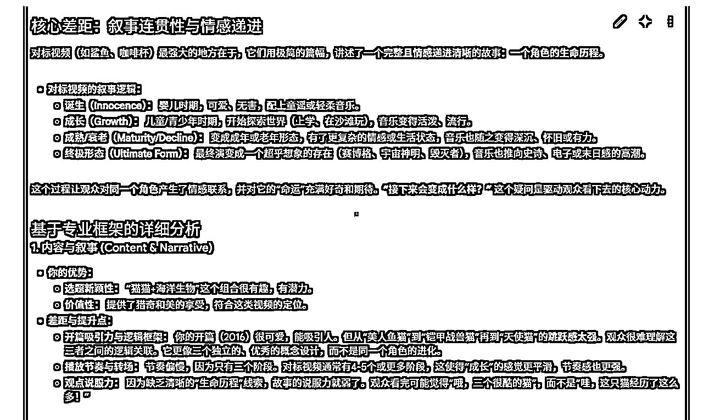

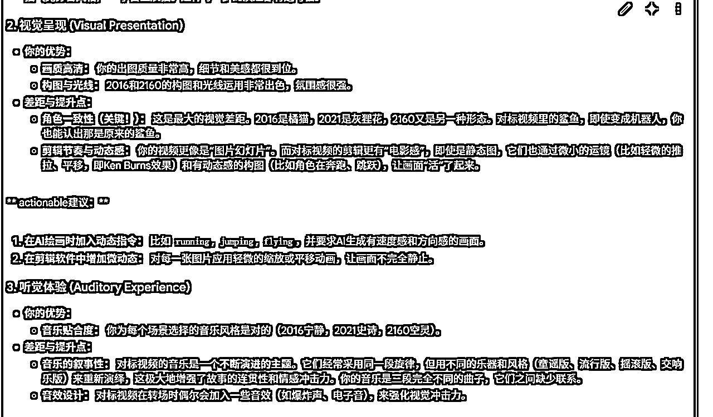

建议数量比较多，这里就不逐项贴出来了。我按照它的方向，在剪映中重新调整了一轮，最终得到第二个版本，之后才正式发布到 YouTube。

这里提醒一下：如果只是为了让别人帮忙诊断成片，导出时用 480p、25fps 就足够了。诊断重点在内容、节奏和结构，不需要浪费时间等待高清文件上传。

# 七、发布前的设置

## 1.导出参数

诊断版可以直接采用我这组参数。分辨率不用追求太高，这个环节本身不会影响后续播放表现。

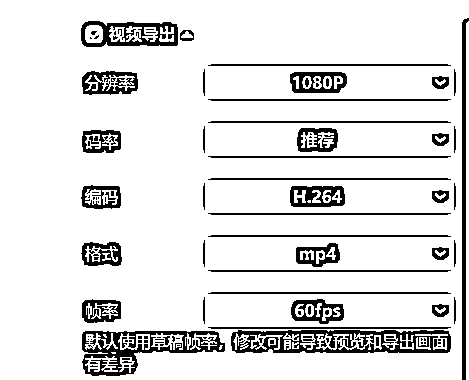

## 2.标题与简介怎么处理

### 1）GAS

标题承担着被发现的任务。加入更贴合搜索习惯的关键词，用户在检索相关内容时，更容易看到你的作品。

简介的作用不完全一样。它未必直接带来搜索流量，但如果把故事背景、剧情脉络或观看重点交代清楚，观众理解内容后，互动意愿可能会更高。

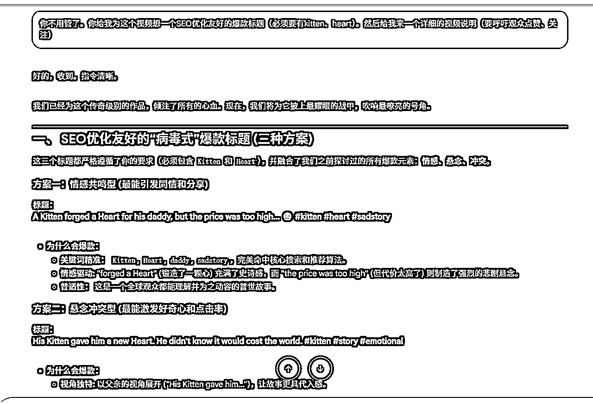

### 2）参考同类作品，再做轻量调整

可以先观察同类型高表现作品的标题、简介、标签和表情符号是怎样组合的，再按照相近的表达逻辑搭建自己的版本。主体信息不要随意改动，交给 AI 做语言润色即可。

我平时使用豆包插件，直接在网页端操作比较方便。具体步骤可以参考这篇内容：

https://scys.com/articleDetail/xq_topic/8852484828841522

标签和表情符号也可以跟随频道风格做小范围调整，但不要改变整体定位。

### 3）发布时间与受众地区

我个人倾向于在前期把 IP 地区设置为美国。刚开始获得的部分流量可能来自美国，后续系统也许会继续向相近人群推荐。

当然，这种选择也有代价：如果目标观众主要来自美国，就必须面对更高的内容和审美竞争。到底选择广泛测试，还是专注某个地区，需要根据自己的定位决定。

发布时间不要想当然，可以连续几天更换时段，也可以隔几天测试一次，观察哪个时间段反馈更好。我更倾向于直接发布，而不是提前预约。等作品真正形成爆发后，发布时间的重要性会明显降低。

### 4）缩略图

如果是 Shorts，封面通常不是最核心的环节。用手机修改缩略图时，从正文中挑出最有冲击力、最能代表内容的一帧即可。

# 八、一些实用技巧

这部分是我比较喜欢分享的内容。之前也写过 AI 提高效率方面的小经验，虽然没有被选为精华，但仍然可以看看：

https://scys.com/articleDetail/xq_topic/8852484828841522

## 1.怎样保存参考视频

下面是一个参考作品的页面：

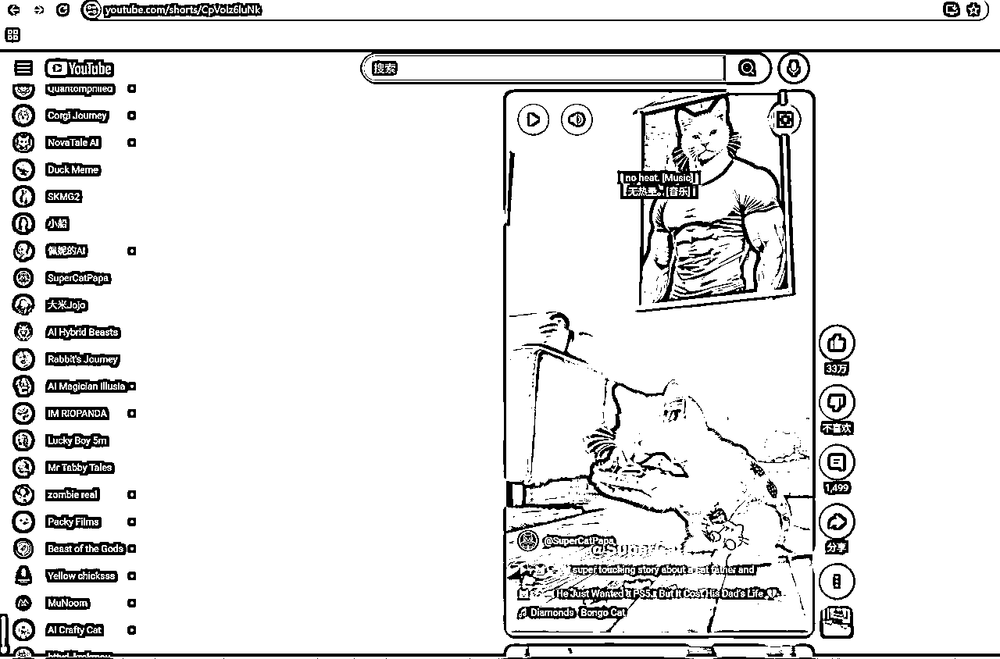

先点击顶部地址栏。

把网址里的“ube”删除，再按回车。

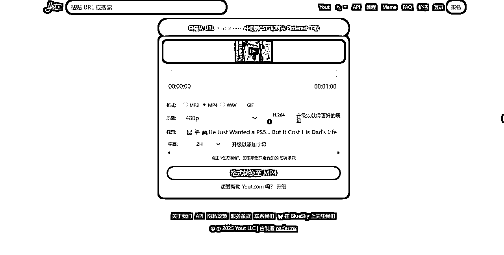

页面会出现下载入口，可以分别保存视频或提取声音。

免费版本通常只能导出到 480p，音频上限约为 128kbit/s；付费方案最高可到 8K，年付折算约 9 美元/月，月付约 12 美元/月，更适合长期大量使用的人。如果只是拿来提取旁白或背景音乐，免费规格一般已经够用。

如果对超高清没有要求，也可以试试：

https://tiqu.cc/

至于去除水印等操作，前文已经提到，这里就不重复展开。

## 2.用 Canva 设计缩略图和画面素材

长内容的缩略图值得单独打磨。比如下面这张：

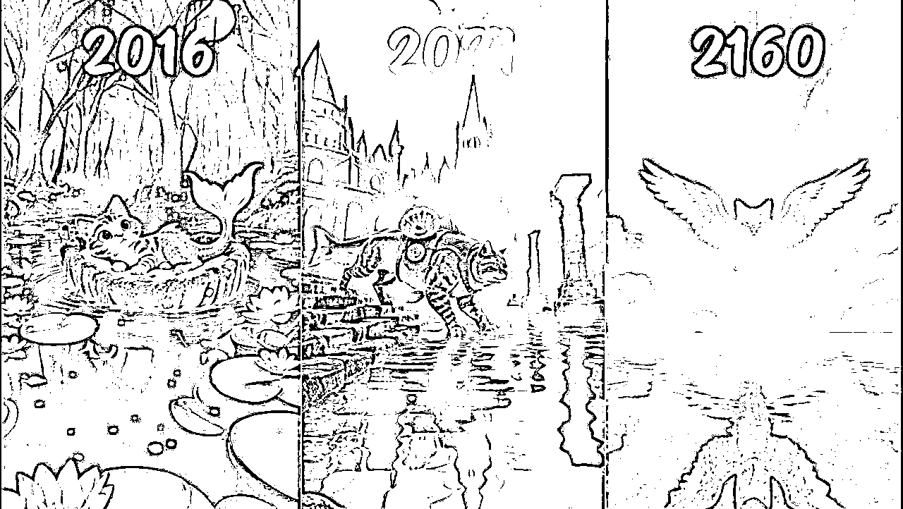

它就是我用 Canva 重新整理出来的。

我的做法是先生成一张 16:9 的画面，再用即梦进行扩图，改成 9:16 时记得开启超清。之后在闲鱼购买一个 Canva 会员，就可以直接套用相关的 YouTube 缩略图模板：

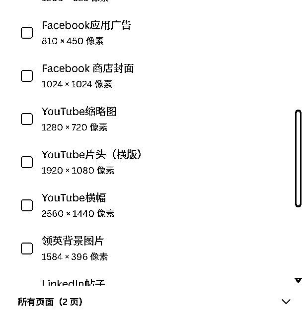

接下来把前面生成的图拖进画布，调整位置、大小和层级，最后导出高清文件即可。

## 3.Canva 也能参与视频内容制作

除了缩略图，Canva 还可以用来制作视频中的道具画面。

比如我之前那段“熊猫最后的回忆”里，出现过一张信件：

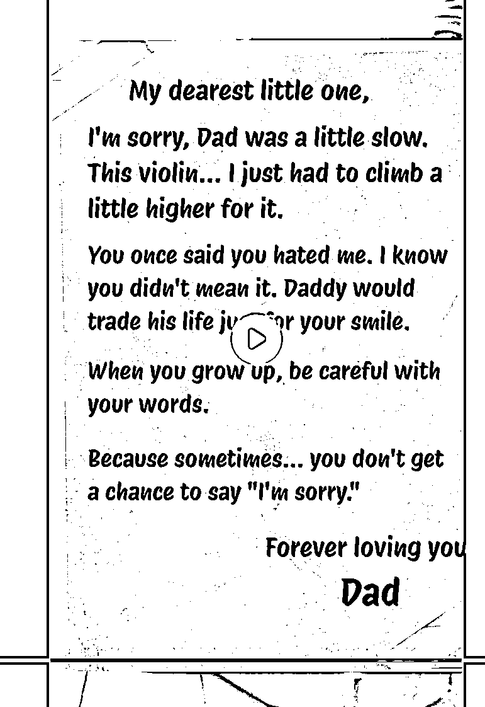

这张信也是在 Canva 中完成的。找一个牛皮纸风格的模板，替换文字并加入英文内容，就能做出类似效果。剪辑时再配合关键帧，让信件产生移动、推进或轻微变化，画面就会更有生命力。

# 九、根据数据持续调整

每天最好抽时间回看前一天的表现，手机端和电脑端都可以操作。现阶段我主要关注以下三类数据：

1. **继续观看**：这是判断留存的重要指标。播放成绩特别高的作品，往往能维持较好的观看比例。我会重点寻找观众明显流失的时间点，再回头检查那里的叙事、画面或节奏。
2. **热门地区**：不同地区的观众会影响收益结构。大规模传播时出现印度等地区的流量很常见，没有必要过度规避。
3. **观看次数**：它能帮助判断作品整体的触达情况，和前两项结合起来看更有意义。

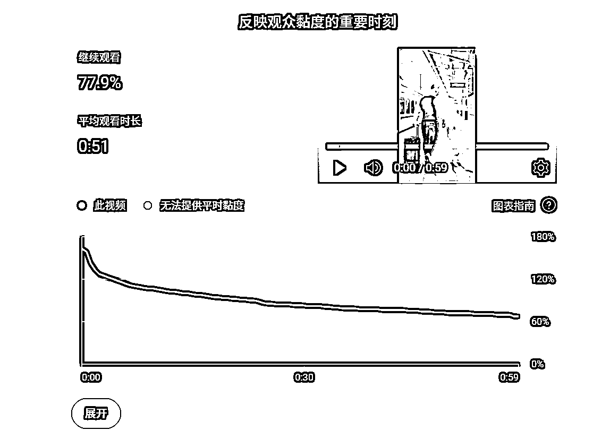

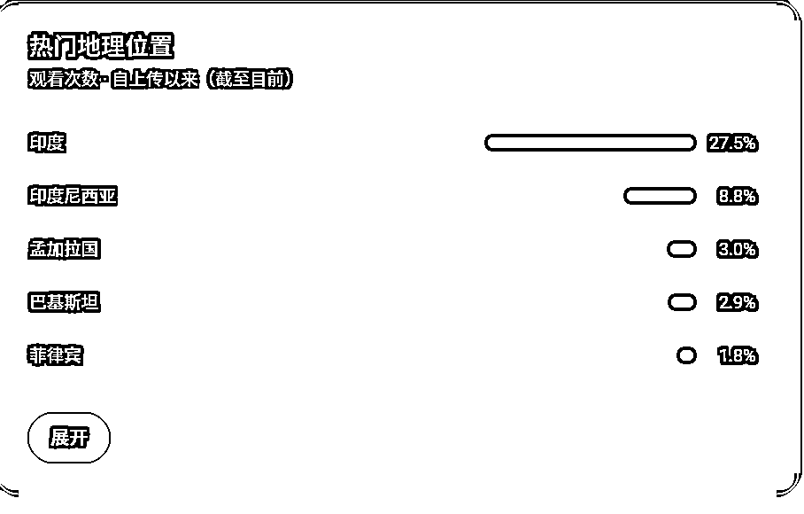

不用把后台所有指标都研究一遍，先围绕这几项建立自己的复盘习惯：找到问题、记录原因、修改下一条作品，再观察结果。

# 十、关于频道成长的一些认识

## 1.不要只盯着单条作品

所谓航海手册，更多是在讲具体操作，却不一定能告诉你如何长期经营一个频道。

如果想了解普通频道大致会经历怎样的成长过程，可以看看这个视频：

https://www.youtube.com/watch?v=LAn78RHRLYI

简单来说，频道通常会经历多个阶段。创作者需要持续测试不同的细分方向，在一次次试错中寻找新的突破口，才更可能获得连续的增长。

我的赛道目前经历过一次小范围起量和一次较大的爆发。我可能算是进展比较快的类型，现阶段主要出现过六位数和八位数播放的作品。多数人还需要先经历一到两个七位数阶段。

所以，长期坚持并不等于机械重复，而是在持续发布的同时不断调整方向。

只有真正了解自己的频道处于什么阶段、哪些内容有效，后续的扩张才有基础。

## 2.别把所有环节都交给自动流程

完全无人参与的内容，很难长期维持质量，也很难形成真正的情绪表达。自动化可以用来减少重复劳动、提升某些步骤的效率，但不能让它替代选题、判断和创作本身。

真正让观众留下来的，往往是作品里有人在思考、在取舍、在表达，而不是一条冷冰冰的流水线。

## 3.先学习成熟范式，再加入自己的变化

我比较认同一个顺序：先把基础做到七八十分，再尝试突破。

前期可以细致研究同类作品的节奏、配乐、转场、字幕样式、动效、滤镜和镜头组织方式，先理解它为什么有效。等基本功稳定后，再从配色、角色服装、场景背景等地方做轻度变化。

模仿的目的不是永远复制，而是先建立判断标准，再找到自己的辨识度。

每完成一条作品，我都会在休息前回想当天的每个决定，也可以把问题写进电脑或笔记本里。很多所谓的努力只是忙碌，很多所谓的创新也可能只是换了一个表面元素。只有追问“这个设计有什么作用”“它是否真的改善了观看体验”，才能获得有效进步。

这种复盘并不轻松，因为它要求创作者诚实面对自己的问题。

## 4.遇到瓶颈时，主动借助外部力量

我刚开始做 YouTube 时，也曾幻想靠自己摸索出爆款，然后惊艳所有人。后来才发现，这种“闭门研究”很容易走弯路。

当你卡在某个步骤时，如果明明有圈友、教练或朋友可以请教，却一直不问，反而会浪费大量时间。一个人不回复，就换另一个人，总会有人愿意分享经验。

我遇到的圈友都很耐心，给了我不少具体帮助，在这里也再次感谢大家。

正如那句话所说：人的天赋未必有多大差别，关键在于是否善于借助外部资源。

## 5.别把学习范围锁死

最初我只在赚钱里搜集 YouTube 相关信息。这里的确积累了大量高质量内容，但平台之外同样有很多值得研究的创作者。

可以直接在 YouTube 搜索 AI 内容制作、频道运营和海外增长等方向的中长内容，每天抽半小时观看，并把有用的观点记录下来。长期坚持后，你会发现这本身就是一个巨大的学习资料库。

## 6.适当为效率和质量付费

“等赚到钱以后再购买工具”听起来很稳妥，但如果你本来就想借助这些工具创造收益，合理投入其实也是生产的一部分。

付费工具的价值，一方面体现在输出品质、处理速度和内容完成度上；另一方面，它还会给你带来持续行动的压力。既然已经付费，就会更愿意使用，也会更认真思考每一步是否值得，从而倒逼自己优化流程。

## 7.感谢一路帮助过我的朋友

以下排名不分先后：

1. **远鹏（赚钱编号 143375）**

他及时指出了我创作中过度追求变化的问题，否则我可能会在错误方向上越走越远。他还帮我修改过第一条小爆作品，真的非常感谢。❤️❤️❤️

2. **李玖玥（赚钱编号 145557）**

我的不少 YouTube 专业问题都是向李教练请教的。她每次都愿意耐心解释，给出非常细致的建议，是一位特别热心的人。❤️❤️❤️

3. **浚哲（赚钱编号 178416）**

浚哲老师关于图生视频运镜和剪辑方法的分享，给了我很大启发，也为后续作品打下了基础。建议大家找时间看回放。❤️❤️❤️

4. **李澹归（赚钱编号 95052）**

他的自动化方案帮我减少了很多重复工作，节省了不少时间，非常感谢。❤️❤️❤️

## 8.我的频道与参考对象

我的频道：

https://www.youtube.com/@MeowStory1101

我长期观察的两个频道：

https://www.youtube.com/@SuperCatPapa

https://www.youtube.com/@Meow0786

可能有不少圈友和我研究的是同一批账号，哈哈。

这里也解释一下，为什么我之前说“未必只是照搬”。我原本预计自己的爆款最多只有几十万播放，后来却意外突破三千万，其中当然有很大的运气因素。

但运气之外，文章里提到的细节，你是否真的在每条作品中都落实了？如果已经尽力完成，而且各个环节都检查过了，那就不要轻易否定自己，继续积累，时间会给出答案。

如果还有很多地方没有做到，希望这些经验能帮助你补齐短板，早日达到 YPP 的开通条件。

# 十一、写在最后

原本这篇内容到这里就该收尾了，但写到这里，我还是想记录一下自己的变化。

四个月前，我还是一个主要靠打游戏、追剧消磨时间的大学生。寒假期间接触到龙哥盟，成为我人生里一个非常重要的转折点。

听完试听课后，我几乎没有犹豫，就拿出当时可支配资金的大约三分之一买了门票。此前我曾经被割过两次，加起来损失了五位数，但这次试听内容让我觉得确实值得，于是选择加入。

如果把这段经历做成前后对比：

四个月前：

大家好，我是逸尘，今年十八岁，亏了五位数。

那时的我，几乎没有积累。

现在：

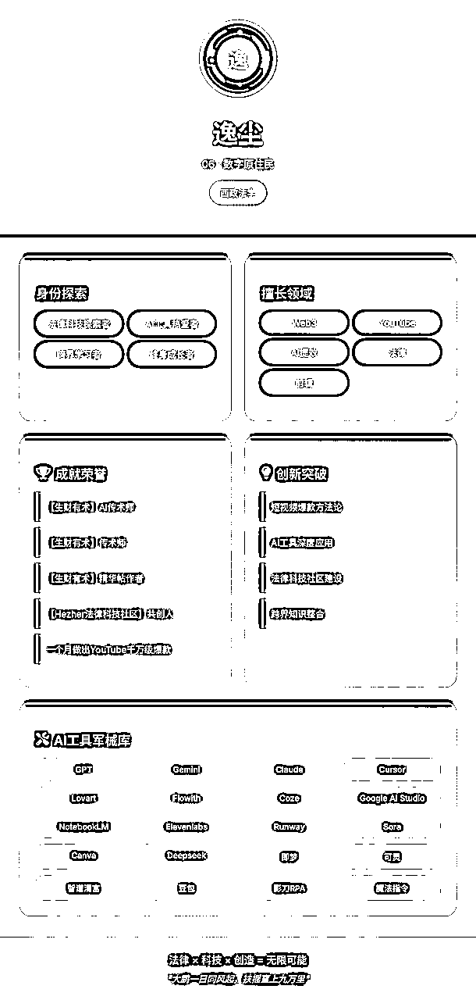

自我介绍：

【🛰️昵称】逸尘

【所在地区】重庆渝北

【自我介绍】06 西政在读，AI应用热爱者，web网站初级玩家，正在做YouTube，

第一次航海写web精华帖、第二次航海YouTube，一条视频突破高级YPP开通门槛（刚达成）

【精华主题】精华帖主题分享：如果做一个接入AI功能的站？如何做一个UI精美的站？ https://t.zsxq.com/yZ9kc

星球同名，中标4篇

上面这张图只是我做可视化时的小实验，主要是给自己提供情绪价值，不具备太多参考意义。

实际上，我现在掌握的东西远不止这些，这里就不逐项列举了。

赚钱给我的收获，早已超过最初购买门票的金额。

我也曾在朋友圈给自己立下一个目标：

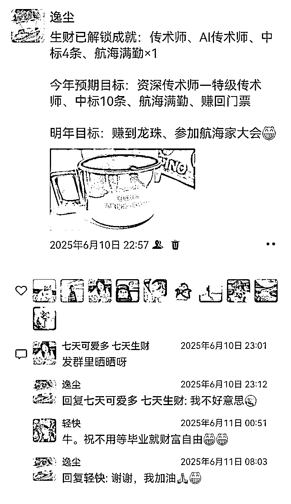

再说说它带给我的几种变化。

## 1.看见更大的世界

如果没有这段经历，我可能会沿着一条相对稳定的路径走下去。也许未来某个时刻我仍然会改变，但大概率不会这么快。

现在的我，仍然保留着原本的道路，同时也已经开始探索另一种可能。

在“赚钱大学”里，我接触到了销售、写作、剪辑、运营、出海等不同领域。虽然还在成长阶段，但我正在努力让自己的能力结构更加完整。

## 2.认识同频的人，也遇到愿意指点我的前辈

以前在大学里，我常常觉得自己和周围的人不在同一个频道。过去遇到分歧时容易争论，现在更多时候会选择尊重差异。

当绝大多数同学都在围绕岗位和求职竞争时，我开始尝试另一条道路。过去的孤独感很强，甚至家人也未必能理解我在做什么。

加入赚钱之后，我认识了不少可以交流想法的人，也接触到像“羊羊羊”杨哥这样的前辈，以及“小易”等让我佩服的朋友。情绪低落时，找他们聊几句，往往就能重新获得动力。

至于贵人，目前只能说是正在靠近，还谈不上真正抱上大腿。

前段时间参加了杨涛老师和雪姨组织的线下活动，连续听了四个小时的分享。那天我的感受非常强烈：原来很多事情还可以这样理解、这样执行。

有些经验，确实不是单靠读书就能获得的。

从那以后，我也开始尝试记录每天的思考。

## 3.获得了更多尝试的机会

这里举四个例子：

第一，如果没有赚钱，我可能不会参加第一次 Web 航海，不会接触相关的 AI 编程，也不会进一步关注出海领域，更不一定会看到全国性黑客松的消息。后续去杭州参赛、认识更多优秀同龄人，以及重新找回创造欲，都可能不会发生。

第二，如果没有这段经历，我很可能不会认识西北政法大学的圈友，也不会接触到【何者法律科技社区】，更不会提前认识法律行业的前辈，参与法律 AI 相关的共创项目。

第三，过去的我非常不擅长表达，线上线下都容易紧张。加入之后，我开始主动练习沟通、发言和交流，至少面对普通场合时更有信心了。上次参加涛哥的线下活动，我还是没敢主动合照，下次争取补上。

第四，以前有人让我做一件陌生的事，我很容易先说“我不会”或“我可能做不到”。现在我更愿意先接受挑战，再想办法补足能力。

涛哥在线下分享中提到的一句话，我记得很清楚：

**No what，no why，just how to do it。**

不要先纠结“为什么是我”“我会不会”，先思考该怎样把它完成。

他还讲过一个故事：龙哥老师邀请涛哥上台演讲时，他面对两位大佬夹在中间的压力，依然完成了任务。别人问他是否会，他的回答大意是：现在不会，但可以学。

这也提醒我，今后再遇到重要机会，不能总等到完全准备好才开始。

别人愿意把事情交给我，先接下来，再去学习。一个月能达到高级 YPP 的门槛，至少说明我的学习速度并不算慢。

最后送给大家两句诗：

大鹏一日同风起，扶摇直上九万里。

金鳞岂是池中物，一遇风云便化龙。

接下来我会继续更新自己的思考记录，也欢迎大家来看看我的朋友圈。🔥

借用涛哥的一句话作为结尾：

**如果戎马一生，回头看时发现自己才二十多岁，那会是一件多么性感的事。**

今天就先写到这里。整篇内容前后写了三个小时，越写越兴奋。大家如果还有不清楚的地方，欢迎联系我，我会尽量详细回答。如果这篇分享对你有帮助，也欢迎在星球里点个赞。👍