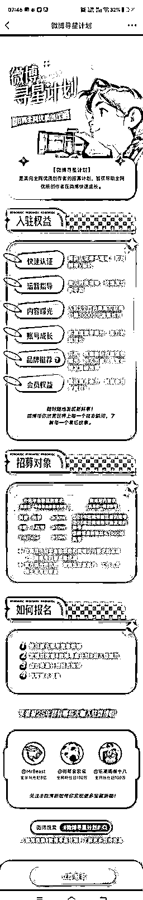
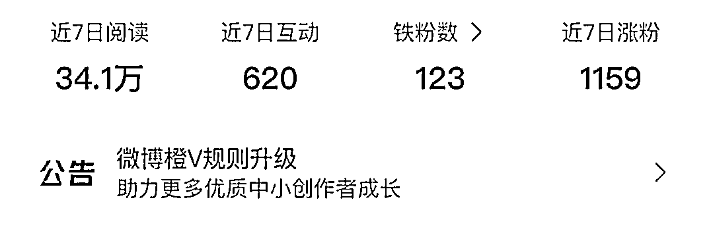
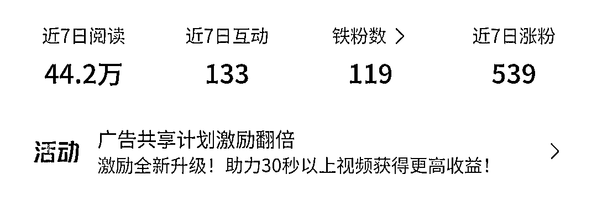
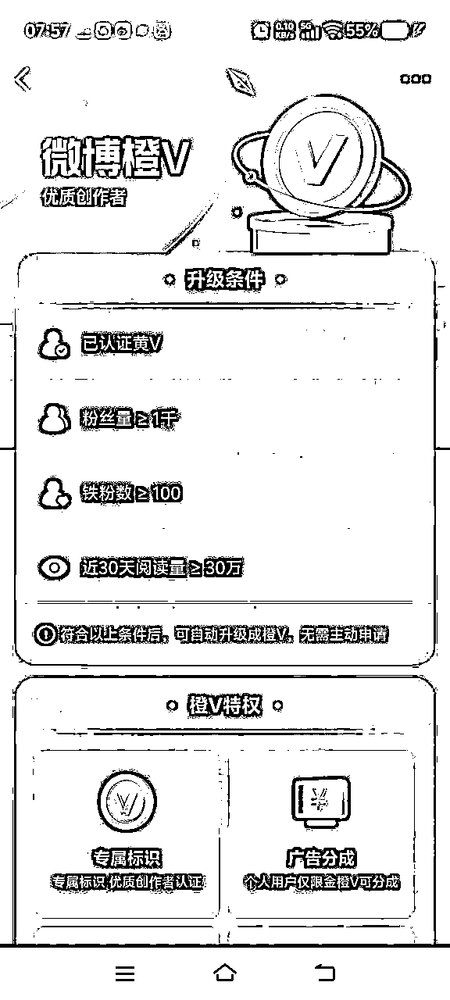
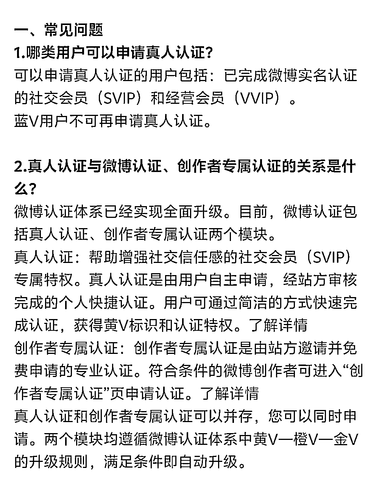
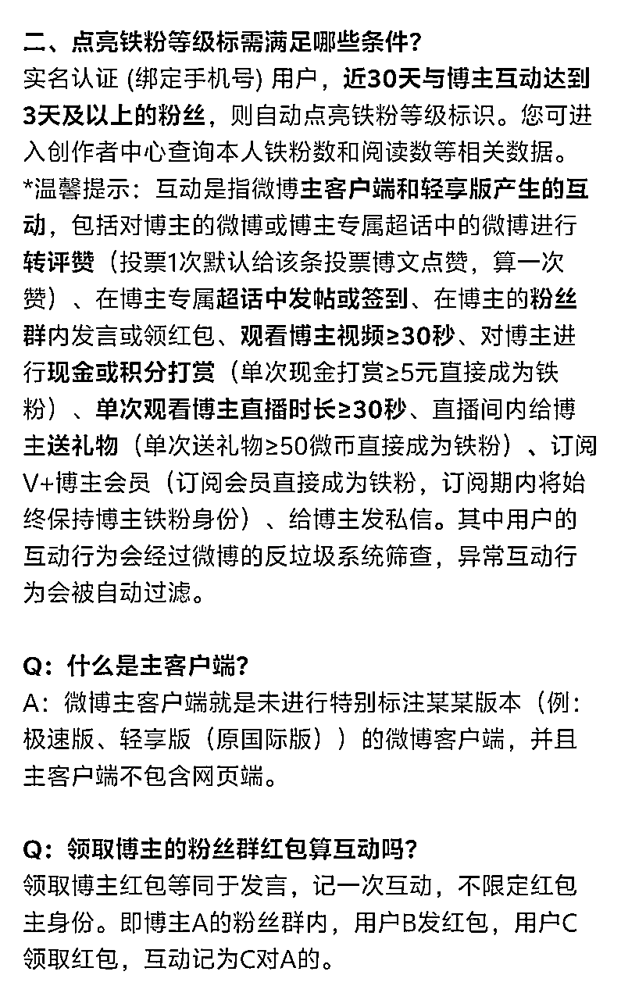
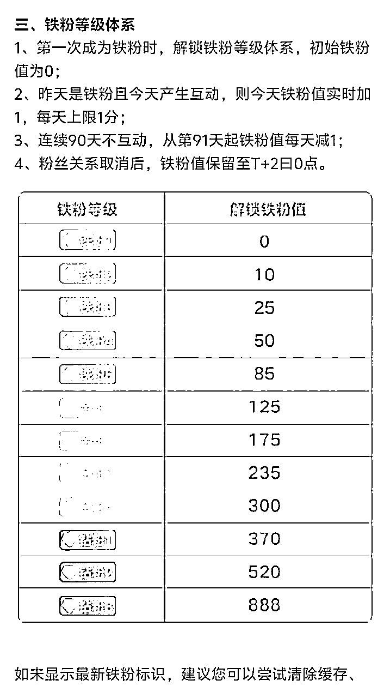
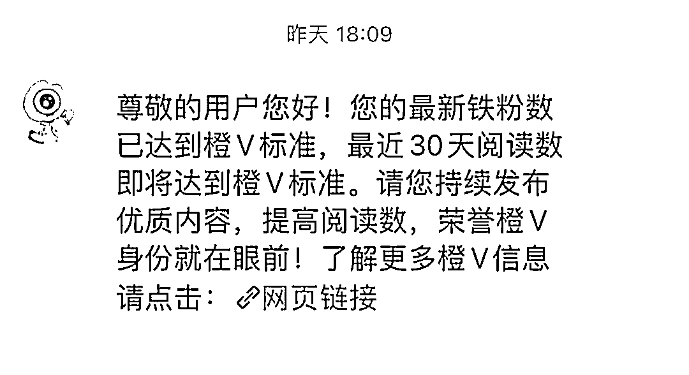

# 🧣优质创作计划资格拿下攻略

各位好，我是亦小亮。最近后台很多人私信问我🧣优质创作计划怎么入围，今天把我踩过的坑和实操方法一次性整理出来，供大家参考。

先说下我的背景：账号长期做👸号，两个主攻方向是影视点评和明星娱乐。所以转战🧣这个项目，对我来说算是顺带积累。

动手之前要先判断自己的定位。如果你本身就是头部达人，那流程就很简单。

直接去报名🧣寻星计划，有抖音、📕存量内容的人基本复制过去就能通过审核。

如果是零基础的素人玩家，后面这套方法更适合你。

进入正题：

这项计划本质上可以理解为🧣版的创作者激励，机制和👸号流量主有相近之处，只是分发和结算逻辑不同。

想要拿到收益权限，👸号只需要500粉，🧣的门槛更细一点，但只要方法对，完全可以快速达标。

我手上现在有三个账号，一老两新。就在昨天和今天，成功让两个新号通过审核。收益还没到账，但资格已经实锤了，所以才敢写这篇分享。

官方页面目前列出四个硬性条件：

逐条拆解：

1. 黄V认证已完成
2. 关注数超一千
3. 铁粉数过百
4. 近30天总阅读破30万

基于我最近两周多的实测，主观难度排序大约是：黄V > 阅读量 > 粉丝数 > 铁粉数。之所以把黄V放首位，是因为它的审核规则偶尔会调整。

# 黄V如何快速通过

1. 先开通SVIP月卡。这是🧣明文要求的门槛，和👸号花钱买基础权重类似。

2. 完成实名，然后做头像认证。建议用本人高清近照，基本当天就能过。操作路径：点击昵称 → 编辑资料 → 头像认证 → 上传真人照片 → 提交。

这里有个细节：之前我用“兴趣领域”通道申请，卡了好几次。后来换一个号改用真人头像通道，秒过。才搞明白，兴趣通道不仅要看昵称和发帖垂类，还要排队1-3天，时间成本太高。如果目标是快上橙V，这条路不推荐。

好消息是，通过头像通道后，头像后续仍可更换，也能再走兴趣认证。我现在是A号走头像快速上车，B号走慢养兴趣，不同矩阵不同策略。

# 30万阅读量冲刺法

### 转发破量

新账号自带冷启动扶持，原创起量慢，转发往往更高效，尤其是蹭热搜。

选材原则：去热搜榜、文娱榜、社会榜看前十，优先大媒体发出的、正向向上的、明星相关的，以及突发事件。严禁转发政治类、负面舆情和过度追星内容。

操作要点：转发时配话题或超话，先写一句自己的观点，再用AI润色，最终用自己的口吻表达，保持调性正面。

发帖窗口期集中在：上午8-10点、中午11:30-14点、晚上19-22点。建议提前半小时发布，每天根据榜单情况发10条以上。

和👸号比，这里不会轻易掉池子，只要时间、话题都对，量会很稳。

### 群内分发

我早期为了冲量加了很多乱七八糟的群，阅读是上去了，但对后续收益帮助有限。建议找垂直领域的精细化群，带来的才是高质量曝光和铁粉。

### 原创保底

橙V之后必须靠原创续命。很多号几万粉5-10天就上车了，结果日收益只有几毛钱，就是因为跳过了养号期。

我的第二个号坚持垂类热点，每天稳在一到两万阅读，虽然慢，但维度均衡。第一个号当年啥热搜都发，有时两条就破30万，可其他指标没跟上，照样卡壳。即使侥幸通过，最后也赚不到钱。

记住：不要贪多，保持垂类。热搜只是冲量的手段之一，还可以用超话引流，每个垂类大V都有超话可蹭；标签相当于👸号的合集功能，也要做好。

# 千粉达成技巧

我目前常用三招：

第一，跟圈内流行的“财字头”玩法，成为财家班成员，涨粉效率很高。插一句，我2022年报过村西边的🧣课，当时没坚持下去转去做知乎好物。后来看同期学员，现在人均万粉起步，甚至百万，有点后悔没坚持。

第二，定期去同垂类大V的帖子下面写高质量评论，提升曝光。

第三，大量关注他人，特别是简介写明“互关互赞”的账号。

# 百铁粉高效积累

🧣设置铁粉，是为了在核心粉丝里获得更高权重曝光。官方定义是：粉丝在30天内对你互动满3天，当天自动转为铁粉并展示标识。

提升建议官方给的比较清晰：多发视频，30秒观看也算互动；发能引发讨论的内容；多回复评论私信、定期发福利。互动形式不限于点赞评论。

铁粉还有分级体系，挺有意思。

作为普通用户，前期主要抓三件事：

一、保持高频更新
转发也可以，但最好结合原创。可以转一篇再自己写一篇。🧣发帖量上去后，进主页的人会自然产生互动。自己也要保持每天给不同内容点赞，才能累积三天互动。

二、私信破冰最快
先关注简介带互助互赞的账号，然后私信打招呼建立联系。别人给你点赞，往往也是因为你也在互动。

细节：设置快捷短语方便打卡；日常做好转评赞，并在对方主页回评；优先处理新消息，忽略已读不回的；招呼语可以用快捷菜单或直接复制。

很多人不回是常态，别在意。目标是筛选出能持续互动的对象。连续三天发消息对方零回应且火花不亮，就清理掉，保留活跃的。样本量足够大，铁粉自然就够了。

三、抱团共进
像财家班这样的组织就是典型。我们也可以自建赚钱班，互相托底。

祝大家都能尽快收到通过通知。

