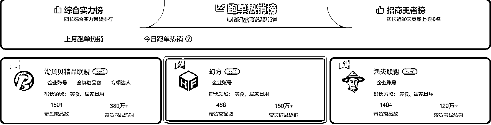

# B站带货的二次思考——被拷问之后的清醒

在评论区回复了龙哥之后，一夜过去我就开始后悔。只要我把想法公开，就等于在跟赚钱社区里对好货项目提出质疑的精华帖正面交锋。而这份质疑只是我个人的主观判断，并非带着一个确定的答案去挑战所谓的“权威”。

原超级群链接：https://wx.zsxq.com/group/1824528822/topic/8852421112888122

我必须承认，对B站好物这条赛道，我是完全认可的。就如龙哥所讲“眼下机会全在B站，平台已放开电商跳转，还在鼓励你成交。评论区挂蓝链、视频里浮窗直达淘宝京东，意思很明确：平台允许你把流量导出去，只要能完成转化。”只要官方态度是鼓励的，这个方向就具备可操作性。问题在于，它究竟是否像想象中那么好做，我们能否把它做得更精细。

我在那个帖子里读到的核心信息，无非是B站现在可以做带货了。悬赏带货其实很早就开放了，只是近段时间大家才把目光聚焦过来，让更多人意识到这个机会。蓝链可以直跳淘宝京东，赚的是淘宝联盟或京东联盟的返佣。B站本身不抽佣，选品完全自主，要么自己挑，要么用官方给的扶持品。玩法上跟传统带货并无二致。区别在于AI时代到来，AI剪辑、混剪、自动化产出让视频制作成本大幅下降，矩阵化运营完全可以把这条链路打通吃下来。

接触AI越久，我越确信AI能赋能这个项目，也确信项目可行。但我第一反应不是把项目做起来，而是想先做一个B站好物带货榜单。第一时间我就去联系了圈友@叶凌尘，第一次聊得不太顺，后面才恢复正常交流。我了解到官方其实已有自己的榜单，可我粉丝不到1000看不到具体价值。结合这段时间看到的选品打法，我开始觉得，如果“野马数据”能挖掘一批真正好卖的优质商品，那含金量会立刻提升。

# 去向实操派取经

于是我带着这个念头下楼去公司开会。就是图中红框里那家好单库综合排名的团队。最初也是在老板的邀请下我们去的郑州，前几年团队只做国学一件事，所有业务都围绕国学展开，从未碰过国学以外的领域。现在公司已经成立，也在补课学习传统淘宝招商的老饭。

我把做数据榜单的想法讲出来后，老板直接给我做了商业化拆解，并当场否掉了这个方向。

## 对话被我压缩成以下几个问题：

1. 你这个榜单如果真的有价值，你能让多少人看到你的野马数据？
2. 如果榜单真的有价值，淘宝、京东、B站会这么蠢或看不上这块业务，以至于不自己去做宣发？
3. 如果榜单有价值，你的站点靠VIP变现？靠代理变现？还是靠其他方式盈利？
4. 如果榜单有价值，投入的精力跟你其他业务比起来是否配得上？
5. 如果榜单有价值，任何人都能迅速复制你。
6. 那你做这个榜单到底有什么意义？

## 我当时的回应大概是：

1. 我也不知道能有多少人访问，但“野马数据”这个名字当初就不是只为📕服务的，我只是想先用这个项目给网站填充内容，体现价值感。
2. 淘宝联盟、京东、B站确实都有榜单，但品类质量并不理想。
3. 我现在更想用爱发电，先证明公司技术能力，而不是立刻盈利。📕的数据我也没指望靠它赚钱。
4. 这个项目最多花我十天左右就能搭起来，后续自动化运行。我并非大公司，不需要做太多取舍。
5. 人外有人，天外有天，担心被复制不如回山里喝茶。
6. 目标现在还很模糊，当初可能只是想验证一下。

最终我还是被老板和几位大佬的逻辑打败了。我们后来开了一场线上会，参会的人就是上图没列全的那些，榜单前列的大多都是朋友。这次讨论完全从淘客视角展开。

说实话，淘客我十年前就玩过，淘宝、拼多多的招商都接触过，只是一直没深耕，也没赚到大钱。这次算是被他们上了一课。正如他们所说，我们看到的内容，在他们眼里就像一个持仓过亿的老股民，看一个拿20万本金入市的新人赚了一笔钱。我们并没有把项目拆解到位。

拆解的方式，就是“赚钱朋友圈”那张图给我的启发。

# 文笔有限，我尽量梳理清楚，这对我来说是当头棒喝，对新手或许也是思维升级。

* 其中一位做社群的老玩家，两年内靠买粉、投流、传统社群的淘客模式赚到一个多小目标，现在基本躺平，没事就出来喝茶感叹人生无趣。在他看来，我们现在做的事，本质上是把传统社群的模式搬到了自媒体时代的众创形态。以前是他们自己拉群卖货，现在B站成了他们的角色，帮淘宝联盟、京粉联盟卖货，我们要做的就是顺势而为。
* 其中一位做招商的老板，以前带过上千人的淘宝招商团长公司。在他看来，能不能把招来的货卖出去才是本事，否则只能依赖传统社群或好单库、大淘客这类导购平台。
* 其中一位做精推的玩家，核心观点是：即便我们自己上手选品，只要和他们的团队一起操盘，差距会被彻底拉开。选品决定生死，他们精推，只挑品牌、爆款、有自然流量的品，并且不惜代价拿下合作资源。
* 其中一位做躺赚的朋友，交流不多，只表达了如果选品这么粗糙，B站做的意义何在。

总体判断是，他们都看好B站可以做，且能放大现有业务。去年他们就尝试过借黑神话悟空热度推PS5，一条视频就卖了几百台，远超公司预期，属于现象级案例。但短视频运营不是他们的强项，所以他们愿意做，只是缺少下手方法。如果AI能生成带货视频，让所有人零门槛制作，那事情会变得非常好玩。一条视频爆了上千万播放，收益可能非常可观。

这次沟通的核心拉片如下：

“大”指我，A、B、C、D、E就是赚钱里参与B站项目的几个人。

假设我能组建这样一个团队，潜力不可限量。我负责选品和文案，ABCDE负责制作发布。

我问：别人为什么要听我的，用我的品？

老板答：第一，人格魅力问题，你能不能让他们信你，是你的事。第二，如果是我，我给的品一定比他们自己找的更好卖更容易成交。给他们几天试错，让他们拿我们的品和自己找的品对比转化和利润，自然会选择我们。

老板问：假设有1000个人，无论是创业粉、宝妈粉还是任何想通过B站好物赚钱的人，都很优秀且严格执行，你能保证他们月入3K、5K还是1W吗？

我答：我保证不了，赚钱航海也不能保证人人赚钱，也会有上不了岸的。就像我有的航海能出成绩，有的不能，全看个人。

老板问：那你缺项目吗？干嘛选这个？

我答：我只是想做个数据站填充内容，体现价值。

老板再问：那你要赚钱吗？

我答：要。

老板追问：想做B站好物的大多数，都是缺项目想赚钱的吧？

我答：大概是的，我更关注项目背后的“铲子”玩法。

老板总结：那就想办法让他们赚到钱。赚不到3K，平均能到这个数也是本事。这是给我们自己加压。

我们是否能让这1000个人做到300万销售额？这是要思考的问题。下面聊实现路径。

老板问：现在聊怎么实现1000人做到300万销售额。现实难度很大，但如果你说AI能批量生成视频，教会他们用AI做视频，然后卖品就行。他们卖得不好，你再给他们数据榜单，他们用了觉得好用，会不会依赖你？

我答：肯定会的。

老板说：如果是我，我会先投1000个创业粉，做个小社群，哪怕免费带项目、免费培训，我出资把他们分成三个赛道：X做3C数码，Y做服装，Z做百货。先测三类目看哪个效果最好，再结合AI视频工具放大。

# 总结

所以关键在交付。能否让用户无痛生产视频，或直接提供视频，让用户尝到甜头，目的就达到了。

很多新手不懂淘客玩法，只知道淘宝返利一种。其实还有招商团长模式，按销售额分佣。如果我们提供的品是我们招商来的，我们额外有这份收入，返利归用户自己。

往下聊也没太多营养。对内行人来说这对话没什么信息量，就像昨天我跟叶凌尘通话不到一分钟，他就能预判整场对话内容。对外行人可能还算有点新鲜感。

# 再聊点别的，借B站说点实话

我问老板：你一直强调手上品好出，那好单库、大淘客拿不到这些信息吗？为什么他们不能做？

老板答：你见过导购平台分享大团长的商品吗？他们自己做过吗？为什么有的团长出单很快，有的很慢？这里面学问很大。文案怎么写，我们做精推会把商品的每个细节揉碎，让用户感觉是真心为用户着想，文案是关键。还有，帖子里提到的选品逻辑我觉得是错的。第一，导购平台的数据不真实，可能有刷榜和买量。严格按那个逻辑选品，榜单可能失真。第二，导购平台五块钱十块钱就能发一条商品，躺赚的团长挂上去互利，不出单就撤，这种商品能有什么质量？只有数量。第三，社群维护，你要知道粉丝画像，推荐匹配的商品。做视频同理，要选好赛道，确认人群，否则再好的品也带不动。第四，我们手上有很多高佣定向品，自己玩只能拿平台结算价，线下给我们结算高佣，如果我们也分润给用户，用户会不会带我们的品？

一问一答大概就这些，主要是讨论过程多。

# 分享下我们的部分共识

### 为什么未来体量会很大？

自媒体传播力强，一条带货视频可能顶一年作品。

### 普通人能做吗？

非常适合做，零成本试错，打通逻辑即可，成本基本就是刷千粉的费用。

### 能做多久？

不看好长期。B站现在在做内容建设和电商体系搭建，先活跃电商氛围。我们现在看到的图拼图动起来的账号能出货，未来官方一定会淘汰。这个拭目以待，普通人能做多久算多久。

### AI能生成视频吗？

不好说。目前没找到能生成优质视频的好方法。图片转视频已经成熟，但效果难以持久。普通人想在短视频拿到效果，可能还要等AI更成熟。咨询了几个做AI的朋友，想让大众可用，还需要一段时间。

### 如何利益最大化？

一、放单方，团长角色：利用做项目的UP主帮自己剪辑视频种草，提升招商服务费。

二、接单方，UP主端：大多数人第一次做淘客，交易额5W才能升级最高权限，佣金最高。拿不到最高收益就是浪费钱，可以接入别人的系统，如冻宝盒、花生日记这类平台，用高级账号拿更高收益。

三、服务商：自建系统，让用户绑定在自己体系下，吃淘客收益。现在团长账号已不开放，可用同样玩法收服务费和佣金。

四、做优质UP主，接商单吃广告费，这个过程漫长痛苦。

简单说，B站就是视频带货，知乎就是文字带货，龙哥早就讲过。所以本质是冷饭重做，谁能在这个阶段做出差异化，谁就能快速拿到结果。

# 结尾

这篇就当给小白分享项目逻辑和心得，大佬请忽略，免得被讽刺。

正如龙哥说的“有碰撞也是好事”，这次碰撞给了我新思路，不知道能否给各位带来一点感悟。