# B站好物榜单视频怎么做？从数据采集到自动生成，一套流程讲清楚

最近研究了一类在B站持续上榜的好物带货视频，发现它们的制作逻辑并不复杂：先找到高销量商品，再把商品信息批量做成榜单画面，最后配合背景音乐和引导文案，就能快速生成一条完整视频。

这次还用 Cursor 做了一个自动化生成工具，可以把采集到的商品数据直接转换成视频素材。对 AI 编程感兴趣的朋友，也可以参考下面的拆解，自己做一套专属工具。

如果只想下载现成软件，可以直接跳到“四、软件分享”。

此前分享过一款 B站好物带货视频生成工具，已经被加精。感兴趣的朋友可以参考：

AI 编程：用 Cursor 制作 B站好物带货视频一键生成软件：  
https://t.zsxq.com/WDLzI

这次主要拆解 B站百万带货榜中的另一种视频形式，并附上相关软件和制作思路。

# 一、自动生成的视频效果

软件可以根据商品数据，批量制作榜单类视频。

整体效果与下面两位长期上榜的百万带货 UP 主视频比较接近，他们发布的内容已经连续多个月进入榜单。

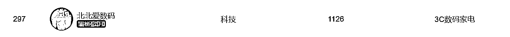

https://space.bilibili.com/3546699228252464

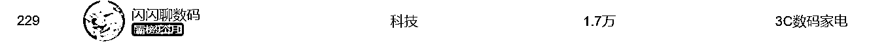

https://space.bilibili.com/1767635624

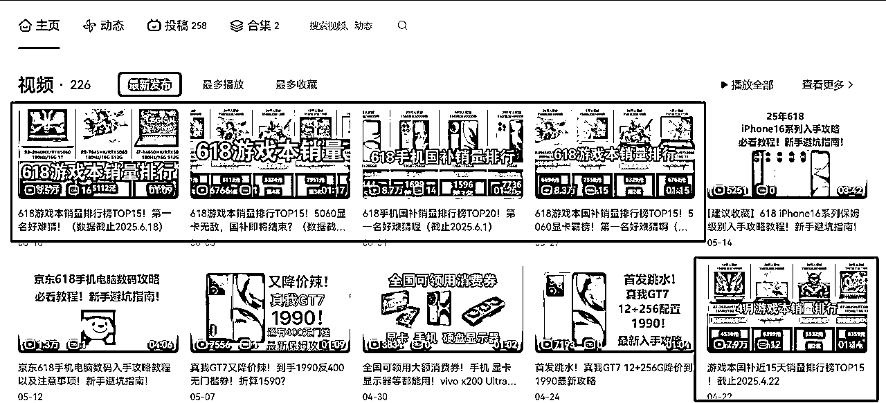

# 二、视频的完整制作流程

以下内容不仅是操作说明，也可以直接整理后交给 AI，让 AI 根据你的需求生成相应的软件。

## 1. 商品数据从哪里来？

平时在手机端浏览京东商品时，很多商品页面都会展示相关排行榜。

这类榜单中的商品通常具备较好的销量基础，因此可以优先选择榜单商品进行内容制作，理论上也更容易获得转化。

第一步，需要使用浏览器插件采集商品信息。插件的实现思路和提示词，会在后文详细说明。

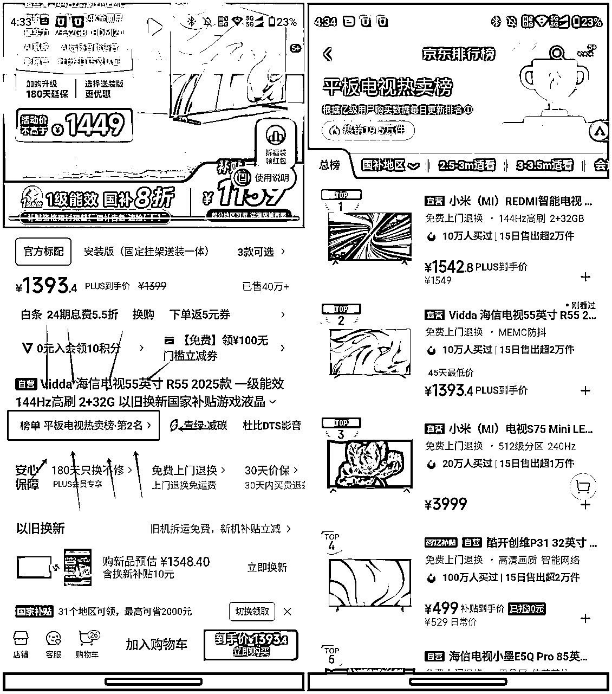

## 2. 视频画面如何合成？

### 2.1 先准备视频底图

可以使用一张 1920×1080 的图片作为视频背景，也可以直接使用纯白背景。

图片可以通过任意作图工具制作，文件名建议设置为：

`beijing.png`

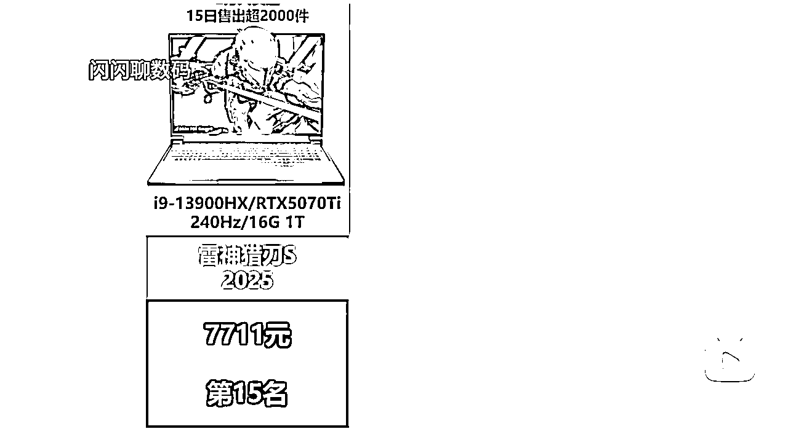

### 2.2 制作单个商品画面

每一张商品画面，主要用来展示商品图片、商品名称、价格以及购买人数等信息。

建议先制作一张不含文字和商品图片的空白模板，命名为：

`shangpinbeijing.png`

随后让 AI 按照指定的纵坐标，把商品信息添加到模板中，并设置为居中对齐。

具体坐标需要根据画面效果反复调整，确定位置后再交给 AI 固化到程序里。


### 2.3 制作视频开场动画

开场部分可以设计成商品卡片依次出现的效果，也就是一张商品图接一张商品图地进入画面。

下面是第一段视频的 FFmpeg 基础结构：

```bash
ffmpeg {输入图片组合} -filter_complex "{转场效果组合}" -map "[f{n}]" "{输出视频文件}"
```

输入图片部分示例：

```bash
-loop 1 -t 3 -i "C:\Users\Administrator\Desktop\排行榜视频生成\temp_1751273106\part1_video_assets\1.png"
-loop 1 -t 3 -i "C:\Users\Administrator\Desktop\排行榜视频生成\temp_1751273106\part1_video_assets\2.png"
-loop 1 -t 3 -i "C:\Users\Administrator\Desktop\排行榜视频生成\temp_1751273106\part1_video_assets\3.png"
-loop 1 -t 3 -i "C:\Users\Administrator\Desktop\排行榜视频生成\temp_1751273106\part1_video_assets\4.png"
```

转场效果示例：

```bash
[0][1]xfade=transition=smoothup:duration=1:offset=2[f1];
[f1][2]xfade=transition=smoothup:duration=1:offset=4[f2];
[f2][3]xfade=transition=smoothup:duration=1:offset=6[f3]
```

其中，`{n}` 对应最后一个输出节点，此处示例为：

```text
3
```

### 2.4 将商品画面拼成一张长图

接下来需要把所有单个商品画面按顺序拼接起来，生成一张横向长图。

可以直接让 AI 扫描指定文件夹，将其中的图片按照从左到右的顺序合并。

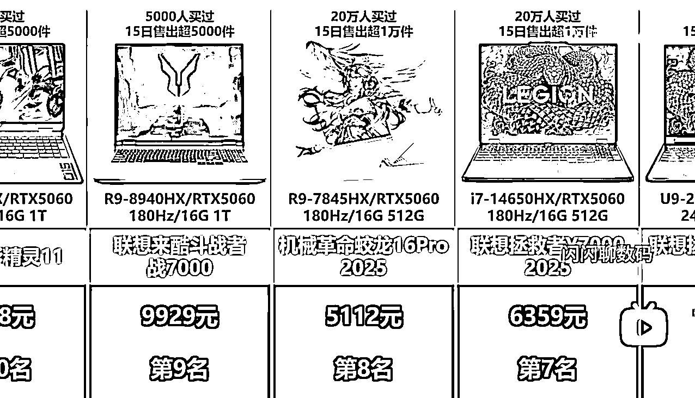

### 2.5 制作长图横向滚动效果

有了长图之后，再把它转换成一段横向移动的视频。

FFmpeg 命令结构如下：

```bash
ffmpeg -loop 1 -i {image} -filter_complex "[0:v]crop=1920:1080:x='if(gte(t*100,iw-1920),iw-1920,t*100)':y=0" -t {time} -c:v libx264 -crf 23 -preset ultrafast -y {video}
```

参数说明：

- `{image}`：前一步生成的横向长图路径；
- `{time}`：滚动视频的时长，计算方式为“长图宽度 ÷ 100 + 3”；
- `{video}`：临时视频文件的保存地址。

### 2.6 拼接开场与滚动视频

开场动画和长图滚动部分完成后，将两段视频合并为最终视频。

对应命令如下：

```bash
ffmpeg -i {video1} -i {video2} -filter_complex "[0:v][1:v]concat=n=2:v=1:a=0[v]" -map "[v]" -c:v libx264 {output}
```

这里的参数分别对应：

- `{video1}`：开场动画，也就是 2.3 中生成的视频；
- `{video2}`：商品长图滚动视频，也就是 2.5 中生成的视频；
- `{output}`：最终成片的输出位置。

### 2.7 最后添加音乐和引导字幕

视频合成后，再使用剪辑软件做最后处理：

1. 添加合适的背景音乐；
2. 加入“评论区抢购”“点击评论区了解”等引导字幕；
3. 根据节奏调整字幕和画面的出现时间。

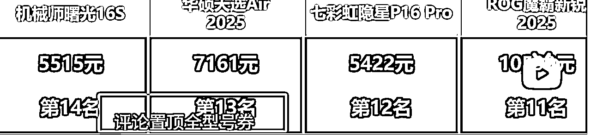

# 三、采集插件的制作方法

由于采集过程会涉及商品数据，所以这里不直接提供成品插件，只分享实现逻辑和可直接交给 Cursor 的提示词。

## 1. 插件的基本采集逻辑

打开京东排行榜页面后，插件需要获取以下内容：

- 商品主图；
- 商品标题；
- 商品价格；
- 已购买人数；
- 商品详情链接。

由于排行榜页面本身无法直接拿到完整商品链接，因此需要按照以下步骤处理：

1. 先读取当前榜单页面中的商品标题；
2. 点击商品标题，进入对应的商品详情页；
3. 等待详情页加载完成；
4. 获取当前页面 URL；
5. 从 URL 中提取商品 ID；
6. 拼接成标准商品地址；
7. 返回排行榜页面；
8. 继续点击下一个商品标题。

## 2. 可交给 Cursor 的提示词

可以把下面这段需求直接发给 Cursor，让它生成浏览器插件。实际使用时，再根据运行结果进行微调。

如果不熟悉 Cursor，也可以找人代写，通常花费 100—200 元左右。

```text
我需要写一个采集京东排行榜的浏览器插件。

1、获取所有商品主图的值，这是商品主图的xpath：//*[@id="J_babelOptPage"]/div/div[1]/div/div[2]/div/div/div[1]/div/div/div/div/div/div/div[3]/img

2、获取买过人数的列表，这是买过人数的xpath：//*[@id="J_babelOptPage"]/div/div[1]/div/div[2]/div/div/div[1]/div/div/div/div/div/div/div[6]/div[2]/div

3、获取商品价格的列表，这是商品价格的xpath：//*[@id="J_babelOptPage"]/div/div[1]/div/div[2]/div/div/div[1]/div/div/div/div/div/div/div[7]/div/div/div/div[1]

4、获取商品标题的列表，这是商品标题的xpath：//*[@id="J_babelOptPage"]/div/div[1]/div/div[2]/div/div/div[1]/div/div/div/div/div/div/div[5]

5、循环商品标题列表，点击商品标题，等页面加载完成后，获取页面的网址。通过正则表达式（wareId=(.*)&sourceType=）提取出商品ID。然后组合成这样的商品链接：https://item.jd.com/商品id.html。

6、当点击按钮开始采集的时候，先保存当前的排行榜网页地址。点击商品ID后，再跳转到当前的排行榜网页地址。等待2秒后，再获取商品标题的列表，再点击下一个标题。

7、把上面提取到的所有数据保存到表格里，表格的表头按这样排序：商品链接，商品主图，商品标题，商品价格，买过人数

8、保存价格的时候，把前面的￥去掉，如果有换行也去掉。

9、请严格按照上面的要求去写代码，不需要你自己发挥，不需要定位卡片，也不要通过标签获取链接。
```

## 3. 采集时需要注意的地方

### 3.1 先获取京东手机榜的排行榜链接

先在手机端打开京东排行榜页面，复制页面链接，再发送到电脑端，最后用电脑浏览器打开。

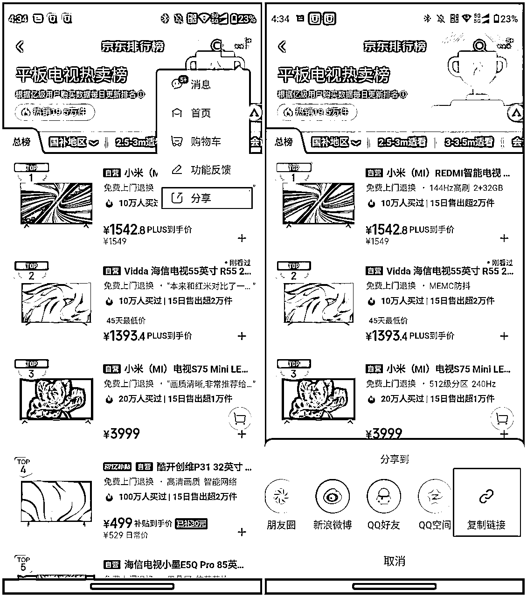

### 3.2 采集前先把页面滚动到底部

开始采集之前，建议先把页面滚动到最后一个商品的位置。

如果不提前滚动，部分商品图片可能还没有真正加载出来，插件拿到的可能是 base64 内容，而不是实际图片链接。

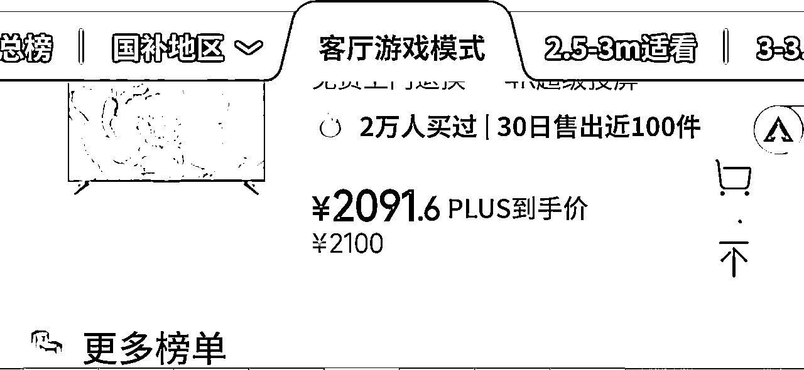

### 3.3 导出的数据结果

正常采集后，最终表格中应当包含商品链接、商品主图、商品标题、商品价格和购买人数等字段。

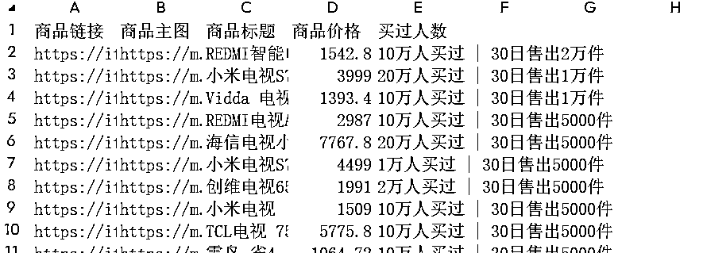

# 四、视频生成软件

软件中的视频参数已经预先设置完成，不过更建议大家按照前面的制作逻辑，自己生成一套工具。

如果直接使用现成软件，最好替换以下内容：

- 视频背景；
- 商品信息背景；
- 商品卡片的字体、颜色和排版。

商品背景可以导入其他图片编辑工具，根据自己的内容风格重新调整。

## 1. 下载地址

https://daming.lanzoum.com/b0ko7yqeb

## 2. 使用方法

### 2.1 先处理商品标题

第一步采集出来的数据中，建议先检查并修改商品标题。

标题太长时，放进商品图片后可能会被截断或显示不完整，所以最好把标题压缩成更短、更适合画面展示的版本。

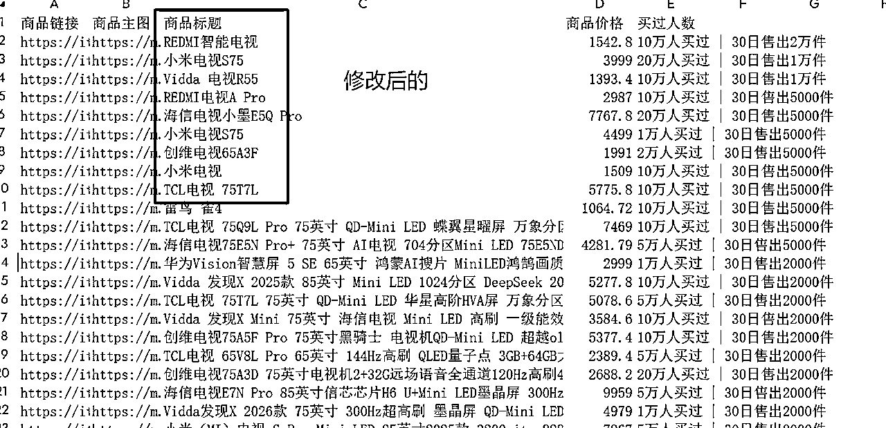

### 2.2 导入 CSV 并生成视频

打开软件后，选择刚刚采集得到的 CSV 文件，再设置需要生成的商品数量。

如果数量较多，生成过程会相应变慢，而且视频太长也可能影响完整观看。一般建议每条视频选择 10—20 个商品。

设置完成后即可开始生成。

视频导出后，再放入剪辑软件中完成最后处理，例如：

- 添加背景音乐；
- 补充引导字幕；
- 调整整体节奏；
- 检查商品信息是否显示完整。

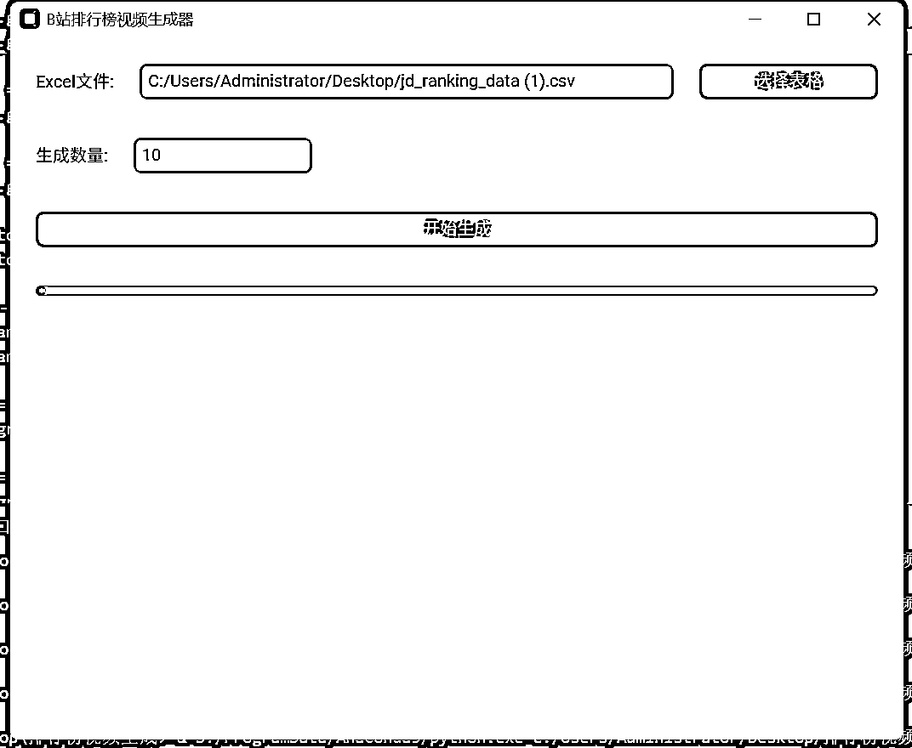

整体流程可以概括为：

**采集榜单数据 → 生成商品卡片 → 制作开场动画 → 拼成长图 → 添加横向滚动 → 合并视频 → 配乐和字幕。**

如果你对 AI 编程感兴趣，完全可以把这套流程拆开，让 Cursor 分模块完成，最后组合成一个属于自己的 B站好物视频生成工具。