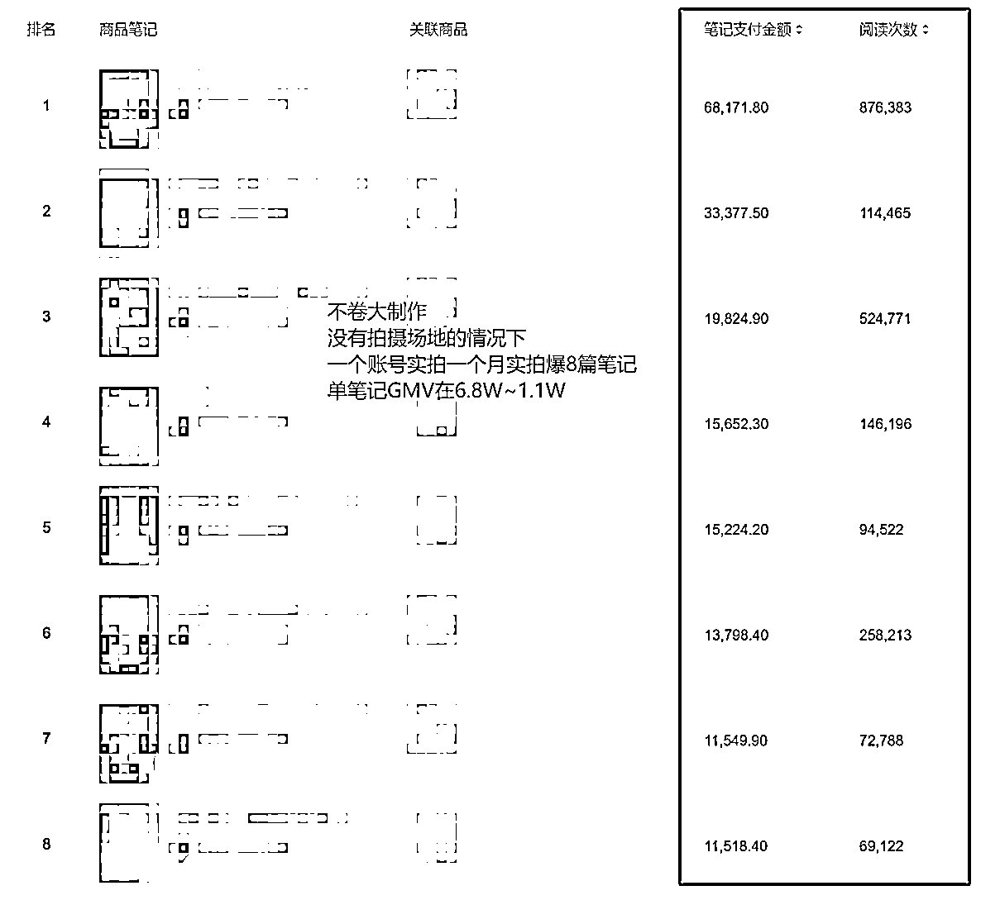
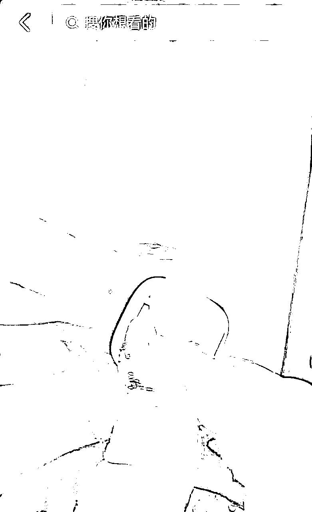
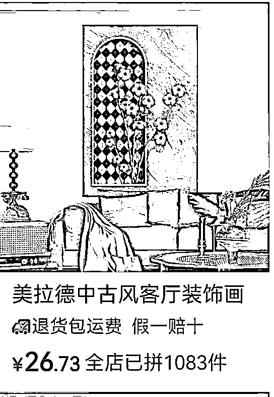
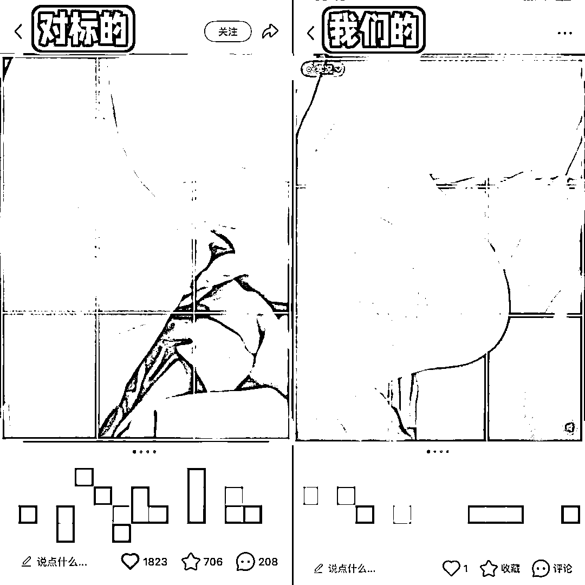
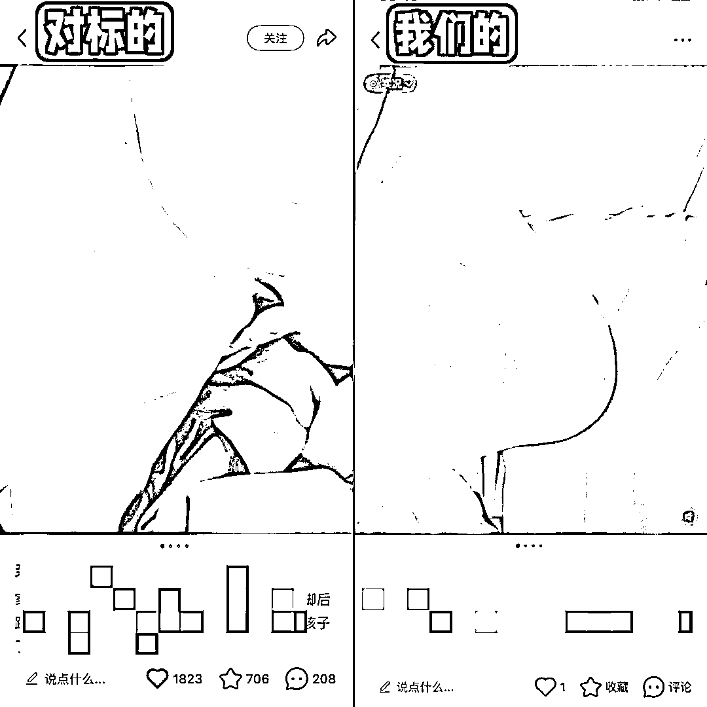
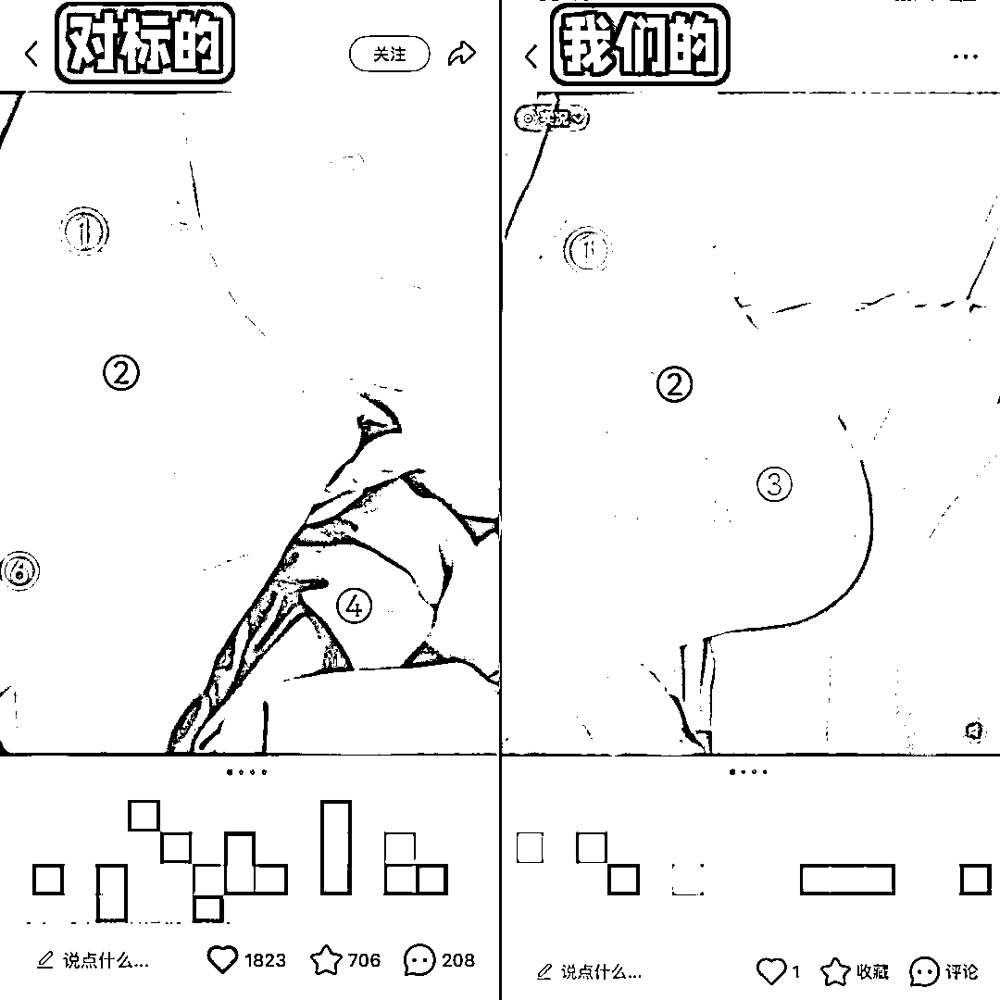

# 以产品实例讲📕实拍！超详细~

📕实拍总是没流量？我用“搓脚板”给你拆透爆款背后的7个细节

大家好，我是小新。一个00后，做📕开店整整两年，做知识付费也满一年了。

之前聊过混剪，但今天想重点说说我真正吃到红利的玩法——实拍。不管是图文还是视频，我都是实拍，而且都跑出过爆款。粗略算了一下，三个月里我实拍打爆了5个品，每个单品销量都超过20W。甚至可以说，同一个品，只要经我的手拍，基本都能爆。全程零投流，从配音、脚本到实拍全是自己原创，硬是靠实拍把8篇笔记送上热门，单品做到类目销量第一。

现在哪怕是在竞争很激烈的测品阶段，我也能用实拍杀出一条路。我的判断很明确：混剪的红利在收窄，实拍才是📕店铺接下来真正的大趋势。我们反复验证过——出单之后，一个视频里插一段实拍，更容易继续爆；要是整条视频全是实拍，这个品很可能直接被打爆，销量蹭蹭往上冲。

最近我正带着一群小白测图文实拍。很多新手觉得实拍比混剪简单，刚开始拍得很兴奋，结果小眼睛少得可怜。这篇就专门讲讲这个问题。

实拍对没出过单、没爆过款的新手来说，其实是有门槛的。如果你平时拍照就拍不出好看的感觉，又不懂📕用户喜欢什么样的爆款图文，实拍课程里的方法也还没吃透，那拍出来的内容大概率是起不来的。

千万别以为实拍很轻松、很省事。如果不能做到一比一复刻参考对象，那基本等于浪费时间——因为拍出来不爆，全是无用功。

# 想靠实拍爆单，你得先具备四个条件

（这些在我们的内部课程里都反复讲过，想爆单就必须吸收+反复练）

## 1. 图片整体细节要一比一复刻参考图

参考图里的道具、背景、光线，能做到接近就要做到接近，越像越容易爆。这些道具大部分在拼多多都能买到，直接“识图搜同款”就行。

### 遇到太贵或者搜不到的道具怎么办？

找类似的就行。我以前拍一款磁吸理线器，参考图里的背景装饰画搜不到同款，我就直接搜“装饰画”，挑了一个花插类似的买回来，拍出来流量也很不错。

所以结论很简单：只要颜色接近、局部花纹相似，不需要绝对一模一样，完全可以。

## 2. 图片要符合📕精致女生的审美

记住一句话：拍得好不如修得好。如果拍出来效果一般，千万别原图直发，一定要做后期修图。

## 3. 实拍图千万不要重复用

一张图只能用一次，想多用就换角度重拍。你要是图省事反复用同一张图，流量会明显下降，图文笔记尤其明显。

## 4. 参考图是live动图，你也得拍live

上传live动图必须要用苹果手机，可以在闲鱼或转转买一台二手的，预算1000-2000块就够。

# 同样是实拍，为什么参考的能爆，你的却扑街？

下面就拿我们最近跑爆过的“搓脚板”来举例。用学员的真实照片对比参考图，把问题一个个标出来，给大家讲清楚差距在哪。

很多学员图文发出去只有十几个小眼睛，这其实很正常。问题不在账号，而在图片本身——因为你拍的图片根本不过关。唯一的解决办法就是：拍出真正优质的图文。

图文确实省时间，但很耗心思。我把参考图和学员实拍放在一起，有问题的位置都标了序号，你们可以对应着看。这个案例非常典型，大多数做实拍的人都会踩类似的坑，建议大家逐条对照自查。

## 第一步：显示主体在画面里的位置，必须和参考图一致

如果你看不出来，就在参考图上加一个九宫格。

怎么加？打开美图秀秀→搜索贴纸“九宫格线”→选一个加上，立刻就能看清主体放在什么位置。

参考图里，脚在左上四格，脚后跟正好居中，把产品效果突出出来，右边和下面都留了一排空间，看画面就不会有不适感。但我们学员拍的，脚后跟没有居中，位置完全不对。用户第一眼扫过去根本抓不到重点——因为人的视线永远先落在画面中心。

## 第二步：光线和色调要统一

大家默认的脚就是粗糙的，而这个产品卖点是“让脚变嫩”，所以你的图必须偏白，不能偏暗黑。参考图整体白净通透，学员的图又黑又糙。

（这个产品明明主打的是用完整只脚变嫩，结果你拍出来还是糙脚，这类好物产品的带货核心就是：通过使用前后的对比，直观展示产品有效果。）

怎么调整？

1. 先把脚洗干净，再用产品搓，搓完给脚后跟和整只脚抹点水乳，让脚看起来粉粉嫩嫩的。
2. 拍摄时打一个白光灯，背景就不会发暗。补光灯在拼多多几十块钱就能买到，拍摄必备。
3. 拍完还是黑的话，就丢进美图秀秀，加一个显白滤镜，或者手动调节亮度、对比度、清晰度。

## 第三步：拍摄细节一定要抠

大家看着序号来对应下面的文字解析。

① 主体必须干净。参考图里脚是干净的，但学员图在①处不仅有红点，还有笔迹。你想想：18-38岁的年轻精致女生，脚上会有这种脏东西吗？红点可以用气垫粉扑盖一下，笔迹洗掉就行。如果介意用化妆品涂脚，就用手晕开，或者拼多多买个便宜的气垫，几块钱的事——舍不得孩子套不到狼。

② 参考图的位置是白嫩干净的，一看就是做过脚膜的脚；学员图明显偏黑。肤色不够白，可以用粉扑薄薄涂一层，但一定要自然，要像妈生皮肤，不能让人一眼看出来“这只脚化了妆”，那就太刻意了。

其实我们都清楚，80%的人用完产品根本达不到参考图的效果，但我们就是要拍得完美，用户才会产生购买欲望。就像美食广告，也像买家秀和卖家秀。站在资本家的角度看，卖货本来就要有美化成分。

③ 参考图给人的信息是“用完脚就不会糙了”，而学员拍出来依然和普通糙脚没区别，这就完全没体现出“使用前后对比”的效果。

④ 背景造型。这个学员做得很好，专门找了一样颜色的绿色被子。既然颜色都找到了，为什么不连造型也摆成一样？参考图能爆，说明那个造型已经被验证过了，摆成那样更容易爆，我们直接照抄就好了。

面料纹理怎么做到一模一样？方法很简单：把手机打开参考图放在旁边，对着图慢慢拧，一点点调整形状。别以为那些纹理是随手一摆拍出来的，都是人为一点点拧出来的。只要你足够慢、足够有耐心，完全可以模仿出同样的效果。

⑤ 参考图用的是纯白床单，画面显得更亮更精致。你也应该铺一块纯白布，没有白布就靠打光打白，或者用美图秀秀的局部调色，把背景调成白色。

⑥ 参考图没有展示脚凸起的部位，你也不要露，尤其不要露那种发黑的凸起。

⑦ 仔细看的话，参考图里的脚并不是直直的侧面，而是微微斜着，能看到一点脚心，所以画面更有感觉；学员拍的是纯侧面，完全失去了那种味道。

以上就是实拍必须研究的细节！

用这张图，我把图文实拍的要点全部拆开了。大家回忆一下，自己平时实拍有没有注意到这些？

这就是为什么参考图能爆，而你的图只有几十个小眼睛。

可能有人心里会犯嘀咕：这些小细节真的那么重要吗？至于抠到这么细吗？

我用自己实拍爆单的经验告诉你：需要！就是必须抓这么细！参考图能爆，就证明它的构图方式是被📕用户和系统推流机制认可的，你不踏踏实实模仿，就永远不可能爆。

我之前实拍过一个日历，爆单的原因特别简单——参考图里的冰箱贴我刚好也有，而且摆放位置和参考图一模一样，结果就爆了。而且这种情况不是偶然，是每一次都这样。这里就不多举例子了。

希望大家都能再细心一点，然后一起迎接流量爆发。

我是小新，感谢你看到这里。想了解更多📕开店玩法，欢迎随时链接我。