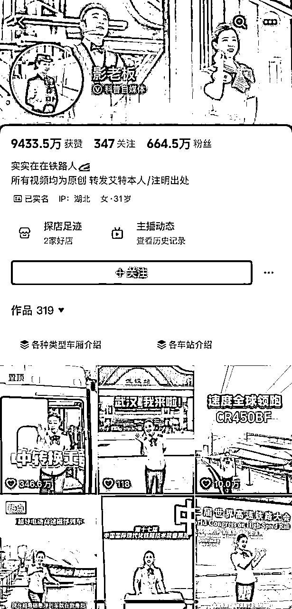
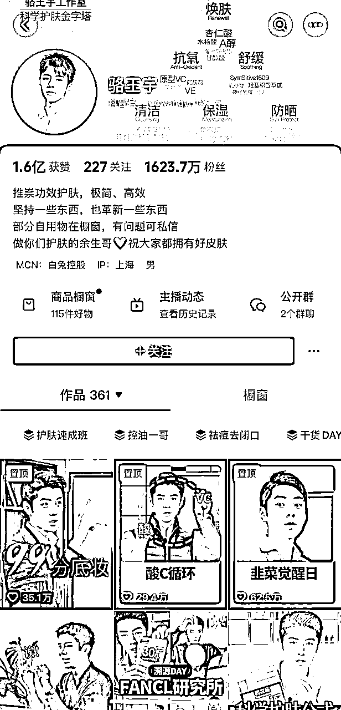
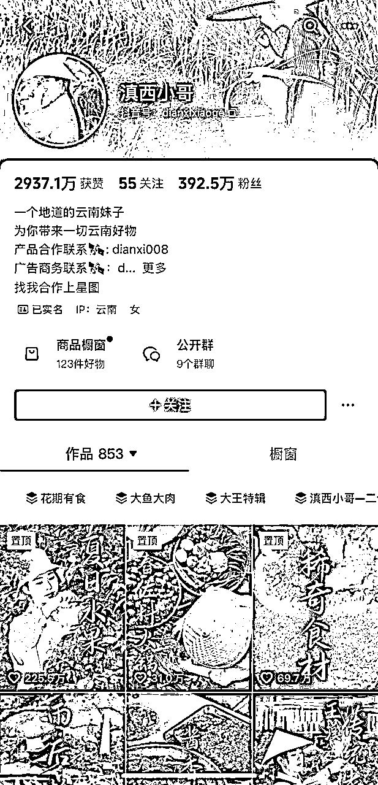
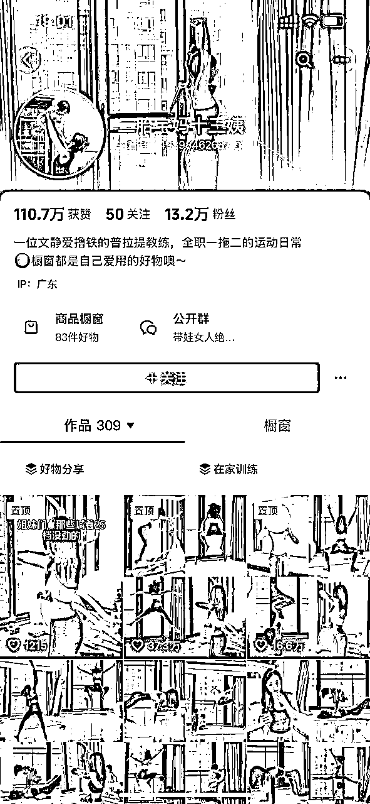
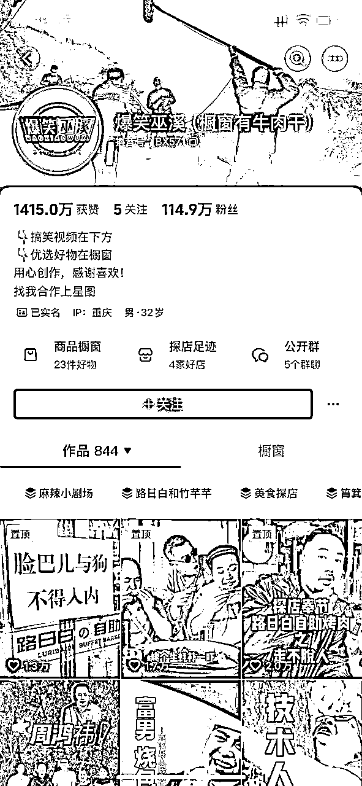
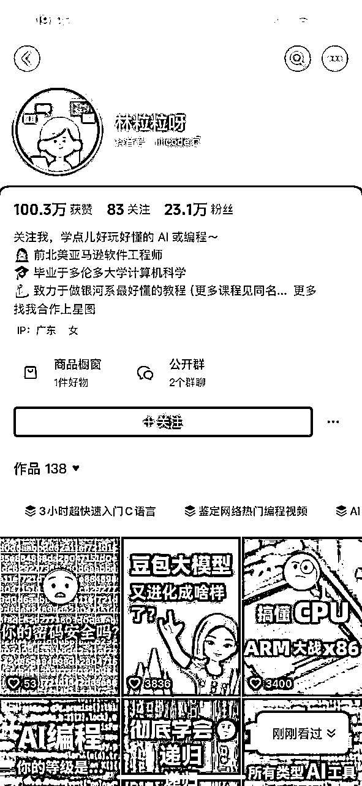

# 做新媒体账号，记住这三个字就够了，亲测能用

> 来源：[https://hq5823whbx.feishu.cn/docx/F0IBd9OCTon9mixnWVjcMI7knKd](https://hq5823whbx.feishu.cn/docx/F0IBd9OCTon9mixnWVjcMI7knKd)

### 做新媒体账号，记住这三个字就够了，亲测能用，

大家好，我是林清。做了近8年新媒体一线操盘，一直在带队做账号，累计带过3000多号人起号。自己账号单条最高4000多万播放，上百条视频破百万，小红书也曾4天涨粉过万。看着太多新人埋头苦干却起不来，我想把这些年的底层打法摊开讲，其实就落在这三个字上：搞懂它、去做它，账号基本都能活下来。  当然，黑五类以及违法违规的账号不在此列。

这几年线下越来越卷，一大波人涌上线上想靠做账号涨粉变现。抖音日活8亿，加上视频号、小红书、B站、公众号、播客等，线上流量池足够大，大家都盯着这块蛋糕。

但现实很扎心。你熬夜写的稿子，精修的镜头，播放量却卡在几百。而有人对着镜头随便聊两句，私信和微信就被客户刷爆，收入直线上涨。

没有资源、没有背景、没有经验，普通人做新媒体怎么就这么难？

我在一线混了近8年，实打实做过上百万播放的视频，操盘带过3000多人。我可以告诉你，不难，难的是你没方法。你盲目跟风、闭眼创作，从不研究同行爆款，不知道好内容的骨架长什么样，你爆了才怪。

真正能起号的逻辑很简单：抄、超、钞。

#### 一、抄：站在已经验证的肩膀上，先不摔跤

别再钻牛角尖搞所谓的原创创新了。真正跑出来的爆款，本质都是可复制的。市场已经验证过的赛道，才是你的起点。

我在陪跑里常听到线下老板说：“我讲的才是最有用的，别人那都是啥”。于是自嗨式录一堆干货，第二天播放量二三百。

怎么抄才不算抄袭？

##### 1，抄选题

痛点、共鸣、热点、普世，这类选题总能让小号快速起飞，它就是你的方向标。选题稳定了，试错成本就下来了。

列车长刘影做“影老板”账号，就是捕捉到大家对铁路知识的好奇。她做的“中转换乘”“高铁卫生间怎么用”等出行痛点选题，200多条视频都稳定吸量，5年积累600多万粉丝。

##### 2，抄结构

开头1秒怎么抓人？中间怎么层层递进留住人？结尾怎么引导互动？把爆款的骨架拆出来直接用，省心又有效。

知识科普类的爆款，基本都是同一个套路：开头抛一个反常识现象或常见误区吸睛，中间分点讲清楚正确做法，结尾抛互动问题引评论。你照着这个框架做，效果会稳定很多。

##### 3，抄变现

别人到底怎么赚钱？带货、卖课还是接广告？先看清别人的变现路径，再复制到自己身上，赚钱更快。

美妆博主骆天宇就是先复盘头部同行的变现方式，发现美妆带货匹配自身定位后，才开始精挑产品、摸索带货节奏与话术，最终实现收入跃升。

#### 二、超：把别人的东西变成你的标签

抄是入场券，超才是壁垒。模仿时注入自己的基因，才能让人记住你是谁。

##### 1，定位超精准

全网都在教做菜，你就做“上班族10分钟快手减脂餐”。切口小，需求反而更集中。

“滇西小哥”董梅华就深耕云南美食这个细分赛道，与泛泛美食博主不同，她把家乡一草一木、一饭一蔬做成600多期内容，吸粉超1600万。

##### 2，选题超犀利

别人晒健身日常，你讲“40岁裸辞带娃，靠健身逆袭成教练”。故事感一出来，吸引力立刻不一样。

比如二胎宝妈十三姨，在家带娃的同时健身锻炼顺带变现，内容兼具共鸣与看点。

##### 3，形式超新颖

别人讲知识干巴巴，你可以用方言配音加搞笑动画。土到极致就是潮。

“爆笑巫溪”团队就用晃动画面和“土掉渣”的方言演绎家长里短，抖音和视频号每条常态30万+播放。

还有那个3个月涨粉70万的剪辑教学号，平均每条涨粉1万，靠的正是新颖的剪辑手法和通俗易懂的教学。

##### 4，体验超预期

同质化严重时，用服务感拉开差距。日更、评论区秒回、送资料包，粉丝粘性自然上来。

医学科普博主“张之瀛大夫”为了让中老年人看懂心血管知识，反复打磨通俗表达，视频配大字幕并积极互动答疑，积累了大量铁粉，影响力还辐射到海外华人。

#### 三、钞：把流量变成真金白银

没有变现的流量都是自嗨。找到适合你的变现路径，努力才看得见。

##### 1，锁定付费人群

学生想要搞钱攻略，宝妈想要育儿妙招。先锁定有付费意愿的人群，再击中痛点，转化更顺。

母婴号“年糕妈妈”就是精准锁定宝妈，围绕辅食制作、早期教育等痛点输出专业内容，后续通过产品推荐和育儿课程实现变现。

##### 2，选对变现模式

粉丝量大就适合接广告和带货。

搞笑号“陈翔六点半”凭借庞大播放量吸引品牌投放，同时直播带货周边产品，收益很可观。

##### 3，专业能力强

有专业壁垒的更适合卖课和建社群。

编程博主“林粒粒”靠专业教学开线上课程并运营学习社群，既做指导也做交流。

##### 4，有案例

案例就是信任状。能提供付费咨询和代运营的账号，客单价更高。

新媒体人“李割”凭借帮助多家老板提效的实战案例，做起了付费咨询和代运营业务。

##### 5，规模化放大

一条爆了立刻做同类延展，把热度吃满。私域转化顺畅的话，再用投流放大入口，让客户源源不断进来。

新媒体本质上就是一场开卷考，同行就是最好的教材。别闭门造车浪费时间，从抄作业开始，在模仿中迭代，最终形成自己的独家竞争力。

我在新媒体一线快8年，见过太多普通人起号时的迷茫和辛苦，所以把这套亲测有效的经验整理出来，希望能帮到你。