# 别人还在打基础，你已玩转进阶！Claude Code 的 14 个实操秘籍
作者：龙哥


大家好，我是龙哥，搞了 10 年大数据架构，现在专注 AI 编程。

最近身边用 Claude Code 的人越来越多了。

有人不知道它怎么跟 IDE 配合，有人连贴图都不会。

今天不废话，直接送上 14 个进阶玩法，学会之后你就是 Claude Code 的熟练玩家。

其实我常跟人说，Claude Code 没有那么多所谓“技巧”，你有需求就直接跟它聊，大部分问题都能解决。

但有个前提：先把 Cursor 那套思路放下。

Claude Code 讲究大道至简，核心就是“干”。

下面进入正题。

先从第一个帮助命令说起。

```
claude --help
```

说白了，就是看看 claude 命令支持哪些参数，用来干什么。

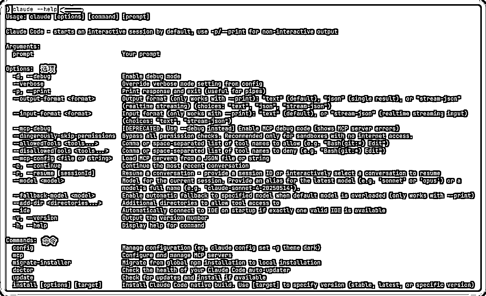

平时用得比较多的几个命令如下：

### claude version

查看当前版本号。


### claude doctor

检查 Claude Code 的安装是否正常。

```
claude doctor
```

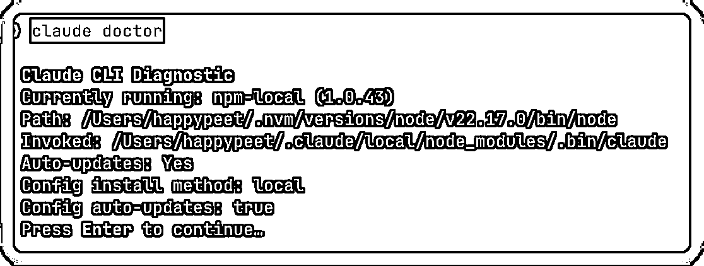

### claude mcp

查看 MCP 相关的配置情况。

```
claude mcp list
```

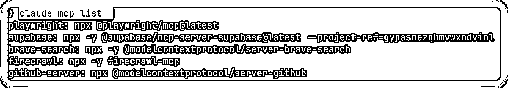

```
claude mcp --help
```

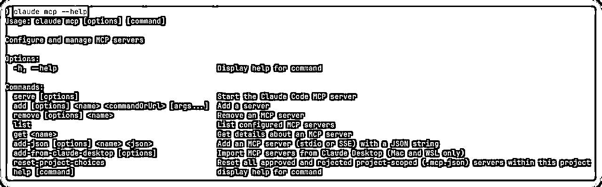

### claude config

查看 Claude Code 的配置信息。

```
claude config --help
```

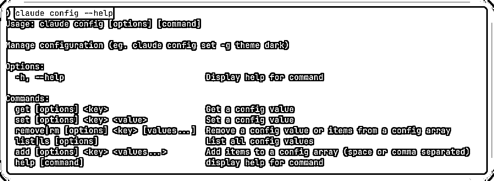

可以列出具体的配置列表。

```
Claude config list
```


### --dangerously-skip-permissions

也就是大家常说的 yolo 模式，我更爱叫它“狂飙模式”。

```
claude --dangerously-skip-permissions
```

这个后面还会详细说。

## 和 IDE 整合

### 第一步：装插件

在插件市场搜 Claude Code，注意认准 Anthropic 官方出品。

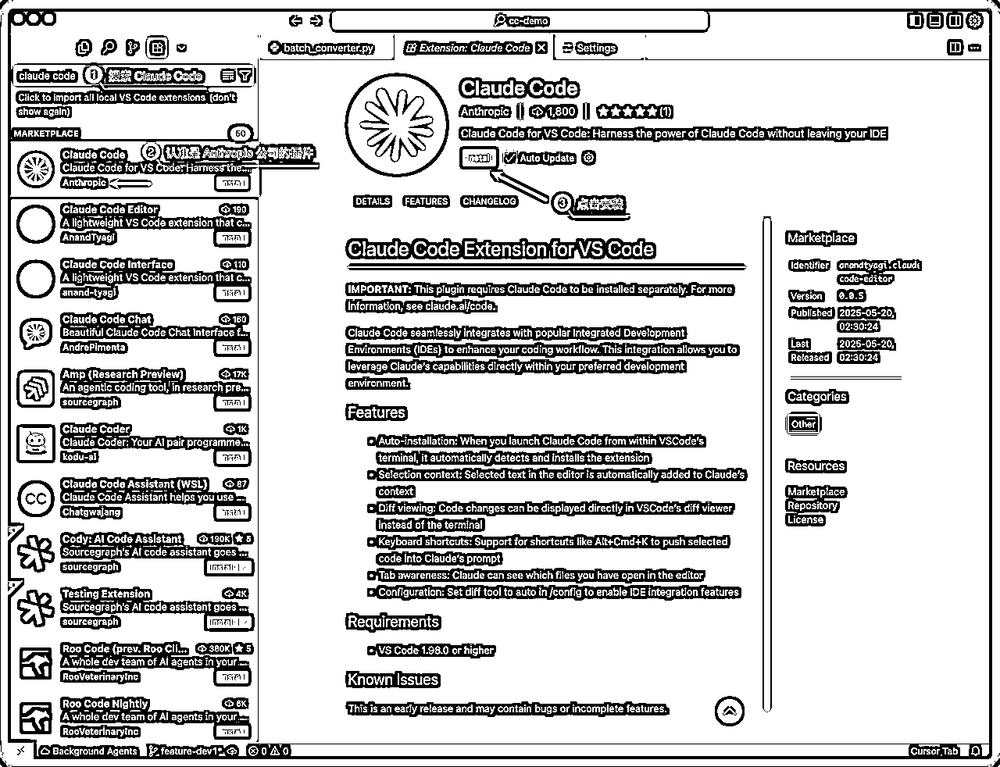

### 第二步：唤起 Claude Code

方法一：按快捷键 Cmd+Escape（我这边没生效，你可以试试；不够也可以自己改键）。

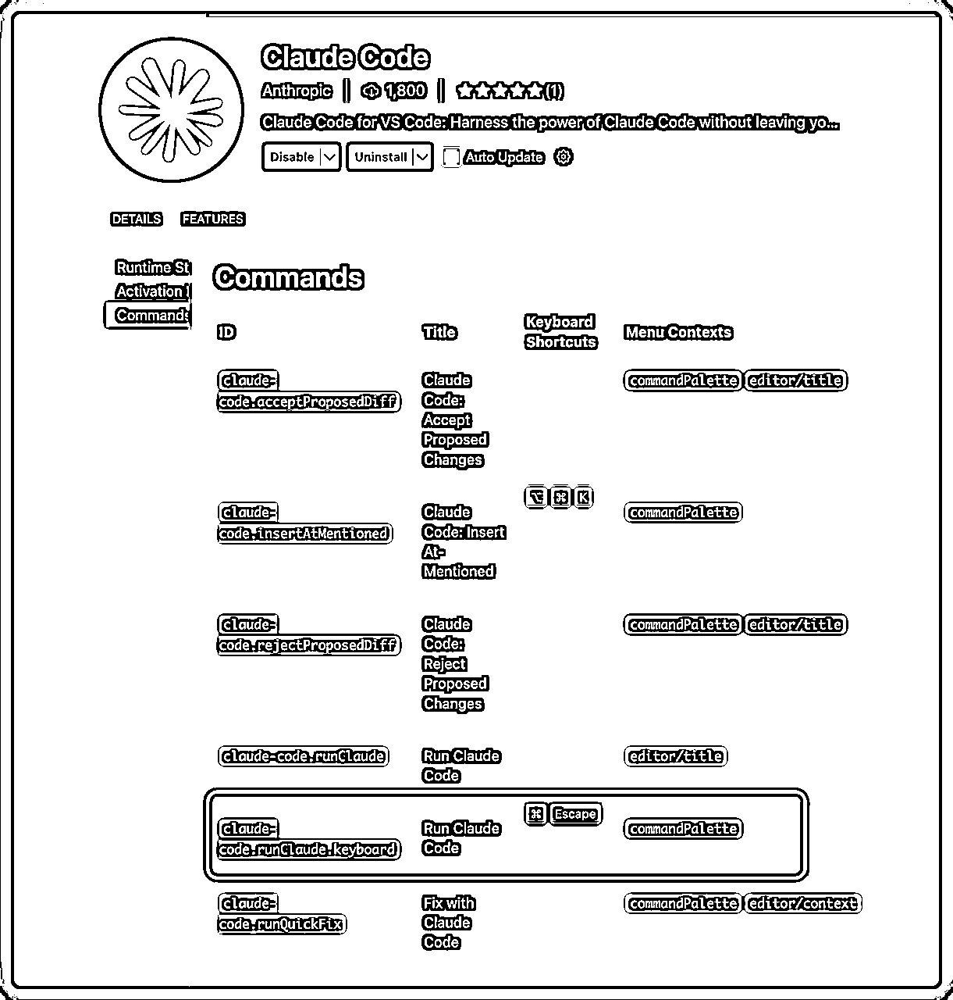

方法二：直接在 Cursor 界面点击那个对应的图标，鼠标点一下就行。

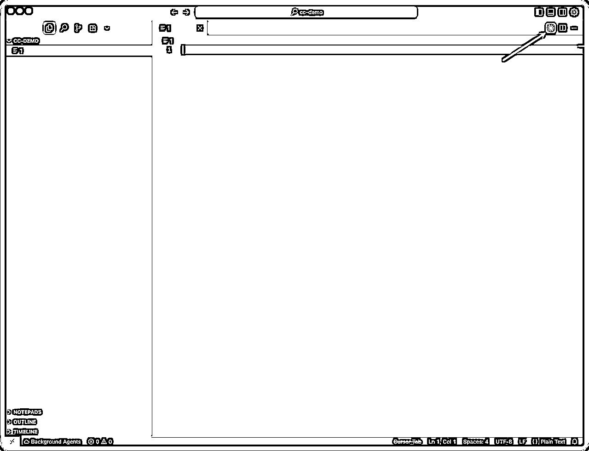

之后你会看到右侧出现 Claude Code 的工作区域。

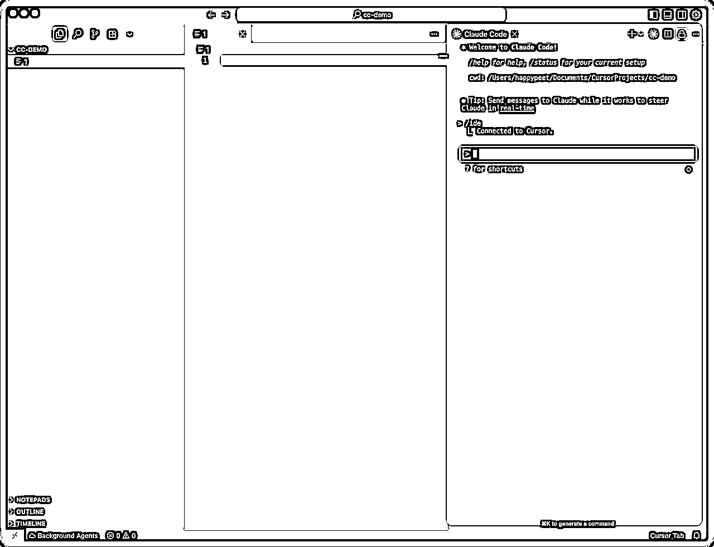

Windows 用户的话，可以按我之前分享的资料，用 WSL 插件连上来，也可以正常使用。

## 自动编辑模式

什么时候用？不想每次创建/编辑文件都要一顿确认时，用它。

怎么用？按一下 shift+tab，就进入该模式。


示例提示词：

```
帮我创建一个酷炫的 todolist 应用
```

## 指定文件

什么时候用？想对某个具体文件进行操作的时候。

怎么用？直接在输入框用 @ 来指定文件，这个操作和 Cursor 一样。


## 深度思考

什么时候用？遇到疑难杂症、要做方案规划、重构代码、解决复杂 bug 的时候。

怎么用？在提示词里写“ultrathink”或“深度思考”这类关键词。


## plan 模式

类似 roocode、cline 里对应的模式，也相当于 Cursor 的 ask。

什么时候用？项目前期规划、碰上疑难问题的时候。

怎么用？按两次 shift+tab 就能看到。


举例：

```
我想写一个像素风格的todolist，我需要移动端也可以使用，帮我规划下方案
```


它会开始思考方案：

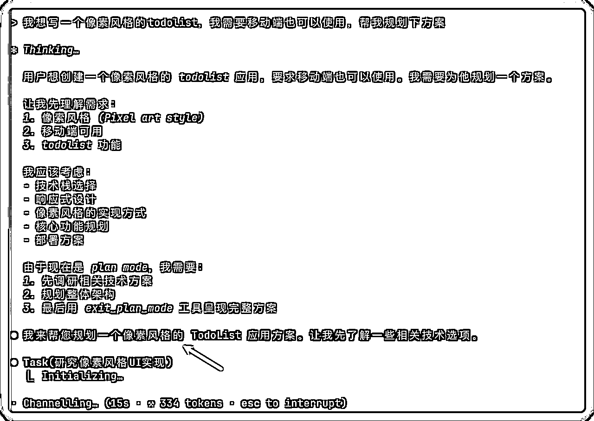

最后会问你要不要继续。不满意可以选 No，然后继续提需求；觉得 OK 就选 Yes，它就开始拼命干活了。

## 粘贴图片

什么时候用？要调页面结构、排查错误的时候。

怎么用？Mac 上直接按 ctrl+v 粘贴图片，或者把图片文件拖到终端里。

Mac 的终端粘贴完大概是这个样子：


想看 Windows 下的截图？文末有彩蛋。

## 常用命令一览

| 命令 | 作用 | 适用场景 |
| --- | --- | --- |
| /clear | 清空上下文 | 想重新开始，或感觉 AI 已经搞不定了 |
| /compact | 压缩对话 | 想开新对话又不想丢记忆 |
| /cost | 查看花费 | Max 用户不用看，API 用户可以用 |
| /logout /login | 登出/登录 | 切换账号等 |
| /model | 切换模型 | 200 刀用户可切到 opus |
| /status | 状态 | 查看当前 Claude Code 的状态 |
| /doctor | 检测 | 检测 Claude Code 安装状态 |

## yolo 模式

什么时候用？重构代码、开新项目、修 bug 等场景。

怎么用：

```
 claude --dangerously-skip-permissions
```

进来以后你会看到这样的界面：

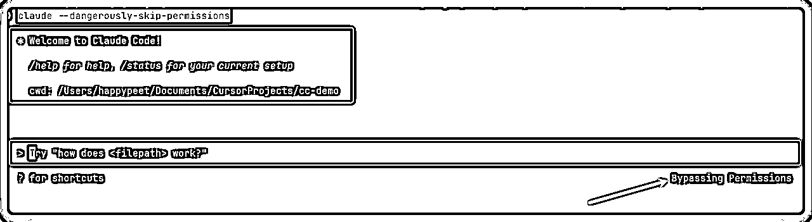

就算进了这个模式，后面也还能用 shift+tab 随时调整。

## 记忆文件

### 全局记忆文件

路径：~/.claude/CLAUDE.md

下面是我自己的配置：

```
# 所有交互回答都使用中文

# 启动并行的代理执行任务

# 搜索约定
- 如需简单字符串匹配 → Grep
- 如需结构化/跨语言模式匹配 → 请优先使用 Bash(ast-grep …)，示例：
  Bash(ast-grep -p '$FUNC($ARG)' src/)

# 环境约定
- python环境：python3 pip3
- nodejs环境：node npm
- docker环境：docker%
```

### 项目记忆文件

路径：项目根目录下的 CLAUDE.md

如果项目里已有代码，建议用 /init 命令自动生成。

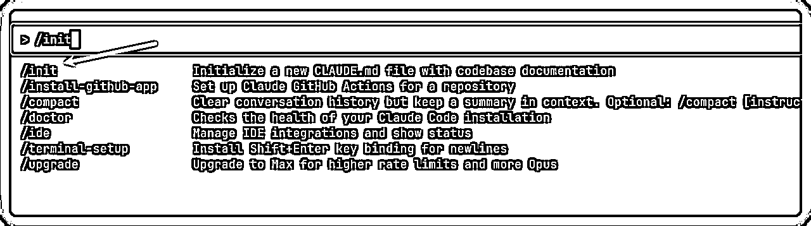

## 用之前的消息作提示词

什么时候用？想回到之前的对话。

怎么用？按两次 esc。


选择第 3 项，就能回到之前的对话框。这样如果觉得之前的提示词不合适，还能在原来基础上继续改。


## 如何回滚代码

类似 Cursor 里的 checkpoint 功能。

什么时候用？后悔 AI 改的代码了，想恢复之前的状态。

怎么用？

### 简单方式：直接提需求

```
回滚到上次的代码
```

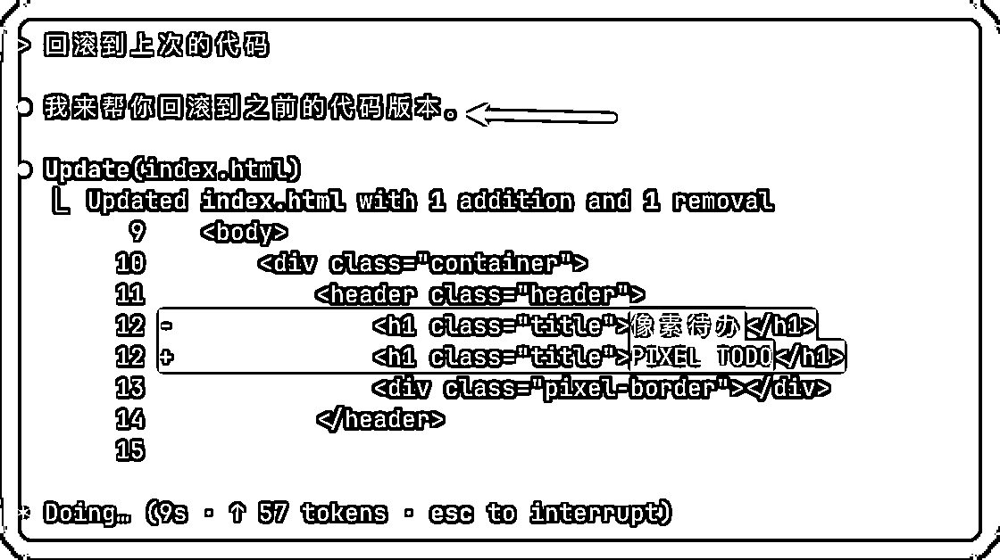

### 高级方式：用 git

这块还没完全整理完。

思路是：利用 git 每次提交记录，再配合自定义 commands 命令。

这样一来，就能用 git 精确回滚了。

## 恢复对话/查看聊天记录

什么时候用？想接着之前的会话。

怎么用？用 /resume 命令，或者用 claude 的 -c / -r 参数来继续或恢复。

```
# 直接进入上次的对话中
claude -c 
```

```
# 选择对话
claude -r
```

## 执行终端命令

什么时候用？想看看当前目录，或者执行一些特殊命令。

怎么用？先输入英文感叹号 !，进入命令行模式。


查看当前目录：


查看当前文件列表：


## 监控使用量

### 按天查看用量：

```
npx ccusage@latest
```

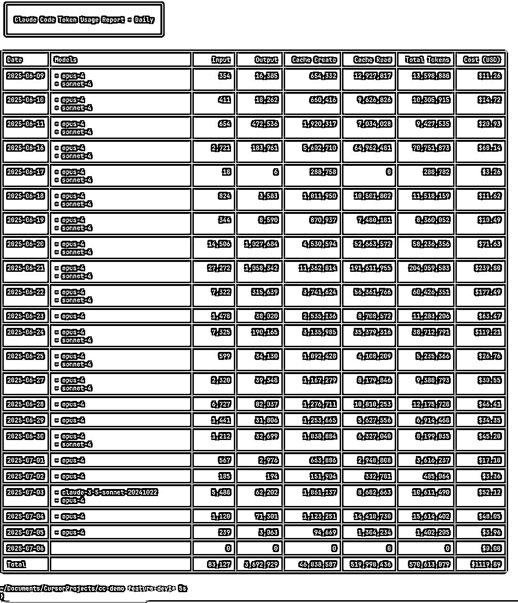

实时采集量的命令：

```
npx ccusage@latest  blocks --live
```

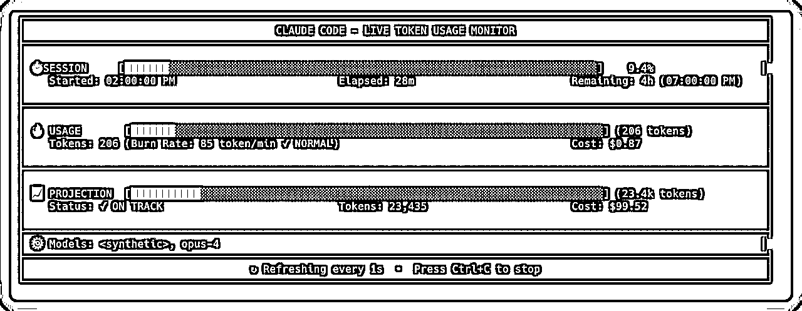

## 自选题：MCP

什么时候用？很多场景都适合。

怎么用？先安装 MCP。

MCP 全称 Model Context Protocol，可以理解为给 AI 装“插件”的通用插座——把爬虫、数据库、API 等外部工具接进来，让像 Cursor、Claude 这类 AI 助手瞬间获得新能力。

所以你可以把 MCP 想象成“用 USB 让各种设备秒连电脑”的逻辑，只不过这里的“电脑”换成了大模型。

```
claude mcp add playwright -s user -- npx @playwright/mcp@latest
```

拿打开📕来演示：

```
在浏览器里打开📕,搜索“Claude Code”,按照浏览量多的前面排序，将前10的结果总结给我
```

搜索结果：

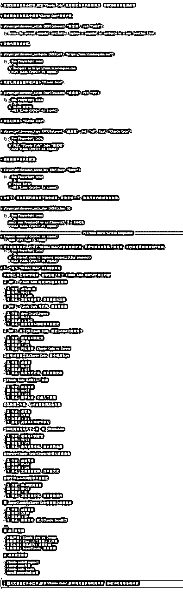

# 写在最后

看到这里，你可能会想：“14 个技能点，也太多了吧……”

我想说：罗马不是一天建成的，但每天进步 1%，100 天后你就不一样了。

我的建议是：

1. 收藏这篇文章，当学习地图
2. 每天练 1-2 个技能点
3. 放到真实场景里用，加深理解
4. 两周后再回来看，你会感谢现在的自己

在这个 AI 狂飙的时代，有人观望，有人焦虑，而聪明的人选择成长。

Claude Code 的这 14 个技能点，就是你向上的台阶。

爬上去，你会看到完全不同的风景。

好了，今天的分享就到这儿。

安啦，各位！

作为圈友直接分享给大家：

链接：https://pan.quark.cn/s/9d53d4b11497
提取码：RY5W

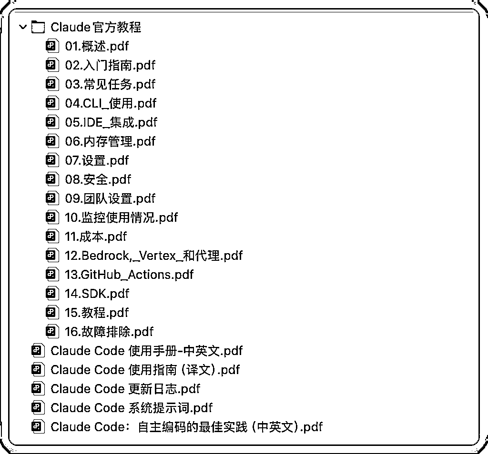

---

如果你觉得这篇文章有用，记得「点赞、转发、关注」，也欢迎点个「爱心」。你的每一个互动，都是我持续输出的动力。我们一起在 AI 爆炸时代，充实自己，迎接 AGI 的到来。