# 用 Cursor 一把做成飞书字段捷径插件：跳过 Coze 资源点限制的完整实操
作者：龙哥


# 前言

写下这篇分享有三个目的：

1. 星球里关于“飞书字段捷径插件”的实战笔记很少，我补一个
2. 讲一个真实项目里遇到的资源瓶颈，以及如何用自建插件绕开解决
3. 重点在流程方法，不展开具体业务逻辑

看完之后，你能掌握从零到上线的一整套字段捷径插件开发路径。

### 效果先睹为快：

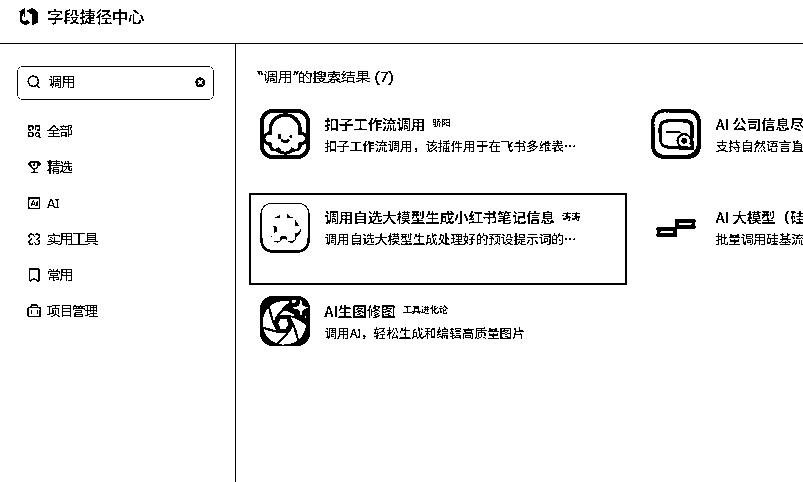

# 问题是怎么来的

在做📕虚拟素材的测试时，

我把笔记的整个管理流程放在了飞书多维表格里。

标题、文案、标签这些字段，

都是先对图片做 OCR 转文字，再丢给 Coze 平台自动处理，最后写回表格。

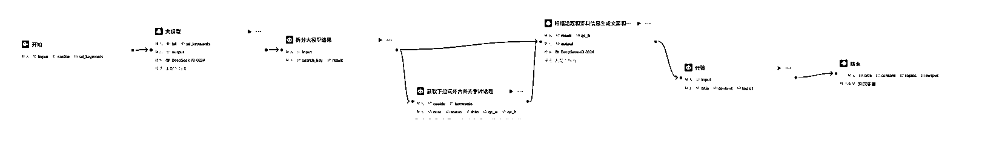

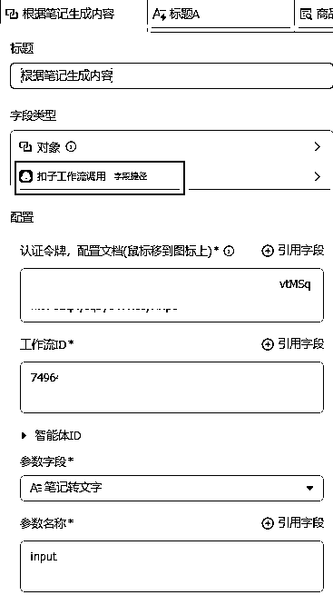

这个方式很顺手，Coze 里能做的事情很多：

能跑爬虫脚本抓关键词的下拉长尾词，也能调大模型 API 一次性产出标题、文案、标签。

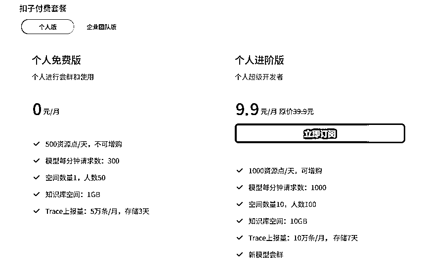

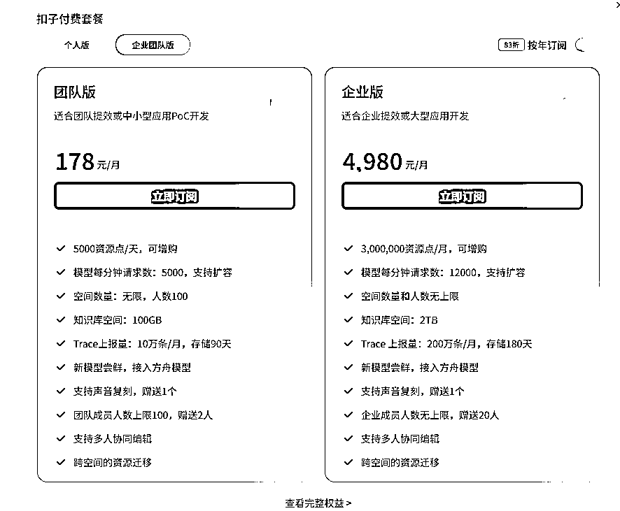

但当笔记量起来之后，Coze 的资源点直接吃紧了。

个人会员每天 1000 点很快用完，想扩容就得升团队版或企业版，成本一下子就上去了。

为了摆脱这个天花板，我决定自己做一个飞书“字段捷径”插件，把 Coze 上的工作流原样搬过来。

插件上架到飞书后是免费托管在飞书服务器运行的，不走 Coze 平台，自然就不再受资源点限制了。

# 一、先把文档搞到手

文档到位，后面用 Cursor 开发会顺很多。

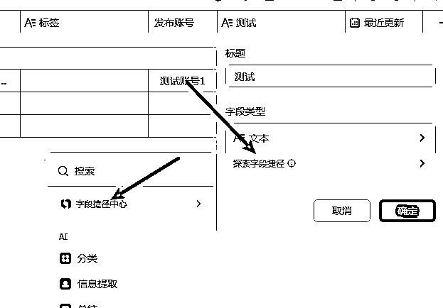


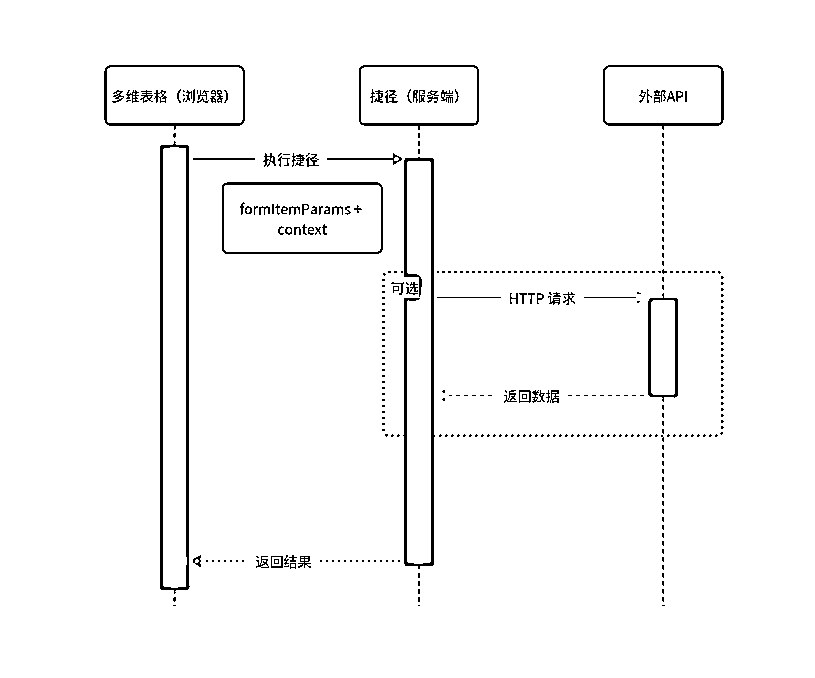

# 二、开工前的准备：字段捷径开发助手

开发调试离不开官方的“字段捷径开发助手”插件。

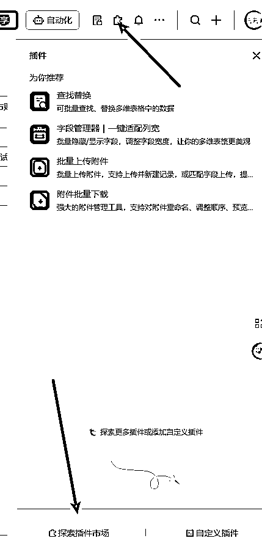


# 三、开发实战

## 运行环境对齐

本地最好和线上保持一致，官方要求 Nodejs 版本 14.16.0 以上。

## 拉官方 Demo 起步

按文档把测试用的示例项目拉下来，先跑通。

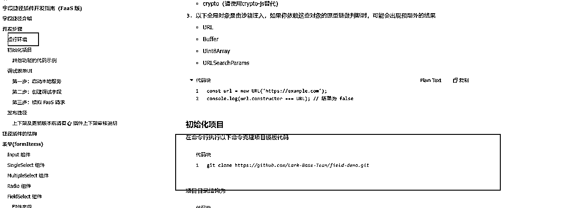

```
git clone https://github.com/Lark-Base-Team/field-demo.git
```

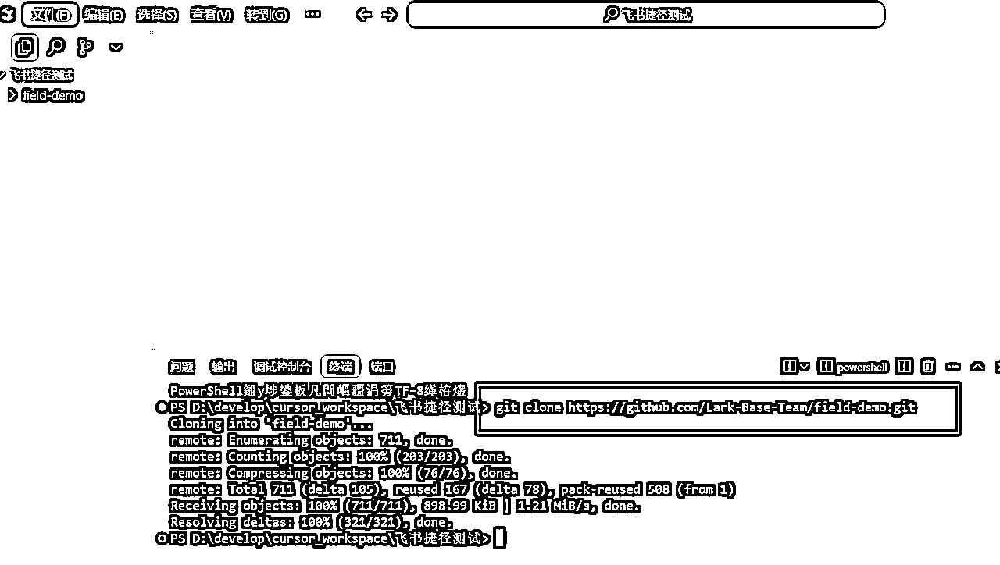

## 本地跑起来

```
cd .\field-demo\
# 安装依赖
npm install

# 启动本地服务
npm run start
```

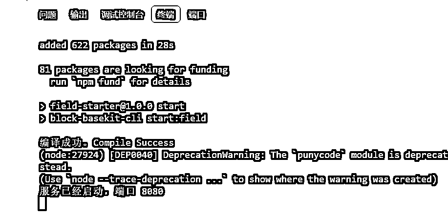

复制项目后打开右侧的“字段捷径调试助手”，也可以在插件市场搜索后 pin 到侧边栏。

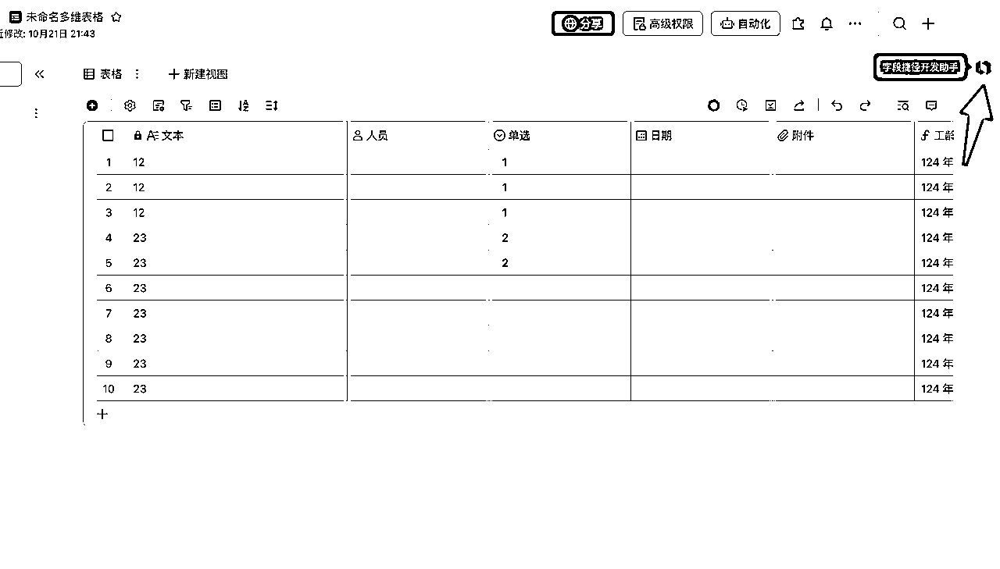

到飞书多维表格里随便测一下，能正常跑通就说明环境没问题。

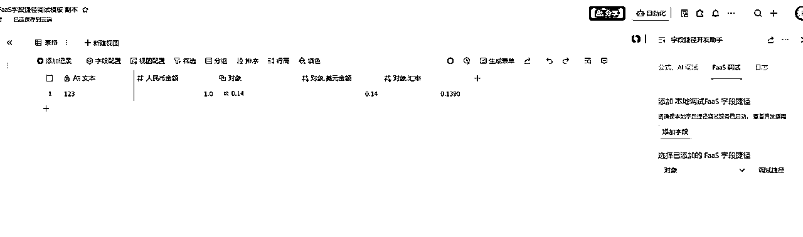

环境OK后，就可以交给 Cursor 开始动手了。

## Cursor 使用心得

### 技巧一：把官方文档塞进 Cursor Doc

这样 Cursor 随时能查、能引用，不会跑偏。

方式1：

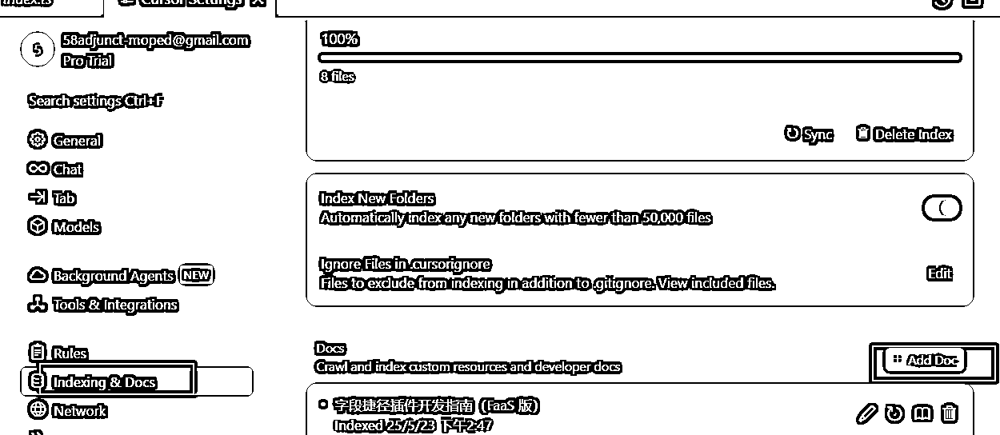

方式二：

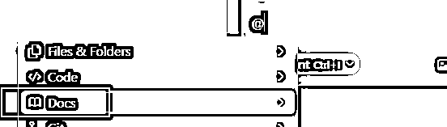


用的时候直接 @DOC 就行。

### 技巧二：抄一个现成的界面逻辑

插件市场里已有 Coze 调用的字段捷径插件，直接借鉴它的参数设计和交互样式，复刻起来很快。

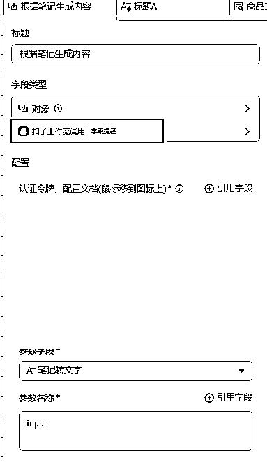

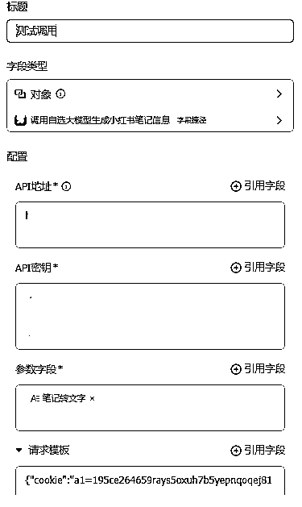

先和 Cursor 把入参聊清楚：要几个参数、哪些必填、类型是什么，按业务需求定好再让它改。

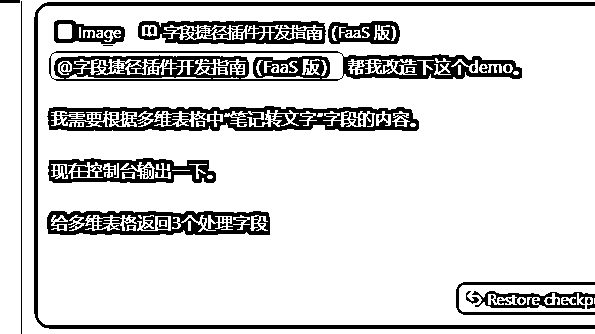

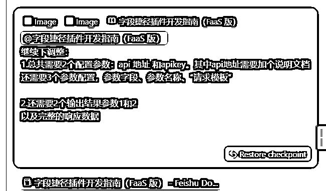


界面参数定稿后，再把 Coze 里的工作流逐步迁移过来。

建议一个功能搬一个功能，搬完就测，不要一次性全写。

比如调大模型 API，我就用之前剩下的中转 API 来做验证。

⚠️ 让 Cursor 写 API 调用时，务必把官方提供的测试样例一起丢给它，基本一次两次就能调通。

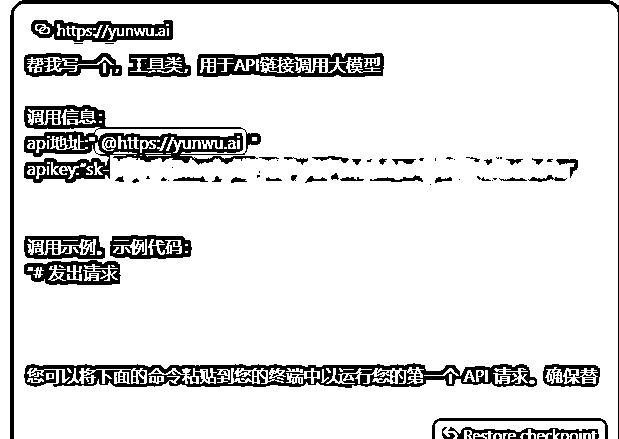


例如用固定提示词生成搜索关键词：

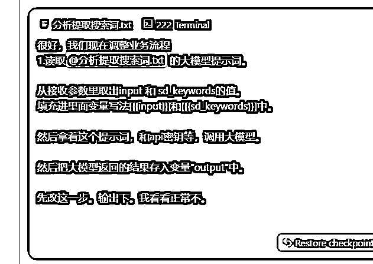

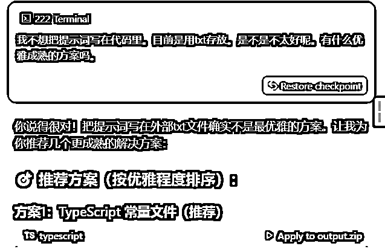

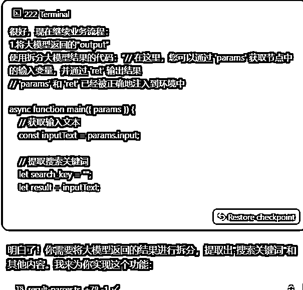

因为 Coze 里的提示词、爬虫脚本、格式处理我早已跑通，这次只是把代码和文案原封不动搬给 Cursor，所以调试非常顺畅。

# 四、上架发布

代码打包完，填一下飞书给的申请表单即可。

官方审核通过后会拉群对接，一般 1-2 个工作日就能上线使用。

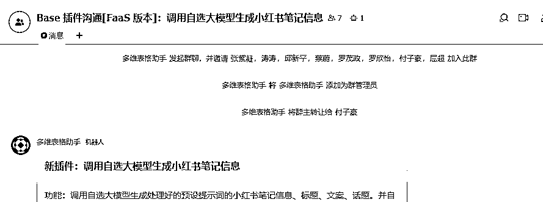


```
发布插件：
要发布自己编写的字段捷径插件供自己使用，请遵循以下步骤，基于知识库中的文档信息

1.
打包插件：在项目目录下执行 `npm run pack`（确保Node.js版本为14.16.0或更高），生成output/output.zip文件。
- 示例命令：`npm run pack`
- 输出文件路径：`output/output.zip`
2.
上传文件：将生成的output.zip文件上传到指定位置。

3.
提交发布表单：访问并填写
多维表格捷径插件表单
。在表单中：
- 选择发布范围为“公司内使用”（适用于个人或团队内部使用）。
```

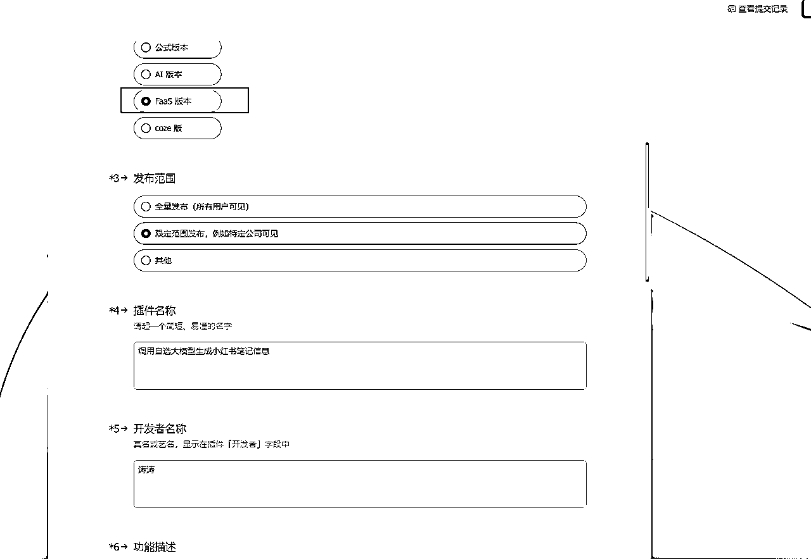

# 收尾

「如果这篇分享对你有帮助，欢迎回星球给我点个赞👍」