# 📕商单接广入门指南：从数据调研到低粉变现
作者：龙哥

如果你正在考虑通过📕接商单，却不知道该从什么方向切入，这份调研或许能帮你少走一些弯路。

本文主要围绕📕商单市场、博主报价、低粉账号表现以及赛道选择展开分析，适合刚准备入局、粉丝量较低，或者想通过数据寻找可复制方向的创作者参考。

## 一、为什么值得关注📕商单？

### 1. 用户消费能力较强

📕用户整体偏年轻，主要集中在一二线城市，消费意愿和内容接受度都比较高。

从平台规模来看，📕月活用户已经超过3.39亿，相较2024年仍保持增长。与此同时，广告收入同比提升约48%，平台商业化能力和用户付费能力都比较突出。

从创作者生态来看，平台上已经形成了多种变现路径，包括虚拟产品、实拍内容、品牌合作、商单接广等。对于普通创作者来说，选择空间比较大。

### 2. 平台对新账号相对友好

📕同时支持图文和短视频两种内容形式，创作者不一定需要高成本拍摄，也可以根据自身优势灵活选择。

平台对于新账号的冷启动相对包容，只要达到1000粉丝，就有机会开通蒲公英并参与品牌合作。相比一些需要较高粉丝门槛的平台，📕的首单距离更近。

### 3. 对不同角色都有价值

对于个人创作者，📕商单属于投入较轻、反馈较快的副业方向。

对于品牌来说，📕能够精准触达具有明确消费需求的人群。

对于消费者而言，真实用户分享、体验测评和使用反馈，能够帮助其降低购买决策成本，同时完成内容浏览与消费转化。

### 4. 低粉账号也存在机会

商单并非只有大博主才能参与。即使粉丝量不高，只要内容方向清晰、用户画像准确，也有机会拿到合作。

从2021年至2025年的相关案例来看，持续深耕商单赛道的人依然能够获得不错的结果。随着粉丝增长、内容质量提升以及账号影响力增强，报价和广告收入也会逐步上升。

换句话说，这是一条存在长期复利空间的路径。

---

## 二、正式入局前，先做好数据调研

有句话说得很形象：调查需要长期积累，但解决问题往往只在关键的一瞬间。

在开始做账号之前，先进行市场调研，是降低试错成本的重要步骤。只有知道市场上哪些赛道有需求、哪些账号表现突出、不同粉丝量对应什么报价，后续的内容规划才不会完全靠猜。

这次调研主要对📕商单博主进行数据清洗、汇总和分析，目标是找到表现突出的账号，再观察其内容结构、赛道选择和商业化方式，最终形成可借鉴、可调整的运营策略。

### 调研工具

推荐使用「灰豚数据」，个人版可免费试用15天。

### 样本范围

- 选取2025年5月至6月仍有更新记录的博主；
- 商业笔记数量大于0；
- 覆盖37个细分赛道；
- 总数据量超过30万条。

### 筛选标准

- 粉丝数量不低于1000，具备开通蒲公英的基础条件；
- 图文或视频报价达到1000元以上；
- 图文CPE和视频CPE大于0；
- 排除没有认证信息的博主。

其中，CPE可按照以下方式计算：

> CPE＝视频笔记报价 ÷ 视频笔记平均互动量

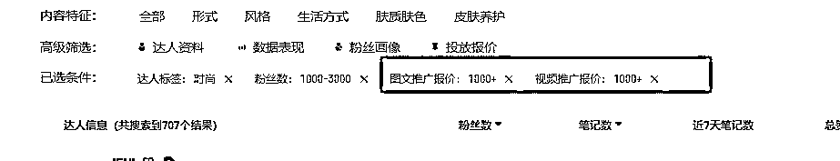

### 为什么这样筛选？

主要基于以下考虑：

1. 1000粉是开通蒲公英、参与平台商单的基础门槛；
2. 低价、高频、纯广告直发的账号，容易损耗账号价值，因此不作为重点样本；
3. 本次更关注各赛道中具备较高商业价值的账号，希望观察行业中的上限表现，而不是普通平均水平。

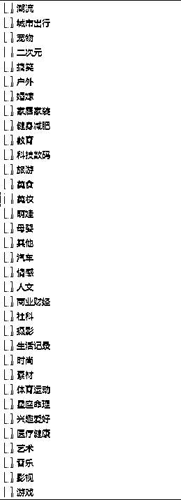

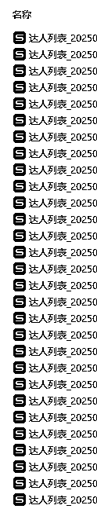

---

## 三、全量市场数据观察

以下图表由Chat-GPT辅助整理。由于样本规模较大，其他工具如genimi、deepseek、元宝、豆包等未能完整读取全部数据。

### 粉丝数量分布

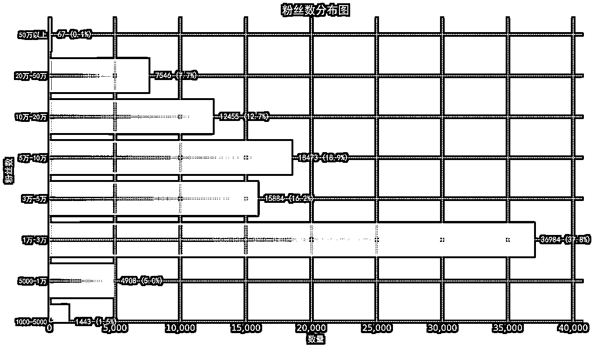

### 不同内容类型的博主数量

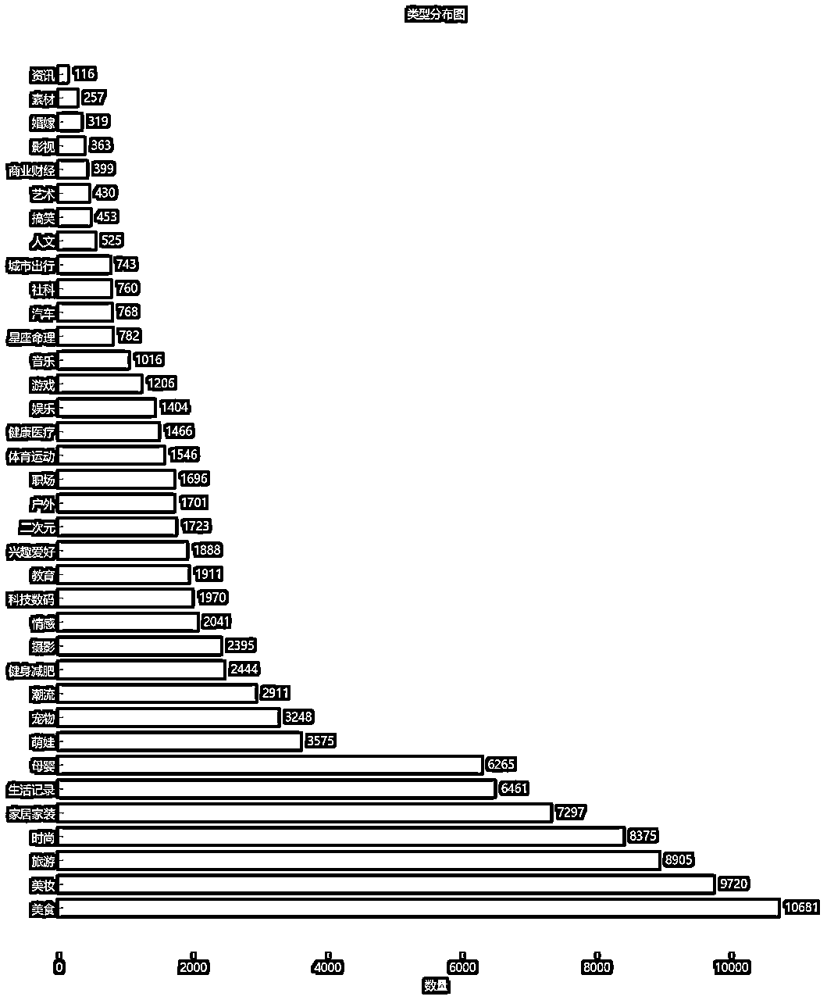

### 视频与图文商单报价对比

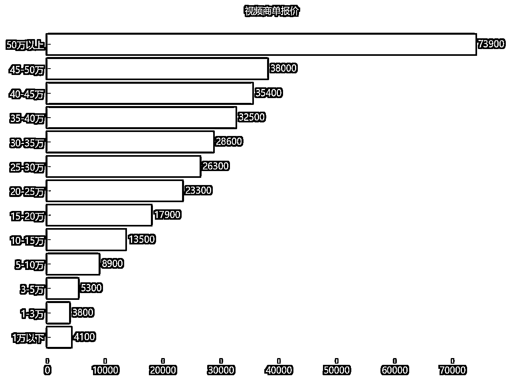

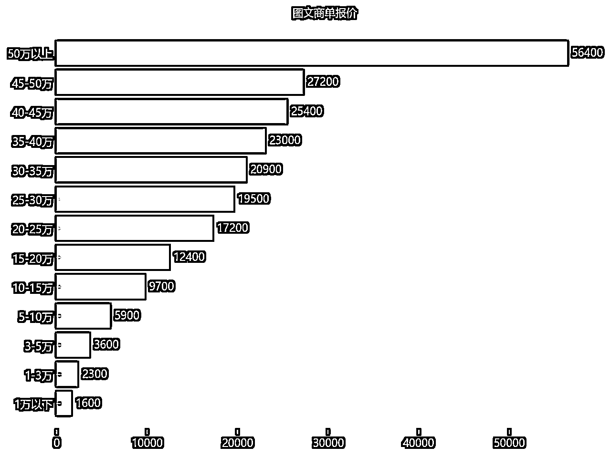

### 各类博主的平均报价与中位报价

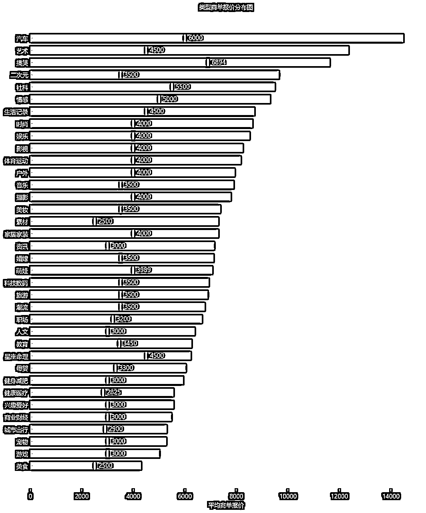

## 给新手创作者的10条建议

### 1. 第一阶段可以把3万至5万粉作为目标

这个粉丝区间的账号数量约占市场六分之一，但商业报价已经明显高于1万至3万粉账号，部分情况下甚至接近两倍。

因此，与其长期停留在1万至3万粉的密集竞争区，不如先集中突破3万粉，再向10万粉迈进。

### 2. 10万粉往往是商业化的重要节点

在10万粉之前，账号报价通常增长较慢；达到10万粉后，品牌报价可能出现明显提升。

因此，10万粉以前要重点做好内容数量、互动率和粉丝沉淀。当账号接近10万粉时，还要提前提升拍摄、剪辑和内容策划质量，为后续涨价做好准备。

### 3. 前期以短视频获取流量，后期加入图文内容

在1万粉以内，短视频平均报价通常是同档位图文的2至3倍，同时也更容易获得平台推荐。

前期可以用短视频完成曝光和涨粉，粉丝基础稳定后，再通过清单、测评、攻略等图文形式降低创作成本，维持更新频率。

### 4. 优先考虑供给较少、报价较高的赛道

汽车、财经、艺术、二次元、社科等垂直领域，账号占比通常不足5%，但平均报价相对更高。

如果你拥有专业背景、行业资源或独特表达能力，可以考虑从这些竞争相对较小的方向切入。

### 5. 进入热门赛道后，一定要做细分

美食、旅行、美妆等生活方式类内容占据了较大比例，意味着用户需求稳定，但竞争也非常激烈。

如果选择这些方向，就不能只做泛泛的内容，而要进一步切分场景或人群，例如：

- 独居空间改造；
- 宝妈重返职场；
- 小户型收纳；
- 学生党平价美妆；
- 通勤人群快速早餐。

越具体，越容易形成差异化标签。

### 6. 用中位价作为初期定价参考

多数内容类型的报价中位数集中在3000至5000元左右。

刚开始定价时，可以先以同赛道中位价作为基础，再结合内容难度、粉丝互动率、账号垂直度以及版权授权范围，上浮约15%至25%。

### 7. 3万至10万粉阶段保持稳定更新

这个阶段的广告主通常比较重视更新频率，而账号报价又尚未进入快速上涨期。

建议每周发布4至5条内容，报价尽量靠近同类账号的中位水平，在保证收入的同时继续扩大曝光。

### 8. 尝试组合套餐，而不是只卖单条内容

品牌方往往更愿意一次采购多条内容。

可以尝试设计类似以下的合作形式：

- 1条短视频＋1至3篇图文；
- 单品测评系列；
- 主题内容合集；
- 短视频种草＋图文补充。

适当给予套餐优惠，有助于提升单次合作金额，也更容易促进复购。

### 9. 粉丝进入新档位后及时调整报价

当粉丝量跨过新的区间时，可以同步更新报价表。

例如从5万粉以下进入5万至10万粉区间，图文报价通常会有一定提升，部分阶段每跨越一个5万粉档位，价格可能增加约2000元。

如果粉丝量已经接近新的档位，例如2.9万或7.9万粉，也可以提前准备新的报价方案。

### 10. 用数据不断筛选选题

每发布约30条内容后，建议进行一次复盘，重点观察：

- 完播率；
- 转发率；
- 评论区关键词；
- 收藏量；
- 粉丝增长；
- 商业内容的转化表现。

表现好的选题可以继续做成系列，长期低效的方向则应及时调整，避免持续消耗创作时间。

---

## 四、不同粉丝区间的高报价博主

我也整理了各个粉丝档位中商单报价较高的部分博主，具体名单仅供观察和学习参考。

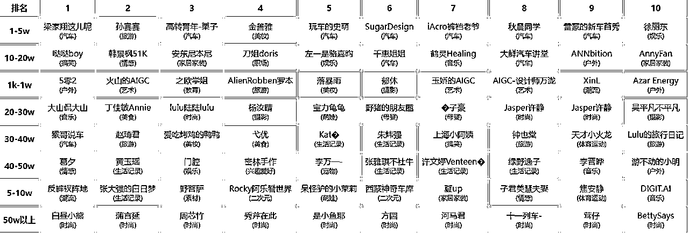

需要注意的是，研究优秀账号并不是为了机械复制，而是分析它们的共同规律，例如：

- 内容切入角度；
- 账号定位；
- 视频和图文比例；
- 广告植入方式；
- 粉丝互动质量；
- 商业报价结构。

---

# 五、重点拆解：3万粉以下的小号市场

完成大盘数据分析后，我发现全量数据对于新手来说仍然不够具体。毕竟大多数新人短期内很难直接做到10万粉甚至更高。

因此，接下来将样本进一步缩小，专门观察3万粉以下的账号，寻找更适合普通创作者的规律。

### 低粉账号粉丝分布

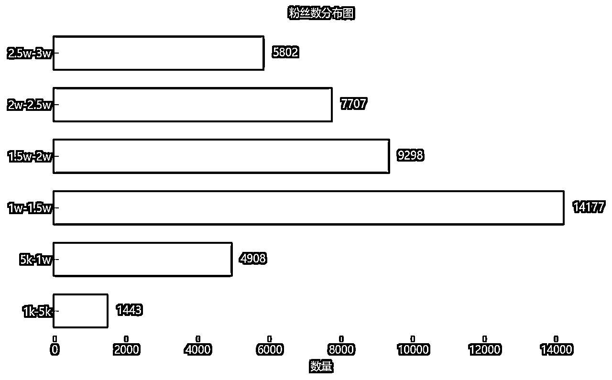

### 低粉账号的类型数量

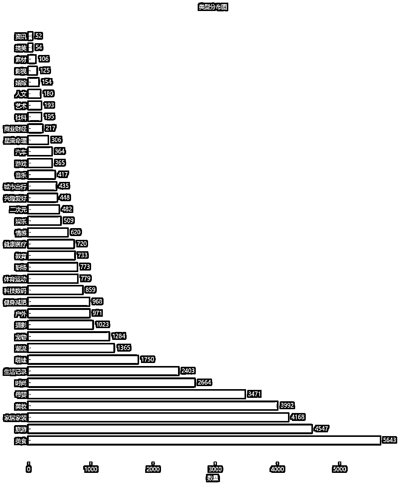

### 各类型账号的平均报价和中位报价

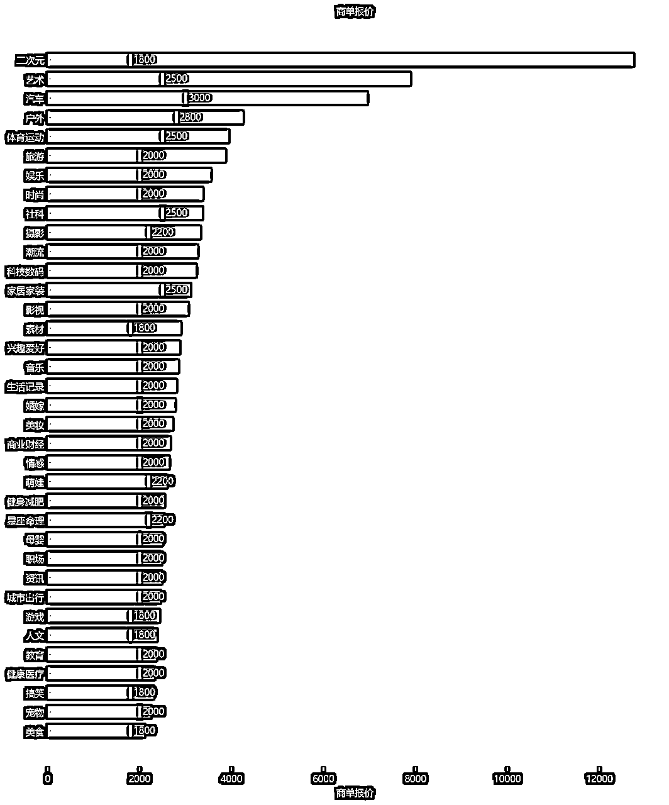

## 低粉账号的10个关键结论

### 1. 小号报价普遍集中在2000元左右

在3万粉以下的样本中，大多数赛道的平均报价约为1800至3000元。

相比全量市场中4000至8000元左右的平均水平，小号存在较明显的价格限制。想突破这个区间，通常需要提供更稀缺的内容，或者使用多篇笔记、系列合作等打包方式。

### 2. 不同赛道的价格差距明显缩小

汽车、艺术、二次元仍然属于低粉账号中报价较高的类别，但与美食、生活等大众赛道相比，优势大多只有600至1000元左右。

这与全量市场中几千元甚至上万元的差异相比，已经明显收窄。

所以，低粉阶段选择小众赛道的主要价值，更多体现在未来的涨价空间，而不是立刻获得高收益。

### 3. 生活方式类内容依旧是新人主流选择

美食、旅行、家居、美妆、母婴、时尚和生活记录等7类内容，在低粉账号中占比接近60%，比全量样本还要高一些。

这说明“吃、穿、住、行”确实更容易入门，但同时也意味着竞争非常拥挤。

### 4. 二次元和户外等小众方向值得关注

二次元账号在全量市场中的占比约为0.5%，但在3万粉以下账号中提升至1%以上，报价也位于前列。

这类方向整体规模不算大，但头部账号相对较少，适合有兴趣、有资源或具备独特内容能力的人尝试。

### 5. 1万至1.5万粉是低粉账号的拥堵区

数据显示，1万至1.5万粉的账号数量超过1.4万个，占低粉样本约三分之一，是一个非常明显的竞争密集区。

当账号突破1.5万粉后，再持续冲击3万粉，就有机会逐步脱离最拥挤的区间。

### 6. 小号阶段，粉丝数量不一定直接带来高溢价

在大盘数据中，每增加一个5万粉档位，图文报价通常能够增长约2000元。

但在3万粉以内，粉丝量提升带来的价格增长相对有限，很多时候只有几百元。

因此，低粉阶段不能只关注涨粉，还要努力提高内容质量、用户信任和品牌匹配程度。

### 7. 专业型赛道可能被低估

健康医疗、科技数码、财经资讯等类别的低粉账号，平均报价大多在2000至2500元左右，看起来并不比美食、宠物高很多。

但这些方向的账号数量往往非常少，部分赛道甚至不足百个。如果能够持续输出专业、可靠、有价值的内容，后期的商业溢价可能更明显。

### 8. 小号合作的重点逐渐转向内容方案

品牌并不只是根据粉丝量决定预算，还会考察创作者能否提供完整的内容组合。

例如：

- 视频加图文；
- 多篇系列笔记；
- 主题内容合集；
- 不同场景的产品展示。

相比只报价一条内容，结构化的合作方案更容易提升总金额。

### 9. 低于1万粉时，短视频仍然更适合冷启动

虽然低粉账号整体报价不高，但在1万粉以下阶段，视频报价通常仍比图文高30%至40%。

如果时间和精力有限，可以优先用短视频获取曝光，再以图文内容维持稳定更新，形成“短视频拉新、图文沉淀”的组合方式。

### 10. 稳定更新比偶尔爆款更重要

1万至2.5万粉是账号数量最密集的区间，也说明平台推荐机制会持续考察账号的更新能力。

建议保持日更短视频，或者至少做到隔日更新图文。先尽快突破拥挤区，再通过更深的内容和更好的商业表达，提高账号价值。

### 低粉高报价博主参考

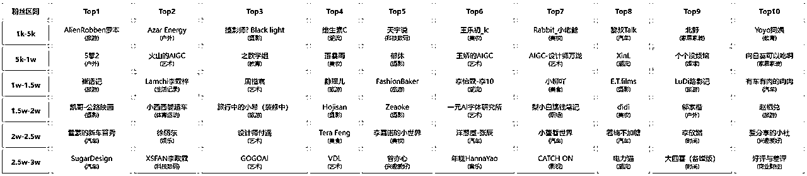

---

# 六、进一步观察：逐个研究1万粉以下账号

前面的统计能够帮助我们判断整体趋势，但仍然无法直接回答一个问题：

到底哪些账号适合模仿，哪些账号只是特殊案例？

因此，我又把所有符合条件的1万粉以下账号逐个打开查看，进行人工筛选。

批量打开网页可以使用：

https://www.openurl.cn/

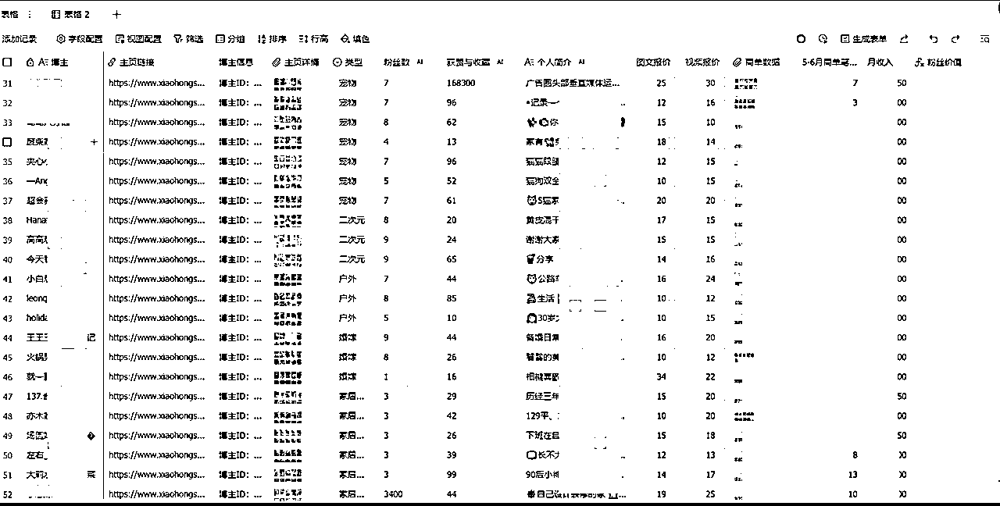

最终，在6358个账号中筛选出565个具有参考价值的账号，并统计它们在5月至6月期间的商单笔记数量、图文报价、视频报价，再进一步估算账号月收入和整体商业价值。

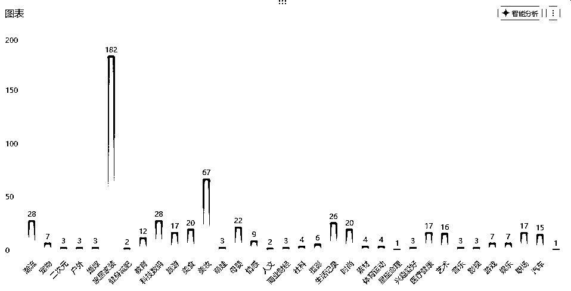

从结果中可以看到几个比较明显的现象：

1. 汽车、设计、金融等赛道更容易获得较高预算，单条合作达到几千元并不罕见；家居和美妆虽然需求大，但同赛道创作者数量较多，报价往往只有1000至2000元左右；
2. 在其他条件接近的情况下，视频合作价格通常比图文高约三成；
3. 汽车、艺术等垂直领域的粉丝商业价值更高，单个粉丝每月可能贡献1至5元的商业价值，明显高于大众赛道。

---

# 七、最后的总结

这次调研前后花费了4天，主要完成了以下几件事：

- 观察📕商单市场整体规模；
- 分析不同粉丝量对应的报价；
- 对比视频和图文的商业价值；
- 拆解3万粉以下小号的表现；
- 筛选低粉账号中的可参考样本；
- 估算不同赛道的账号变现能力。

接下来，我会结合自己最终选择的方向，继续研究具体博主的内容结构、选题方式和笔记表现。

数据调研的作用，是帮助我们减少盲目试错，提高判断成功率。但调研本身并不能直接带来收益，真正决定结果的，仍然是持续执行。

更有效的路径应该是：

> 调研—行动—复盘—调整—再次验证。

这篇内容只是分享一种基础的调研方法，不一定适合所有人，大家可以结合自己的资源、能力和兴趣进行判断。

愿每个人都能找到适合自己的方向，并在持续行动中获得结果。

本文所使用的数据，主要来自公开网络信息及第三方数据工具，仅用于个人学习、研究和信息分析，不构成任何商业推广建议，也不代表对任何第三方进行评价、诋毁或指责。

文中未收集、公开或传播任何博主的个人隐私信息，也未将相关资料用于商业售卖。如涉及版权、隐私或其他权益问题，请及时联系作者处理。

本文内容仅代表作者个人的调研方法与观点，与📕官方平台及文中涉及的博主无关。任何人使用相关信息时，都应结合自身情况独立判断，并自行承担相应风险。