如果你是个朝九晚五的上班族，却总觉得心里有一团火没灭——想做点自己的产品，又担心没技术、没资金、没时间，那今天这个故事，或许就是你一直在等的那道光。

故事的主角叫超级峰，本职工作是一家农业类互联网公司的产品负责人，听起来挺传统、挺安稳的。但他只用半年时间，就在本职工作之外，揭开了另一个身份——AI独立开发者。一个人，不辞职、不烧钱，愣是用AI编程做上了App Store免费榜。

## 从零开始，他凭什么半年就跑通了？

先说说他的起点。大学读软件工程，毕业后一直做产品，代码这件事，说实话已经丢了很多年。去年底偶然接触到Cursor这类AI编程工具，刚开始也只是抱着试试的心态。那会儿这类工具还很小众，他算是亲眼看着AI编程从小圈子一步步走向大众的。

六个月，说实话不算长。但就是这半年，他的生活轨迹几乎被改写：从一个按部就班的上班族，变成每月稳定上线两款产品的人，而且每款从外界反馈来看，都挺能打。

他不是天才，也不是技术大牛，就是个普通的互联网产品经理。但他深信：普通人，真的可以借AI编程改写自己的命运。正是出于这份信念，他还运营了一个完全免费的AI编程互助群，让更多有创作冲动的人，找到趁手的工具与对的方法。

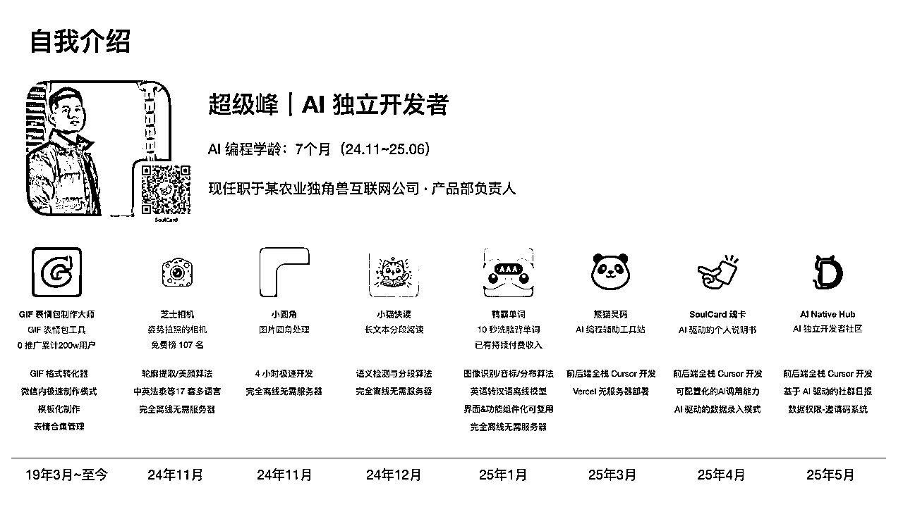

## 震撼案例：一款App，开发只用了一两天？

很多人对AI编程的威力没有概念，那先听他说一个真实战果。

去年11月，他人生中第一款完整的AI编程产品——芝士相机——上线了。真正投入开发的时间，只有1-2天。你没看错，就一两天。而45天，是他从“完全不懂AI编程”到能独立做出这款产品所花的学习时间。

更让所有人意外的是，这款App上线仅一周左右，就冲上了App Store免费榜第107名。

要知道，在这个榜单上走到100多名，意味着单日下载量至少要达到5000-6000。对一个零经验的个人开发者来说，这个数字原本是想都不敢想的。但AI编程，硬是把“不可能”变成了“可能”。

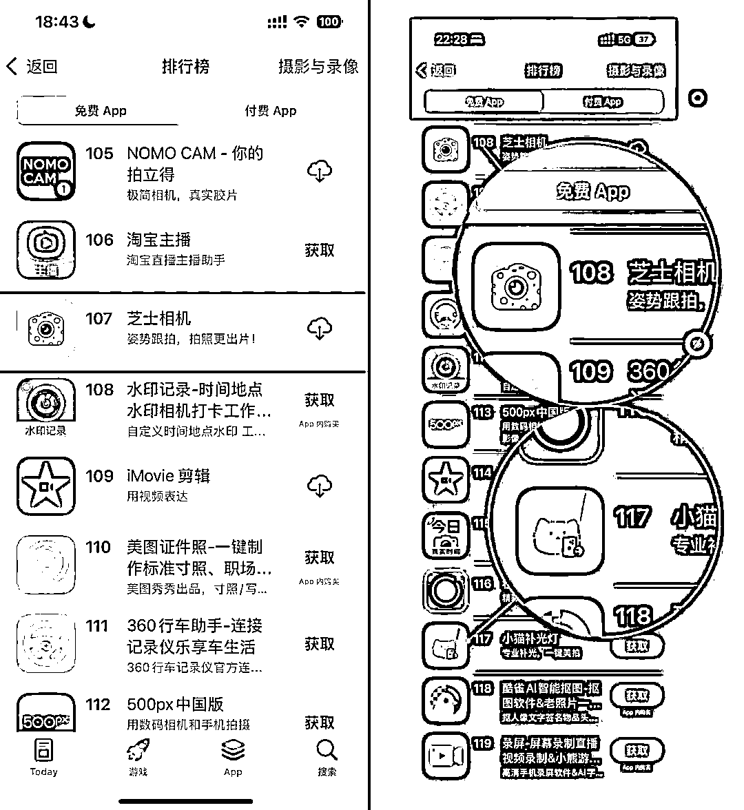

他还给了一个特别直观的对比：2019年，他曾经手工开发过一款叫“GIF表情包制作大师”的微信小程序。当时重新啃技术，反复磨细节，拖了极长时间才上线。虽然最后积累了200万用户，过程却异常痛苦。而2024年，AI编程让他45天入门、1-2天写出一款能登榜的产品。这效率差距，说是天壤之别都不为过。

芝士相机本身，解决的是个非常具体的痛点：帮男朋友把女朋友拍好看。但背后的技术含量并不低——包括自动识别拍照姿势的轮廓生成算法，以及保证照片足够好看的美颜算法，还实现了13套语言支持。过去要搞定多语言，得花钱花时间找翻译，现在AI直接一步到位。

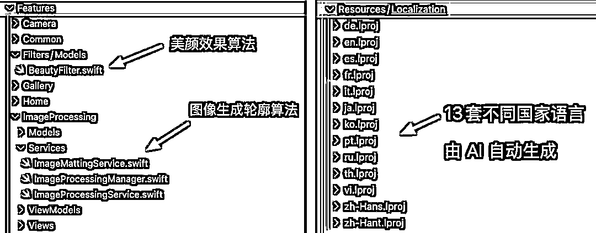

效果如何？这款App在国内免费，海外版定价1美元，偶尔就有外国用户掏钱。这说明AI生成的多语言，配上产品本身的价值，是完全能过商业化这道关的。而且芝士相机全程离线，不需要服务器，既省成本，又避开隐私顾虑。

这正是AI编程的真正魔力：它不只是让你写代码更快，而是让你一个人拥有了过去一个团队才可能具备的能力。

所以说，一个人，也能做出爆款App。但那不是撞大运，而是有迹可循的。

## 爆款公式：三大密码，解开成功之门

超级峰后来逐渐提炼出一个公式，用来描绘“爆款App”的诞生：

**爆款App = 精准的需求场景 × 高效的AI赋能 × 合适的曝光渠道**

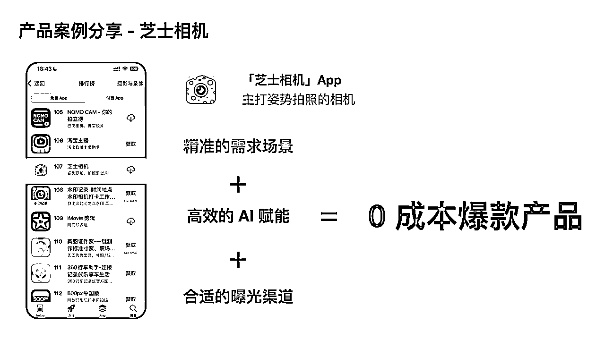

这三个要素，每个都值得掰开来聊。

### 密码一：精准的需求场景

芝士相机能一炮而红，绝非偶然。它瞄准的需求极其精准：男朋友帮女朋友拍照。它不是泛泛的“美化照片”，而是只为这一个场景而生。

这个痛点来自他自己的生活。直男视角，拍照老被女朋友吐槽，这种共鸣简直不要太广泛。动手之前，他去小红书搜了“拍照姿势”，满屏爆款笔记，好几万的点赞比比皆是。需求真实存在，用户体量巨大，偏偏市面上没什么产品专盯这个场景。

于是机会就浮出水面了。产品发布后，评论区许多人说：“我早就有这想法，但一直没做。”这印证了他的判断：细分场景，天生适合个人开发者。因为个人成本低，锁定1000个铁杆用户就够了；而大厂因为成本结构，根本看不上这种小切口。

给所有想入局的朋友一个建议：从自己的痛点出发做产品。你自己真正需要它，才会在第一个版本上线后，被真实的使用场景推着去迭代和改进。

### 密码二：高效的AI赋能

光有灵感还不够，还得做得出来。放在过去，芝士相机这种需要图像识别和处理算法的产品，个人开发者几乎想都不用想。但AI编程，硬是把技术门槛降下来了。

比如“自动抠出图像轮廓”这个功能，自己研究透可能要几个月，但AI直接帮他写出算法。至于内部怎么实现？他不需要知道，只要结果达标就行。在iOS生态里，苹果开放了大量现成的算法与能力，AI编程就像一个翻译官，让开发者可以轻量调用这些强悍技术。13套多语言也一样，过去找翻译，现在动动嘴就行，效率高、成本低。

一句话：AI赋能的本质，是让个人开发者拥有了曾经只属于团队的超能力。

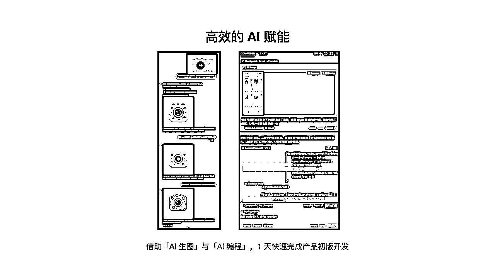

### 密码三：合适的曝光渠道

好产品做出来，还得让人知道。芝士相机的推广，靠两个渠道就完成了冷启动。

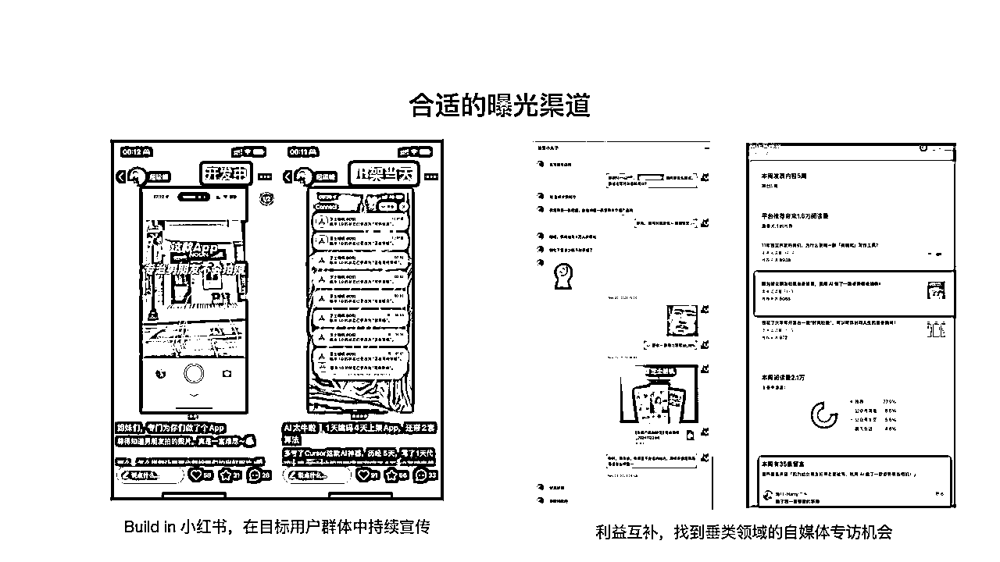

第一是小红书。这款App的目标用户是女性，小红书的女性用户密度高，而且“男朋友帮女朋友拍照”这个场景天然自带情绪共鸣，极易传播。第二是公众号。一个专栏博主邀请他写了篇稿子，顺带讲了讲开发经历，没想到反响相当不错，评论区里全是男性用户诉说同款痛点。

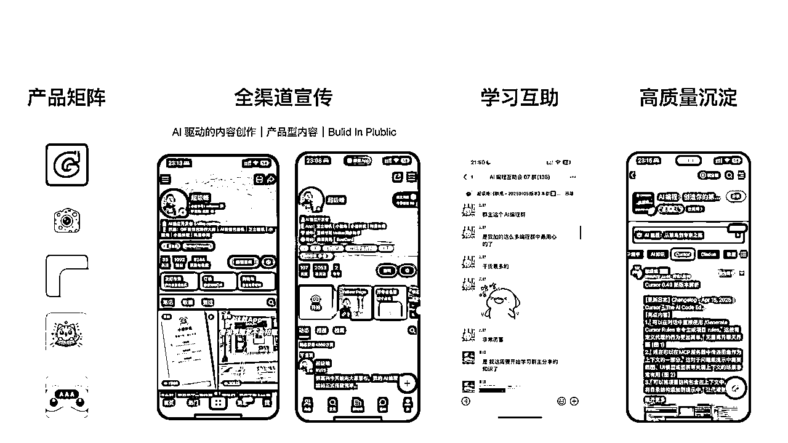

有意思的是，两个平台形成了完美互补：小红书打到的是使用方（女性），公众号打到的是购买决策方（男性）。用户触达的闭环就这么合上了。

零推广预算，换来App Store免费榜第107名——这就是这套方法最真实的战绩。更关键的是，这套打法完全是可以复制的。

## 零基础起步：四级进阶路线图，照着走就行

说完了“道”，再来说“术”。很多人问：AI编程到底该怎么学？超级峰把学习路径拆成四级，由浅入深，你可以看菜下饭。

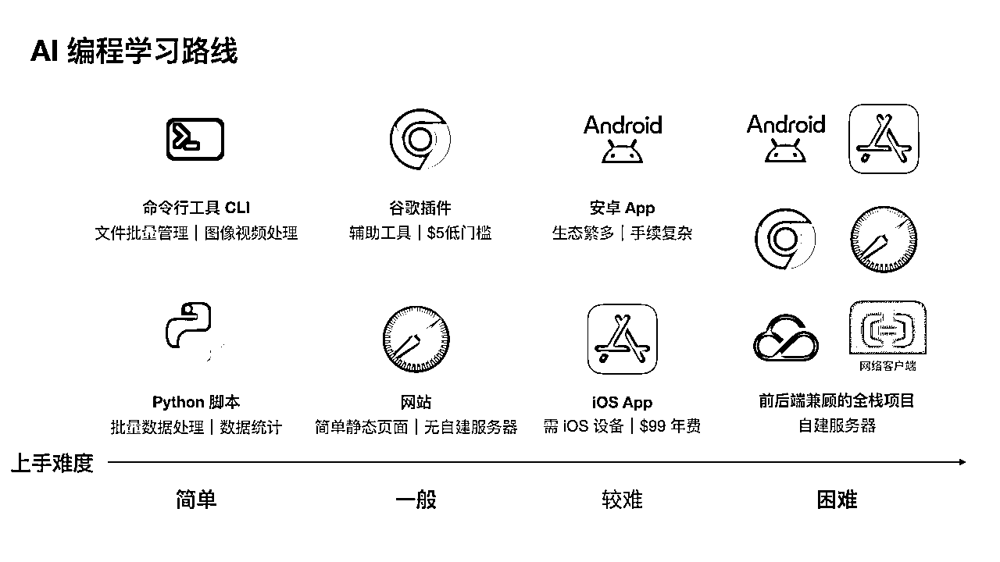

### 第一级：简单级——命令行工具 & Python脚本

适合纯小白，想最快体验到AI编程的甜头。无需配置复杂环境，让AI生成一个工具，批量改图、批处理数据的活儿，几句话就搞定。他在开发“鸭霸单词”时，就靠AI生成了三套脚本：批量处理数据、核对数据、修复数据，全流程自动化，效率直接起飞。

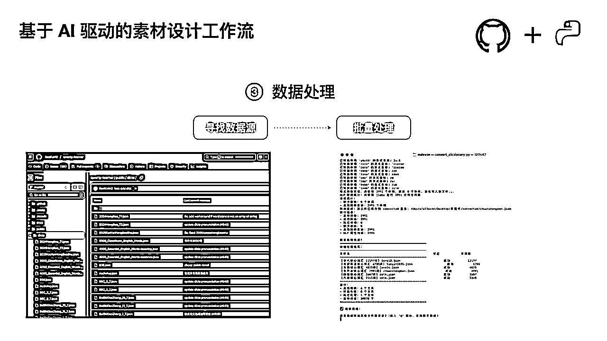

这个级别的最大爽点是：立竿见影。把AI给的代码跑一下，事情就办完了。

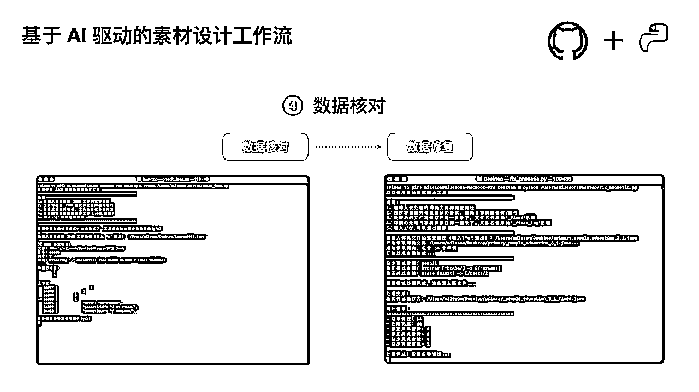

### 第二级：一般级——谷歌插件 & 静态网站

适合想做有界面产品、又不想碰服务器的朋友。他的第一个AI编程作品，就是一个豆瓣书籍信息一键同步Notion的谷歌插件。谷歌插件的优势很清晰：一次性开发者账号费用，无需服务器，成本极低，还有商业潜力。静态网站的玩法就更多了，像“一句话生成贪吃蛇”之类的趣味工具，本质上都属于这一层。

这一级，既有界面，又不需要后端，是绝佳的进阶跳板。

### 第三级：较难级——iOS/Android App开发

适合真想做出有商业价值产品的玩家。如果二选一，他强烈推荐先做iOS。理由非常实在——

- iOS用户付费习惯明显更好，客单价也更高；
- 苹果的技术生态完善，图像识别等现成算法直接用，AI编程的成功率更高；
- iOS的盗版问题比Android少得多；
- 苹果开发工具、文档都扎实，AI写起代码来也更顺手。

至于成本：一台二手Mac mini大概3000块，加上99美金的年费。比起潜在的回报，这笔投入完全值得。他的芝士相机、鸭霸单词、小圆角、小猫快读等产品全都跑在iOS上，而且每一款都实现了不同程度的商业化。

### 第四级：困难级——全栈应用

适合想挑战复杂产品、愿意碰服务器的进阶者。这一级要打通前端、后端、部署、维护的各种概念。他最近做的“熊猫灵码”、“SoulCard”、“AI Native Hub”都属于这个范畴——有完整用户系统、数据库、API接口，复杂度一下子上来了。这时必须理解数据传输、服务器部署、域名配置等基本概念。

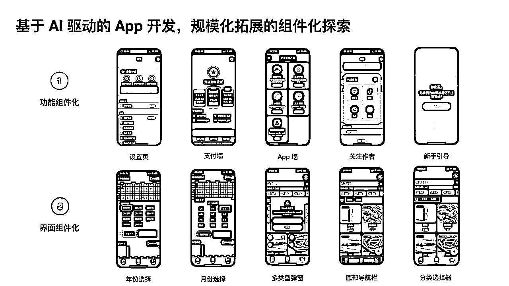

给新手的建议，按顺序走：先从简单级建立信心，再挑战一般级练手，想商业化就往iOS发力，最后才考虑全栈应用。记住，AI编程的核心从来不是写代码，而是学会与AI对话。从一句话指令到文档驱动开发，是一步一步长出来的能力。

但会做产品，不等于能赚钱。真正的考验，在变现这一关。

## 真实变现：被动收入，真能让App自己“下蛋”

做产品，终归要谈钱。超级峰这六个月的商业化探索，积累了不少硬核数据和经验。

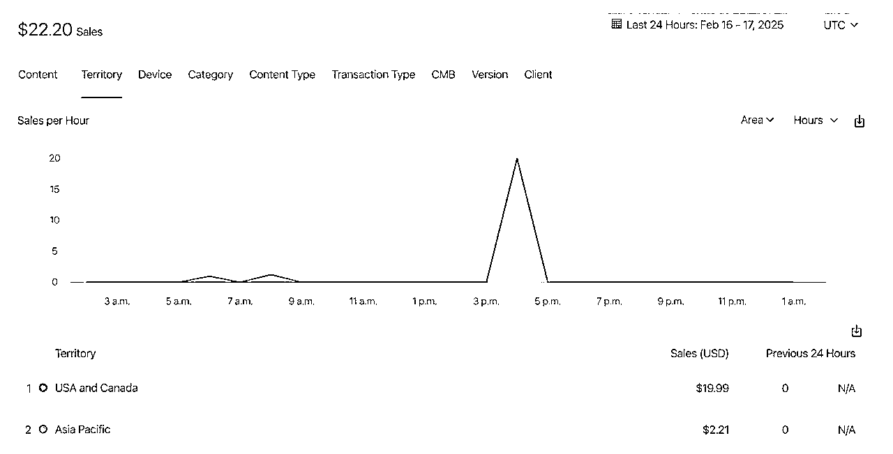

### 变现标杆：鸭霸单词

在他所有产品里，鸭霸单词的挣钱能力最强。这款产品是他投入时间最久的，整整做了两个月，春节都没歇。因为这是他第一次在App中加入付费功能。

数据很实在：上线两个月后开始有持续付费进账；在完全不主动推广的情况下，它贡献了个人产品矩阵里的大部分收入；哪怕不再大改，依然能时不时冒出几笔入账。它走的是iOS内购模式，国内外版本都有用户真金白银地为之买单。

这已经有力证明了：AI编程做出来的产品，完全过得了商业化这道关。

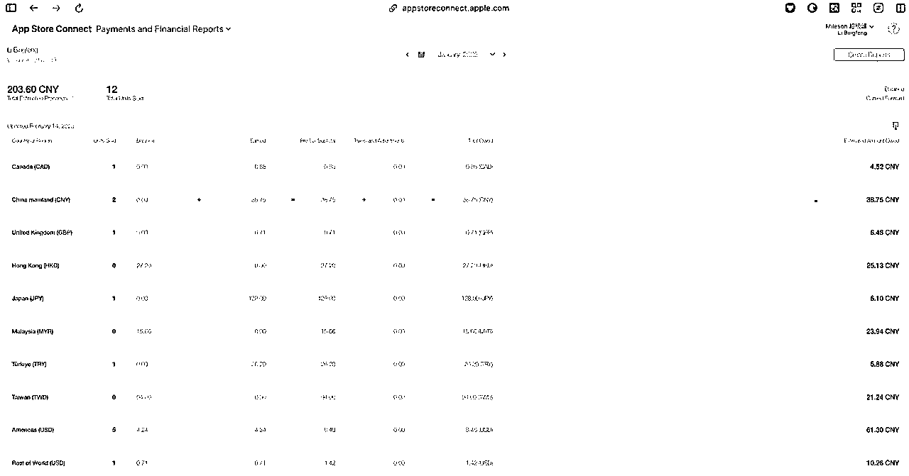

### 成本回收，超出预期

很多人担心亏本：App Store开发者账号688元/年，对于收入不确定的人确实是一笔开销。但超级峰的实际体验是：上线后仅用2-3个月，被动收入就把这笔年费赚回来了。

按传统模式，独立开发者一年做一款产品，万一用户少，连账号费都回不了本。但AI编程让他能以极快速度同时铺开多款产品，风险被大大分散了。

### 芝士相机：免费+付费的双轨玩法

芝士相机在变现上走的是一条组合路线：

- 国内版完全免费，用来跑量、验证产品；
- 国际版卖1美元，面向海外。

虽然付费收入不及鸭霸单词，但时不时的海外付费单，加上积累来的产品经验，依然是一笔丰厚的隐形收益。

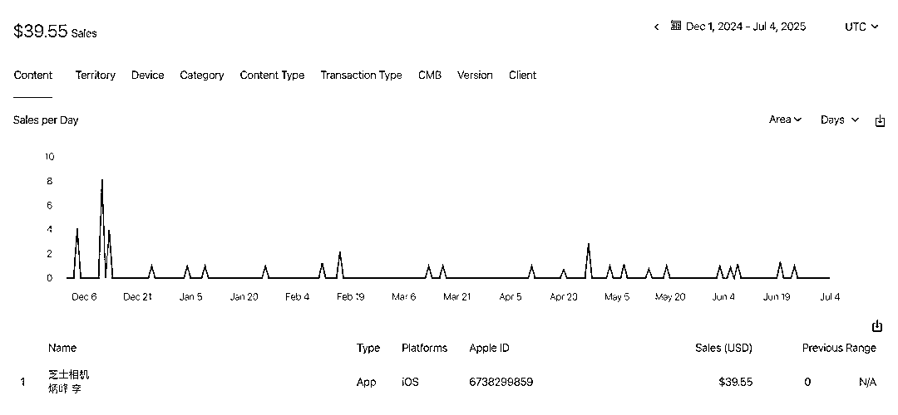

### 真正的“睡后收入”

最让人兴奋的，是“被动收入”真的被实现了。被动收入，翻译得直白点：你不去推、不去运营，产品自己就能赚钱。他的几款App如今都活在这种状态里——没花广告费，没专门做运营，甚至连版本都很少更，但钱就是会自己流进来。

半夜手机弹出一条App Store收入通知，那种感觉，无法形容，但绝对上头。

### 几条关于变现的实在建议

- **死磕iOS**：付费生态好、盗版少，是个人开发者最容易变现的地方；
- **内购优于买断**：订阅和内购的现金流更稳定；
- **语言即市场**：用AI做多语言，就等于打开了全球的付费地图；
- **矩阵分散风险**：别把鸡蛋放一个篮子里，多产品能导流，也能对冲风险。

当然，也有句大实话：AI编程不会让你一夜暴富。但它真能提供一条普通人可走的副业变现路径。

关键在于一点，动起来。光看不练，永远不会有第一笔进账。

## 最好的时代，开始行动吧

从农业公司产品经理的六个月逆袭，到芝士相机的登榜案例，再到四级学习路径、变现经验总结，超级峰几乎把全部心得都摊开来了。

他现在做的事，是继续在AI编程的边界上探索，同时希望把这套经验传递给更多人。因为他深信：我们正处在一个创造者最好的时代。门槛被砍平、成本被拉低、工具被普及——普通人最缺的，从来不是能力，而是一次开始。

你和独立开发者之间，差的不是技术，也不是天赋，只是“动手”二字。现在，AI已经站在你这边了。

你，准备好开始了吗？

AI 编程带来的震撼，不是它多么高深，而是它把过去我们眼里的“不可能”，一项项勾成了“已完成”。以前要一个团队协同开发数月甚至数年的产品，今天靠一个人、几天的工夫，就能跑起来。

但这扇窗不会永远敞开。随着 AI 编程工具越来越普及，使用门槛不断走低，所有人都会冲进来，竞争必然白热化。现在早早入局的朋友，吃到的将是最大的蛋糕。

我到现在还记得 2019 年做微信小程序的情景：生态刚起来，随便做一个产品都能蹭到海量流量；如今再从小程序赛道切入，难度完全不在一个量级。一样的道理，AI 编程的窗口期，就摆在眼前。

那么，你适合学吗？结合我自己的观察和实操，有三类人是明显有机会的：

第一类，离研发流程最近的人：产品经理、设计师、开发、测试、运营。他们本来就知道产品是怎么做出来的，学习成本最低。

第二类，互联网行业里非研发人员：市场、实施、运维、新媒体、管理者。虽然不直接写代码，但对软件产品有常识性理解。

第三类，非互联网行业的朋友：传统企业的新媒体、行政文员、在校大学生。随着 AI 编程工具不断进化，这个群体的参与感会越来越强。

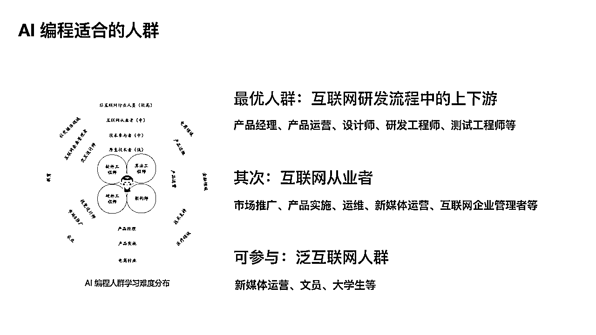

如果你属于前两类，判断很清晰：你已经站在了优势位置。如果你属于第三类，也别慌，因为 AI 编程的门槛正在肉眼可见地下降。

决定开始的话，建议按这四个方向走：

一、挑个合适的入口。回到前面聊过的四级进阶路径，选一个匹配自己当下水平的位置，别一上来就憋大招。

二、揪住真实痛点。从自己日常中最想解决、甚至愿意花钱摆平的问题出发，让 AI 编程帮你解决它。

三、钻进一个圈子。一个人坚持很难，我目前也运营着一个 AI 编程互助群，欢迎感兴趣的朋友来交流。

四、保持学习的好奇心。这个领域变化太快，今天的新技巧，下个月可能就过时了，持续输入才是护城河。

最后说点掏心窝的话。半年前，我还是个对 AI 编程一脸蒙圈的农信互联网产品经理。半年后，我做出了好几个产品，有了稳定的被动收入，也找到了一种完全不同的生活方式。我真的不是天才，你也不需要是。AI 编程这班车，就是给普通人准备的。关键就看你敢不敢启动、敢不敢试错、敢不敢把自己的念头交给代码。

我总跟朋友讲：先把想法做出来，比想一万遍都管用。很多人脑子里不缺创意，但只有真正动手的人，才配摘果子。

现在轮到你上场了。别等，别怕，开机，唤醒 AI 编程工具，让第一行代码从你指尖诞生。也许半年后，你也成了那个讲逆袭故事的人。

我是超级峰，一个靠 AI 编程改写人生的普通人。如果今天的内容帮到你，记得点个赞、转给身边的朋友；如果你也想聊 AI 编程，欢迎评论区见。在这个创造者空前吃香的时代，最低成本的逆袭，就是立刻开始。让我们借着 AI 编程的浪潮，一起写出属于自己未来的代码。