# 从风向标到实操变现，🧣热点优质创作计划分享

大家好，我是龙哥盟五年老圈友陶美丽。长期以来我习惯在风向标里找灵感，每天刷更新。刷多了会发现，各大平台都有类似的情报汇总，唯独新浪🧣这块一直空着。我抱着试试看的心态，在🧣里有目的地去找官方信源，盯上了🧣小秘书、粉丝服务、🧣热点、🧣热搜、创作者中心这些官方号。

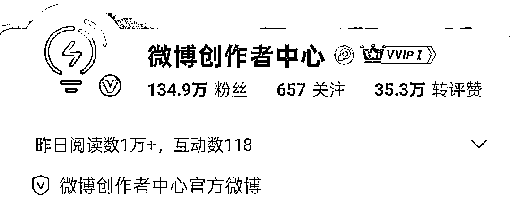

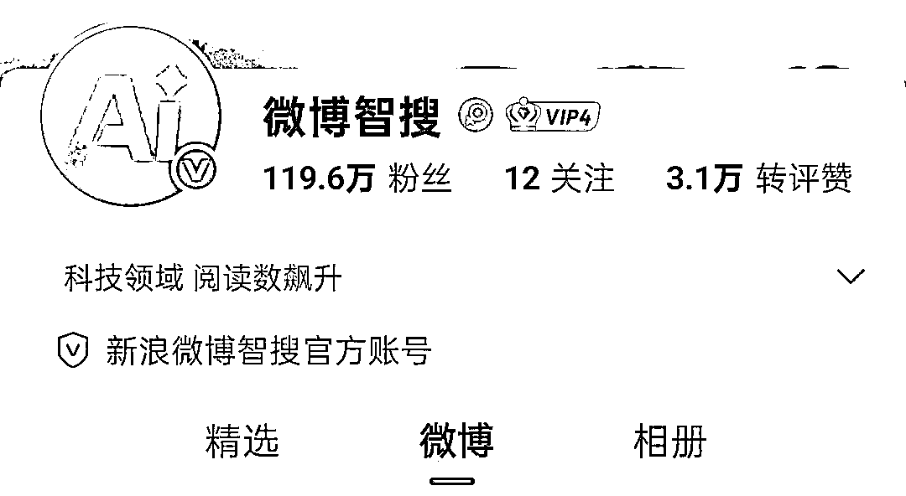

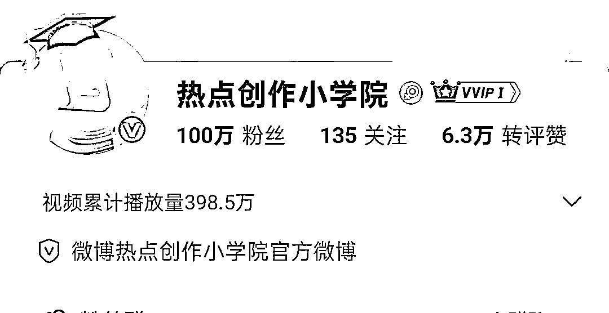

四月二十八号，我正好刷到创作者中心推送的一条关于热点激励的公告，当天就写了条风向标发出来。

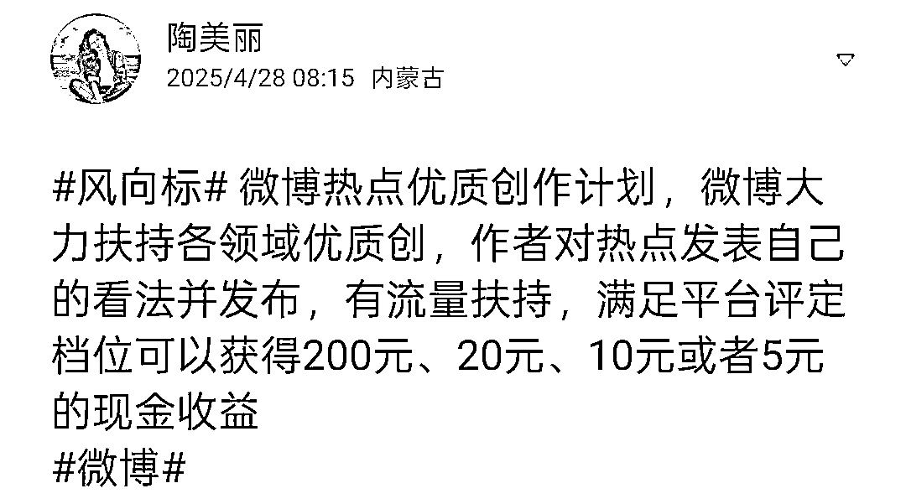

风向标在圈子里起了点小水花，有人点赞我就琢磨着再深挖一下，看看能不能帮到更多人。我顺着活动说明往下扒，找到了一批做得好的头部账号，关注后去他们评论区蹲线索。

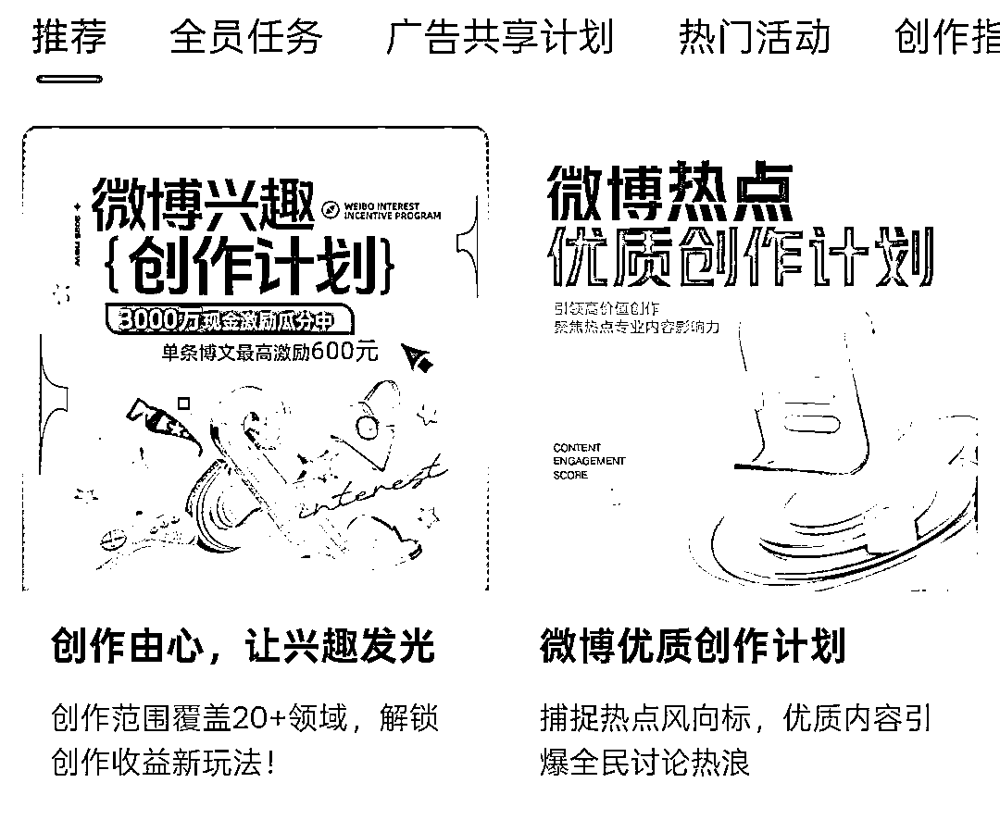

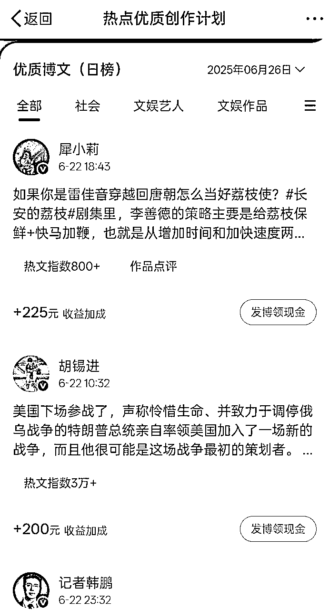

在评论区里我找到了几位思路相近的创作者，开始一比一照着学。刚上手时完全懵，别人写什么我跟写什么，做了两天对比发现差距很明显。跟着走的帖子哪怕只有十几个字，阅读都能上万。看到这种异常数据后，我开始拿热搜榜来对照，慢慢摸出点门道，本文第三节会展开说。

先聊下我的实操数据。我是带娃的全职妈妈，只能用碎片时间操作，大概四十天左右，一个沉寂的老号从三十来粉涨到六千多，铁粉一百八十多，顺带完成了账号认证，广告分成到手一千五左右。

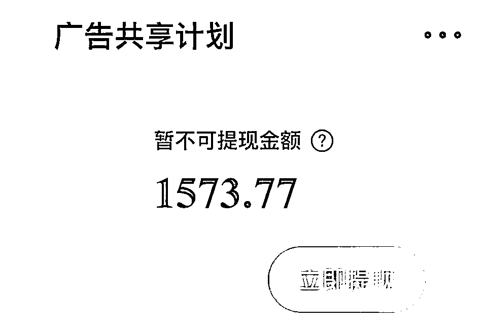

这个🧣热搜的玩法门槛不高，概括起来是这样：先准备一个🧣账号，进入热搜榜找自己擅长的方向，像做命题作文一样写一段配上话题标签，同时要主动去找同频创作者互关。粉丝破千后去申请创作者认证，就相当于开了个收稿费的通道。认证后发帖，阅读量达标就能拿到创作激励。

下面这张热搜图就是我常去找灵感的地方，从这里挑题材，爆的机会更大。

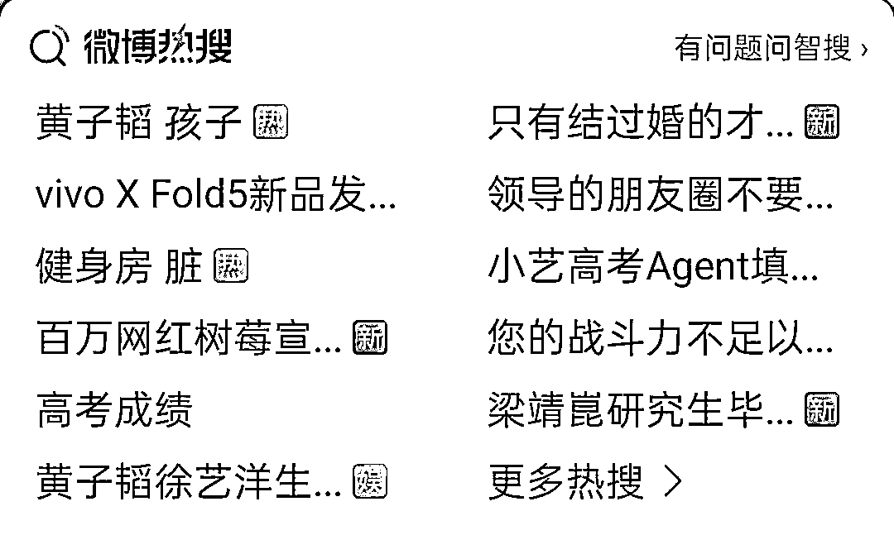

关于收入，有大V透露目前参与创作计划的人里，八成每月在百来两百之间，二成能做到五百到五千。手感好的博主单日两千到三千也不是没可能。

这是一篇零基础可直接上手的操作笔记，适合想拿第一笔线上收入的同学。我已经帮大家实测过，下班摸鱼能加个鸡腿，认真做就是副业的起步。🧣的优势在于结算很快，稿费基本隔天到账。下面进入具体步骤。

## 一、🧣热点激励

在🧣里猜热点，本质就是带#话题的短评。一个话题单条大概二十到九十元。转发后补充三十字左右的评论，有流量就能产生稿费，目前单日内可转发五十条左右。

## 二、热点优质创作门槛

1. 粉丝数达到一千，一千粉相对好做，后面会讲拉粉方法
2. 申请认证拿到橙V。认证相当于开通了收款账户，🧣的稿费是隔天结算，口碑不错。热度高的帖子还有机会拿到额外奖励。

## 三、起号

### 涨粉

首先把头像、昵称、简介这三件套准备好

头像要有辨识度，最好模仿同屏里最吸睛的那张，清晰且色彩鲜明最好

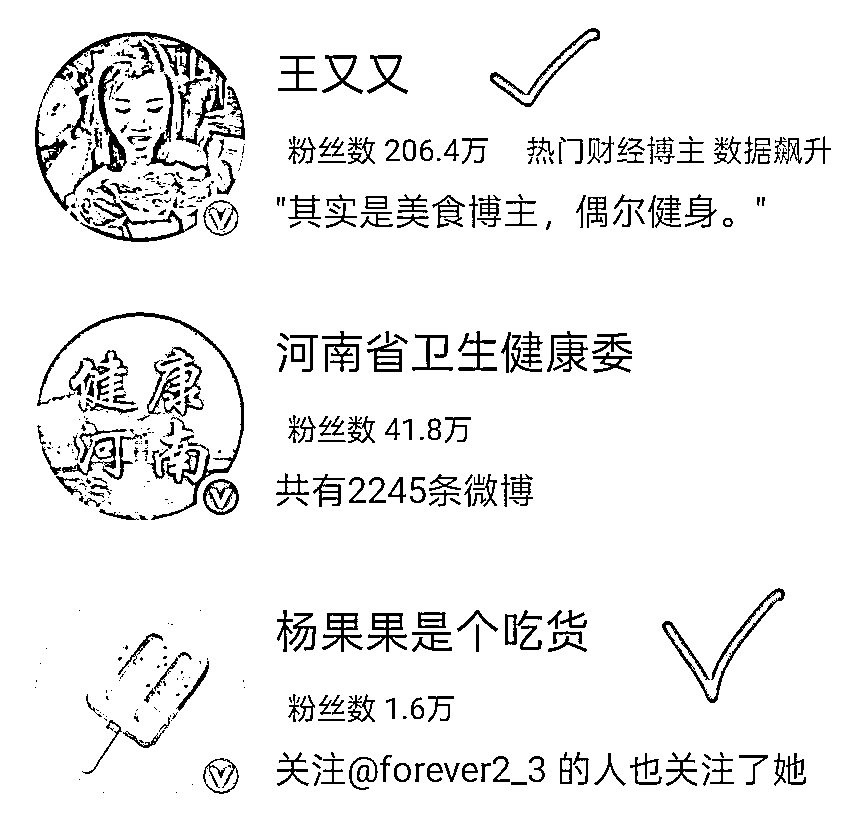

昵称要像真人，带点温度更容易让人想点关注

简介会在推荐页展示，建议写上互关互助之类的关键词，方便同频的人识别

新号注册后三天内别频繁改资料，也别大量关注取关。初期以原创为主，每天多发几条，转发占比控制在百分之十以下。

推荐配图或表情、分段排版，提升可读性，别发纯文字。

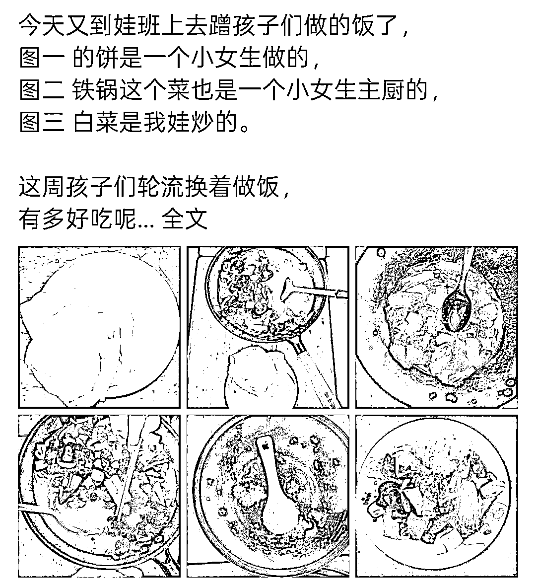

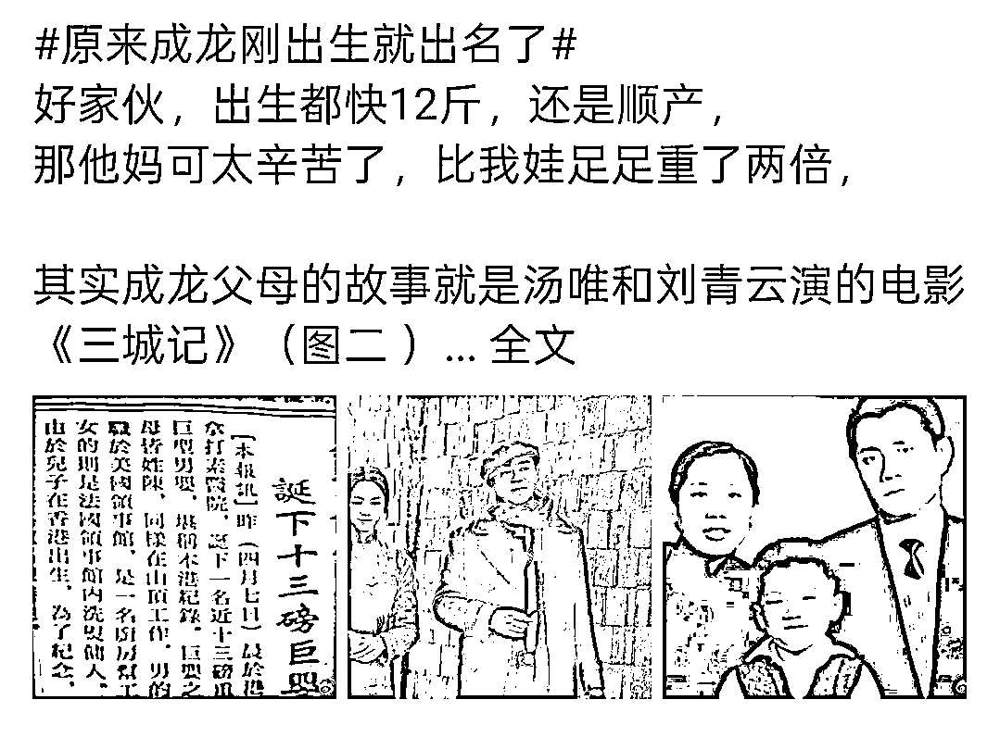

新注册的账号，系统会推荐三十到五十个博主，先按提示关注，然后点进关注列表，看推荐页简介里有没有互关标识，找到需求互关的博主进入主页。

点右下角“相关推荐”

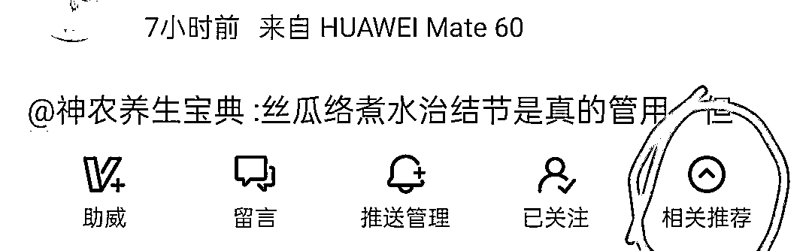

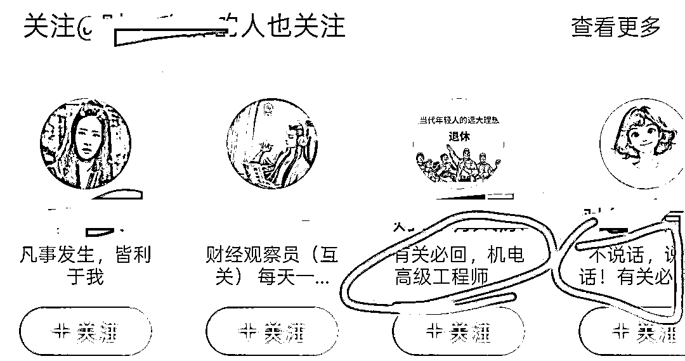

重复这个动作

这个动作有频率限制，我现在一次能关注二十九个，第卅个就会被限制。利用这几分钟去点赞评论提升活跃度，几分钟后限制就解开了。

用内容涨粉太慢，🧣的激励本身就带阶段性。大家不如用百米冲刺的心态，先薅一波。抱团互关，快速冲到一千粉。非会员关注上限大约五千。

建议选择粉丝三百到八百、近期有更新的博主，关注十到十五个歇十分钟再继续，这样能避开系统限流。

还有一种做法：

四月份有一位百万财经大V财宝宝，在🧣推广粉丝发帖赚稿费。

经过几个月的沉淀，粉丝间形成默契，把昵称改成财开头，或在简介写互关互助，方便识别，互相托举...

操作是这样的：

把名字改成财XX，简介写诚信互关...

然后找到认证头像的博主，进他主页动态，看他关注了谁，一键关注！

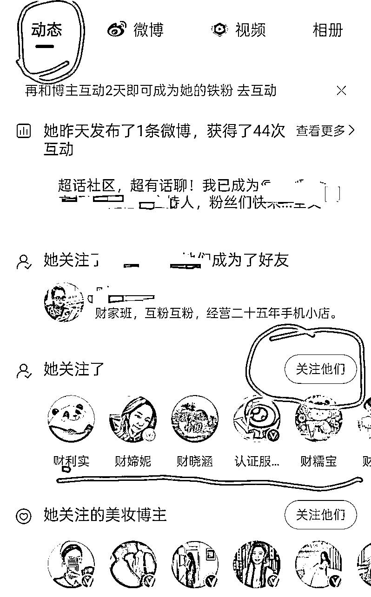

实测新号用这招，一天能涨五百多。可能属于平台的灰色地带，用多了效果会递减，也存在安全风险，自行判断。

### 认证

先说🧣的等级和认证规则

##### 🧣升级机制：

普通→黄V：粉丝≥1000+铁粉≥10+月阅读≥10万

黄V→橙V：粉丝≥1000+铁粉≥100+月阅读≥30万

橙V→金V：粉丝≥1万+铁粉≥1000+月阅读≥1000万

##### 黄V五大认证路径任选其一

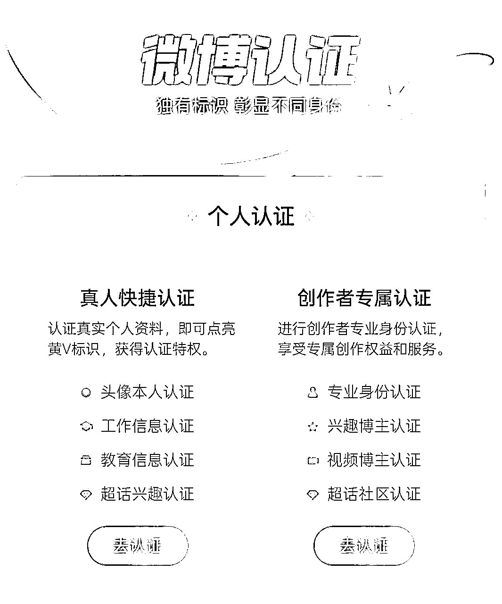

视频博主认证最快，三天可过

原创视频要求：三十天内发≥4条原创视频，时长≥15秒，需加转场特效BGM

播放量：近三十天总播放≥1万，可自然增长

路径：🧣APP→我的→创作者中心→视频认证

超话社区认证

超话粉丝大咖：特定超话等级≥12级+绑定手机

超话创作官：超话等级≥10级+近30天发布≥1条互动≥50的帖子

超话主持人：通过考核

兴趣博主认证需垂直

领域举例：娱乐/美妆/情感/游戏等

数据：铁粉≥10，近30天阅读≥10万，内容持续≥1个月

个人身份认证

资质：职业证书、学历证明等

特殊：颜值博主需平台人工审核

文章/问答认证

成为头条作者或问答博主

攒够一千粉后，个人认证对新手更友好，门槛低反馈快。跑通流程后再考虑换成兴趣或视频认证。

##### 铁粉养成要点

连续三天每天至少互动一次，点赞评论都行，别断签。加入粉丝群每日发言，或参与超话活动。

私信连续三天互动更易成铁粉，但容易掉，需持续维护。

关注后要保持互动，光关注不活跃标识不会显示。

前台铁粉显示十个，系统实际判定后往往只剩七八个，建议多养几个。

### 猜热点方法

粉丝到一千，认证搞定，找到潜在热搜发布。

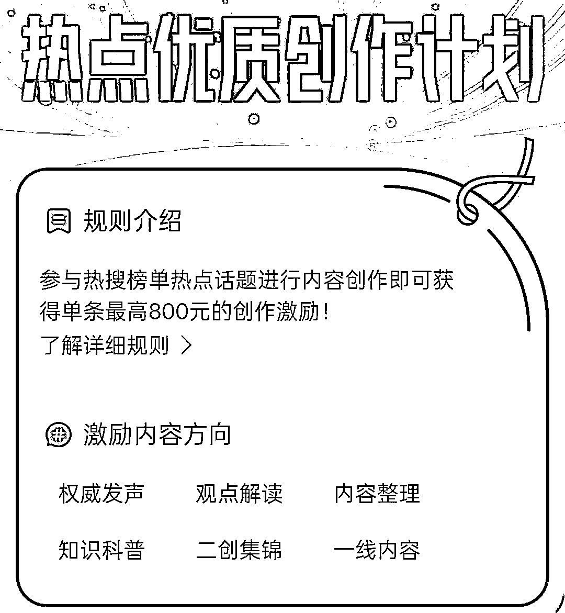

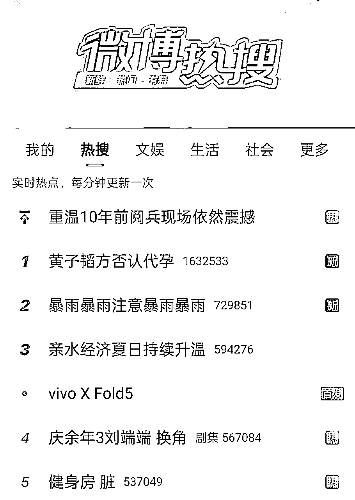

##### 热搜算法

搜索热度+讨论热度+传播热度×互动率，热搜数据每分钟更新。

##### 如何挑选

答：找有潜力的新热搜。

操作：

1. 热搜后面带“新”字的。

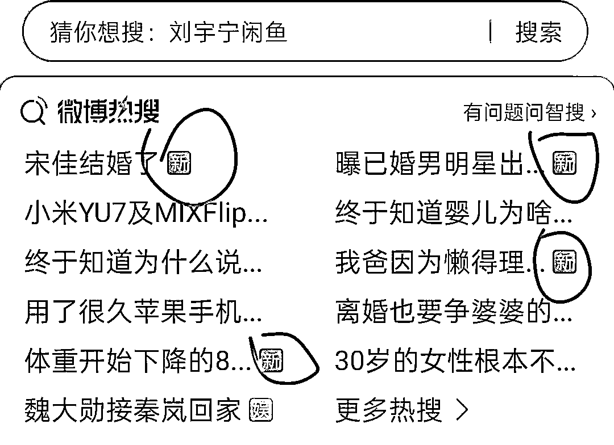

点进去看阅读量、讨论量、发布时间

阅读量越高且讨论量越少越好，最重要的是刷新看两者增长速度

2. 处于上升期的热搜

排名持续上升

阅读数据在攀升

在榜时长较短

明星、广告类热搜常有平台投放，潜力大

3. 参与时尽量带关键词

例如“理理是猪”这个热搜，内容里带“理理”“猪”更容易吃到流量

例如“王楚钦半决赛训练热身”，把关键词融入点评，阅读量会明显提升

重复核心词+个人视角，很容易写出爆款吃瓜稿

4. 在该热搜下找点赞最多的🧣，提炼关键词和观点，改写后放进自己的帖子

5. 文笔弱可以用话题里的AI智搜功能辅助理解主题

6. 提前预判，从上升热点往上蹭，在成大热点前下手。评论要短小精悍，找评论几百、阅读几百万的新话题

7. 大量覆盖。时间充足可蹭五十条，总有几条十万加。经验显示早上六点到八点是黄金时段

选一条上升期潜力大的新热搜，写它！

##### 组合公式

想表达的内容+热搜里高赞金句+话题标签

发出去后监测：

发布半小时阅读过万，基本蹭中

一小时仍只有几十几百，基本没中，可删

蹭中的帖子热度过去后可设为仅自己可见，不影响整体数据

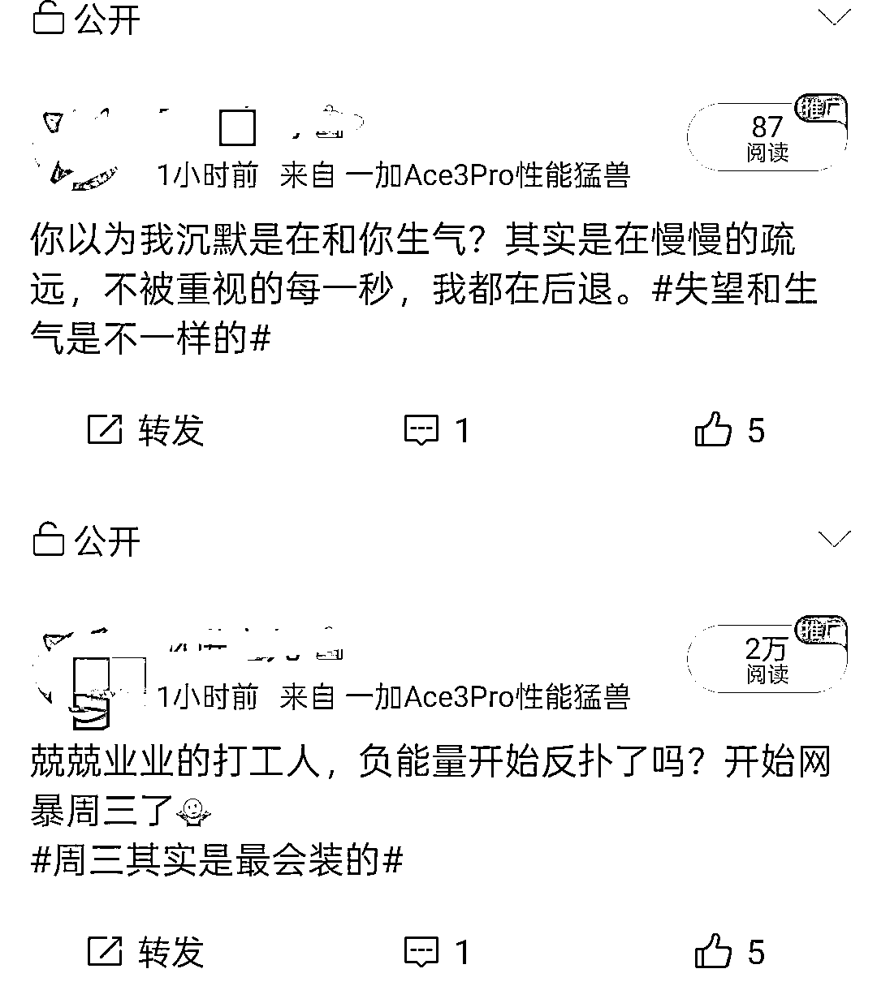

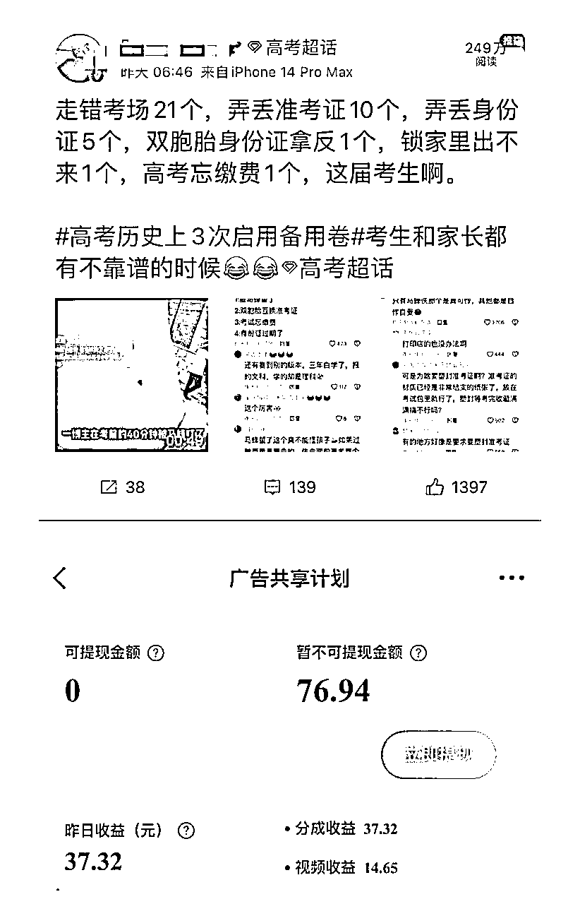

收益图仅供参考，平台稿费维度很多，目前没找到阅读量与金额的精确换算，感兴趣的可自行探索。

有激励后提现路径：🧣APP→我→创作中心→收益中心→广告共享计划→去提现

1. 最低一百元起提，低于一百无法操作。退出计划前记得先提现，否则未提现收益失效

2. 每七天可提现一次，间隔需≥7天

3. 到账约十二个工作日，扣除约百分之十个税，提现一百到账约九十。建议查银行流水确认

遇到问题可私信@🧣创作者广告共享计划或@🧣客服

### 黄V之后做什么？

粉丝破千后做黄V认证，为橙V做准备

认证后领域垂直度高会得到流量倾斜，这时要思考自己擅长哪类写作。不确定赛道的话先把粉丝和铁粉基础打牢，把🧣当朋友圈用，想发就发。平台大数据会帮你找到垂直方向。

在追热点的同时别忘了维护铁粉和阅读量

1. 铁粉一百个，每天点开铁粉列表，拉到最底，找铁粉值为零的互动

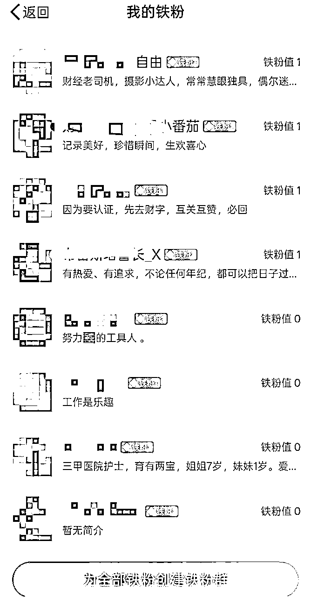

2. 阅读量三十万，时间允许可早上六点到八点从下往上追热搜，全转评热门顶帖，基本能凑够。方法简单不需花太多时间

3. 橙V要求：粉丝一千、铁粉一百、月阅读三十万

注：橙V十五天后可免费送VVIP会员

4. 橙V后算中V级别。持续输出符合平台内容，平台愿意给流量的。有橙V、有领域指数、有热门、有五十以上的转评赞、有良好信用，稿费会趋于稳定

橙V后加入广告共享计划，跟着同领域前辈学习写作，蹭热点、加词条、用AI写原创都能获得收益，为生活增加底气

### 怎样保持橙V

需持续满足：粉丝≥1000、铁粉≥100、近30天阅读≥30万

1. 维护铁粉

每日通过评论、点赞、转发互动，连续三天可建立关系。可发起话题互动或建铁粉群

双向维护，定期回访铁粉主页，优先和活跃度高、带认证的账号互动，提升权重

2. 阅读量维持

蹭热搜策略：选上升期或中低位热搜，讨论量一万左右，带话题发十五字以上原创，配图/视频更易推荐。单日别超三条避免限流

内容垂直：专注特定领域，申请兴趣/专业认证提升权重，结合热点做信息增量内容

高频发布：每日至少五条，结合用户活跃时段如十点、十二点、十八点、二十一点定时发送，用数据助手优化时间

3. 账号健康管理

避免秒删、频繁改可见范围、大量转发

会员认证需及时续费

每周检查数据中心，关注铁粉波动和阅读趋势，临界时可通过互助群短期冲刺

4. 辅助技巧

参与广告共享和内容激励计划，用官方补贴反哺活跃度

每日完成超话打卡、熊猫守护者等任务，提升健康度

加入五十人以上互评群，约定时间集中互动提升曝光

### 重要注意事项

* 头像认证有三次机会，选定后别轻易换，否则掉V

* 老号记得清理历史头像，保持形象

* 私信养铁连续互动三到五天，可设置私信页底部文字方便对方一键互动。记得维护铁粉值为零的粉丝

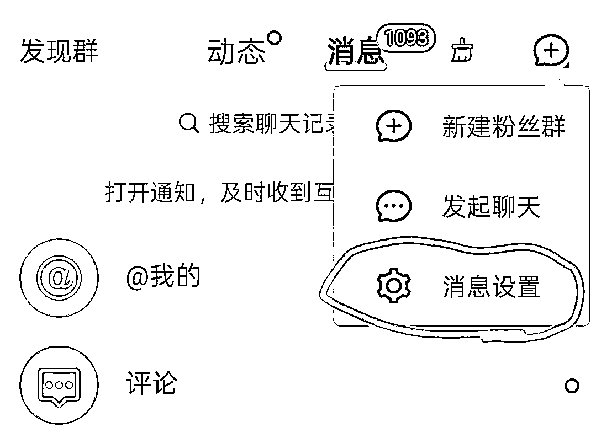

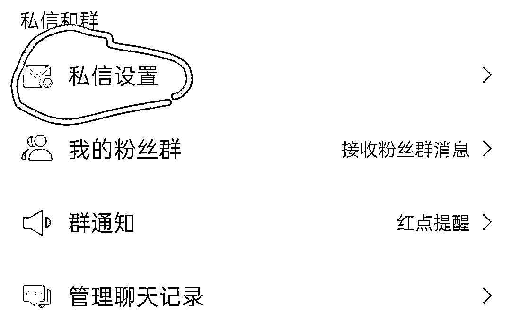

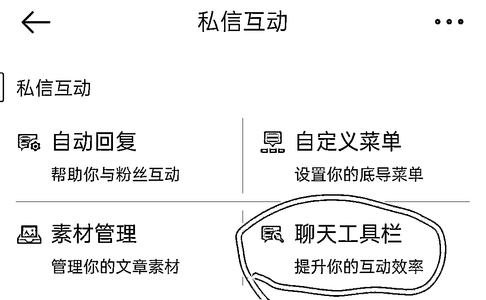

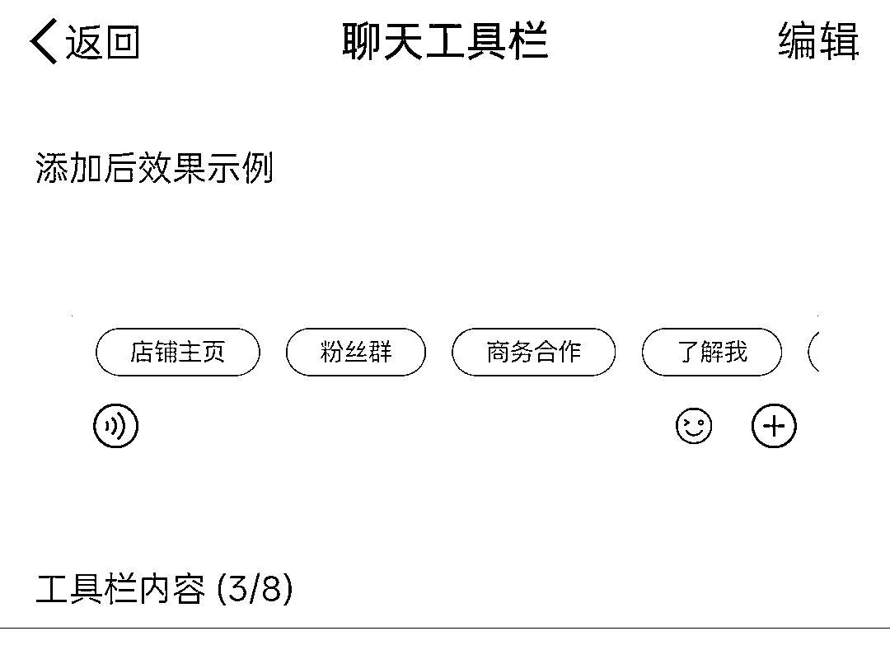

* 找黄V及以下账号互动，橙V多已进入疲惫期。新人目标是快速达标，可找粉丝八百到三千、互动需求强的人，回访意愿更高

* 评论区是最佳广告位，多出现混眼熟

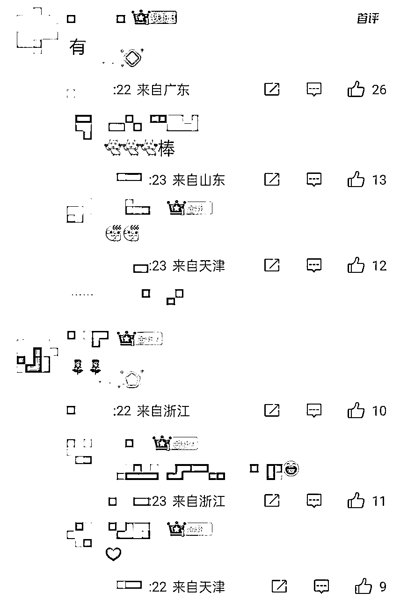

* 如果买了SVIP，建议先拿头像或学历认证个黄V，后续再转兴趣领域。带着黄V去新人区回复，对方会觉得你是大佬，互动率提升

* 实践发现娱乐话题最易起量，女性用户带V且头像精致的更受欢迎

* 转发热门话题带视频成功率更高。发文三十分钟左右不到三千基本没戏

* 用好🧣分组功能：关注下拉新建分组，把宝藏博主归类。追星和学习互不干扰，互粉分组可定期互动。粉丝过万后不分组根本刷不过来

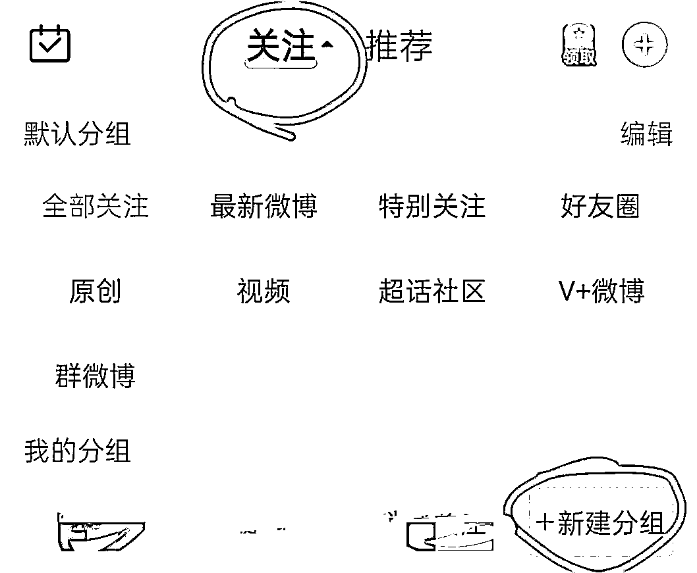

想在🧣起号的同学，这篇方法帖可以留着反复看。关于互关、铁粉养成、排版观感、变现路径，我把踩过的坑和可用的做法都梳理了一遍。

**一、互关怎么才不被限流**

先打开个人主页，点进粉丝数，在新好友里点全部。回关的频率建议每次10个左右，贪多很容易触发限制。付费会员的上限会放宽到一次29个。回关前要看来源，平台推荐来的大概率是系统分配的，优先回关从正文页点过来的用户，这类人群更容易形成稳定互动。刷到铁粉就直接互动，粉丝不足时可以去同好互粉群里点赞。万一漏掉，可以留言私聊，精准互关效率更高。

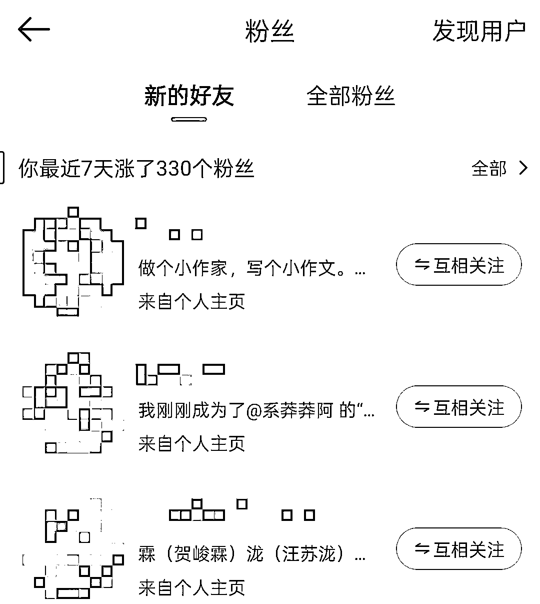

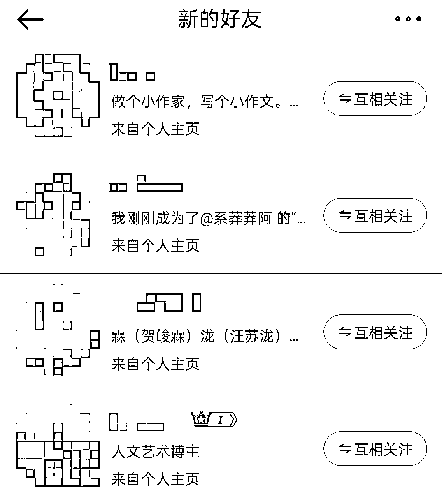

**二、互动数据不错，为什么铁粉不动**

很多人以为高频点赞评论就够了，实际上系统会判定互动质量。批量集中爆发、只赞不评、评转与账号主线脱节、没读原文就转发，这些都会被视为无效互动。高质量互动要像真人日常那样自然，节奏分散、内容相关、有真实反馈。

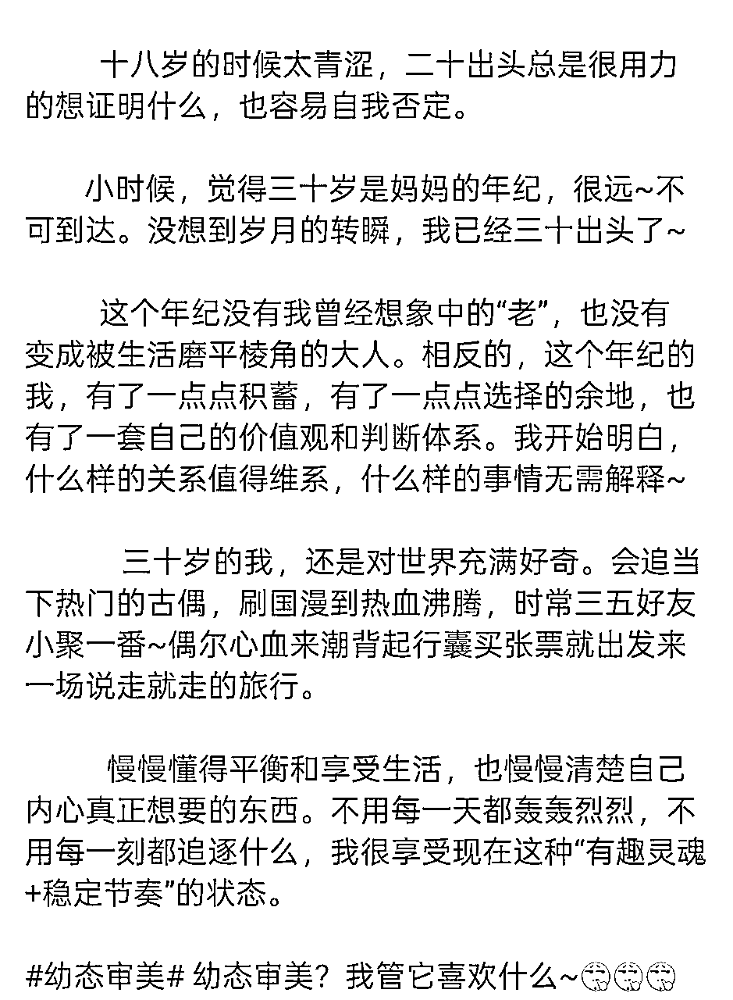

**三、提升阅读体验的排版要点**

段落首行空两格，每段控制在三行以内，适当留白降低阅读负担。全文色彩控制在三种以内，重点信息用加粗或标红突出，避免整篇统一格式。配图选高清无版权风险的素材，视频时长尽量压在五分钟以内。

**四、内容方向与账号定位**

🧣的选题一定要有新鲜感，角度要让人眼前一亮。人云亦云的选题很难拿到自然流量，也很难吸引陌生用户评论。

另外赛道要聚焦，擅长文字就坚守图文，擅长剪辑就深耕视频，混搭容易分散权重，互相拉低推荐。

还有“动态页关注”这个方式，新号操作风险大，容易进黑屋。建议先手动关注，找到同频对象再批量操作，单日控制在三五百以内。频繁出现验证的情况，就要放慢节奏，多参与互动。

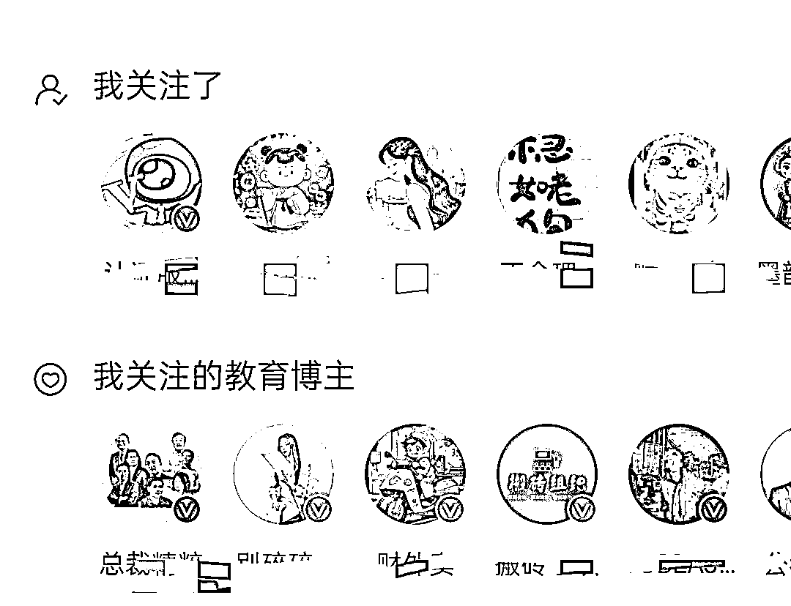

**五、规避审核风险**

写文时注意敏感词的规避，可用谐音或替换说法，降低被误判的概率。

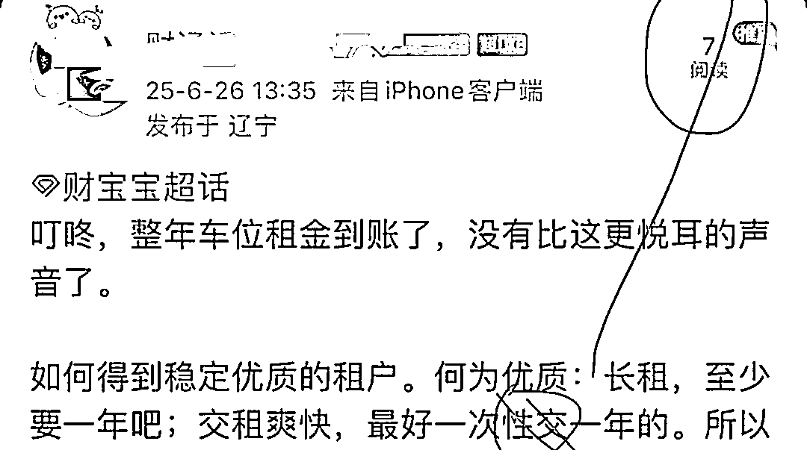

**六、配图表现**

九宫格的呈现效果比单图更吸睛。若手头只有一张图，可以用九宫格工具拆分重组。

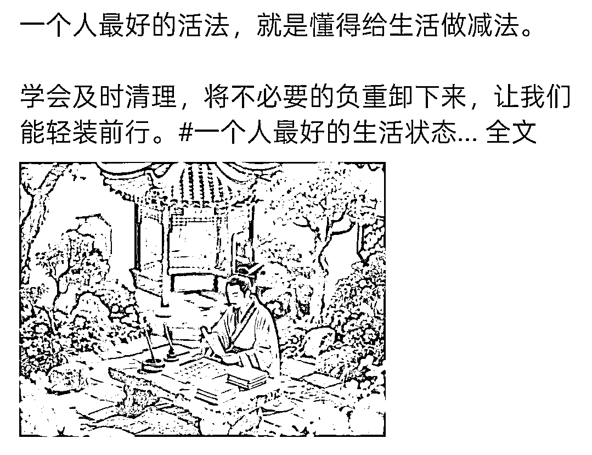

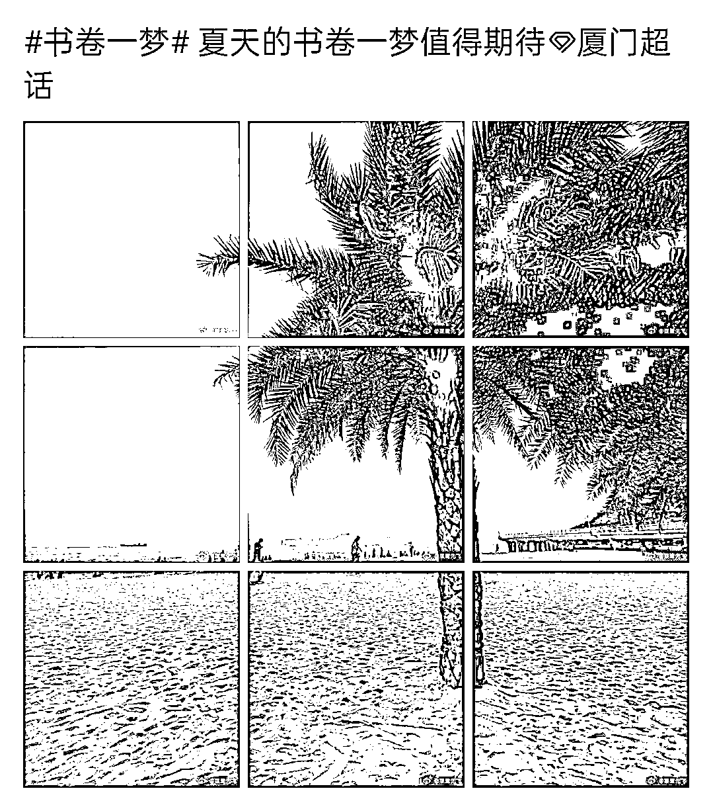

**七、资产安全边界**

即使是长期互动的铁粉，也要守住底线。不点不明链接，不帮忙代操作，除了点赞评论外的请求一律拒绝。安全第一。

**八、橙V后如何拿到收益**

单纯橙V还不足以产生收入，需要加入广告分成计划并开通VVIP权益。一般橙V后约半个月左右VVIP会自动开通，开通前要维持铁粉不掉，持续经营。

手动申请路径：🧣App -> 我 -> 创作中心 -> 收益中心 -> 广告分成计划 -> 立即申请，阅读协议后提交。需填写真实身份并完成实名。若近期流量与内容质量达标，系统也可能自动开通，注意收益中心的通知状态。

**九、音频赛道玩法**

发布音频流程：发🧣 -> 右下角加号 -> 选择音频 -> 本地上传 -> 填写标题合集简介 -> 添加话题如#🧣声浪计划# -> 关联热点词条。可用AI批量生成mp3上传，但严禁使用名人音色，避免纠纷。音频里可植入好物推荐引导购买。结算周期较长，约发布后十天左右。收益与评论量挂钩，评论少于30条约1-2元，30-50条约3元，60-80条约5元，具体以平台实时数据为准。

**十、金橙V的智搜纠错**

参与智搜纠错需为金橙V，提供被采纳的更正可获200元/条奖励。操作：在智搜找到疑似错误内容，点击我有补充创作，发布原创更正内容，让检索结果更准确。可参考智搜页面的博主补充板块。纠错方向包括事实澄清、谣言反驳、时效更新、引用补全等。例如指出检索摘要中数据、时间、人物关系错误并给出正确信息。

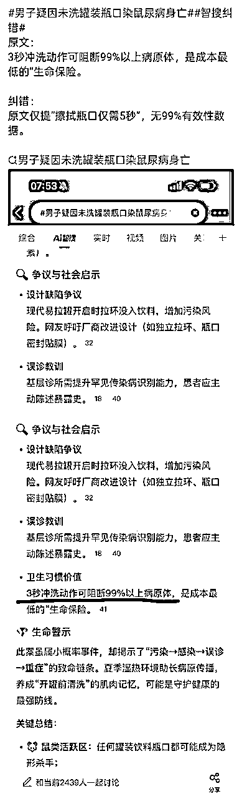

**十一、实操心态与避坑**

为了验证这些方法，我另起一个账号测试，新号会赠送五天会员体验。按文中做法，五天内顺利达到黄V门槛。实操时建议把关键点多看几遍，执行会更顺手。

这个项目反馈和结算都快，适合练手。写作过程中不断修正风格，培养网感，了解受众偏好，用真诚吸引粉丝，可作为IP孵化的跳板。

目前平台激励仍在，建议尽早进入。即使未来热点激励调整，平台也会推出新机制，内容创作者与平台是共生关系，可持续性强。可从起号增粉开始，做出第一个作品。

适合人群：有空闲时间愿意持续输出的人，输出能让思维更清晰；具备自学能力的人，玩法更新快需自建体系；想做副业精进写作的人。现阶段🧣正处于用户争夺期，机会窗口明显，之后会逐步筛选。

最大的误区是贪心。平台有音频视频图文多条赛道，前期应聚焦写作，热点对新人友好。最稳妥的起步是先写满30篇，别在意质量和流量，先围绕健康、教育、副业、生活经验、穿搭育儿等熟悉领域持续产出，写着写着就能找到手感。

增粉期容易上头，不要为数据而数据，满足认证标准即可。前期以打基础为主，先把稿费技巧练熟。橙V黄V是动态评定，数据下滑会掉级，写作之余要留时间维护互动。目前一个身份证可注册两账号，建议提前准备备号，防误触红线。冲橙V时别被30万阅读吓到，热点列表从低到高写一遍也能轻松突破。

我坚持下来的原因是有明确目标。起初想做风向标整理，于是收集官方号信息，对比后发现🧣激励力度可观，小号也能拿到50-200元奖励。于是模仿热搜前排的排版结构和配图，假装自己是博主，模仿中逐渐形成习惯。按规则写作、及时追热点，拿到稿费后动力更足。

若没有外部督促，就要自我激励：承认进步，保持节奏，不摆烂。每日给予自己积极心理暗示，按时更新。

项目仍在迭代，我也在持续学习。个人收集的信息难免不全，欢迎补充。福往者福来，爱出者爱返，期待与更多同频创作者交流。

最后感谢龙哥的指导，感谢赚钱团队的专业评估，也要特别致谢我的运营参谋彩虹运营，在我卡壳时提供灵感和建议，没有她这篇文章可能就流产了。我爱彩虹🌈！