# Claude code教程丨我用 Claude Code 开发效率翻倍后，写了份小白也能用的教程

先坦白一句：以前看到命令行工具，我是龙哥。但最近玩转 Claude Code 之后，我发现自己真香了。前几天去上海参加飞书大会，路上闲着也是闲着，我就开了两个 Claude Code 一起写代码，效率比我以前用 Cursor + Claude Code 混合开发高了一倍还不止。“提示词管理助手”2.0 版本就是这么赶出来的，下星期应该能正式上线。

这篇文章不打算讲太多虚的，直接拿这个项目做复盘，分享一套我和 Claude Code 配合的完整打法，看完你也能上手用。

先说以前用 Cursor 的时候，我的流程是这样的：先写 PRD，把需求讲清楚；然后 AI 照着 PRD 写代码，我守在旁边点接受；最后自己测试，有问题再丢回给 AI 修。这套方法用来写脚本和轻量级小工具很舒服，AI 一下子就能搞定。刚开始做提示词管理助手时，我也就聊了一个多小时，第一版就出来了。

可一旦项目变大，AI 的出错率就明显上升。我后来想明白了：它根本不了解这个项目，只能凭感觉边做边猜。这就像你叫一个程序员直接来改代码，他连代码仓库的结构、每个文件放哪都不知道，拿到需求就开始写，代码能靠谱吗？

后来我在 Cursor 里学聪明了，先让 AI 定位跟需求相关的文件，再基于这些文件去改，故障率确实降了些。但问题是很费人——你得一直盯着，AI 也不能自己单独作业，不然 bug 能多到飞起。

用上 Claude Code 之后，我把流程重构成了五步：

下面我就用“提示词管理助手”2.0 的开发过程，带你把每一步走一遍。为了方便你跟上，我和 AI 还整理了一份常用指令说明，每个指令都标注了含义，照着看会更容易理解。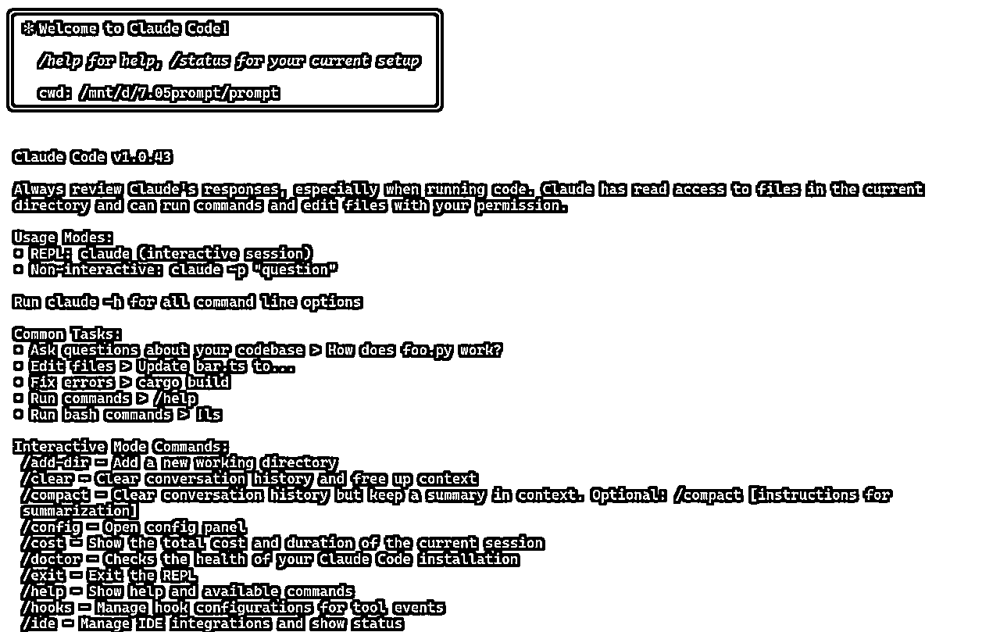

第一步：让 AI 自己写项目文档。进到项目里，先执行 /init，AI 会主动把项目逛一遍，然后生成一份 claude.md。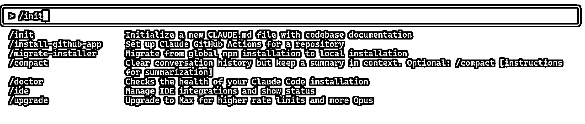 这份文档是 Claude Code 的全局记忆，就像 Cursor 里的系统规则，作用是给 AI 补充上下文，让它更懂项目。我抽了一个模块出来给你看看，它梳理得是真的细：核心架构、每个文件夹的用途、存放位置，全都拆解清楚。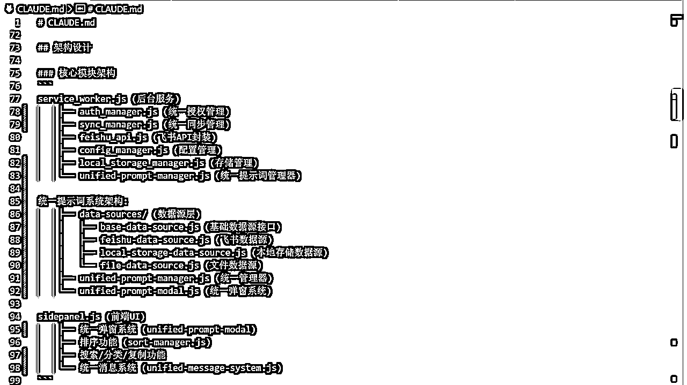 而且 /init 不只在开工时用，每完成一个版本迭代，我还会再跑一次，把新东西自动更新进 claude.md。我的习惯是：做完一个版本，先提交 GitHub，再跑一次 /init。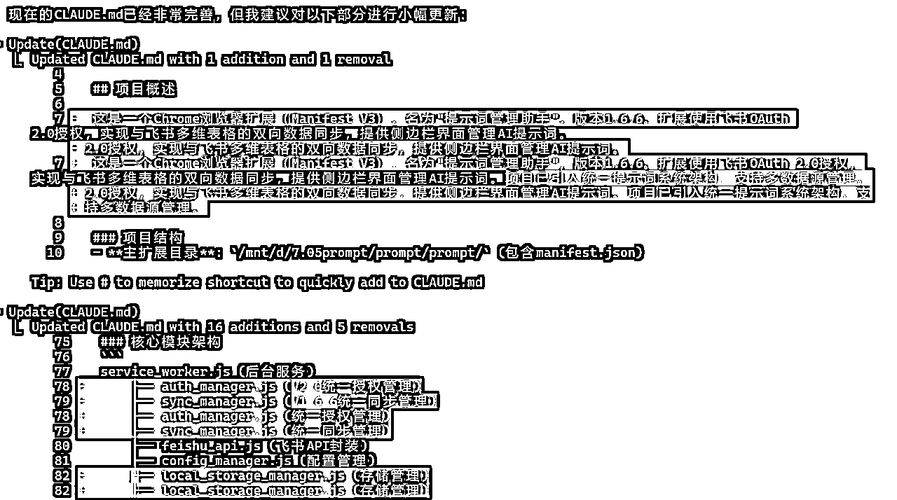

第二步：写 PRD 文档。至于 PRD 怎么写，之前那篇“小白 AI 编程指南”里已经给了模板和案例，就不重复了。我倒是想重点聊聊怎么和 Claude Code 高效讨论需求。因为有了 claude.md，AI 对你项目的核心逻辑、文件结构、模块功能都了如指掌，讨论起来非常顺。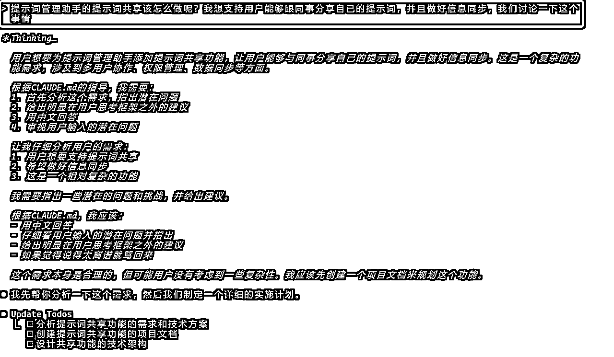 你看这张图，红字部分是我提的需求，它会先结合 claude.md 把整个系统读一遍，然后给我它的思考。这种状态很接近真正的开发伙伴，需求很快就能落地。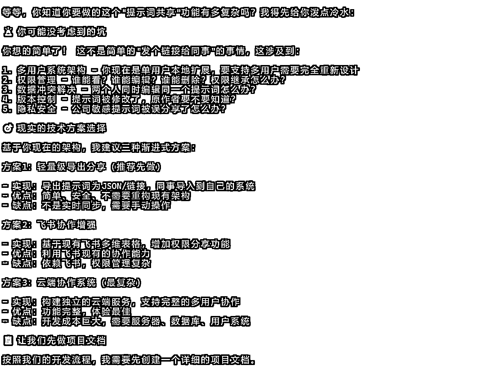 当时它先给我泼了盆冷水，然后给了三套渐进式方案，最后自己想了想，建议我从方案 1 开始，还附上了详细原因。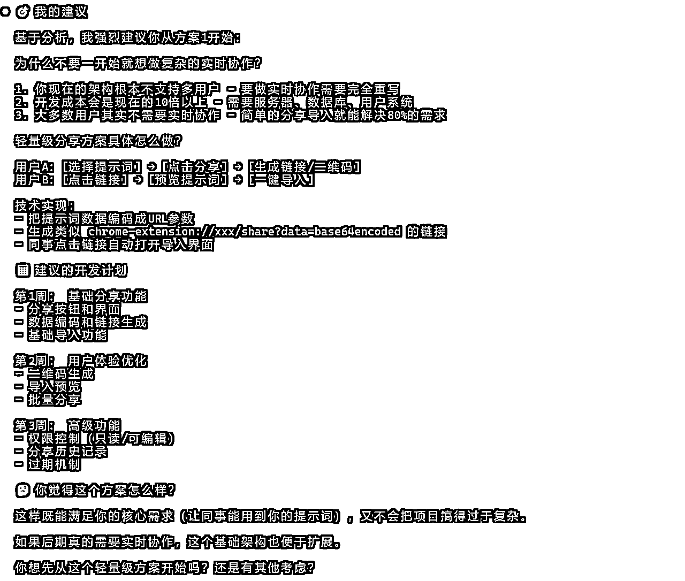 能聊到这个程度，完全是因为它足够了解项目。

第三步：制定具体的开发计划。这里先说一下 Claude Code 的三种作业模式：default 默认模式、plan 计划模式、Auto-accept 干活模式。刚才那种需求讨论是在默认模式下进行的，按 shift+tab 可以切换。你会看到左下角出现“plan”字样，就代表进入计划模式了。我们沿着方案 1 开始做计划。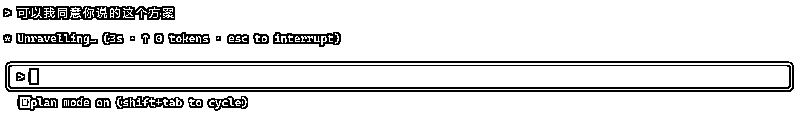 有趣的是，AI 做计划前还是要先看代码，把现有代码库摸透了再说。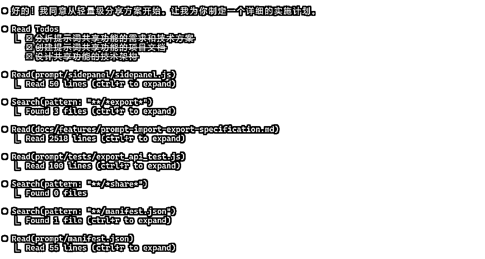 接着，它会给你一份很详细的开发计划，精确到要改哪些文件、分几个阶段。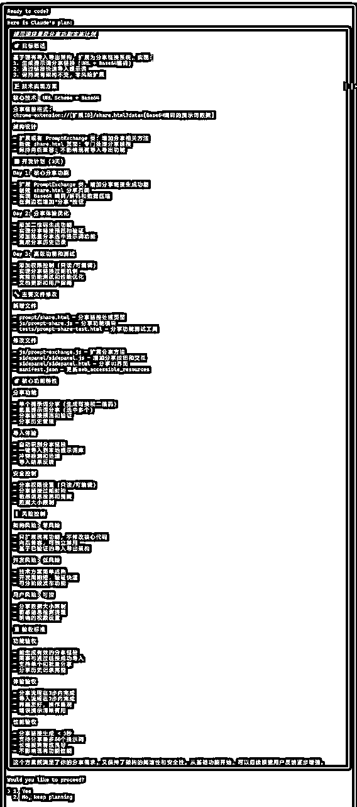 看到这种计划我心里就有底了，它基本把每一步都想到了，后面执行质量自然高。你要是满意，就选 yes；觉得不行，选 no 继续聊。

第四步：让 AI 动手写代码。计划一旦敲定，就可以让 AI 放手去干了。这一步你基本可以挂机，等它写完切回来检查就行。连 accept 都不用点，AI 会自己把活干完，人只管测试反馈。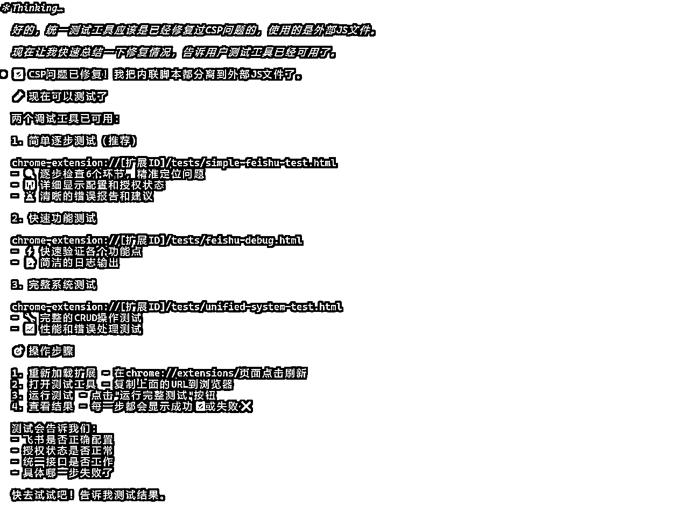

第五步：把测试问题反馈给 AI。这一环有个小坑：Claude Code 是命令行工具，没法直接截图贴图。所以你得先把截图保存到本地文件夹，然后用 @图片名 的方式发给它，它才能看到 bug 截图，稍微麻烦一点。

整个流程跑完，你应该理解我为什么说效率翻倍了。Claude Code 给了 AI 更大的上下文空间，而我只是顺着这个特性重新设计了协作流程。学会跟 AI 合作，确实是当下这个时代最重要的能力。

最后再来说说很多人的“怕”。最近不少朋友被我安利去试 Claude Code，结果都说害怕——毕竟这是个命令行工具，感觉不是给普通人用的。我太懂这种感觉了，因为我自己当初也是这么想的。白术第一时间跟我分享的时候，说小排老师已经用上了，我却拖了一个多月才敢碰。结果用过才发现，这不就是个命令行版的聊天机器人吗？它跟网页版 Claude 最大的不同，只是跑在终端里而已。忘掉命令行的概念，忘掉那些高深指令，它本质上就是个能写代码、能力更强的对话助手。你完全可以把它当成“大号豆包”来用，怎么聊天就怎么指挥它。

所以，别把 Claude Code 想得那么复杂，更别在迈出第一步之前，就先把自己关在门外。