最近很多兄弟都在问：小红书上卖虚拟资料，到底还能不能干？

我的答案是：不仅能干，而且我认为这是目前做副业最值得投入的方向。原因很简单——市面上真正靠谱的项目已经不多了。早年靠短视频、直播、AI风口赚钱的那拨人，确实是吃到了红利，可现在玩家太多，玩法早就透明了，没有一套精准的打法，很难再分到一杯羹。

另外，我之前分享过一套小红书“淘式”打法，当时被评了精华。评论区里冒出来不少做虚拟项目的朋友，大家普遍反馈：方向是认可的，但具体操作很模糊，基本是跟着感觉走，心里没底。

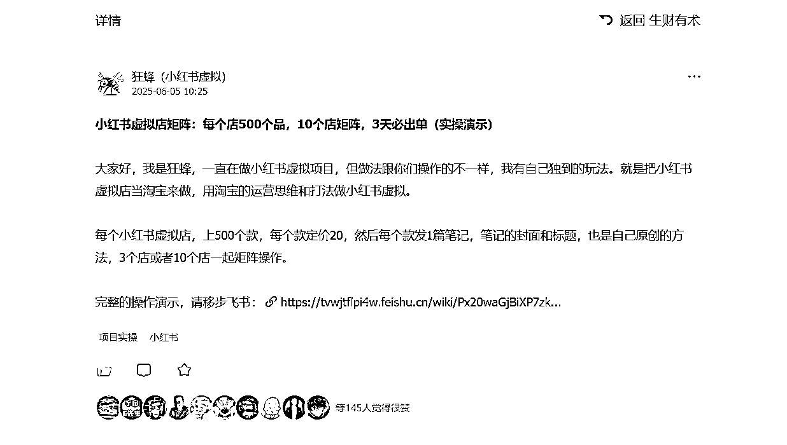

其实在做小红书之前，我干了十年天猫实物电商，主营厨房电器。说实话，每个月销售额也能做到100多万。

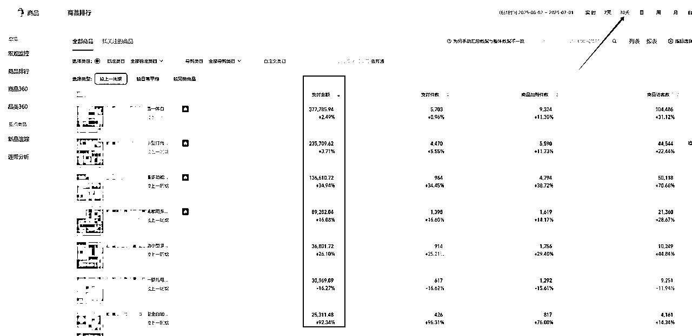

但问题是，现在淘宝这类平台，流量基本靠付费买。算下来，一个月到手的利润真没多少。

方向不对，努力白费。十年电商经验让我认清一个道理：赛道选错，再牛的技术也白搭。

去年开始，我全力转向小红书虚拟，结果真的让我眼前一亮。给大家看几个实际数据：

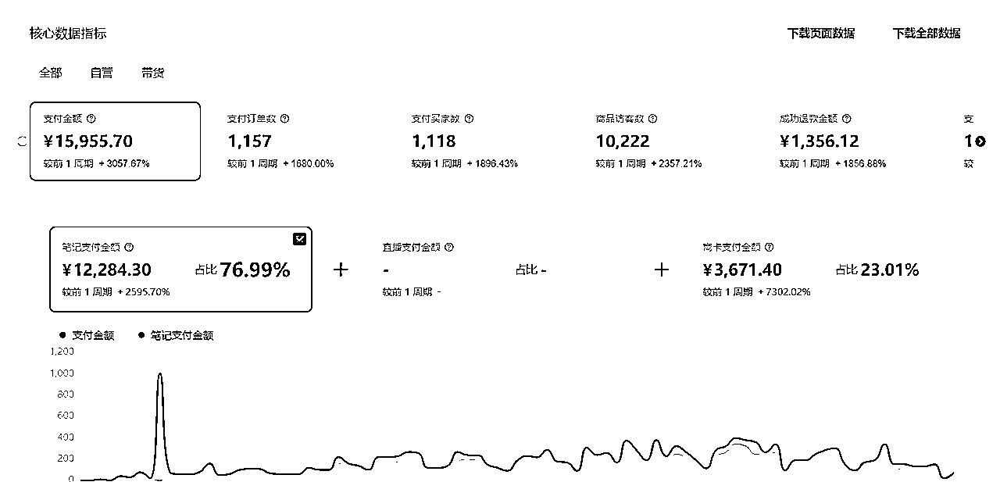

第一个店，一个月成交1.5万。别嫌少，虚拟品是零成本，这金额对副业来说已经非常舒服了。

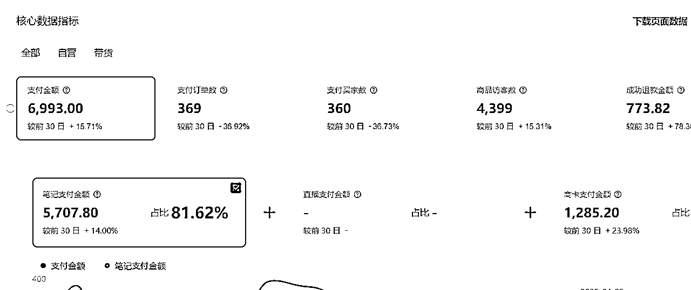

第二个店，一个月7000多。这个量级就够用了，别贪大——规模一旦放大，难度是成倍涨的。所以要按我分享的矩阵玩法来：每个店上500个品，组10个店的矩阵，3天基本能出单。

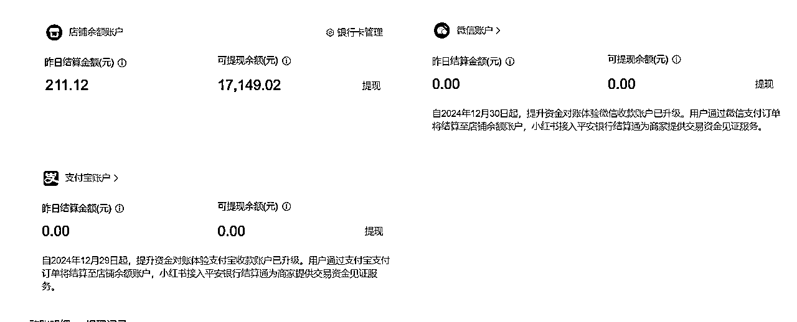

第三个店，每天稳定到账两三百，目前累计收益已超17000。你说，这作为副业还不够香吗？

所以我敢放话：小红书虚拟店，是目前最适合普通人的副业选择！电商离钱最近，而小红书上卖虚拟品，又是电商里门槛最低、利润最高的玩法。

下面，就把我压箱底的《小红书虚拟6技合1》完整拆解出来。

第一技：选冷门品，速成关键
第二技：吃透搜索流量
第三技：V4层破免费流
第四技：人为搞销量，主动出击
第五技：原创笔记封面，大量铺
第六技：矩阵操作，放大收益

---

# 第一技：选冷门品，速成关键

先说说为什么选小红书而不是淘宝、拼多多。

拼多多虚拟品主要靠付费推广，单价又低得可怜，一单几毛几块，选品一失误，推广费都回不来。淘宝虚拟呢？竞争惨烈，你费劲打出一个爆款，同行马上跟风，20块的品被压到几毛几分。买家不傻，同样的东西，凭什么买你的？

但小红书不一样。同样一份资料，小红书上能卖18.8、28.8，冷门一点的，定价100也有人买。

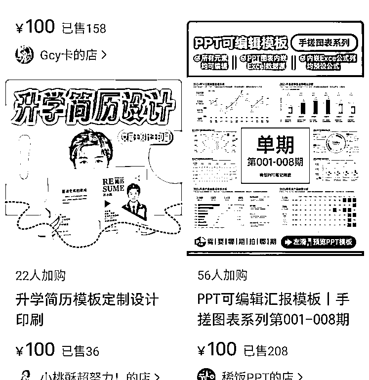

## 1. 冷门品更容易出单

别一上来就碰K12资料、教师资料、公务员资料这些大红海。新手选冷门小众品类，更容易做出结果。有了第一单的自信，你才能坚持下去。

举个我们自己的例子。这是店里500个品之一：

标题：对外汉语教学ppt课件HSK标准教程123456课件教师用书

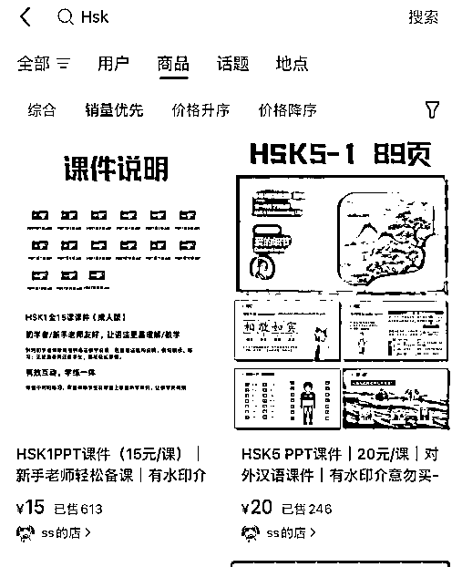

这个品上架后，发了笔记，用“乘风”稍微推了一下，立刻出单，而且后续持续出单。冷门品的威力，你体会一下。

## 2. 差值法选冷门品

### 方法①：去淘宝挖词

淘宝搜“模板资料”“表格”“文档”“素材”“协议”“合同”这类主词。比如搜“模板资料”：

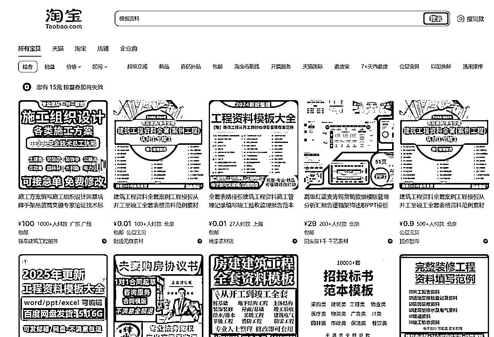

怎么判断冷门不冷门？相对概念。只要不是小红书上泛滥的K12、教辅、考公考学、儿童英语这些大类，都算相对冷门。注意，淘宝有千人千面，我截图里显示的都是我平时常看的品。你们自己去搜，看到的肯定跟我不同。

### 方法②：对比淘宝和小红书的销量差值

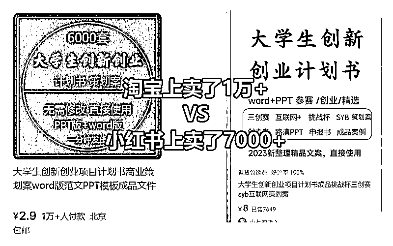

看这个品：大学生创新创业。淘宝已卖1万+，小红书也卖了7000+。这说明两边市场早就饱和了。你现在0销量0评价入场，等于在别人吃完肉之后啃骨头，难度极大。因为对手的笔记权重、商城排名都遥遥领先，你很难打。

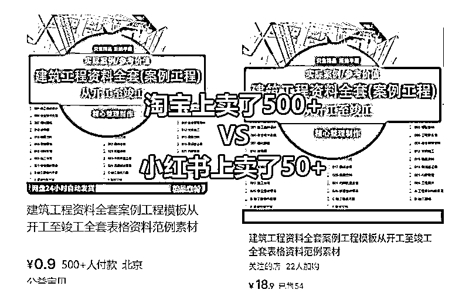

再看这个：建筑工程资料。淘宝卖了500多，小红书上同款才卖50多。这个差值非常大，说明小红书这边有巨大空白。放心上架，定价不用学淘宝低价，大胆往高了标。上架后按后面的搞销量方法把基础销量和评价做好，然后铺笔记，持续怼。很快就能看到订单。

## 3. 500个品，直接治好选品困难症

新手刚入行，尽量别碰教辅、教资这种大神扎堆的赛道。选小众领域的资料，竞争小，更容易做出成绩。但实际操作中，很多人还是会迷茫：到底怎么选？

我们的做法很简单：不去纠结，直接一个店上300到500个相对冷门的品。哪怕大多数不出单，也影响不了大局。

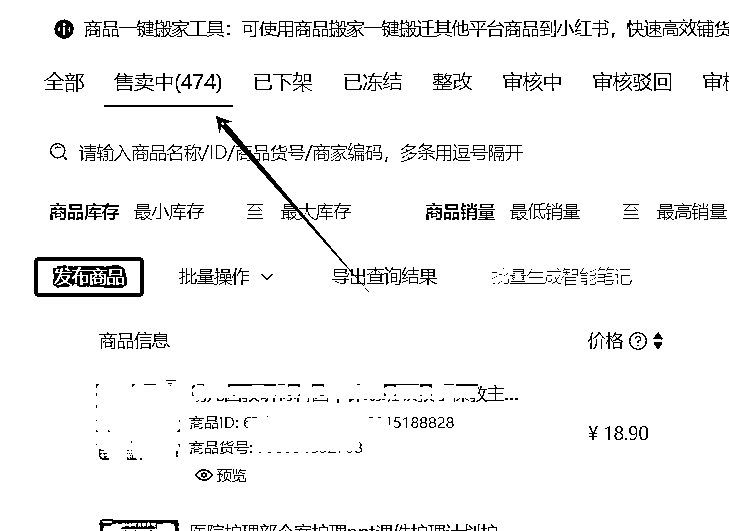

这样能大幅提高命中概率。等跑出那种0销量0评价还能自然出单的款，再放大操作：怼销量、怼评价、怼笔记、怼乘风。

---

# 第二技：把搜索流玩到极致

小红书有个天然优势——很难比价。它是兴趣电商，买家是因为看了你的笔记觉得不错才购买，所以搜索的核心是笔记，而不是产品本身。

小红书的用户价值高，愿意为优质内容付费。所以我们做虚拟品，从来不低价竞争，最低也定价20左右。

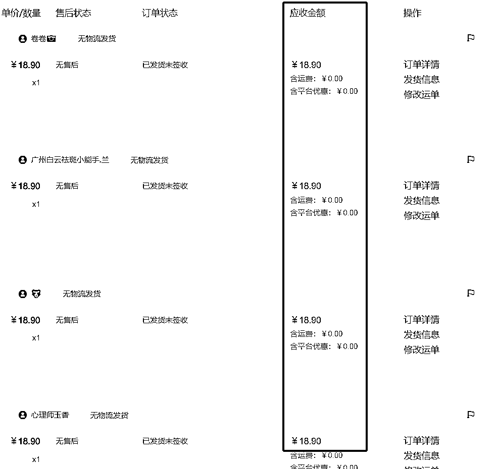

小红书的用户对虚拟资料的需求量极大。你是老师，需要教学资料；你是学生，需要学习资料；你是白领，需要行政人事资料……任何人在生活工作中，都离不开资料。

## 1. 搜索流量是主力

后台“流量数据”里，可以清楚看到流量和成交的构成。

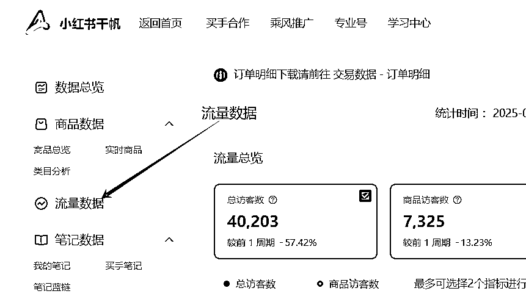

以我们其中一个店为例，综合搜索页加搜索商品页的占比超过80%。这说明小红书跟淘拼抖完全不同——其他平台是推荐流占大头，小红书却是搜索流唱主角。

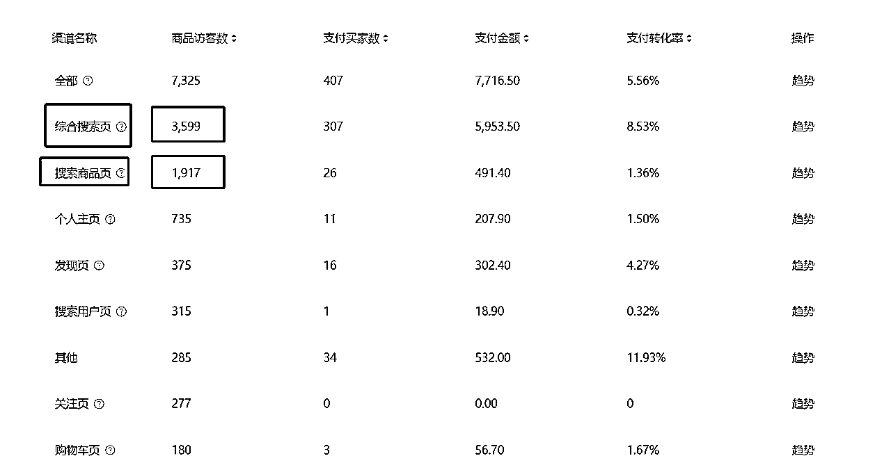

所以结论非常明确：想做好小红书虚拟，核心就是把搜索做透！

再往下看，“引流搜索词”里能看到过去30天，店铺是靠哪些词进来的。

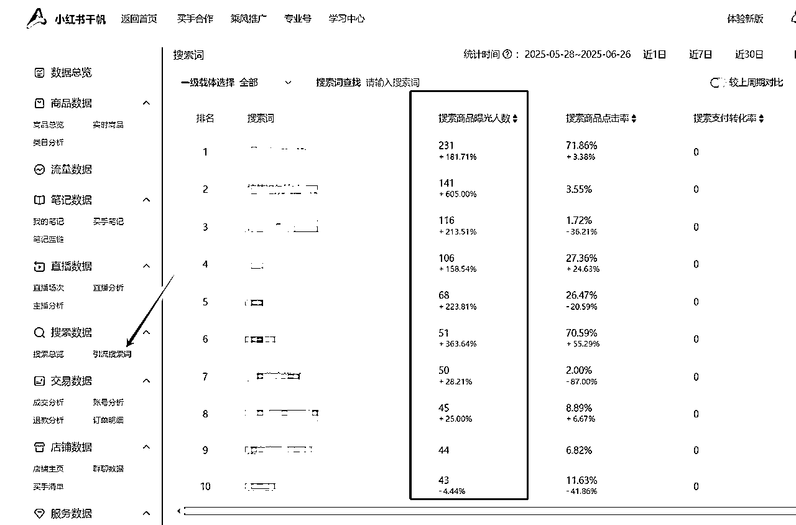

懂得看数据的人，从中就能找到新打法。既然某些词流量大，那我们能不能把这些词的宝贝多上一些，笔记多布局一些？词的权重不是白来的，背后有大量考核维度。既然已经有了权重，就必须及时利用、放大。

## 2. 搜索词从哪里来？

### ① 小红书搜索下拉框

先确定主词。比如我想做模板资料类，因为小红书人群对模板、表格、合同、协议特别友好。

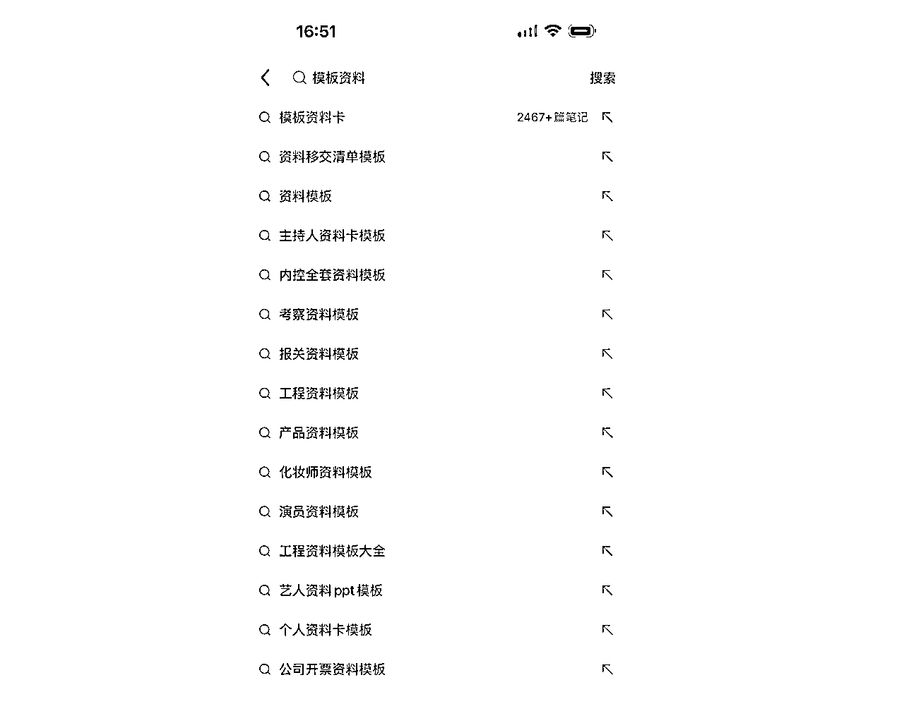

搜完主词，会出现很多三级词。比如“报关资料模板”这个词，就是我们之前完全没想到的品。然后去淘宝搜一下，看有没有货源。

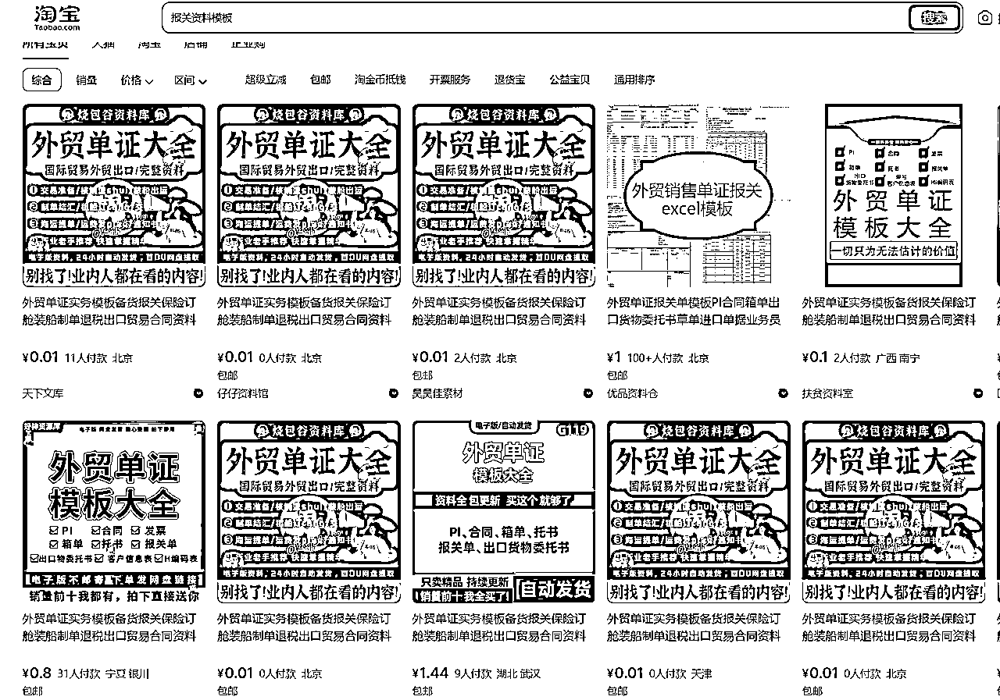

果然，淘宝上拿货价只要1元甚至1分钱。既然小红书搜索框里出现了这个词，就说明有需求。直接从淘宝搬过来，按我们的标价法定19.9，开卖就完事了。

### ② 淘宝生意参谋找词

我是十年老淘宝人了，看词习惯用生意参谋。有人问：淘宝的词适合小红书吗？其实从找产品的角度，底层逻辑是相通的。况且我们选品不是选几个，而是一个店500个，这也是我之前实操帖受欢迎的原因。

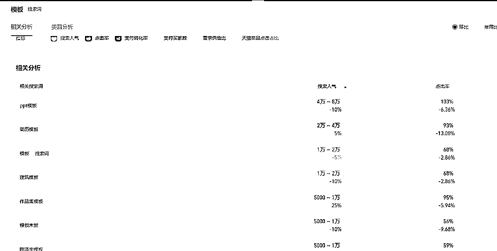

## 3. 涵盖更多搜索词

既然知道以搜索为主，也知道了找词方法，接下来就是如何布局。

### 方法①：款少笔记多

这是市面上大多数人的玩法：一个店精挑细选几个品，然后不断发笔记。比如下边这个店，全店只有4个品，所有笔记都围绕这几个品。

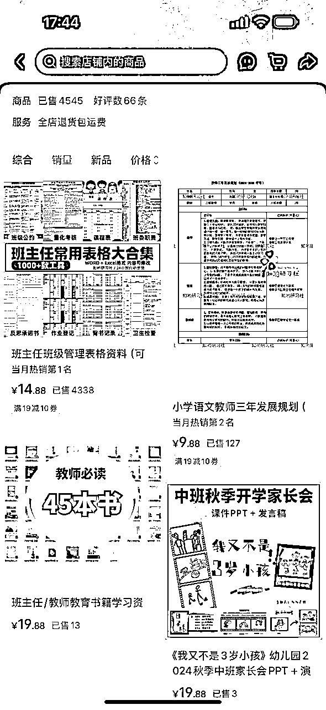

还有更狠的，全店就1个品，所有笔记死怼这一个。

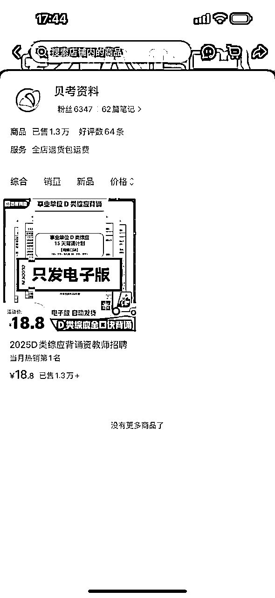

这种打法的关键在于笔记标题——每篇笔记标题尽量包含不同的关键词，所有笔记加起来，覆盖的搜索词就多了。但它有个致命点：选品必须特别准，否则发再多笔记也白搭。

### 方法②：笔记少款多

这是我们正在用的玩法：一个店上500个品，每个品发一篇笔记，笔记标题直接用宝贝标题。具体操作步骤在我之前的分享里写得很详细。

这种玩法大大降低了选品压力。你想，0销量、0评价、笔记0评论的情况下都能出单的品，这不就是你要找的好品吗？不用纠结，照做就行。看我们店的搜索支付金额占比，超过80%，靠的就是这套款多打法。

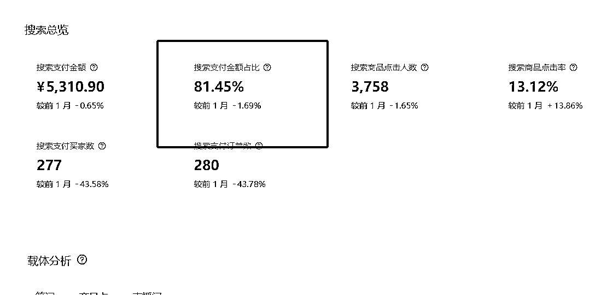

---

# 第三技：V4层破免费流

免费流分两种：一种是主动出击去拿的（第四技），另一种是系统白给的。白给的不拿白不拿。

## 1. 每周报名任务，必做

打开笔记中心，就能看到每周任务。一定要点“参加任务”。只有参加了，系统才会根据你的完成度给曝光。

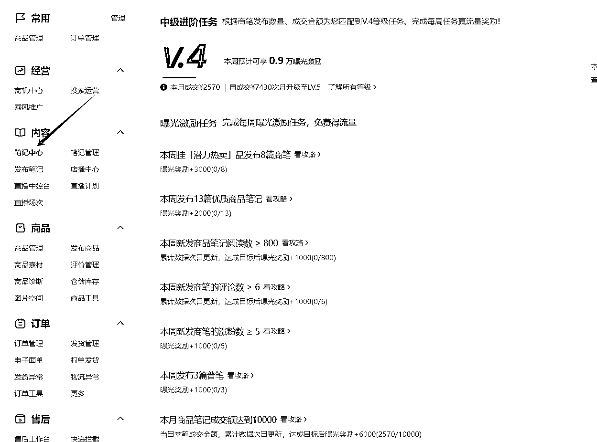

最容易完成、奖励也最多的两个任务：发布8篇商笔、发布13篇优质商笔。这两个无论如何都要拿到。第一个很简单，点“去发布”，按系统提示的潜力热卖品发笔记就行。后面几个任务，店铺基础好就不用管；基础一般的话，可以人为操作一下，你懂的。

## 2. 等级越高，免费流越多

笔记等级越高，系统给的曝光越多。V1级每周免费曝光只有0.2万。

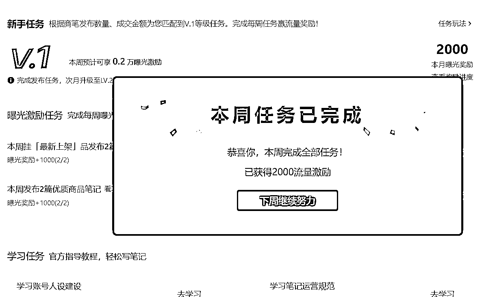

而V4级每周能拿1万左右，接近V1的5倍。所以尽量提升等级。想正规提升的话，速度会慢一些；想快一点，也是能人为操作的——点开后台各等级要求，你自然就明白了。

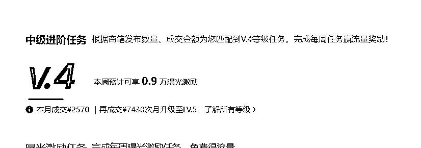

别小看这些曝光激励。每周都能拿，还是系统白给的。如果保持V4一个月，免费就有4万曝光，真不少。所以每周一定要去参加任务。

## 3. 怎么上V4

官方划分标准主要看上月带货笔记的成交金额。要上V4，只需要1000到1万的成交额。你要是太老实，慢慢积累肯定慢；要是不太老实，那就很快了。不懂怎么操作？看下一技。

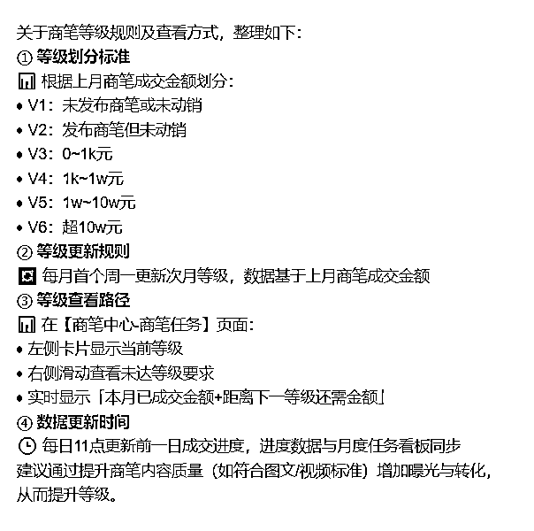

---

# 第四技：人为搞销量，主动出击

别傻等。0销量、0评价、笔记0评论的情况下能出单的款，我们叫“神款”，但那是少数，偶然性太强。所以要主动出击，人为补一些销量。虽然有人排斥，但商场上这是绕不开的。懂的都懂，不理解的照做就行。

## 1. 宝贝销量和评价的做法

小红书的电商起步晚，稽查系统还没淘拼抖那么完善，所以操作起来可以稍微“放肆”一点。我的步骤分四步：

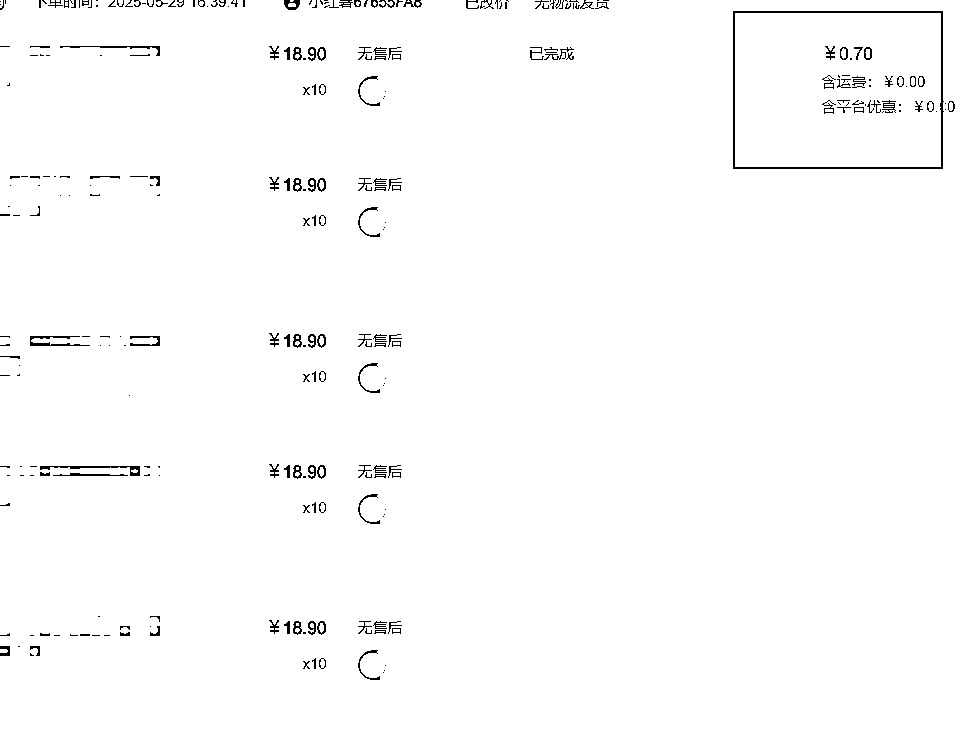

### 第①步：分手机，用4G

准备3-5个小红书号和手机，全部用4G网，不用WiFi。必须一机一卡一号，千万别一个手机来回切换小号，更不能用WiFi。做过淘宝的都懂，淘宝查这个比小红书严多了。我们可以粗放一点，但别把小红书系统当傻子。

### 第②步：每个款加购10件，每次加购5个宝贝

一个款要搞到30-50单。1个账号、1次1个宝贝可以加购拍10单。想拍30单，就准备3个小红书号，同时加购5个宝贝，每个加购10件。想拍50单，就准备5个号，同样每个宝贝加购10件。

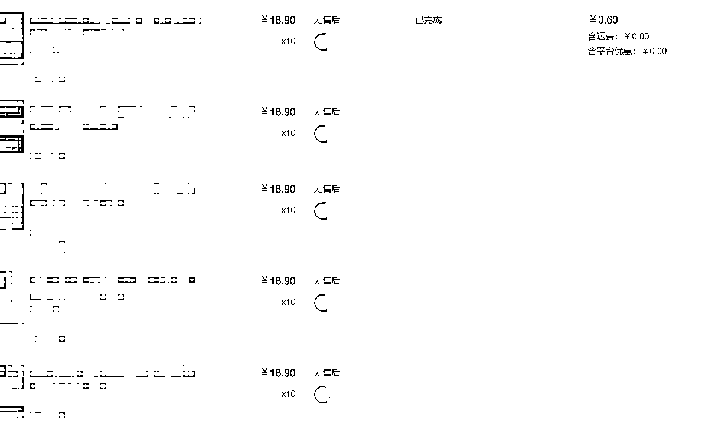

### 第③步：改价0.1-1元

拍完后，每个款订单改成0.1元。这样总价就不是18.9×5了，否则加上回款周期和店铺数量，资金压力太大。改到0.1×5，基本可以忽略不计。

### 第④步：节奏控制

每个店前期每天补1单就行，优先做点击量大或已出单的款。新店不可能一上来就大量订单，要循序渐进。前期每天1单，过半个月、一个月，随着店铺流量和真实销量增加，再逐步提高补单量。这个度必须把握好，否则被排查到会扣10分。

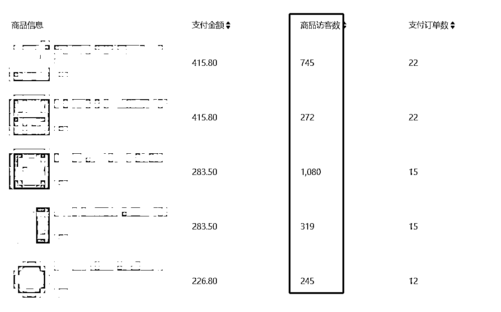

## 2. 人为做笔记的“勾心”评论

勾心的评论才能吸引人点击宝贝，提高转化率。种子评论就像往井里倒的第一杯水，目的是引出更多水。因为没有买家想当第一个评论的人，也没有买家想当第一个买的人——这就是人性，也是电商的本质。

方法①：用自己的主号留评论并置顶。

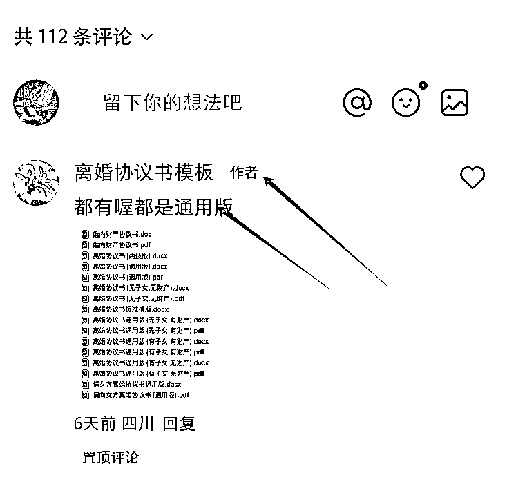

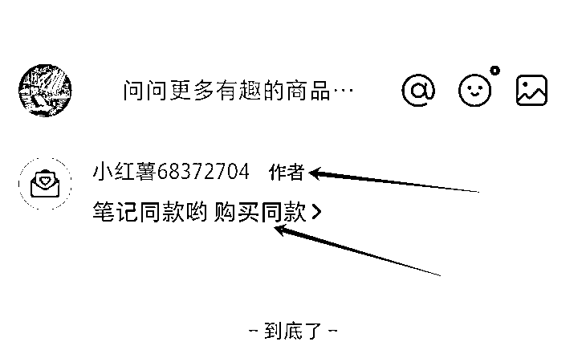

方法②：用几个小号留评论。

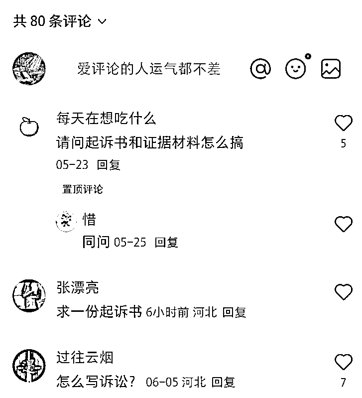

方法③：主号置顶留 + 多小号留。

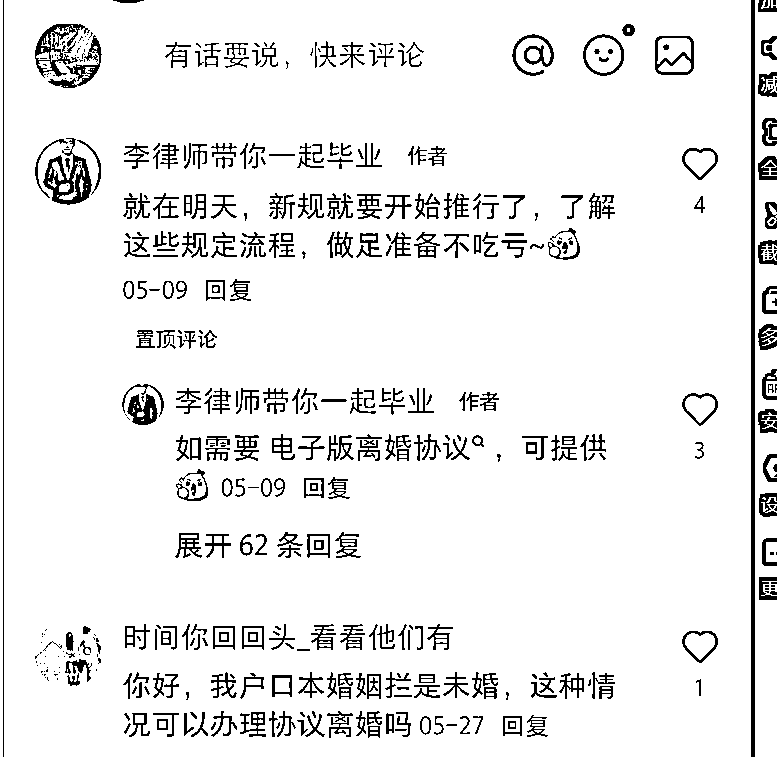

---

# 第五技：大量原创笔记封面

## 1. 简单背景 + 产品主词

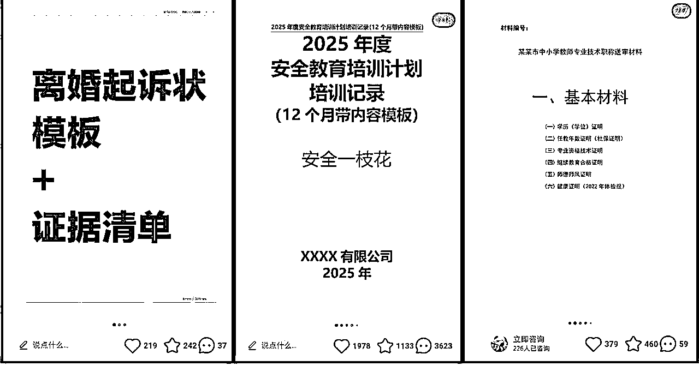

## 2. 内容截图 + 文案

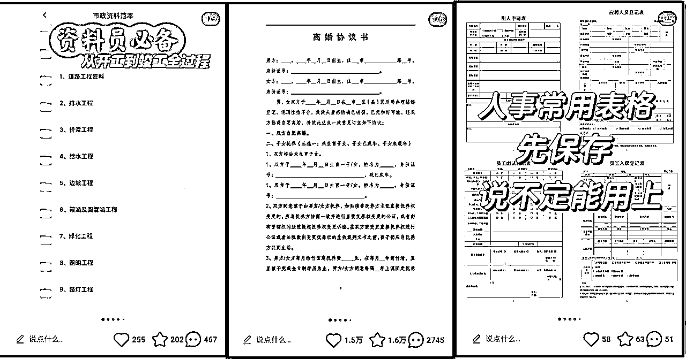

## 3. 打印 + 拍照

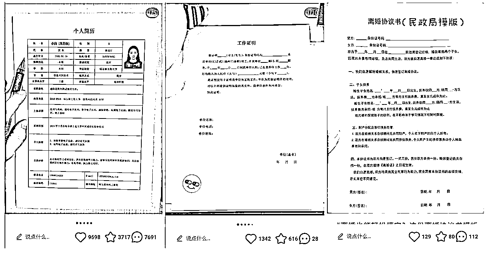

---

# 第六技：矩阵操作放大

## 1. 矩阵是放大的内核

简单的事重复做，才是积累数据的最好方法。当你把一个店做到出了第一单，或者一个小红书号开始有赞有评，说明0到1已经跑通了。跑通之后，就该考虑多店、多号矩阵，解决放大问题。

很多人习惯在0到1跑通后，拼命想把一个店或一个号做到很大的数据。思路本身没错，但实操中难度极高。与其死磕单店，不如用矩阵去降低风险、提高总量。

---

总结一下。小红书的虚拟店，是离钱最近的副业。选冷门品解决出单问题，吃透搜索流量解决流量问题，V4层拿免费流解决成本问题，人为搞销量解决转化问题，原创封面解决点击问题，矩阵操作解决规模问题。这六招合在一起，成功率自然大幅提升。

方向对了，努力才不会白费。希望对还在观望的你有帮助。

说实话，我并不是让你开一家小店玩玩就收手，而是想告诉你，当单店跑起来有了基本盘之后，真正的放大方法就是做矩阵。这点我们自己就是活生生的例子，目前手上的这家店笔记已经发到七八百条了，同时店矩阵和号矩阵也在同步推进，两种打法并不矛盾，反而是相互配合的。

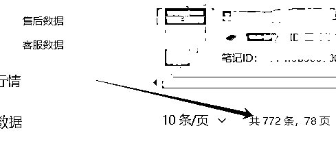

简单算笔账就明白了。同样是成交100单，一个店去冲100单，和先把一个店做到稳定出10单，再开10个店来做，哪个更轻松？答案不言而喻。当你已经摸清了怎么让1个店稳定出10单时，复制10倍体量，100单自然就水到渠成了。

很多人会觉得这只是纸上谈兵。真实情况是，我们现在就是这么在跑的，下面就是我们的小红书店铺矩阵和账号矩阵的实际操作。

## 2. 小红书店铺矩阵

做虚拟赛道，店矩阵几乎是必选项，我们的实操回报已经很明显了。下方截图就是我们目前挂在腾讯云服务器上的店铺数量，你自己数一下就知道规模了。

把店铺挂服务器上，核心目的只有一个：实现24小时无人值守自动发货。小红书市面上常见的自动发货工具基本都得保持电脑开机，根本做不到真正离线运行，这个坑做过的人都懂。至于服务器怎么搭、自动发货怎么配置，后面再细说。

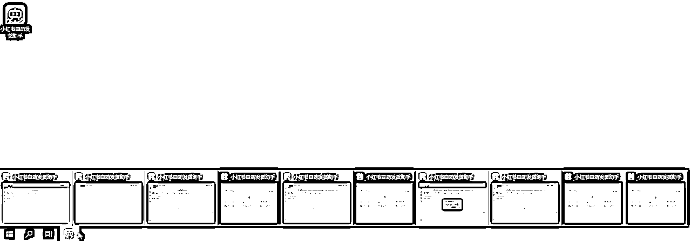

“越做越有沉淀，越沉淀越好做”。以前我们会花大量时间纠结单品怎么拉销量、要不要投付费。现在思路完全变了，更多在思考怎么快速多开店、怎么把更多虚拟产品铺进来。

前期启动可能费点劲，但做到后面你会发现，随着数据和经验的累积，整个操作会越来越顺手，自信度也会跟着上来。

## 3. 小红书号矩阵

现在很多人做小红书虚拟还在用老套路，比如3个号带1个店。这种玩法也能出结果，就是有一个隐形风险：你选的那个店的品真的就是爆品吗？靠3个号去硬推一个不确定的品，风险挺大。

我的个人偏好是多开店、单店单号1带1。宁愿把多余的手机号和设备拿去注册新店、上新品，也不愿意把资源集中去赌一个店。玩法没有绝对的对错，关键看能不能拿到结果，因人制宜即可。

# 别放弃，坚持做，有积累

最后说一句关于小红书虚拟的感悟：别轻易放弃，坚持下去就会有积累。

在这个赛道里，只有不断地去实操、把每一次失败和成功都沉淀下来，才能真正完成从量变到质变的跨越。

荀子在《劝学》里讲过：“不积跬步，无以至千里；不积小流，无以成江海。”

一切成果都是积少成多、厚积薄发的结果。只要你保持耐心，持续复盘沉淀，就能做到水滴石穿，每天都有新的心得，每天都比前一天更进一步。