哈喽，各位圈友，我是嘉平，今天来跟大家聊聊我做淘宝代写这几年的真实经历。

先简单介绍一下自己：00后ENFP射手座，坐标的话，家在山东聊城，学校在成都，目前在大理做义工旅居，以后还想去更多城市看看。我特别喜欢交朋友。

我的代写经历大概是这样：22年下半年开始在淘宝接单，那时候还是纯手写；23年初开始接触AI写作，但只是当个兼职，没钱吃饭了才接几单；直到24年夏天，家里出了点事，我爸突然生病了，我一下子意识到得赶紧赚钱。那个时候尝试过公众号爆文、回收二手书啥的，基本都只回本没什么结果，于是又回头想起来了代写这条老路。

24年8月，我开始疯狂在闲鱼发帖。当时很多人都说暑假是淡季，但我意外撞上了一个需求很大的品类——三下乡新闻稿。客单价虽然不高，普遍在20到40块左右，但架不住量大，第一个月一个账号就赚了3000多。后来靠着这个号的流量，下半年最高做到单月GMV破万。可惜年底账号流量开始下滑，我也没怎么继续运营，就只能靠老客户复购撑着了。最近时间比较空，想再赚点钱，流量又还没起来，所以我又把目光转回了淘宝接单群。

很多人跟我吐槽淘宝群现在太卷了，根本接不到单。我承认，有一阵我自己也是这种感觉。但后来我想明白了一件事：与其抱怨卷，不如想办法让自己看起来更专业，于是我想到了做作品集。

操作很简单，用飞书新建一个文档，把加好水印的案例直接拖进去就行。但有几个细节必须注意：客户的个人信息一定要删掉，水印也一定要加，这样看起来既专业又真实；分享之前记得把权限设置成“互联网获得链接的人可阅读”。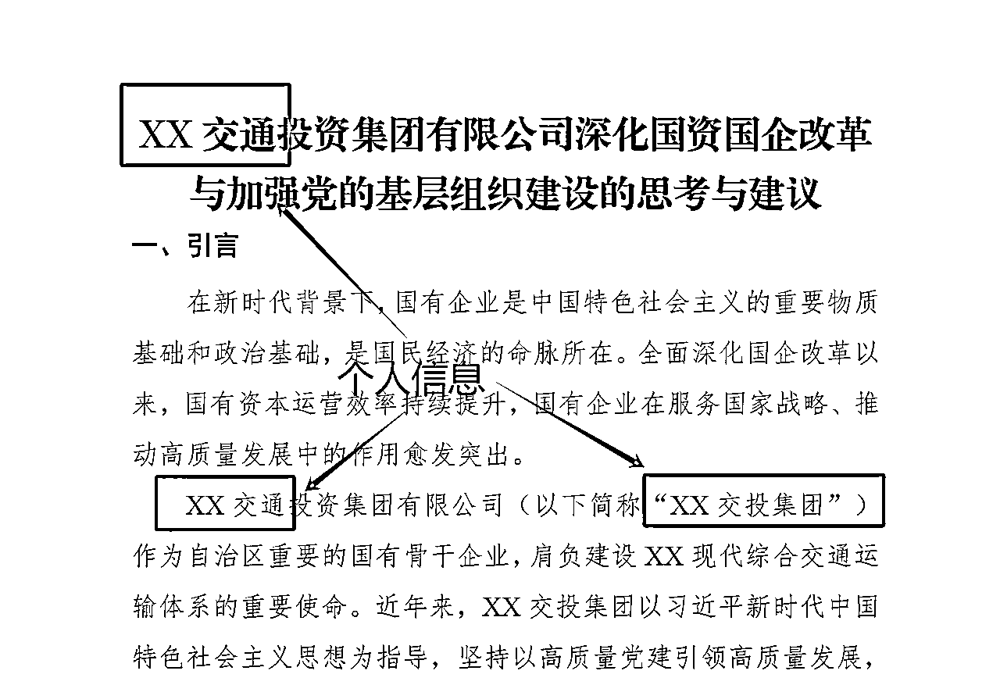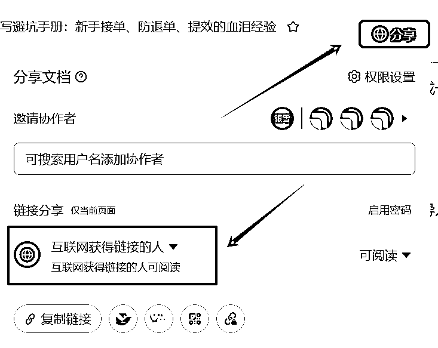

可能有人会说，我一个新手，哪来的案例？两个思路：

第一，跟着航海手册老老实实做作业，作业本身就是现成的案例，保留下来慢慢积累。第二，走点野路子，去小红书找一些优秀案例先“借用”一下。真接到类似单子的时候，就按照“找对标拉齐认知→用AI写稿→改稿”的逻辑边学边做，只要单子不是特别急，基本都能搞定，做完之后也就成了自己的案例，慢慢把小红书上的替换下来。

有人担心被客服识破？其实客服也就瞄一眼你稿子的质量，不会真去验证到底是不是你原创的——除非你倒霉到照抄原稿，这个概率太低太低了。

注意，这两条路一定要同时走！一个让你快速启动看到正反馈，另一个帮你真正长本事。光有作品集可不够，最终客户看的还是你实际写出来的东西。

顺便分享一个实用小技巧：小红书上的优秀案例很多是图片形式，有水印、有笔记、有手写，没法直接复制。这时候可以求助AI，让它把图片里的原文提取出来。提示词我给你放这儿了：“请你帮我把附件图片的原文提取出来，不需要笔记部分”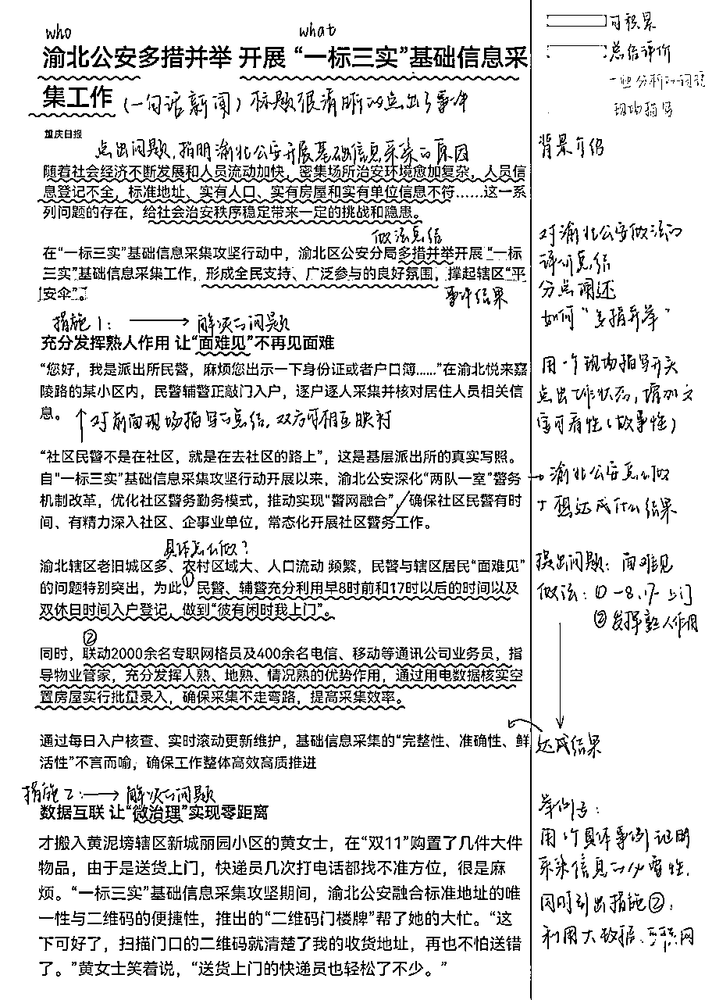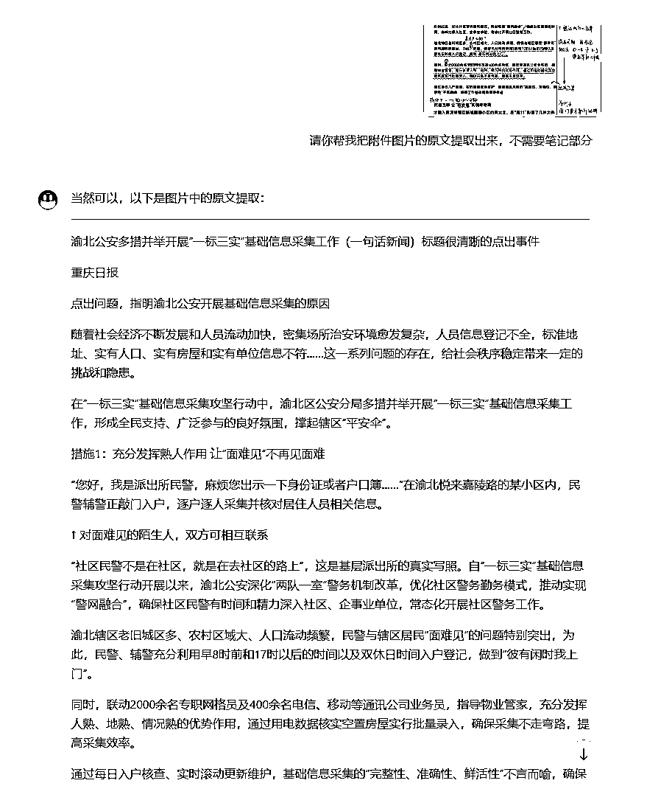，国产AI基本都能做到，我用得比较多的是Kimi。同理，遇到需要把图片转成表格的单子，也可以用AI：“请你帮我把附件内容做成excel的形式，以markdown的形式发给我”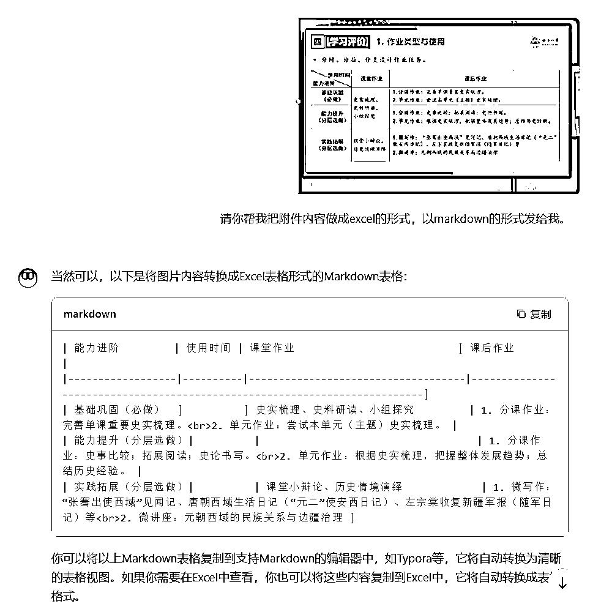，然后用tableconvert这个在线工具（https://tableconvert.com/markdown-to-excel）直接粘贴转换就行。

那作品集里放什么？建议尽量丰富一点。可以去淘宝或闲鱼搜代写，看别人文案里写的品类，比较简单的文本类型都可以写。如果你会做PPT，也可以分成文字作品和PPT作品两个板块放进去。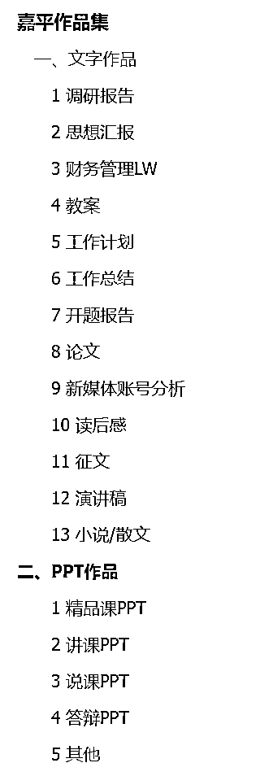后面写的单子多了，再慢慢补充就行。我们现在做作品集的核心目的，就是让客服觉得你经验丰富，他才会放心给你派单。

那有了作品集怎么快速接到单？加进淘宝派单群之后，看到合适的单子就直接私聊客服，话术大概是：“你好，我想接你刚刚发的×××单子，这是我的作品集~期待长期合作！https://（飞书链接）”

我实操下来，效果确实比干巴巴问一句好得多。有个客服当时就接了单，后来合作得也挺好，基本上那个客服一有单就喂给我，我都不用自己去找了。还有另一个客服，第一次没接我单，后面反而主动给我派了活，不过这个客服让我不太舒服，感觉不太负责任，之前的单也还没结算。这里也想提醒大家：我们在被客服筛选的同时，也要反过来筛选客服，一个靠谱的客服真的能让你省心太多，专心写稿就完了。当然也会遇到不接单的客服，比如有个客服管我要接单记录，可我已经很久没在这个群写了，也不清楚他们的规矩——算了，没关系，客服那么多，这个不行咱就换下一个。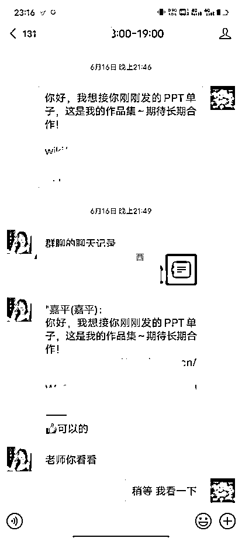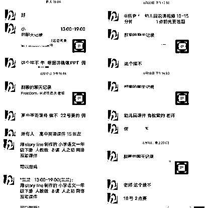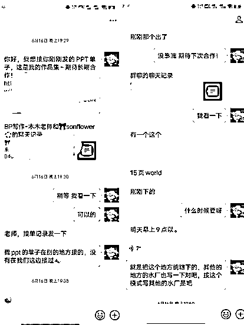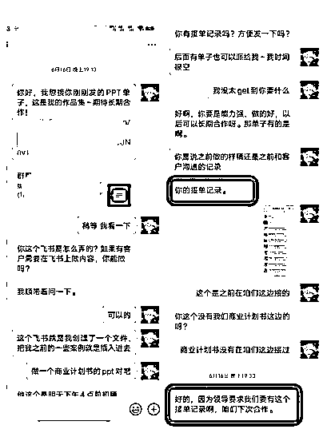

总之，这方法不是百分百有效，我也被拒绝过很多次，但概率绝对比干问一句大得多。被拒绝太正常了，千万别灰心。

接下来聊聊新人最容易踩的几个坑。

第一个坑：不要哪个群都接单。我以前总觉得单子少是因为群加得不够多，于是疯狂加企业微信。后来发现，真正有单的就那一两个群，其他加了也都是摆设。加群的过程其实是筛选哪个群价格高、哪个群靠谱，但筛选完之后一定要聚焦，聚焦到一两个群，一两个靠谱的客服身上。我们的精力有限，今天跟这个明天聊那个，根本忙不过来。当你手里有几个一有单就找你的客服，你完全可以把注意力放在写作本身，不用再盯着群刷低价单了。

第二个坑：接单前一定要跟客户确认需求。很多人东西写完了，客户说要大改，真的是想哭都哭不出来。建议把客户的需求用自己的话总结一遍再发给他确认，需求特别复杂、文件特别多的话，直接合并转发聊天记录也行。但需求简单的话，我更推荐自己提炼总结一下，反正后面用AI写稿也是要提炼需求的，这一步不算白做。文章长的话，一定要先确认大纲；如果是PPT，一定要提前确认风格或模板，样稿做2到3页发过去，淘宝单一定要等对方明确说出“样稿满意”或者“满意继续制作”再继续动工。

我最近就踩过一个这样的坑，熬夜赶了一个PPT单子，结果客户直接退单了。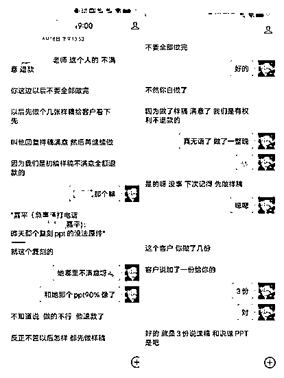后来复盘才发现，这种单子大概率会出问题：第一，急单真的不要轻易接，那个单子是当晚10点多接的，第二天早上六七点就要，太赶了。第二，当时觉得那是照着视频复刻PPT，应该不难，就没做样稿跟客户确认。第三，水印一定要加到位，PPT最好合并成一张图来加，图小了客户想偷稿都没法用。我之前是转成PDF再加的水印，现在想想还是不够安全。有圈友做过一个把PPT合并到同一页的工具，这种对PPT来说安全了很多。

第三个坑：就算AI写得快，也千万别秒交稿。拿一篇3000字的稿子来说，可能半小时AI写完，再改改一小时也搞定了。但你不要一小时就交，手敲1000字就得半小时，而且大部分单子还需要查资料，这时间都得算上。你给客户交得太快，一方面等于明摆着告诉他这是AI写的；另一方面人性就是这样，你花时间少，他就觉得钱花得不值，哪怕内容完全一样，尤其是淘宝单客单价还不便宜。

第四个坑：不管在什么渠道接单，只要客户还没确认收货，原文件绝对不能发！可以发带水印的截图或者半屏截图，水印要在不影响观感的前提下尽量小而密。不要试图挑战人性，你要是买个东西没花钱就拿到了，你也不会乖乖付钱的。有个技巧是：把文件转成图片型PDF再加印，这样对方想提取文字都难。

最后我想说：不要因为一个单子就否定整个赛道。有的新手刚入行就遇到离谱客户，疯狂让改稿，写完还要退单，这些在代写路上都是概率内的事。你写得越多，遇到奇葩的概率越大。但新手最难的就是自信心还没建立起来就被打击到。千万再坚持一下，这个赛道是真的能拿到结果的。我试过那么多项目，最后还是觉得这个最容易看到结果、来钱最快。深耕下去，你一定会遇到很多很治愈的客户。

以上就是我全部的分享了，我们一起加油，各自努力，顶峰相见！