# 2025私域矩阵获客与精细化运营：心法和算账

大家好，我是yeye/耶耶

先说读者定位。

这篇给的是已经把0到1跑通、正在想1到10怎么打的伙伴。如果你还在起步，建议先看我之前那篇更偏操作的文章。今天这篇聊的是底层逻辑，偏虚，但很重要。

如果你已经把1到10跑顺了，转化率长期跑赢同行，后端有成熟的升单体系，流量和转化都不缺，那这篇可以直接略过。你现在要做的就是：全平台铺号，B站、视频号、各大社群、FB、Reddit、X、YouTube都覆盖，尽快做付费放大或死磕内容；把七成以上精力放在流量规模化和团队搭建上，SOP颗粒度做到人头，销售漏斗每个环节都优化。还有一个高效打法：派个自己人长期卧底同行。我最近复盘，发红包不如放一个内线划算，细节全在里面。SOP最快的来路就是抄。飞书多维表格看日周，飞书知识问答关掉联网后非常好用，把所有SOP丢进去，员工提问即得。很多团队问题不是SOP不够细，是SOP太多嵌套。搭ERP，组一个能自闭环的团队，重点培养运营和销冠，给钱给到位。人才梯队、年度节奏蓄水预热大促返场、企业文化搭好，等风来即可。

本文两条线。

明线：2025年如何稳住矩阵获客并把运营精细化。
暗线：如何找需求找痛点做爆款，如何搭建高效赚钱模式，如何算账。

全文约2.1万字，阅读20-30分钟。

## 一、私域还能做吗？

今年做📕、抖音获客的伙伴都感受到压力。自然流被压，抖音频繁实名，📕动不动要资质。打击很多，也有人开始怀疑行业还能不能做。

我的判断是能。五个角度自洽：

1. 利润=(曝光/流量)*转化*客单价-成本
平台算法天然是多对一的杠杆生意，放大效应极强。
做自然流，只要前3-5秒能留住人，一晚10w+播放很正常。内容有分享价值，百万播放不是天花板。
成本极低，很多做知识付费，边际成本接近零。连这个都做不下去，重资产行业更难。
做对比，现在很多制造业靠堆量摊薄早期亏损，普通人玩不起。千万别碰重资产，比如制造业。最近某充电宝品牌，砸了多少钱攒口碑，一款品出问题停产半年，裁人砍线路疏通关系又要花大钱。
2. 私域价值远未被榨干
朋友圈曝光规则对所有人一样，营销成本几乎为零。想一想，如果朋友圈能花钱买曝光会怎样？电商换品就要重新投流刷单，资产留存几乎没有。
营销管控相对松，有操作空间。今年朋友圈折叠说明用户被轰炸烦了，反而把营销门槛抬高，会写才值钱。
私域信息差极大，竞争少。案例真假难辨，朋友圈是否仅你可见，差评近乎为零。
资源差>认知差>信息差。普通人没必要跟手握能源土地权力的二代拼资源。放在私域，资源差就是号的数量和能打的团队。投放、SOP、薪酬体系都是信息差，赚钱里都有。认知差本质是信息整合+执行反馈。
所以大家都在喊高客单高复购高利润高转介绍，因为获客成本在涨，不做高客单利润养不起规模。
能撑高客单的赛道，一定是信息差大、一定程度非标。比如留学、玄学国学塔罗风水、教出海、雅思托福GRE、情感、投资投机、古董、医美。龙哥盟能卖3365，就是高质量信息聚合，文字信息密度远超短视频。当然也有人说信息要落地才值钱，所以航海实战是知识付费的进化。
很多人低估信息差。你比别人多知道一点、早一步，就能赚钱。做生意要么信息优势，要么成本优势。这篇文章就是把我看到的实践的小圈子摊开。
案例：2020-2022年，身边前辈囤碳酸锂、熔喷布。熔喷布最疯的时候，今天1万进，明天7万出，40天翻30倍。我当时高一在亲戚公司帮忙，印象最深是疯狂招人，连包装线都用武大本科生。年初蛇钞、茅台，现在Labubu，都是同一套玩法：信息差+早+胆大。
近期我看到的信息差：
成绩一般去剑桥读本科300-400万，哈佛500-800万，绩点前60%即可，软背景可充值，三中一华能帮你刷满。
阿里最近开始收13%所得税，广州之前90%电商没交税。
美团饿了么券，00后红利。美团搜“我想要600”，9.9买600券，每月发50。小信息差背后几亿人不知道。
电商拿货成本没想象的重，5000块能跑通闭环。阿里联系供应商就能摸到上游。说货盘重的，要么骗你，要么囤多了。
🛰️自带社交基因，私域下半场是信任经营、人心经营，终点是粉丝经济。
用户买的是你背后的人和服务，不是服务本身。很多机构把线下搬线上，朋友圈只发广告晒收益晒肌肉晒价格，没把用户放在心里，运营粗糙。
用户全生命周期价值LTV天花板很高，赚钱效率高，后面细说。
3. 私域仍有普通人翻身窗口
这几年明星直播带货越来越多，吴彦祖卖英语课，汪峰卖音乐课。大资本全面入场，普通人机会变少。现在抖音直播间卖399英语课已难如上青天。趁明星还没做私域，是窗口。
想象一下：某年周杰伦在📕抖音发口播，拉满投放，吃掉多少流量？CTR拉满，eCPM、CVR、ROI有多高？刷朋友圈发现好友都在他朋友圈底下评论，你敢信？
明星也想要免费持续触达，营销宣传都要成本，🧣热搜要买，活动宣发要钱还不精准。用SaaS管2000个满人🛰️号，2000万精准私域粉丝，冲热搜轻而易举。之后卖课解决收款渠道，多爽。甚至不用抖音直播，直接独立站私域直播。
4. 会不会出现去中心化链Web3，不再需要🛰️？
有可能。但本质是满足需求，需要对接人，用户要迁移。🛰️是人与人最近的社交平台，带着用户上链效率最高。
公域引导粉丝换平台，平台不封你就算客气。早期👸号大V做星球，👸号就是启动渠道。
5. 今年引流团队波动大，封号严重。但要看底层逻辑，平台不会无故封号，平台需要创作者。赚钱也是平台，用户沉迷平台才好。今年我们明显感觉📕素人账号真实的流量更好，这和大家体感的封号有些矛盾。
换个角度，我们顶多是小卡拉米，被打压+SOP不细+账号少+人效不满的团队直接解散，作品批量下架。他们吃不下的量，就是我们的增量。
目前用买家秀A种B收效果最好，现在求职机构都在Boss上玩A中B收，因为完全贴合📕定位：年轻人生活兴趣社区，最难封。限流封号一般几种：内容AI味重，引流痕迹重，网络没隔离，账号本身有问题，二手号被收回，网络环境曾有灰产，误封。
我们现在一机一卡一号，账号厅卡稳定最好。设备越贵越好，苹果12以上基本够用，华为Mate60流量很好，一个设备登3个号不影响。矩阵分发软件不用，测过基本没量。号的数量线下办优先，其次渠道买，最好招个家里孩子多爱搞钱的潮汕人，开100个号不在话下。养号，直播间商城购物的号、注册时间长的存活高。模拟真人刷三天号的逻辑我没搞明白，养号就正常用，带出门走走就行。

总之私域大有可为。面对政策打压封号限流，多计提固定损耗，别内耗。把精力放在能优化迭代的地方。
目标不是干平台不是干同行，不然极度内耗。目标是找到并满足需求，赚钱引流。要么堆号，要么提升内容，要么精细化运营提升转化。
我花这么多篇幅论证私域价值，因为太多人不是不会引流运营投放，是对自己和事情没信心。信心解决完，其余术只是时间问题。

## 二、把两笔账算清

### 2.1 成本账
建议跑通0到1准备1到10的伙伴列一张表，把所有开销算进去，包括自己时间换算成时薪。这样才知道招人不招人，不然容易亏钱低效。
很多人没财会意识，会高估低估成本。
矩阵手机不贵，二手可倒卖。平台380买二手华为Mate20，用完卖300，实际成本80，不是380。路由器、二手空调、桌子同理。电脑能租就租，二手转三手折损很低。设备买贵一点效率提升巨大，卡顿就拖一天。
三线城市人力场地便宜，但交通不便招人难。二三线成本低，但一线城市快递费低，量大谈价，广州比三线便宜0.8/件，一天5000单就是4k，一个月12万毛利。再精细，包装体积降仓储费，尾货早卖废品。一线也更好招人，团队更强。二三线节奏慢易惰性。当然也有三线团队做得很好，核心是SOP打磨到极致，工作内容优化到极致。
做自然流获客一定要用皮糙肉厚听话的大学生，日薪120能找到本科，月休一天=3000。私域团队基层流动大，用账号折损对冲，几个月换一轮。
基层是重复劳动，除非招合伙人。合伙人最多两个，初创建议夫妻档+一个合伙人。不是这个架构很难走到最后。跨境电商身边有人一起拿货最后闹掰，海外仓管理费贵，美区零元购，活动五折叠五折我们以为25%，亚马逊直接白送。
人和人差异大，别拿自己的标准要求员工。你永远猜不到员工小九九，何况钱不多。劳动力套利不香吗？
也别中了一人公司的毒。AI很强，会用AI的人更强。最近聊的圈友很多怕招人想靠工作流代替。人是工具，AI是工具，不冲突。私域内容仍需人写，AI只能辅助。飞书多维表格+DeepSeek也只是选题大纲，内容仍需人改。
真有人能让AI直接生成不修改就发，请晒200条以上帖子/视频的引流客资、爆款率、账号存活。我愿意付费。近期封号严重，账号折损扛不住，所以内容要更优质。
为什么私域比电商好做？欧洲美区例外，这两年Temu冲击亚马逊也不好做了。一是沉淀积累可长期投流，二是电商做到规模想自营就要拿货，拿货多想买设备做品，设备多了变供应商，回款周期拉长，坏账要计提。库存难控，2000平算小厂。05-15年开厂的库存清不掉，迭代快最后几十块/吨甩掉。开了厂麻烦多，小地方消防税务就折腾很久。

### 2.2 效率账
案例：
5月跑通一个小赛道，一算发现上限低。
一个号平均引流15人泛粉，20个号一天300人，先不算折损。
转化率5%，毛利40%，客单150，假设当天转化，1v1点销月毛利=300*5%*40%*150*30=27,000。
1v1极耗精力，配3个销售一天接待100人不太现实。
人员成本合计19,400
固定底薪14,000：销售3人3500*3=10,500，引流1人3,500
提成5,400：27,000*20%
员工首月到手4850左右。
账号成本：📕号30一个，存活一周，一个月折损20*4*30=2,400
广州白云区工作室60平25/平+水电网福利约2,000
可变成本=19,400+2,400+2,000=23,600
净利润=27,000-23,600=3,400，还不如打工。这个模式走不通，免费流很难自营扩大。
7个策略：
提高客单价利润率
接受短期薄利先搭团队，后续升单复购
1v1变朋友圈营销一对多，接受更长回款
做付费投放，减少流量端人力
降低薪资去二三线或招兼职
阿米巴知识付费放大，轻资产后端服务
放弃深耕当练手
我们选7，原因：利润低，人群消费力弱，不改模式团队规模大、人效低、利润低。现金流>利润>规模。加上我们有更高净值自营盘，单粉产值是这个赛道28倍约210元，账号封控严，做高客单高利润更划算。

做流量做销售都要把赚钱效率刻在脑子里。不断测试找投产比高的模型，比如AB测试。
AB测试就是控制变量，看改变某个环节的数据变化。
手机厂做过屏幕浏览器广告投放，用SQL分析计划，数据量大Excel不够。
私域AB测试，唯一标准：日获客多少、转化周期多长、转化率、总成本。
投放：素材、计划跑量，数据CTR eCPM CVR ROI CPL。
引流效率：投放>截流>自热。
引流丝滑度：如果📕群聊再加🛰️流程太慢，虽然安全但效率不划算，宁可效率高账号折损高。
后端转化：IP>自热≈投放>截流。
截流分两种：评论留钩子等主动联系，和1v1私聊评论区别人。肯定前者好，是互联网思维一对多，后者是用时间换钱还不精准。
自热比截流好，截流需更多信任周期更长。但创作质量差时可以在爆款评论区截流，不过会很卷。

运营成本很多朋友忽略。有人说矩阵单人日引千粉，但粉很泛。放大业务必须考虑人效和运营成本。

运营这件事很多人都后置思考了——哪怕获客量看起来很漂亮，一旦变现节奏跟不上，现金流就会被拖垮。那种情况和做电商没什么区别。电商的好处是和平台对抗成本低，主要靠精细打磨和持续砸钱活着，可压货和投流的压力同样致命，而且很难沉淀积累。

私域的弹性更明显。不少人的私域其实很杂，初衷就是用低价买量换规模，等规模起来再谈转化。获客成本只会抬升，用时间换空间已经成为常态。验证路径不一定要自己闭门造车，更聪明的做法是把验证外包。把已验证的拉新思路整理成视频课或飞书SOP卖给付费学员，让学员去实操跑数据，谁跑出结果就把案例收回来放到自营盘放大。

这个打法有两层收益：学费能直接填补自营扩大的资金缺口；学员的复盘能帮你迅速剔除无效方向。鼓励学员碰撞出新玩法，遇到真正能打的直接签约合作。如果一个过去能跑的模型学员上手后失效，也别死磕，适当退款即可。相当于花极低的内容成本请了一批人帮你探路，市场情报直接到手。

有人提到，赛道一旦需要极致精细运营就说明红利在收敛。我认同。守着一个越来越吃力的盘子硬扛，不如果断止损换方向。

***

赚钱效率最终落在人效和速度上。

以近期很热的B站好物带货为例。表面门槛比知乎高，需要实拍和剪辑，但效率打通后放大空间很大。我的拆解逻辑如下：

第一步马上启动情报收集。把龙哥盟的精华帖梳理成笔记，然后在B站手动扒100个可模仿的同行，重点记录难以复制的壁垒。

第二步花钱买认知。不要只找单一对象，至少找3到5个已经做起来的玩家，用红包费交流。找到共通痛点后，立刻起5个号做0到1实战，目标是赚到第一笔钱。跑通后把完整流程沉淀到各大社群，争取精华置顶，抢占先发。

第三步做模型测试。持续做对比测试，找到投入产出最优的流量成交模型。对B站而言就是单条视频能带来多少GMV，以及如何用AI提效剪辑和投放。每天拉满14到16小时工作时长，赚到1万元后，把建号全流程录制下来。这时可以开始接触B站内部工作人员，提前拿到规则解读。

第四步算人效。人力ROI转正就招人，把重复工作写成SOP交给助理。能自营就自营，ROI高的时候自营扩大的速度远快于知识付费。

第五步补充变现。若内容质量稳定且现金流充裕，可小额投放或做IP。但最快的路径永远是无死角模仿，别和镜头恐惧硬刚。

第六步沉淀影响力。把0到10的细节整理公开，账号问题、选品逻辑、迭代路径全透明，等待精华加持。

第七步参与社群共建。报名航海计划担任教练。教学中收集学员问题，整理成颗粒度极细的百问百答SOP，做到连90岁老人都能照着拍剪发。

第八步转化团队。航海结束后，拿到小结果的学员就是最真实的案例库。愿意深耕的就吸纳进自营。

第九步启动知识付费。与圈友联合分销，把他人的私域当自己的私域用。能力足够可自建流量团队打商业粉，但更推荐直接从靠谱的打粉方采购流量，自己拉新太耗精力。

第十步解决账号供给。大量对接号商，或自己囤号。账号稳定性是核心资产。做到1万后可批量购号，后期甚至可只做账号供应生意。

一个判断：B站目前仍在种草阶段，拔草力量不足。私域团队目前集中在抖音和📕，对B站转化不理想。但若渠道迁移发生，账号稀缺性会立刻放大。

升单体系可做成：

入门版299到499，只给录播课+SOP+5人售后群，交付成本接近零。

进阶版980到2980，赠1000粉账号，成本可控时可赠5到10个号，还能靠卖号套利。提供课程加🛰️群助教陪跑。

高配版6980，核心卖工具和工作流。自研剪辑去重工具或AI系统后，还能卖AI课，每月邀请嘉宾分享，季度做线下闭门会。

顶配版走MCN签约，或做19800的线下两天一夜私教，教脚本、编导、表达力。实话说，教人做IP比自己做IP更赚钱。

这套打法可复制到美甲、面膜、保健品、演唱会票务、水晶、留学代理、代购、自习室等多个赛道。本质是微商代理的加盟逻辑。传统加盟要花大钱打广告，私域触达成本近乎为零，朋友圈持续曝光即可。

只做项目，单客价值有限。结合私域做知识付费，就能同时赚钱、积累团队。未来人人都该做私域。

***

做庄思维处处适用。

德州扑克本质是数学期望游戏。大部分人第一层靠感觉下注。第二层背牌理按规则出牌，输得慢。第三层把决策量化，用代码和模型击败情绪玩家。把Pluribus的核心逻辑提炼成可执行简单策略，就能稳定赢靠直觉玩的人。

项目上亦然。当别人讨论哪个赛道赚钱时，你要思考怎么赚到想靠这个赛道赚钱的人的钱。信息差就是优势。用量化思维审视每天工作，效率自然提升。

***

用户思维是最后环节。

大家总说缺流量、获客贵，根源是没有找到可直接复制的对标和转化素材。产品卖点不清晰，就找不到对的人。电商选品占七成，品不好再优化无用。商业洞察力就是去搜集真实困惑，我写此文前参加了三次线下局，收集圈友痛点，避免自嗨。

这就是网感。

送花案例：5分水平直接美团下单；6分去📕搜送女朋友花；7分会搜送闺蜜花，用女生视角找审美

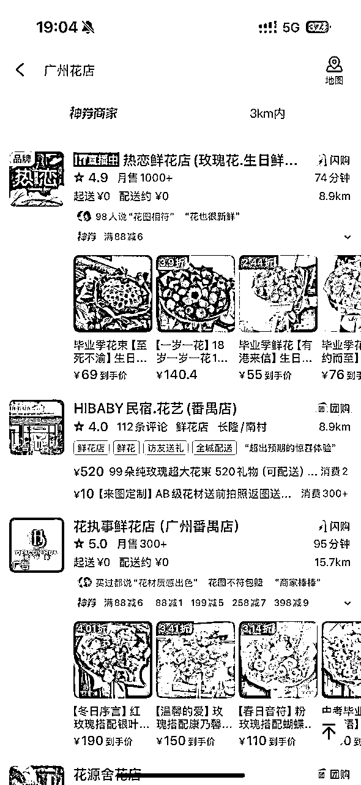

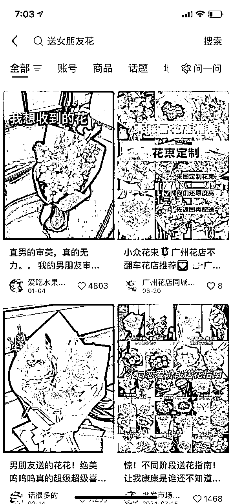

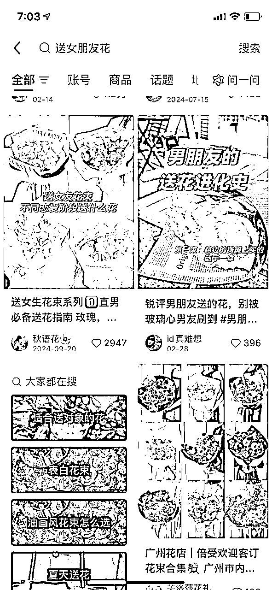

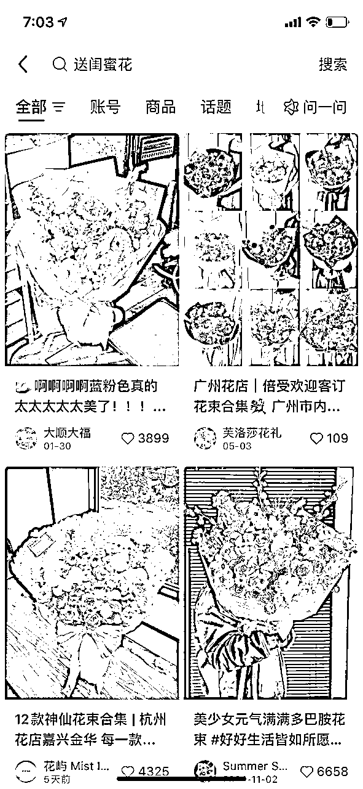

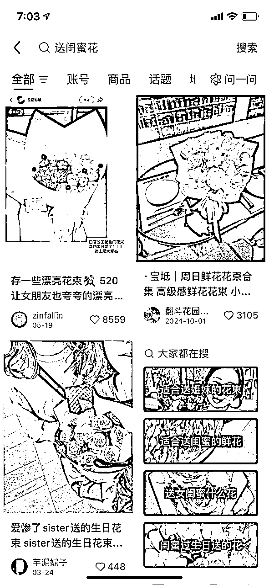

8分会在7分基础上预估成本，防止被割韭菜，很多花源于云南大理，成本极低。10分则在审美基础上叠加情绪价值和惊喜。

AI套壳产品也一样，别自己空想需求。去社交平台看真实吐槽和求助。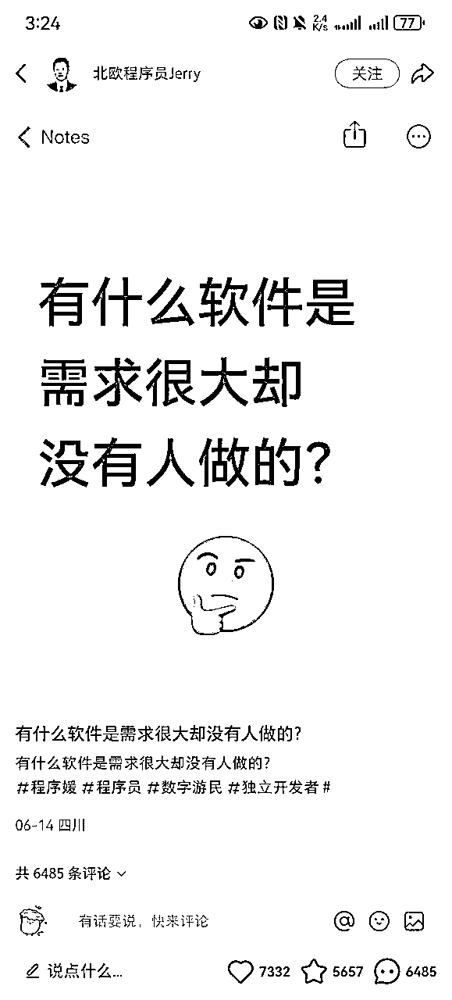

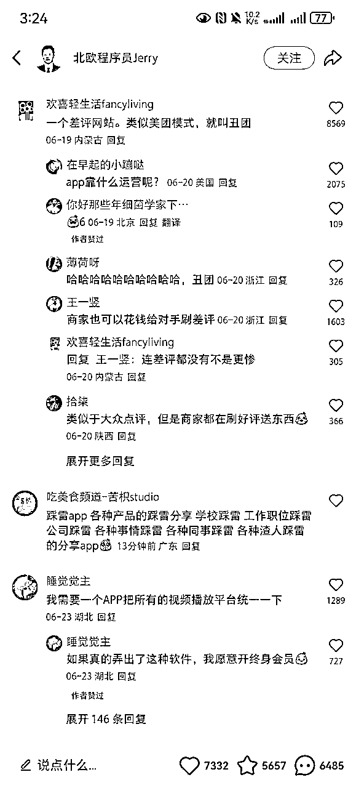

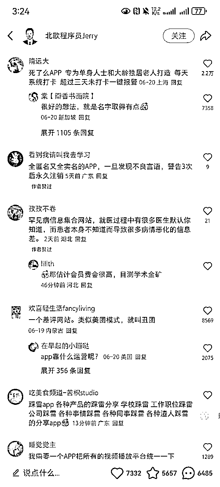

赚钱社群的问题求助区就是金矿，很多问题看似零散，整理后就是产品方向。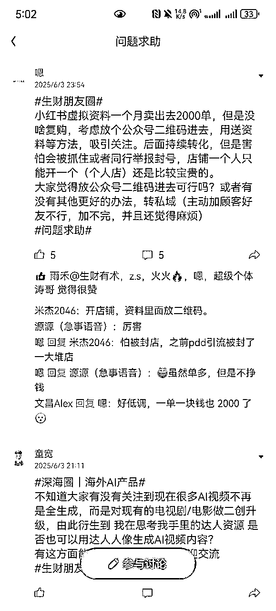

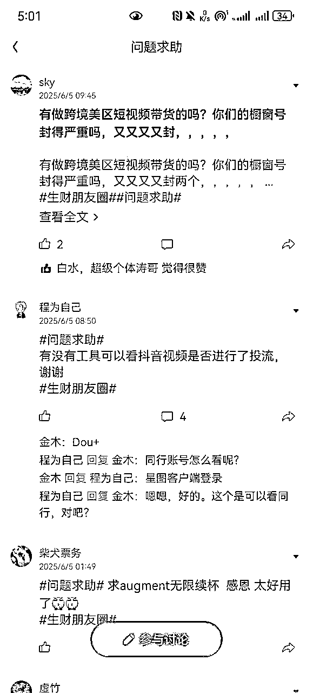

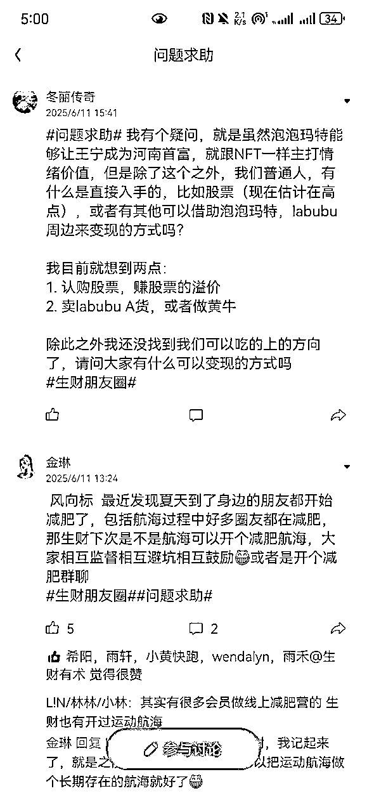

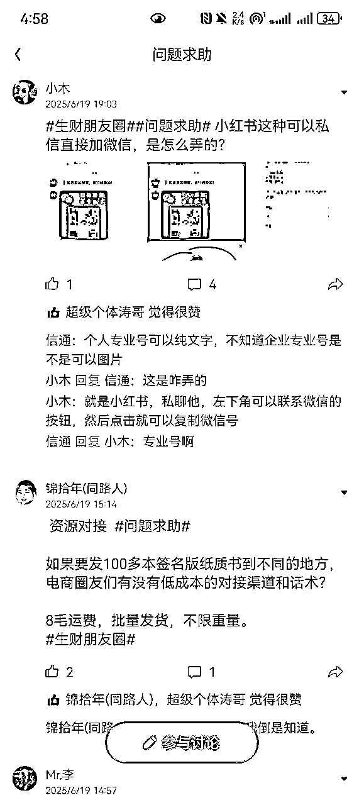

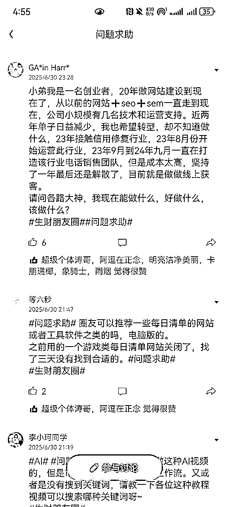

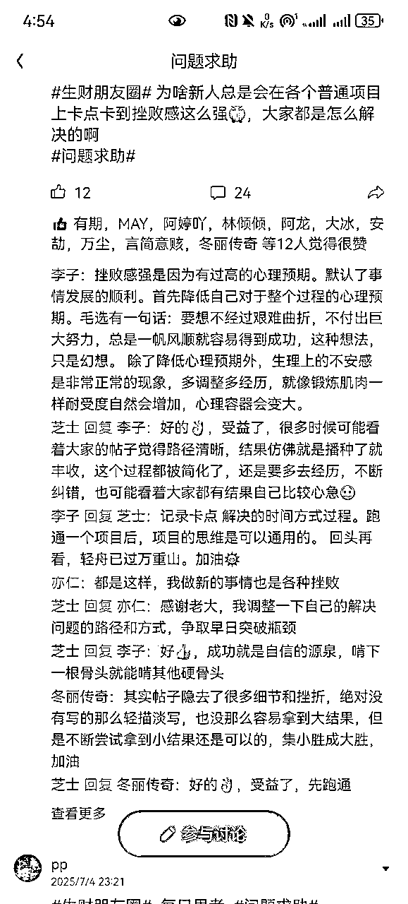

网感不是会梗，它是对平台规则、内容趋势和用户心理的直觉把握，能逆向拆解用户的真实搜索意图，并把经验和数据结合起来找到商业机会。

做私域要对人群有画面感：年龄、城市、困惑、性格特征、自卑或自信点。朋友圈和头像能透露很多信息：大学生、打工人、创业者、宝妈、富二代、体制内、名媛等。对非标品要敢于大胆定价，自信是累积出来的。

旅游分层明显：南极非洲、欧美、东南亚日韩，留学分层更直接决定消费力。

***

网感的价值在于快速找到对标、同行、玩法和投入产出高的模型。对标需要每周甚至每月更新。凌晨1到4点刷到的非合规投放，说明ROI能打正。账号活不过一晚也值得做。

找到高ROI模型是创业最难一步。早期要多迭代，别用战术勤奋掩盖战略懒惰。试错成本很低时就该大胆测试。

现在很多团队做矩阵，但内容粗糙，平台自然限流。若ROI足够高，就不要纠结精细化，直接冲。若平台风控严格，一次封几百号，损耗扛不住。

换项目是常见误区。0到1不难，难的是1到10的细节打磨。一个环节效率降10%，五个环节累积就是近40%损耗。

0到1跑通后要算人效和投入产出比，决定自营还是知识付费放大。

***

培养网感的核心是保持好奇心，多刷多问为什么、怎么做。

做久了容易陷入成本、效率、SOP的思维定式。在社交平台吐槽老板辛酸，反而能吸引同类创业者。但做ToC就不能吐槽，要么你既懂商业又懂人心，要么足够接地气，要么把用户需求听清楚全力做流量。

以教人炒股为例。写干货吸引的是懂的人，但高手太多，付费意愿低。生活场景化+情绪释放+真人出镜晒盈亏截图，蹭热点猛做内容，反而能把流量做大。大部分股民要的不是干货而是情绪认同。等流量起来后偶尔讲干货，秀收益，接广告，导私域，开小灶，和机构合作，至少有五种变现方式。

***

搜集同行的骚操作：在Boss直聘发招聘贴，让应聘者用Word/Excel搜集10到20个对标账号，并说明找到路径。成本极低，还能把应聘者导入私域，发红包激励积极性，零成本拿到大量情报。

信息差永远在多想一步的人手里。

商业嗅觉好不好，看你算账准不准。

当网感成了一种本能，你看一个赛道第一反应不是热不热闹，而是去拆大盘体量、流量怎么来的、能不能跑通稳定模型、毛利有多少、走量的引流款和赚钱的利润款是什么、人效如何、ROI能做到什么水平、头部一年到底赚多少、腰部能分到多少、启动资金要准备多少。这套账算得越清，决策就越狠。

---

### 转化，这件事本质是换脑子

别急着背销售流程、漏斗节点、异议话术、逼单技巧，那些都能抄。抄不来的是卖家自己心里的那堵墙——觉得卖东西丢人、觉得产品不够好、自我设限。一旦这道坎不过，上面所有方法都是无效的。

**信念感和配得感**

“用户要么掏钱买我的解决方案，要么花更长时间去试错。”这就是100%相信自己产品的底层逻辑。

大家只算下单那一刻的价格，忽略的是用户在了解前的学习成本、对比成本、犹豫成本。你帮他省下的不只是钱，是大半年甚至一年的时间弯路。信念感听起来虚，看几个生活里的真实共振就懂了。

见过认知平平的圈友，单号就月入十万，半夜还在想：怎么什么样的人都能赚钱？好闺蜜找了个条件不如她的，翻来覆去睡不着：她图什么？卖保险的先给自己爸妈买了再推荐客户，炒房的自己先全仓再喊别人上车，这股劲儿谁都挡不住。小米SU7 Ultra预期80万，结果50万，很多人第一反应不是买，而是骂自己没钱，雷军已经够良心了。

这就是销冠的状态。不是话术好，是底气足。特别是做培训，状态比脚本重要100倍。你会产生“半夜睡不着怎么办”、“不这么做我真的要和你翻脸”、“你都all in了怎么还不买”、“我这么拼他怎么不买”这种真实情绪的时候，你就离成交不远了。

我自己最烦行业黑话，中台、后台这些词。让我学就生理性抗拒。如果我做个号专门骂黑话，情绪张力绝对拉满。因为是真的讨厌。

**对钱的认知**

“能用钱解决烦恼是一件很幸福的事。钱是工具，是用来降本增效、换加速度、满足欲望的。钱解决不了的事，钱就不该管。”有了这个认知，你会发自内心地去找用户痛点，发自内心地为对方着想。

迷茫往往来自两件事：没钱，和问题用钱解不了。你知道自己在正确赛道，哪怕结果还没来，也不会轻易焦虑。

人有需求，而且需求很多：想变好、想变美、想攀比、想要安全感、不知道钱怎么花、想把预算花掉、想早睡、想一个人待着、想被理解、想赚钱、想被夸、想逃避、想被骂、想堕落、想好为人师、想社交、想装X、想被骗、想控制、想刷短剧爽……把生活里这些痛点记录下来，找到能对应的产品服务，对标后直接抄就行。

记住“好烦”、“想骂人”、“无语”这种瞬间情绪，这是痛点最直观的表达。痛点比痒点更容易付费，也更容易爆。

我现在写这篇就觉得烦，答应7.7交稿，现在都7.13凌晨3点了。我在想架构，想着没什么好写的。最想要的是有人帮我理清逻辑。这是我的当下痛点。Gemini和Claude越聊越烦，解决不了。谁能解决，谁就能拿走我的钱和人情。

很多人说被销售套路，其实是痛点被挖出来了，后悔了。根源是钱包没规划。如果你能提前给钱做预算：这笔钱是学习，这笔钱是定投，这笔钱是试错，花钱有优先级，谁都忽悠不动你。

**客户不爱100分的产品**

用户不要100分，也不愿买100分。100分意味着溢价极高，完美稀缺，供需失衡，自然贵。

豪宅就是例子：地段、配套、朝向、户型、绿化、隔音、楼间距样样顶配，看着都舒服，但谁会轻易掏那溢价？谁的钱是大风刮来的。富豪图省心一步到位，普通人更接受有瑕疵的性价比。

多听客户怎么说，别“我觉得”。销售常犯的错是认为产品贵，用户感知不明显。产品差不多就行。人群分层了，大部分人要的是感觉赚到，只有少数人要最好。

有时候客户要的不是有用，也不是性价比，是好看，想得到，仅此而已。

**常见异议怎么破**

思维对了，话术只是锦上添花。

价值异议：客户说免费内容一堆，为什么花钱买社群。五分销售会辩解我们更系统有老师答疑。八分销售会说：你说得对，信息是免费的，时间不出错的机会才贵。你要花半年自己筛选验证，可能踩一个过时信息就亏三个月。省了3365学费，可能付了三万时间成本。我们卖的是结果和省下的试错时间。问他：你是要自己半年大海捞针，还是直接买下明天就开始？

价格和风险异议：客户担心经济不好怕被割韭菜，外行看不懂。先复述他的担心：价格压力和能力不确定。把问题转到能力上：如果你钱不是问题，最担心的其实是不是真能学到用上赚回来？承认大家都是外行进来才成长。我们有三天无理由退款，72小时体验期，三天后问自己值不值，值得就留，不值得点一下就全额退。这不是一锤子买卖，是先试后买。

---

### 私域朋友圈的下半场

私域的尽头是粉丝经济，是经营信任和人心。

粉丝不是关注数，是愿意反复看你内容的人，就像同一首歌循环听，像刷短剧一样上头。别做xxx天打卡挑战，没人爱看你日更，除非你卖学习。做观众想参与的有趣挑战。

朋友圈要讲故事、造梦，别爹味教学。情感销转和交付，故事比逻辑更有效。实在没故事就换第三人称，让客户替你说话。

定期给干货，制造信息差。行业黑话很重要，让粉丝觉得你知道他不知道的东西，好奇心上来了，洗脑就顺了。

流量不行就all in流量，朋友圈直接抄。优秀文案改一改就能用。

IP不是玄学，是用你自己的价值观、人格偏好、擅长领域，用人话在镜头前表达观点。先有观点，再有结构，再有脚本，多拍多测试。数据会告诉你3秒、5秒、中间、结尾怎么写。准时更新，持续输出。

情感大V起步时一天拍300条，不满意就重拍，拍到麻木坚持一个月就有了流量。

### 线下销售转化率怎么提

别整90岁奶奶都能用的SOP，那是基础。

让员工自己分析竞品好坏、我们好坏，不要设限，最后老板拍板。

面试要筛：做过功课的、现实压力大的。车贷房贷娃的，压力越大，钱给到位就敢拼。毛利不够给高提成，是公司问题。

培训：反复开会讲底层逻辑，日/周复盘为什么推进不动，定KPI淘汰不合适的，鼓励员工提问题。给够钱，给够钱，给够钱。人才走要么钱不够，要么心寒，心寒说白了还是钱不够。

### 投放和团队的坑

投放拿量和追求短期ROI是两回事，回款周期完全不同。低成本拿客资注定不精准，1v1销售压力大。朋友圈营销转化慢但率高，考验现金流。

精准投放要么贵，要么素材强。点击、完播、互动才能降本。归根到底是内容能力。

如果为了拿量想清楚：能否长期做这个人群，三年后还在做。如果能，就all in。人群比赛道重要。赛道会换，人群不变，切换会很丝滑。私域卖的是人，不是单品。赛道多了会发现痛点是通的。

### 稳定矩阵获客

自然流量不可能稳定，平台要的是你给它贡献内容，不是帮你导流。要么投放，要么做优质内容。贪心都是两头空。

找到一个好素材就上大量号，能上1000别上100。避开315、高考等打压期。

有能力可以出海，华人市场Facebook投放合规松，ROI能很可观。但要看现金流。

### 焦虑怎么破

焦虑是未来模糊，流量焦虑。其实很多人焦虑是因为“我赚到钱就能xx”。建议从打工思维转投资思维。

你花500吃顿饭，不要算要打多久工赚回来，算你需要多少本金让被动收入就能覆盖这顿饭。假设年化15%，通胀7%，真实增值约7.3%，月增值0.63%，日增值0.021%。500块需要约238万本金才能睡后赚到。

你会发现再有钱都得搞钱，欲望会涨。钱到一定程度，不只是正反馈，是需要现金流防止标的回调。大佬还在赚钱，是因为欲望更大，也需要现金流对冲亏损。

这样想就不焦虑了。你注定要工作，要做事，关注过程。哪怕年入几百万，人上有人。很多事钱解决不了，是关系问题。

说到底，人与人之间拉开距离的，其实就是信息获取量和落地执行的差距，并不是谁天生就更聪明。刻意拓宽自己的信息触角，哪怕只是先建立一个“原来还有这回事”的认知都很重要。线下聚会也一定要去，圈子里的朋友真正在场时分享得都很实在、很上头。

另外，如果你自己暂时还没找到一个特别合适的赛道，那就去观察身边正在靠合法方式赚到钱的人。紧跟、紧贴、完整复刻他的打法就对了。坦白讲，普通人做生意能走通的路子，本质上就是把A赛道、B赛道、C赛道里能用的好点子，系统性地迁移到你自己的D赛道里，持续借鉴、反复融合，直到跑通为止。

欢迎大家参加7.26杭州的航海家私域运营大会~

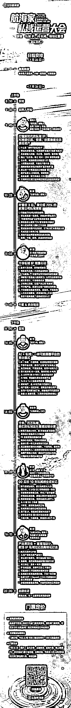

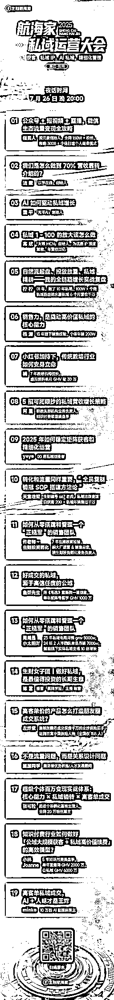

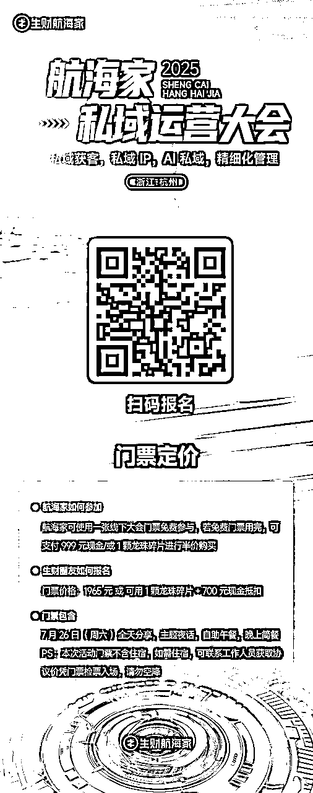

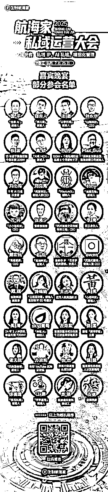