# YouTube未来的打法已经变了

> 来源：[https://rlwxa0zgke.feishu.cn/docx/JTAwdmGDAoxODdxAdgmc36lwnR6](https://rlwxa0zgke.feishu.cn/docx/JTAwdmGDAoxODdxAdgmc36lwnR6)

我是在2025年6月28号、29号跟着圈友哥飞跑活动，回头结合自己实操的经验，总结出YouTube接下来会怎么玩。

核心逻辑其实就一句话：Google搜索和YouTube搜索是打通的。真正的新打法是，网站和YouTube别再各做各的，要绑在一起做。

先说一个容易踩坑的地方。你用自己的账号去搜结果会偏。举个例子，搜 `youtube shorts crawler`，我这边能刷到 https://shortscrawler.com/ 排在第一，但这不是真实的排名。原因很简单，搜索会被你的浏览历史、cookie影响，看到的版位都是个性化后的。

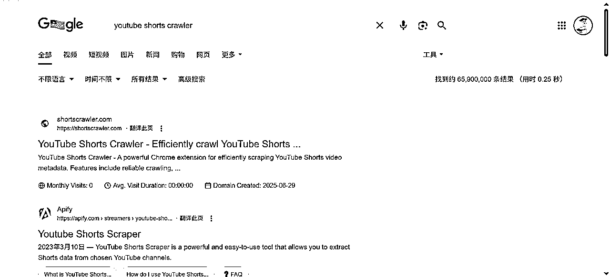

关掉干扰、用无痕窗口再看一遍，画面就完全不一样了。第一位还是大站 https://apify.com/streamers/youtube-shorts-scraper，但第二位直接就被视频占了。

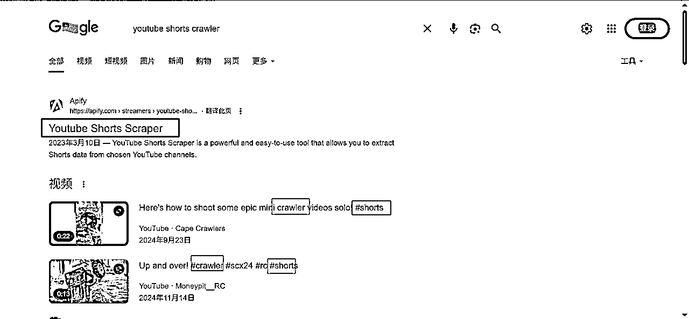

点进去看视频标题，第一个是 Here's how to shoot some epic mini crawler videos solo! #shorts
第二个是 Up and over! #crawler #scx24 #rc #shorts

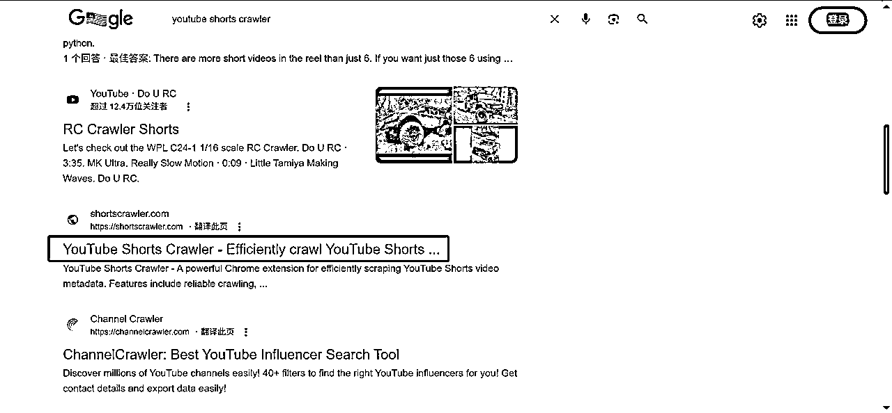

想做引流就得全套到位，标题和视频语言最好都用英文。演示一下没登录的状态下搜索，第一个出来的是广告。

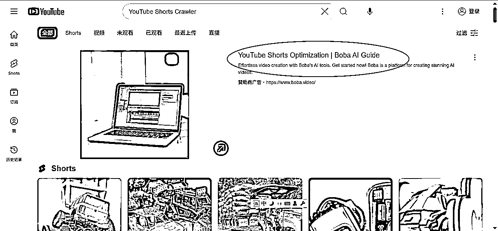

往后滑，匹配到的全是英文视频。

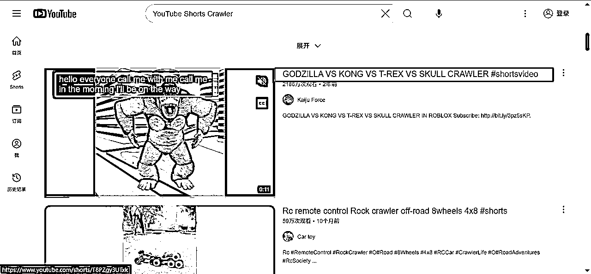

如果你平时搜索习惯是中文，系统默认就会优先推中文内容。这里我全程用无痕，就是为了剔除个人观看记录带来的偏差。

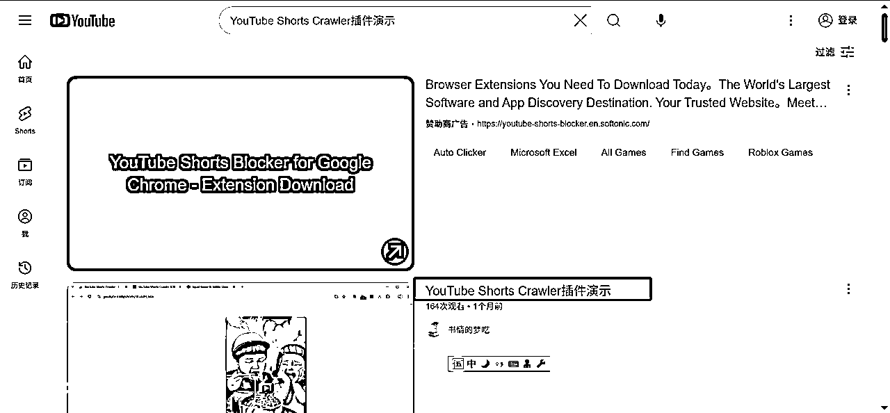

小结一下：

做个站、做个插件，完全可以通过在YouTube视频标题里埋词来承接搜索流量。这个点算是个半公开的秘密，知的人早就上手了，不知道的人还在单打独斗。

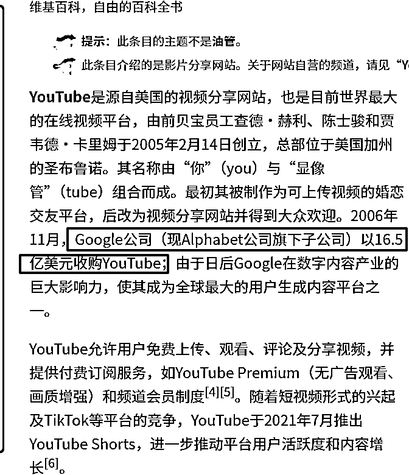

在这种机制下，你看搜索结果第一是Google自己的，第二就是YouTube，也就是Google的亲儿子。很多人只盯着网站SEO，却忽略了YouTube这个流量入口，更没想过把两者联动起来。

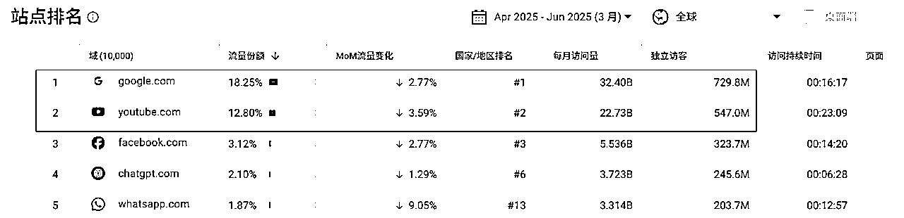

怎么联动？做法很直接，给你的YouTube视频铺关键词，等用户从搜索点进来，就在视频简介里挂上你的官网链接。观众搜到视频进来看完，自然就能被导到你的站。

讲完搜索，再说变现的加速器。之前在生财发的无人直播思路，到现在依然能用。无人直播可以快速冲时长、过YPP，找到个最近在试播的朋友给你看。

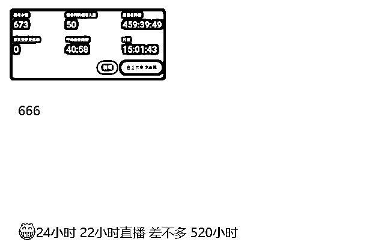

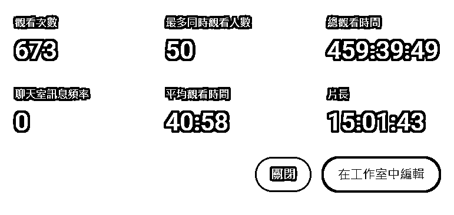

做得顺手的案例也不少，一场直播的累计时长直接就达标YPP了。

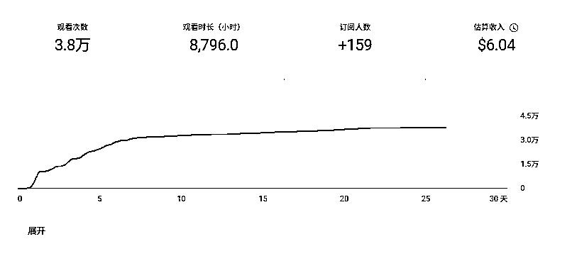

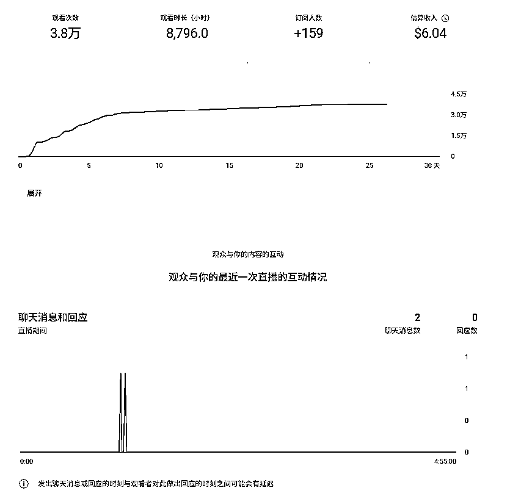

YouTube本身也值得做SEO。关键词布局好后等流量进来，下面这个例子就是视频在YouTube搜索拿到了133W观看。

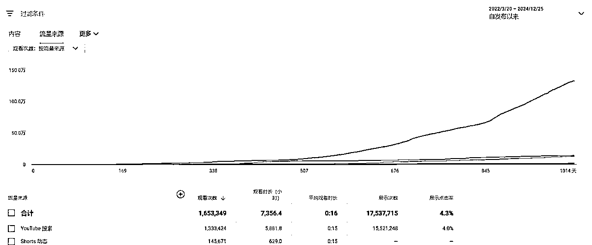

今天抛出来的这个思路，对一部分人来说可能已经是常识，但对另一些人来说可能真的是第一次听到。抛砖引玉，希望有更多高手能把这个组合玩法放大，做出结果来。