# YouTube小白从零起步，如何做到月入3W？

## 写在前面

我目前主要做的是YouTube Shorts，还没有尝试长视频。因此，今天复盘的内容，全部围绕Shorts展开。

如果让我回到今年3月份，重新开始做YouTube，我依然会选择现在这套方法。它更像是一份写给自己的Shorts实战攻略。

当然，这只是我的个人经验，不一定适合所有人。如果你有不同观点，或者发现了相反的数据案例，也欢迎交流。

这篇内容不会只讲理念，也会尽量拆解具体步骤。即使你是刚接触YouTube的新手，看完之后，也应该能知道第一步该做什么。

全文主要分成两个部分：

- 第一部分：如何寻找爆款、测试赛道，并快速开通YPP实现变现；
- 第二部分：如何搭建自己的制作流程，提高视频生产效率。

先说一下目前的结果。

## 我的YouTube成绩

大家好，我是大臣。今年3月份参加赚钱的YouTube航海后，就开始持续做Shorts。

目前，我已经开通了8个高级YPP账号和2个初级YPP账号。上个月总收益大约4500美元，其中单个账号最高收益约3000美元。

不过这只是预估金额，因为收益要到每月7日至12日左右才会打款，最终到账情况还要以实际为准。

前几天，我还收到了YouTube银牌。

不过，我有两个账号都超过了10万粉丝，最终只有一个账号能够领取银牌。另一个账号没有通过，官方给出的原因是：内容原创程度不足。

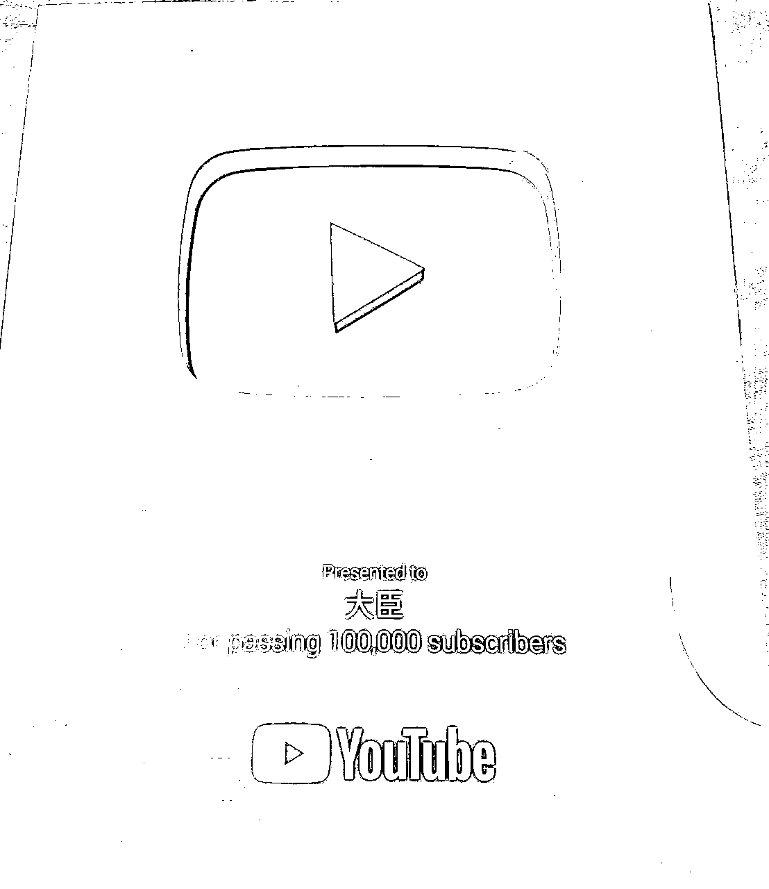

## 怎样快速开通YPP并实现收益？

### 先建立几个基本认知

在具体讲方法之前，我想先分享几条对我影响比较大的行动原则。

### 1. 流量本身就是收入来源

无论是申请YPP，还是依靠YPP赚钱，底层都离不开播放量。

所以我的判断标准很简单：哪里有流量，我就研究哪里。

但这个原则有两个边界：

- 违反YouTube规则的内容不做，因为即便获得流量，也可能无法通过YPP审核；
- 让自己明显感到不适的内容不做，因为这种项目很难长期坚持。

#### 不要被个人偏好限制

比如《鱿鱼游戏》这个主题，我很早就知道它在YouTube上非常热门，但之前一直没有尝试。因为我不喜欢追热点，总觉得追热点显得不够“高级”。

但后来我意识到，做项目的第一目标是赚钱，不是证明自己的审美。

再比如，当你长期做一个赛道之后，切换到新方向，往往会本能地抗拒。

我之前主要做故事类视频，后来发现了一个找茬类赛道。即使它只是单张图片，我依然觉得它不如故事视频好做。

找茬游戏：

https://www.youtube.com/shorts/xMLTJfuqBV8

猫猫故事：

https://www.youtube.com/shorts/LYEkg7rHhy8

这种时候，我会提醒自己：我是来找机会赚钱的，不是来维护舒适区的。

### 2. 刚开始时，目标不要定得过高

低预期，反而更容易坚持。

4月和5月，我主要是在摸索如何开通YPP。真正开始依靠视频获得收入，是从6月份开始的。

当时我给自己设定的目标是：这个月赚500美元。

结果最后超过了预期。

但到了6月底，我又开始担心：如果7月份无法保持现在的成绩怎么办？

于是我重新问自己：即使状态变差，最低能接受多少收入？

我的答案是3000元人民币。换算下来，500美元依然是可以接受的结果。

不过不能永远停在原地，所以我把下个月的目标提高到1000美元。

### 3. 项目跑通之前，不要过早思考长期主义

长期坚持当然没有错，但有一个前提：你现在的项目必须能够带来收入。

只有先活下来，才有资格谈长期。

我一开始做故事赛道时，就想着未来要长期发展，于是开始研究故事理论，甚至去读罗伯特·麦基的《故事》。

但看了一天之后，我发现不太对劲。

这本书可能有价值，但阅读和理解需要投入大量时间，而我当时连项目能不能赚钱都还没验证。此时最重要的不是建立完整理论体系，而是先确认这件事能不能产生结果。

在项目没有跑通之前，任何高成本的长期规划，都可能只是自我感动。

## 做出爆款的完整流程

### 第一步：先找到合适的赛道

Shorts能不能做起来，方向选择非常关键。

你不能只盯着一个领域研究，而是要尽可能扩大视野，看看平台上正在流行什么，其他创作者正在做什么。

同行，就是最直接的案例库。

#### 方法一：使用YouTube手机App

在手机上安装YouTube，不登录账号，直接刷Shorts。

前提是需要自行解决网络环境问题。

#### 方法二：反复刷新YouTube首页

通过浏览器打开YouTube首页，不断刷新，观察首页推荐的Shorts内容。

我挖掘到不少新赛道，都是通过这个方法发现的。相比直接在浏览器里连续刷Shorts，首页刷新有时更容易看到不同领域的内容。

这里有个细节：

如果你的目的是拓展赛道宽度，最好不要关注频道，也不要直接点进感兴趣的视频。可以复制链接到其他浏览器中观看，避免推荐系统迅速把内容集中到单一领域。

但如果你已经确定了一个方向，想深入研究该赛道，那就反过来操作：

- 大量观看同类视频；
- 关注相关账号；
- 让算法持续推荐这个领域的内容。

#### 方法三：借助第三方数据网站

我目前使用的是：

https://www.viewstats.com

进入Top Videos后，可以看到平台上播放量靠前的视频。

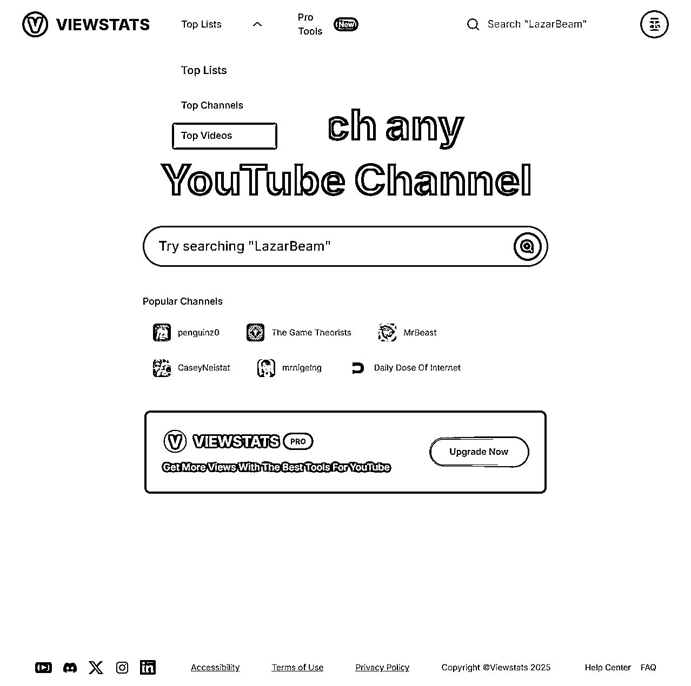

选择Shorts后，左侧能够按照时间筛选，包括：

- 昨天；
- 最近7天；
- 最近28天；
- 最近3个月。

这些时间范围都建议分别查看。

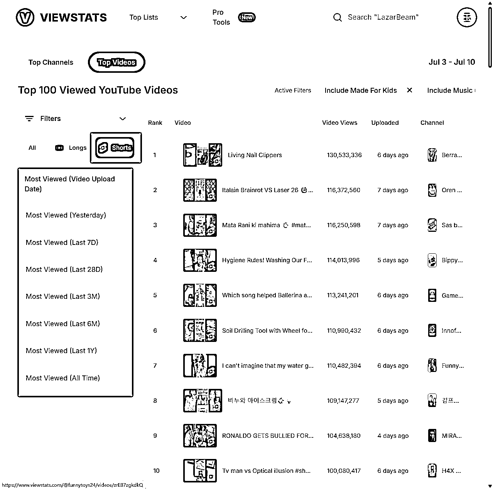

在Filters里，还能继续按照国家和内容类型进行筛选。

你可以把国家、分类和时间范围组合起来，反复挖掘不同区域、不同领域的热门视频。

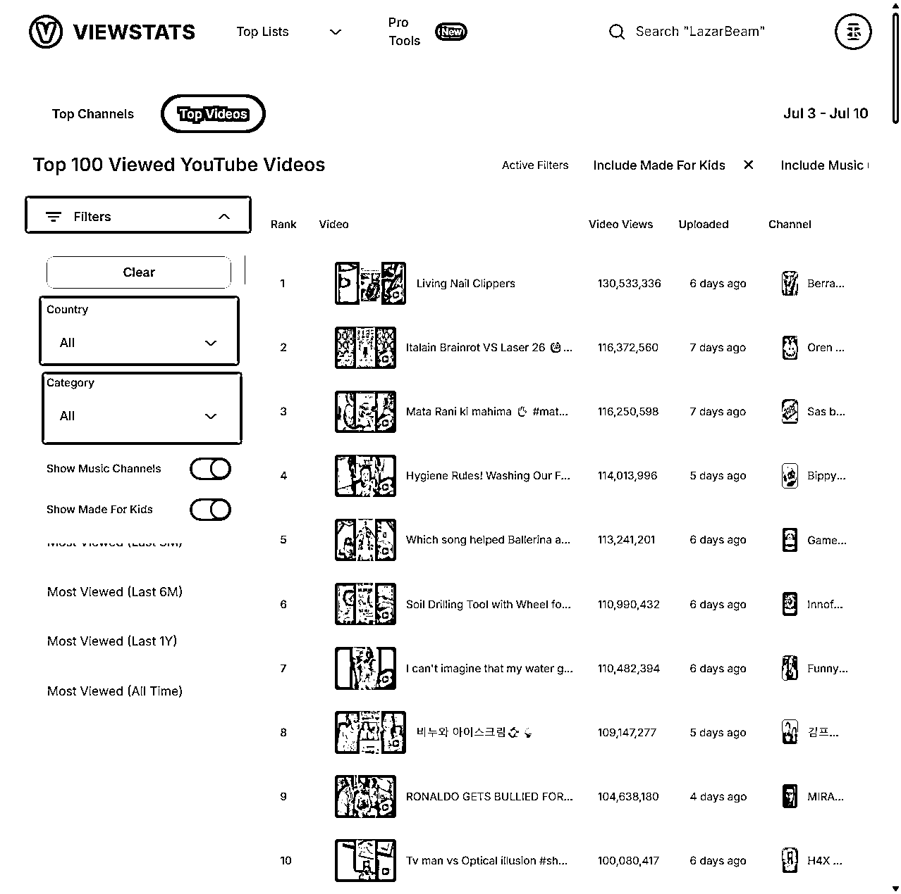

例如，可以筛选“美国+动物”这一组合。

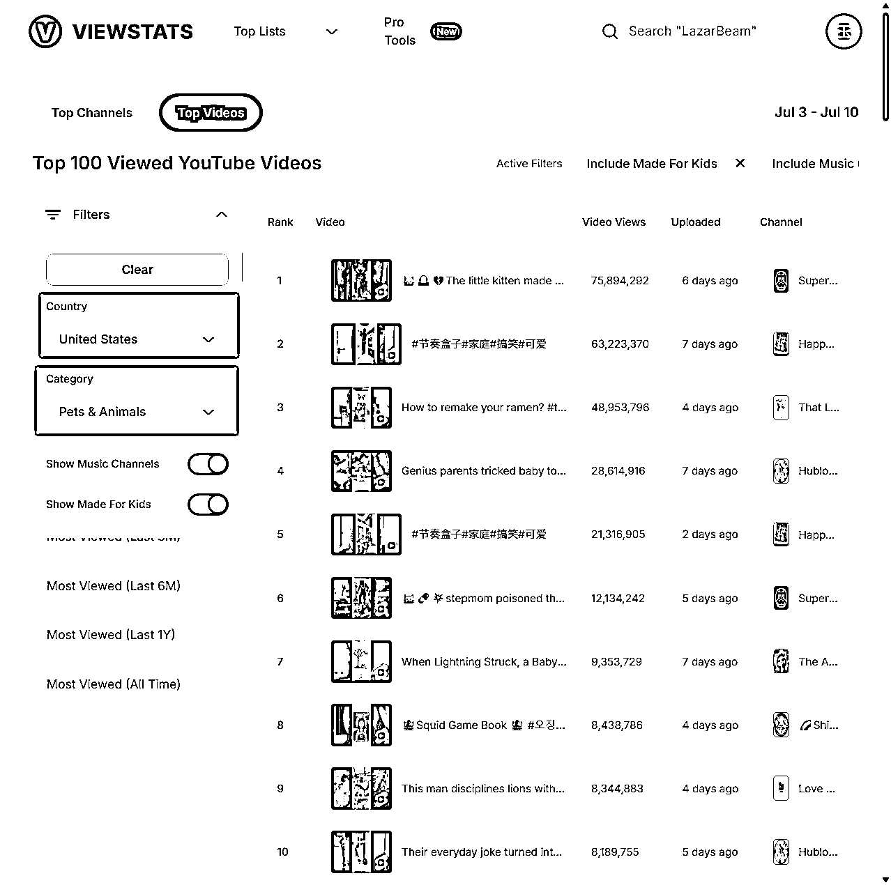

#### 方法四：用关键词扩大搜索范围

这里说的关键词，不是为了寻找某个赛道里的对标账号，而是为了建立更广泛的内容认知。

你可以让AI先生成一批一级关键词，例如：

- 舞蹈；
- 历史；
- 音乐；
- 动物；
- 游戏；
- 故事。

看到感兴趣的方向后，再继续拆成二级关键词，逐步缩小范围。

### 第二步：判断赛道是否仍有机会

完成初步搜集后，你手里应该已经有了一批候选赛道。

接下来要判断的是：这个方向现在是否仍然值得进入。

#### 内容有生命周期，赛道未必会消失

Shorts中的内容通常存在生命周期。

这里说的并不是某个赛道彻底死亡，而是同一类内容可能因为供给过多、用户看腻而进入低谷。

很多赛道本身是长期存在的，比如故事类内容。但某一种具体表达方式，可能会逐渐失去新鲜感。之后如果出现新的创意形式，就可能重新开启一个流量周期。

内容是否进入疲软期，通常会反映在播放数据上。

如果同一赛道的大多数视频长期只能获得几万播放，很可能说明当前内容形式已经趋于饱和。当然，也要排除视频质量本身不够好的情况。

可以参考下面两个视频：

https://www.youtube.com/watch?v=LAn78RHRLYI

https://www.youtube.com/watch?v=4CH7SFCaejA

这两个案例通过单个账号的内容变化，展示了同一赛道中内容热度的起伏。我也按照这个思路分析过一些频道，确实能看到类似规律。

#### 我的筛选标准

我通常会从以下几个维度判断一个赛道是否还有活力：

- 这个领域历史上出现过的最高播放量是多少？我个人认为，至少要出现过1亿播放，最好有2亿以上；
- 最近一个月内，是否仍然出现过上亿播放的视频；
- 最近7天内，是否还有千万级播放的内容，最好能看到5000万以上的视频，或者至少有4条千万级视频。

满足这些条件，说明赛道仍然存在较强的流量机会。

### 第三步：确认自己能不能做

筛选出仍在增长的赛道后，还要考虑一个现实问题：

这个方向，你能不能真正制作出来？

因为我目前主要使用AI制作视频，所以我的判断方式是：

能不能用AI完成复刻或改造？

能做，就进入下一步；做不了，就暂时放弃。

#### 不要拿自己的短板硬碰别人的优势

假设你的对标账号是真人拍摄，而你手里只有AI工具，那么你很难在动作流畅度上完全超过真人。

如果你花大量时间，试图让AI生成和真人一样自然的动作，往往是在低效消耗。

真人轻松完成的事情，不一定适合AI。

反过来，你应该思考AI的优势：

- 能生成现实中难以拍摄的画面；
- 能快速改变角色和场景；
- 能构建怪物、外星世界或超现实环境；
- 能实现低成本的视觉想象。

例如这个视频：

https://www.youtube.com/shorts/vQJwWJV86o0

视频的核心结构是：主角每推开一扇门，门后都会出现不同的东西，比如马、跑车等。

如果用AI去改造，我们完全可以把门后的内容替换成异形怪物、UFO、星际战场等。

这些具体设定未必一定爆，但思路很重要：

不要机械复制别人的表现形式，而要抓住内容结构，再用自己的工具优势重新表达。

AI、真人拍摄、3D建模、游戏引擎，都只是载体。真正重要的是：你能否把核心内容做出来。

### 第四步：亲自测试

赛道到底行不行，不能只靠观察和分析，最终必须下场验证。

我的测试周期通常是一周左右。

如果一个方向连续测试一周仍然没有结果，就切换到下一个方向。同一个账号也可以先后测试多个赛道，不必把自己锁死在一个领域里。

不过要注意，测试赛道的前提是内容质量达标。

如果你做出来的视频明显比对标账号差，那么最终数据不好，无法判断究竟是赛道不行，还是视频本身不行。

我的判断标准是：

只要能够做出百万播放的视频，就说明这个赛道具备可行性。

### 第五步：如何提高爆款概率

找到一个热门领域，并不意味着你一做就能爆。

真正困难的是：如何做出属于自己的第一个大爆款。

我的定义是：

- 100万播放以上，算爆款；
- 1000万播放以上，算大爆款。

这里主要介绍两种方法：

- 矩阵测试；
- 爆款微创。

两者并不冲突，实际操作时可以配合使用。

#### 矩阵：用更多账号增加成功概率

我建议至少准备3个账号，同时测试同一个赛道。

Shorts爆款有一定随机性，同一个脚本并不是每次都能获得相同结果。想提升成功概率，就必须增加测试次数。

我曾经把一个爆款脚本发布到10个账号，最后只有一个账号突破千万播放。这已经算比较幸运的情况，有时可能一个都不会爆。

我过去做矩阵视频的方法很简单：

- 保留生图提示词；
- 保留图生视频提示词；
- 只替换视频中的主体角色。

不过，YouTube在2025年7月15日将进一步打击AI批量生成的重复内容。实际上，平台此前已经开始关注这类问题，只是规则边界仍然比较模糊。

因此，过去这种简单复制的矩阵方式是否还能长期使用，需要继续观察。

即便这种模式受限，也不代表没有解决办法，关键是不能只做低差异的重复内容。

再看一个我自己的案例：

某条视频的选择观看率达到81.4%，完播率超过100%，互动观看达到2.6万，但最终播放量只有5万左右。

从数据表现看，它明显具备冲击更高播放的潜质，但结果并没有继续放大。

这也说明，爆款除了内容质量之外，确实还存在一定运气因素。

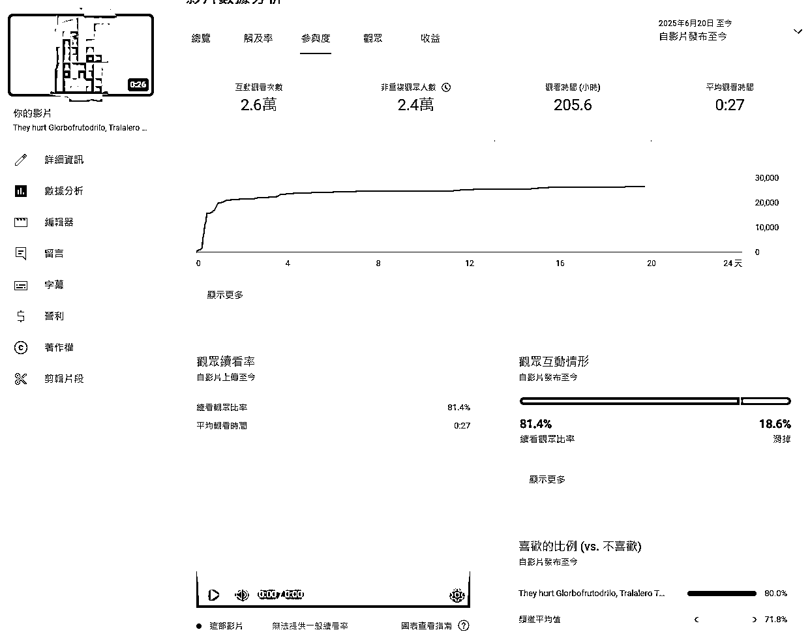

#### 微创：把多个爆款元素重新组合

微创不是随便改几个细节，而是把已有的热门元素进行重新拼接。

可以理解为：

爆款元素A + 爆款元素B = 新的内容组合。

例如：

- 《鱿鱼游戏》在YouTube上很火；
- AI山海经角色也曾经爆火。

那么就可以尝试把两者结合起来。

我曾经在一个动物故事老账号上测试过“鱿鱼游戏+AI山海经”的组合，第一个视频就获得了300万播放。此前，这个账号也只有一条视频达到过300万。

## 怎样做有效微创？

由于我目前主要做故事类Shorts，下面的案例也以故事赛道为主，但这个思路同样可以迁移到其他领域。

### 先拆分爆款中的两类元素

我会把爆款内容拆成两个部分：

1. 爆款脚本；
2. 爆款IP。

二者可能单独发挥作用，也可能同时出现。

还需要注意，有些IP本身具备明显的时效性。

比如今年4月初大火的AI山海经角色，就属于阶段性爆款IP。到了明年，它是否还能保持热度，很难确定。甚至现在，它的流量已经开始下降。

所以，观察热门内容时，要及时记录和归类。

例如：

https://www.youtube.com/shorts/Co7_pyl9150

这条视频包含：

- 爆款剧情：被嘲笑后逆袭；
- 爆款IP：C罗和梅西。

再看：

https://www.youtube.com/shorts/BO-jbdJ6wmo

它沿用了类似的剧情结构，但把人物替换成了拟人化猫咪。

拟人化猫咪本身也是YouTube上表现非常好的形象。

那么，我们自然可以继续替换其他热门IP，比如：

- AI山海经角色；
- 鱿鱼游戏角色；
- 其他正在流行的视觉形象。

不过需要提醒一点：不建议直接使用C罗和梅西等真实人物制作内容，因为这类素材容易触发版权或平台警告，已经有人因此受到限制。

### 建立自己的爆款素材库

你可以持续积累两类资料：

- 爆款IP库；
- 爆款脚本库。

之后再进行排列组合，就能不断生成新的内容方案。

除非你已经有稳定收入，想认真打造长期品牌，否则不建议一开始就从零创造原创IP。

原创IP的成功率通常较低，试错周期长，成本也高。

### 通过改换IP完成微创

下面再看一个剧情改造的例子。

原始版本：

https://www.youtube.com/shorts/4KQ2vDTuYmg

这个剧情曾经出现过上亿播放的视频，虽然原视频目前没有找到，但这里的版本采用了相同的剧情结构。

改编版本：

https://www.youtube.com/shorts/kjdph7YNhHw

故事赛道里，“被嘲笑—努力改变—最后逆袭”一直是非常强的内容结构。

如果你不熟悉这一类型，可以看看这个频道的其他内容：

https://www.youtube.com/@MysteriousKittenn/shorts

改编后的视频，前半段借用了“猫妈妈被剃头”的热门开场，后面又接入了被嘲笑、完成逆袭的剧情。

这就是典型的爆款元素重组。

## 同行为什么是最好的老师？

我做爆款的方法，很多都是从同行身上学来的。

以前我也知道要向同行学习，但并不清楚应该具体学什么。

后来我发现，真正值得研究的，不只是“他的视频火了”，而是：

- 他为什么选择这个IP？
- 他借用了哪一种剧情？
- 这个视频是在改编谁？
- 他是如何组合爆款元素的？

如果你发现某个同行通过更换IP获得了高播放，那么你也可以尝试替换新的IP。

如果他是通过重新组合爆款剧情获得流量，那么你也可以拆解并重组结构。

关键是要看得足够多，否则很难找到内容之间的来源和关联。

### 从同行案例中提炼模板

比如“剧情反转”本身就是一个常见的爆款元素。

案例一：

AI山海经反转：

https://www.youtube.com/shorts/nTTDGTkI-TI

案例二：

耶稣反转：

https://www.youtube.com/shorts/6RmwJWGb2rU

通过分析，你可以抽象出一个通用结构：

开头看起来是在做坏事，最后却产生了好的结果。

以后再遇到其他爆款剧情，就可以套用这个结构进行改编。

到这里，爆款内容的基本流程就完成了：

1. 找到有流量的赛道；
2. 判断赛道是否仍有机会；
3. 确认自己能否制作；
4. 用实际视频测试；
5. 通过矩阵增加测试次数；
6. 通过爆款元素重组提升成功率；
7. 从同行案例中提炼内容模板。

剩下的，就是真正开始做，并用数据验证自己的判断。

## 怎样搭建自己的提效流程？

提效不是第一步。

只有当你已经跑通一个赛道，明确知道内容能够获得结果之后，才值得花时间优化生产流程。

如果项目还没有验证成功，却一开始就投入大量时间开发脚本、搭建工作流，很容易陷入“效率很高，但做的是错误的事情”。

在赛道还没有跑通之前，如果觉得手工制作太慢，可以先借用别人现成的脚本或工作流。

我现在的流程，也是先确定素材制作方式，再根据实际需求逐步搭建出来的。

脚本和工作流本身不是核心。

真正重要的是，你要清楚制作一条视频究竟需要哪些环节，以及每一步最终要得到什么结果。

当你明确需求后，无论是：

- 自己用AI开发；
- 找专业人士定制；
- 使用现成工具；

都只是执行层面的选择。

### AI制作视频通常要解决哪些问题？

以我的流程为例，主要包括：

1. 生成文生图提示词；
2. 完成文生图；
3. 设计图生视频提示词；
4. 完成图生视频。

目前，我重点优化了前两个环节，后续步骤暂时仍然以手工处理为主。

## 文生图提示词如何提效？

我曾经通过和Gemini反复沟通，设计了一套文生图提示词模板。

这里说的Gemini，指的是Google AI Studio中的Gemini Pro模型。

当时的对话记录已经找不到了，最初大概是从这样一句话开始：

“请帮我设计一个适用于Sora出图的提示词模板。”

但只提出这一句远远不够。

你必须先想清楚自己想生成什么画面，再不断向AI补充要求、修改结构、实际测试，最后才能得到真正适合自己的模板。

我的角色通常会使用参考图，所以不需要重复描述角色外观。实际制作中，我最常需要调整的内容主要是：

- 表情；
- 动作；
- 场景环境。

经过多轮沟通和测试后，我整理出了下面这套结构。

### Sora文生图提示词模板

**[主体]**

角色：

表情：

动作：

**[环境]**

**[时间]**

**[天气]**

**[视角]**

**[景别]**

**[风格]**

追求极致的超写实摄影效果。画面应呈现高度真实的视觉质感，仿佛由顶级数码单反相机拍摄，例如佳能EOS R5或索尼Alpha 1，搭配50mm f/1.2或85mm f/1.4等高质量定焦镜头，在专业灯光或理想自然光环境下完成拍摄。

**[光照]**

采用自然光照，整体柔和均匀，光影细节真实自然，避免生硬或过度戏剧化的阴影。

**[色彩]**

使用自然、写实的色彩表现。保证白平衡准确，避免明显偏黄。画面色彩干净、协调，不过度饱和。

**[画质]**

如果你问我做AI视频这一年多，最难的是哪一步？我的答案可能和很多人不一样：不是技术，而是等待、返工和来回切换工具。本文没有“一键变大师”的魔法，但应该能帮你省下不少低效时间。

### 我给自己定的画质底线

我习惯用“看起来像实拍”来要求每一张画面。纹理要经得起放大，光线明暗要自然，色彩不能偏，画面还要干净到看不出噪点和数码加工痕迹。我通常按8K标准来评估结果。落到具体操作上，风格、光影、配色和画面质量这几组基础参数是底座，一般不会改动。

模板固定后，真正让我头疼的是“改东西”。以前我把所有镜头都放在表格里，可图片要另外开窗口看，改一个镜头就得在两个窗口之间来回跳。时间一长，我实在撑不住了。

于是我动了做浏览器扩展的念头，借Gemini的能力把流程串起来。直接用API当然也行，但免费额度不够稳定，当时Pro的免费入口也关了。最省心的方式，反而是自己控制前端。

### 静态画面：角色稳定是Sora给的

我一直在做神话向的AI内容IP，最大的难点是：光靠文字描述，角色根本立不住。我之前把即梦、Sora都试了一遍，最后发现唯独Sora能做到“同一角色百变场景不乱”。所以只要涉及静态画面，我都用它；后来连别的视频里需要固定角色的图，也默认交给它。

但它有一个硬伤：慢。我原来买的共享会员，一个会员排队名额有限，两个会员一起开，同时能生成四张都算不错。每张至少等两三分钟，一旦撞上内容审核或构图不合格，一个镜头折腾半小时也不稀奇。

既然单张等太痛苦，我想试试API批量跑。先算账：第一次找的云雾平台，单张0.175元，我的片子大约25个镜头，算下来4元左右。这个数额我完全接受，于是写了批量跑图工具。最近工具又兼容了书虫老师的接口，单张降到2分钱，四舍五入等于免费。

### 把静态图变成动态：即梦的一点心得

动态环节我更常用即梦。两个技巧分享给你：

第一，每一条描述语的结尾，我都会补一句“镜头衔接顺滑，动作符合自然物理规律，画面里不要有多余人物。”加上这一句，生成的稳定性会好不少。

第二，描述动作时要带时间轴，比如“开头3秒原地观望，后面2秒起飞”，能防止角色在开头长时间发呆。

### 额度见底了？我用两个笨办法解决

第一个办法就是“用狠一点”。新号的初始额度是66积分，只要每天都花完，额度慢慢会升到100积分。我现在手上这些账号，基本都稳定在100积分。

第二个办法是多养号。老账号可以协助开启子账号，不需要额外绑手机，等于一个主账号能扩展出两个独立登录身份。步骤很简单：打开App的账号管理页  
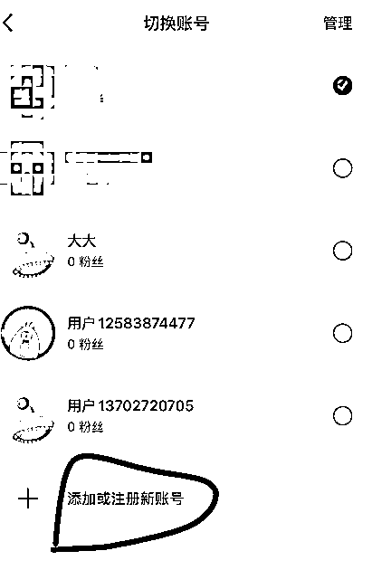  
点“新增账号”  
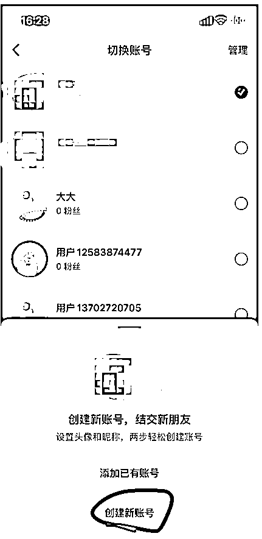  
选“由老账号协助开启”  
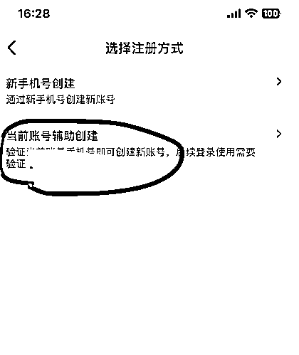

另外，建议在Android上操作新号，因为只有安卓端有“1元购200积分”的福利，iOS没有。如果是全新安装即梦，还能领首装奖励。

账号一多，登录就麻烦。我用防关联浏览器来管理，不用反复扫码。目前常驻的是ixBrowser，网址可以通过邀请码BK85找到，这不算广告，纯粹是个人喜欢。它每天能开10个独立窗口，默认还有100次进入次数，单人使用很够用。

### 生产力工具一：Gemini镜头助手

这个扩展是我用Cursor做的，安装文件是crx，导入Chrome就能用。

用之前要理解它的工作方式：因为我在Sora那边已经用参照图固定了角色外形，这个工具生成的镜头描述不会重新写角色长相，而是以“图1”“图2”这种占位符代替。如果你想指定角色名，就在角色映射区写下对应关系：

“全部镜头中会出现若干主角，请用下面的名字替换对应角色，不要改动名字本身：  
角色甲 = 角色甲的英文识别名  
角色乙 = 角色乙的英文识别名”

例如，父猫角色给一个长英文名，幼猫角色给pup，Gemini就会自动把占位符换成这些名字。

接下来是操作流程：

先点界面右下侧的“镜头表”入口  
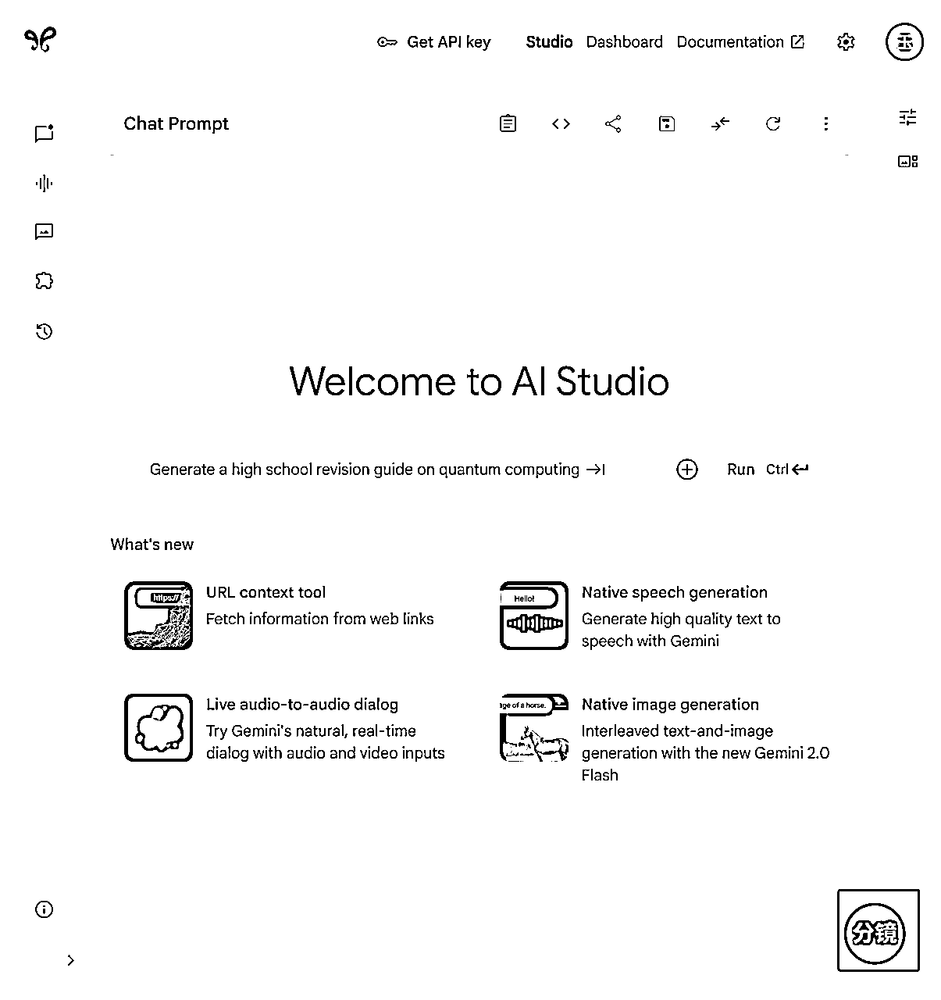  
点“发给Gemini”，让它按预设指令开始拆解  
  
上传图片时可以用“批量选择”，也可以直接粘贴截图；粘贴第二张前，先点击“补充描述”那一栏  
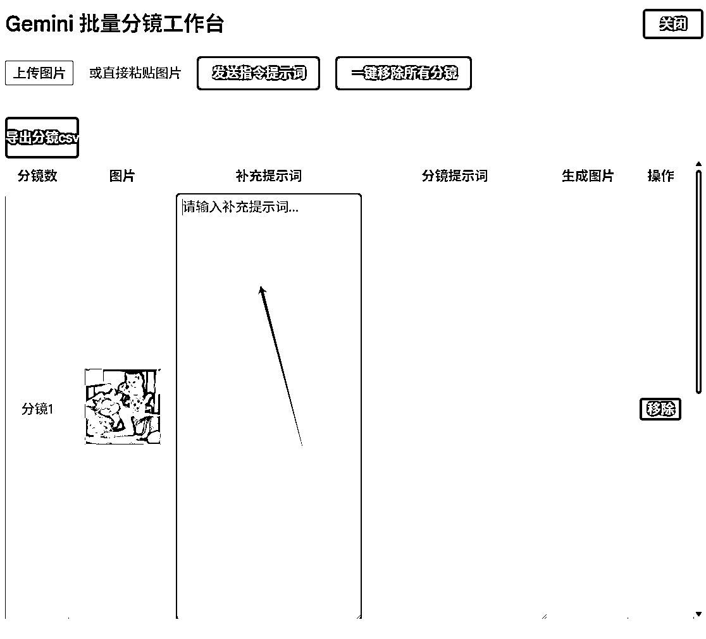  
只改某一个镜头时，把要求写进补充描述里  
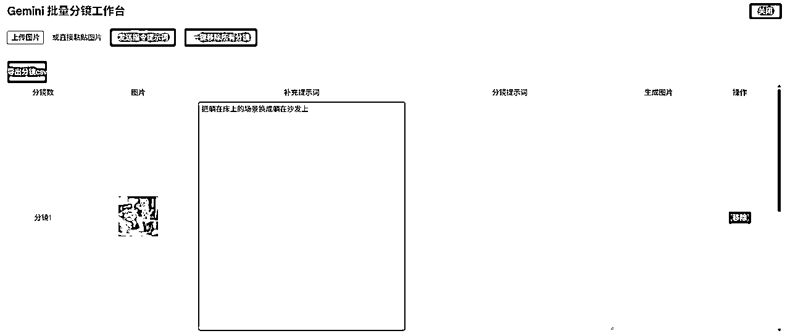  
需要统一修改全部镜头，在底部总输入区域填写  
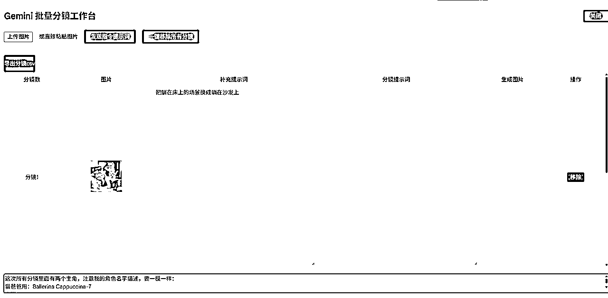  
全部设置好后，点击“提交”，再关闭面板，等Gemini出结果。结果回来以后，选择“回填到工具”  
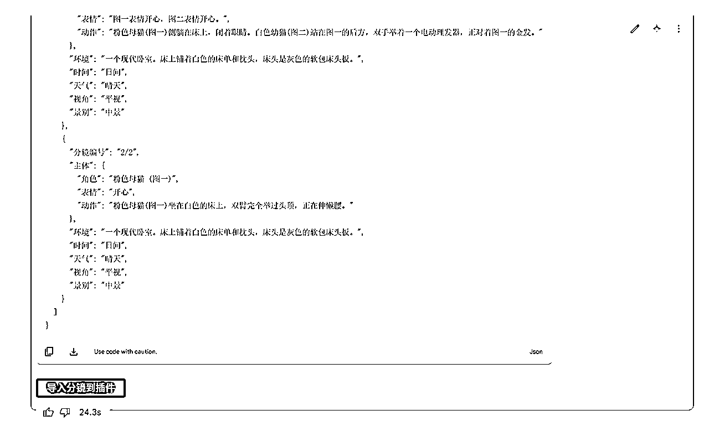  
回填后，可以在工具里逐条修正  
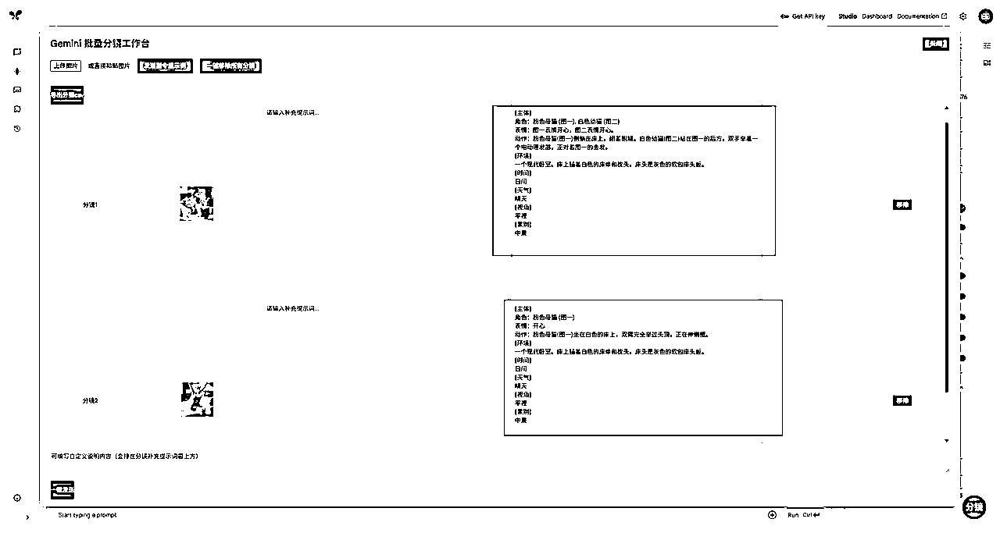  
确认没问题，点击“导出CSV”，表格会保存到电脑里  

这工具目前有个小缺陷：会让Gemini原本的滚动区域失灵。所以我建议把它装进防关联浏览器里使用，绕开这个坑。

### 生产力工具二：Sora批量跑图器

这个工具之前单独分享过，不重复写细节。最关键的是，Gemini扩展导出的CSV可以直接喂给它，形成一条自动化链路。

### 最后

本文里所有流程，都是我自己踩过坑之后留下的。它能告诉你的更多是“先做什么、再做什么”，而不是“怎么把某件事做到完美”。真正的剪辑感、画面审美和节奏判断，永远需要自己慢慢练。

如果你也在这条路上探索，欢迎来找我聊。相互连接，相互启发，比一个人闷头折腾要快很多。