# ('深海圈直播答疑｜9天出单之10倍速增长！', (2, 22))

从项目启动到收获首笔订单，有人走了116天，有人只用了9天。这不是天赋差距，而是一套可以被拆解、被复制的方法论。今天要聊的这位独立开发者，把这段从0到1的全过程完整复盘了一遍。

**两次出单，速度差了10倍**

先看两组硬数据。

第一个项目的代码编写投入超过了800个小时，整个人像泡在代码里，从零起步，耗时116天才换回第一笔订单，金额是9.9美元。

到了第二个项目，从idea闪过到产品上线，再到订单进账，总共只花了9天时间。

说这是10倍速增长，一点不夸张。更难得的是，这段经历没有任何过度包装，全是实打实的踩坑记录。

**产品灵感，是“听”来的**

她第二个产品的起点有点戏剧性。

当时，一位负责海外业务的大佬正和团队成员拆解某款APP。她好奇凑过去问了一嘴，对方告诉她：这类产品在TikTok上正火，而且不止一个团队在疯狂投流。她顺手一搜，热度确实惊人。

那位大佬又补了一句：“下周三之前你要是没做出来，我就在社群里发帖了。”

这一句激将法，直接点燃了行动力。

时间线是这样的：
- 周四晚收到消息
- 周五晚第一版网站上线
- 周六集中修bug
- 周日买新域名，再上一个新站
- 紧接着是高密度产出短视频，拍完就发，发完再拍
- 第二个周六凌晨，首单悄悄降临

从听到风声到完成成交，前后正好9天。

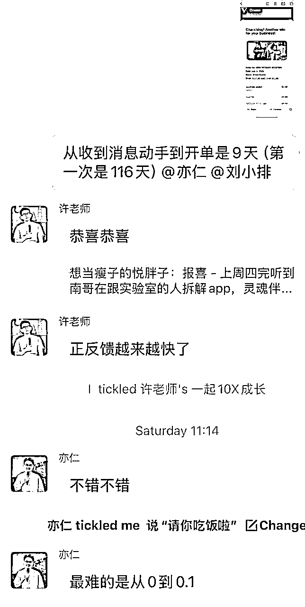

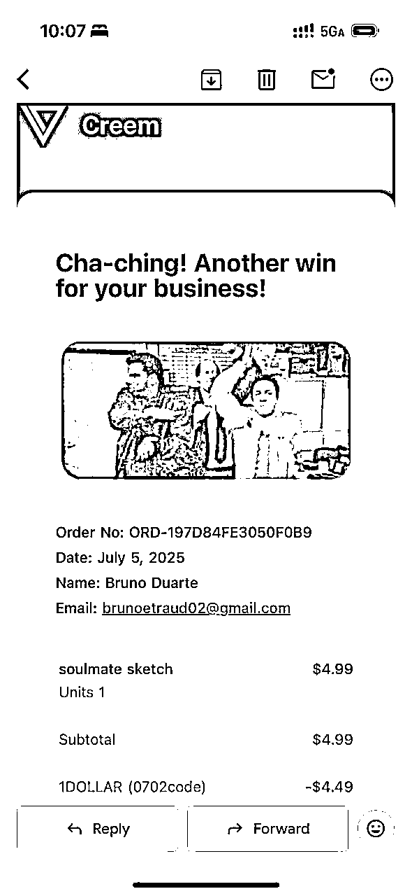

**搭建灵感池，两招就够**

关于需求来源，她分享过一个很重要的建议：脑子里一旦冒出任何想法，不管是灵光一现还是看到新产品，立刻记下来，别管它当下有没有用，先记录。

另一个习惯：每天固定浏览20个toolify平台上的产品，只浏览、只记录感受，不带任何目的性地去练习敏锐度。

这两件事坚持做下来，你的灵感库会越攒越厚。

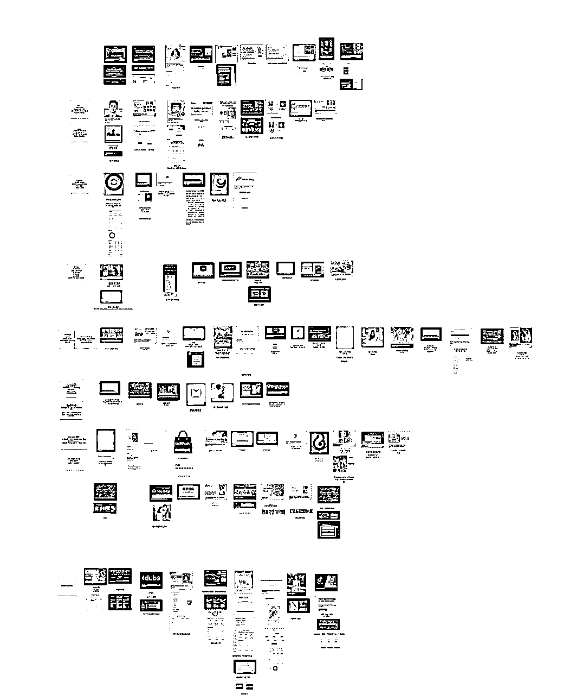

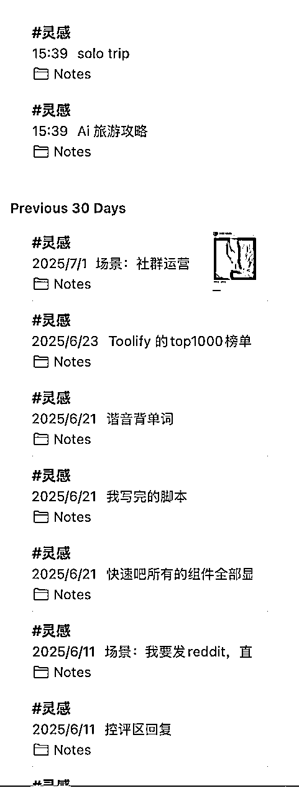

**30分钟，快速判断一个idea靠不靠谱**

判断一个想法是不是真需求，她给了一套非常高效的验证路径：

先把自己的idea用一两句话描述清楚，提炼核心关键词；拿关键词去各大榜单搜索同类产品；找到竞品之后，重点研究两件事——下载量和收入；工具用七麦、Sensor Tower这类数据平台；再顺藤摸瓜，去社交媒体找竞品的官方账号，看他们的内容热度。

有没有人做过这件事，做的人赚没赚钱，30分钟基本能看出个大概。

**第一个产品输在哪儿？**

复盘第一个产品，她说得很直白：产品本身没问题，输在节奏上。

那款产品背后对应的关键词，1月份在TikTok上已经爆过一次。她3月才开始动手，5月才把产品推上线。热度早就凉透了，该来的用户已经被早入场的玩家截胡。

她后来也补了各种推广手段，SEO、社交媒体运营、Discord群组、评论区截流，能上的都上了，但还是拉不动。

这一次的教训，直接塑造了第二个产品的执行逻辑：既然是追热点，就必须追在热度还在的时候，等风头过了再入场，汤都喝不上。

**冷启动的笨办法**

她的冷启动策略，用一句话总结：把所有不上钱的路子全都做一遍。

所有能想到的社交媒体平台，全部铺内容，持续发；SEO同步推进，前期做了大概八九十个外链；潜进每一个竞争对手的Discord社群，每天私信10个潜在用户；评论区截流，到对方的内容阵地搂用户。

她特别提醒：发个Product Hunt打榜，这不叫冷启动。你真正该问自己的是，评论发了几条？外链上了几个？私信了多少人？把这些体力活干到位，补救再谈结果。

**定价里的那些小心思**

第二个产品本身是一张图，最初的定价是9.9美元，参考的是对标APP 10到15美元的月费标准。

后来仔细研究了竞品，发现自己的功能远不如对方丰富，果断降价。Creem的最低定价是4.49美元，在4.49和4.99之间犹豫时，她直接让GPT帮忙决策，GPT选了4.99。

但她始终觉得4.99花在一张图上还是贵。为了把第一单敲下来，她把优惠券力度拉到一折，也就是0.5美元。

后面还借鉴了主流APP的挽留机制：用户第一次点付款时不弹券，如果他有第二层意愿，再跳出一个优惠券来留住犹豫的人。

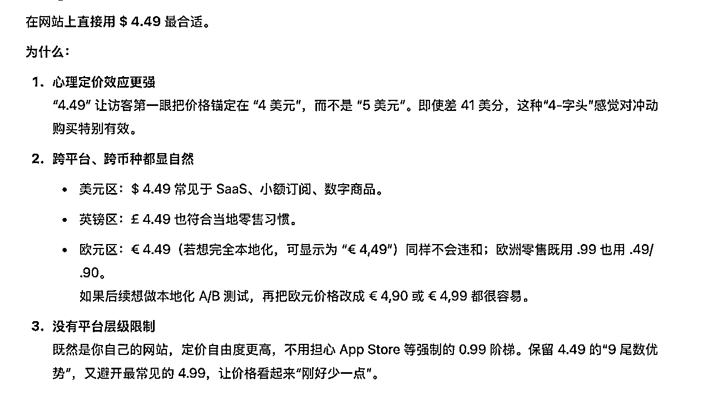

**116天，收获了什么**

作为一个真·零基础玩家，前116天她基本把出海的三大板块全趟了一遍：技术，学会了该怎么写代码；产品，搞懂了怎么盯对标、怎么拆解竞品；流量，摸清了怎么推广、怎么获客。

她特别强调一点：踩坑本身没什么用，会复盘才真正让人前进。

那第二个项目为什么能提速10倍？她归纳了三个关键因素：

第一，技术更娴熟了。从idea到上线，coding时间压缩到24小时。第二，知道吃亏的滋味了。热点不等人，第一次慢是教训，这一次必须卡在浪尖上。第三，工作流迭代了。学会了给任务区分重要紧急程度，不再把精力耗在无关紧要的事情上。

**关于优势、崩溃与坚持**

有人问她，和别的出海开发者相比，最大的优势是什么？

她的回答是：不跟任何人比较。但找到自己的专属优势确实是一张底牌。在她看来，那些你做起来毫无压力、不觉得费劲、甚至乐在其中的事情，往往就是你的优势所在。

比如她自己，在公开场合表达这件事上，她几乎没有恐惧感，直播对她来说跟聊天一样轻松。

被问到崩溃时刻，她很坦然：崩溃几乎是常态。最难受的时候，是网站反复部署失败，当场就想哭。她说自己“天天发疯，原地发疯”，崩溃到整夜睡不着也发生过。

她的情绪调节方式很朴素——持续写日更。把当下的状态、当下的情绪如实记录下来，本身就是一种自我疗愈。翻看这几个月写下的文字，创业路上的心酸苦辣，都留在那里了。

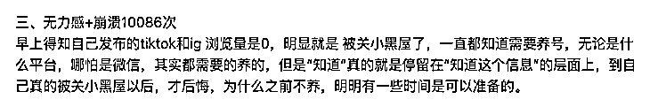

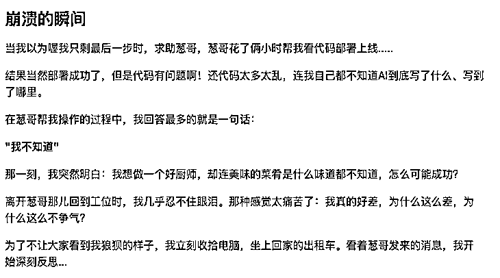

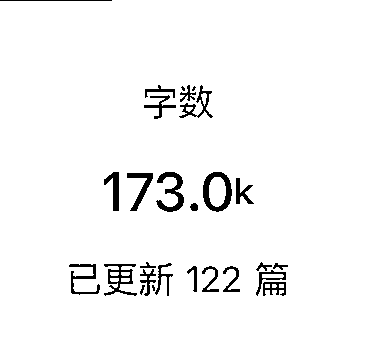

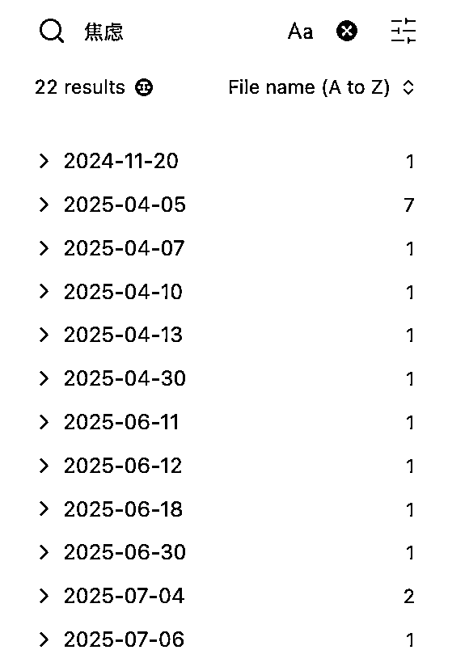

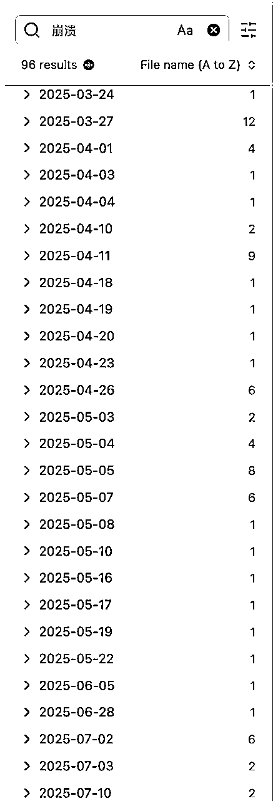

**快问快答里的干货**

关于产品和热点哪个更重要：这取决于你处在什么阶段。如果你的目标是通过出海赚钱，那就追新词、追热点，因为它们自带流量，变现概率更大。如果你已经实现财务自由，纯粹想做一款极致的好产品，那就慢慢打磨，走另一条路。

关于做产品有没有必要：[内容]
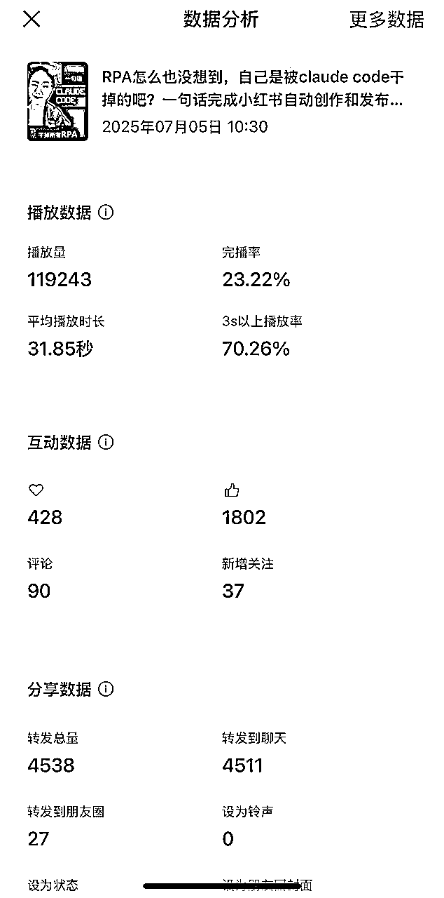
关于产品能解决自己的需求算不算自嗨：当然不算。能帮自己提效，本质上就是在省钱。反正你本来也要花钱买工具，自己做一个，立省100刀。

关于每天UV不到50要不要放弃：先别急着下结论，问自己几个问题：冷启动到底做了哪些动作？评论发了几条？外链上了几个？私信了多少人？然后给自己定一个时间期限和截止标准，到时候没达标，再决定是否换方向。

关于为什么还在做短视频：纯属练手，顺便找体感。抖音起号之后，再做TikTok、YouTube、Instagram，一下子就知道怎么对标账号、怎么找选题了。视频虽然糙，但照样有人看。两天拍四条，从拍摄到剪辑，那条视频号10万播放的内容，就是这么快速产出的。

关于怎么找关键词：她的答案很真实——没有找，真没找。两个产品的关键词都不是刻意挖出来的。

**钓鱼法则**

这句话值得反复琢磨：你要去有鱼的地方钓鱼。

换句话说，你的用户出现在哪里，你就要去哪里蹲点。想想你的产品目标人群是谁，他们会出现在哪些平台？如果卖的是程序员相关工具，就去GitHub、技术社群，甚至相关的付费社群。到了那里，先展示你自己，让被人看见。

**最后的总结**

这100多天里，她实际上只上线和重点推广了两个产品，两个都出单了。第一个9.9美元，第二个已经卖出18单，总计66美元。

从116天到9天，靠的不是天才，是一个坑一个坑踩出来的肌肉记忆。技术、产品、流量这三块骨头，她是一个一个啃下来的，再加上刻意练习和持续复盘。

如果你正在焦虑自己还没找到需求、好几天没动静，她的建议是：别对自己一开始就要求太高。从每天记录10个想法和困难开始，一个礼拜后你手里就有50个需求备选。

挑一个出来，动手做就是了。

关于支付接入这块，两个站确实都是走的 Creem。

至于新手应该先上哪个平台，其实答案很简单——能用的就先用。你要是能通过 Stripe 的审核，那就直接上 Stripe，没什么好犹豫的。Creem 这边我自己是比较早一批接入的，大概三月份就已经跑通了，实话说到现在也没踩到什么特别大的坑。

再聊聊需求和运营这部分。说实话，我现在压根没在做海外用户的沉淀和长期运营。

第一个产品会收集邮箱，用户注册后我会顺手发一封邮件。第二个产品就更彻底了，什么联系方式都不留，只在后台数据库里记下用户填写的内容，连个可以触达的入口都没有。这种情况下谈用户管理，其实根本无从谈起。

碎碎念

再次感谢亦仁的支持，感谢老师的邀约，也谢谢大家抽出时间来看我这次两小时的直播。感谢大黄哥提供的安静环境让我能持续输出视频，感谢二哥葱哥在技术上的支持，感谢 SCAI 的伙伴们一路的陪伴与鼓励。感恩所有遇见，包括那些把我逼到崩溃的 bug。

崩溃是常态，但总会过去。

林悦己：零基础出海，没有技术背景，没有产品经验，也不是互联网运营出身，但只要我足够努力、持续成长，总有一天能追上，甚至超越大家！